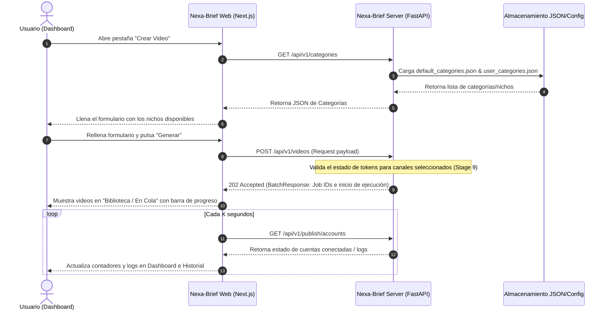

# Nexa Brief — Panel de Control (Prototipo Visual)

## Introducción

Este es el prototipo del futuro panel de control de Nexa Brief: la interfaz desde donde se va a manejar toda la fábrica de videos, sin tocar código ni la terminal. La idea nace de una necesidad simple — hoy el pipeline (generación, grabación y publicación) corre por scripts y por la API, pero no hay una pantalla donde ver de un vistazo qué se está generando, qué está listo para publicar, en qué canales, con qué plantilla visual y cuándo.

Acá se navega ese flujo completo: se arranca en el **Dashboard** viendo el estado general, se crea un lote nuevo de videos en **Crear video** eligiendo nicho, plantilla, canales y recursos, se consultan las **Plantillas** disponibles con sus renders reales, se administran los **Canales** conectados (YouTube, TikTok, Facebook), se define cuándo se publica en **Programación**, se revisa todo lo generado en la **Biblioteca**, y se audita cada etapa del proceso en **Historial**. Todo el contenido que se ve hoy es de ejemplo (vive en `data.json`), pensado para validar la distribución, los componentes y la navegación antes de construir la versión real en Next.js conectada al backend.

Es un prototipo **100% visual**: no hay servidor detrás, ningún botón "Generar" o "Publicar" ejecuta algo de verdad. Sirve para decidir cómo se ve y se siente la app antes de programarla en serio.

## Cómo abrirlo

Doble clic en `index.html` y listo — no necesita servidor. Los datos se cargan desde `data.js` (una copia de `data.json` en formato script, porque abrir el HTML como archivo local bloquea la carga directa de JSON por seguridad del navegador).

## Estructura de archivos

- `index.html` — toda la app (una sola página, las secciones se muestran/ocultan con JS)
- `styles.css` — sistema visual completo (colores, tema claro/oscuro, componentes)
- `script.js` — toda la lógica: render de cada sección a partir de los datos, navegación, interacciones
- `data.json` — datos de ejemplo (canales, cuentas, plantillas, videos, horarios, historial). Es el borrador de cómo se va a estructurar la información real más adelante
- `data.js` — mismo contenido que `data.json`, cargado como script para que funcione sin servidor

## Funcionalidades

### Dashboard
Resumen general: 4 tarjetas (Videos hoy, En cola, Publicados, Fallidos) que además son **filtros clicables** — al tocar una, la sección de abajo cambia de "Actividad reciente" a una tabla paginada solo con los videos de esa categoría (nombre, canal, hora, botón "Ir →" que salta a Biblioteca en la pestaña correspondiente). El botón "Actualizar" vuelve a la vista general en cualquier momento.

### Crear video
Formulario para armar un nuevo lote de generación:
- **Nicho/categoría**: opcional (por defecto "el sistema elige"), con botón para agregar una categoría nueva al vuelo.
- **Plantilla visual**: cuál de las 5 plantillas usar.
- **Publicar en**: se elige canal (YouTube/TikTok/Facebook) y, al abrirlo, qué cuenta(s) específicas de ese canal.
- **Recursos** (opcionales): subir imagen/video de fondo y canción propia — con vista previa real. Si no se sube nada, el sistema decide.
- **Duración**: automática según la canción (muestra duración detectada + repeticiones + total calculado) o manual (horas exactas).
- **Resumen del lote**: panel lateral que muestra en vivo todo lo elegido, sin tener que hacer scroll para revisar.

### Plantillas
Catálogo de las 5 plantillas visuales reales del sistema (imagen con fondo, PNG sin fondo, paisaje completo, video en loop, letras de canción), cada una con su render de ejemplo real. Botón **"Ver información"** abre al lado el detalle técnico (carpeta de origen, `config.json` real de ese ejemplo en filas compactas) sin salir de la pantalla ni abrir un modal. Botón **"Ver videos creados"** lleva a Biblioteca ya filtrada por esa plantilla.

### Canales
Una tarjeta por plataforma con sus cuentas conectadas, estado (activa / token expirado / sin conectar) y accesos para gestionar o reconectar.

### Programación
Tabla con los horarios de publicación configurados por canal y cuenta (días + horas).

### Biblioteca de videos
Los videos organizados en 4 pestañas: Listos, En cola, Publicados, Fallidos. Tiene filtros por **plantilla** y por **canal**, y cada video listo/publicado se puede reproducir (reproductor real con un clip de muestra).

### Historial / Logs
Por cada video, la línea de tiempo de las 8 etapas reales del pipeline (análisis, diseño visual, recursos, prompt, generación de HTML, grabación, resumen, publicación) con su estado.

### Notificaciones
Todavía no está desarrollada — la sección ya existe en el menú como recordatorio de que está planeada (alertas de tokens expirados, fallos de publicación, videos listos).

### Sidebar y tema
El menú lateral se puede colapsar a solo íconos, y hay un botón para cambiar entre tema claro y oscuro. Ambas preferencias se recuerdan la próxima vez que se abre.

---

## Integración con APIs (Futura Arquitectura Unificada)

En la versión final, este prototipo visual pasará a ser una SPA interactiva en **Next.js (`nexa-brief-web`)** conectada al backend REST de **FastAPI (`nexa-brief-server`)**. A continuación se definen los contratos de API y el flujo de integración de datos que reemplazará a los mocks estáticos (`data.json` / `data.js`).

### Flujo de Interacción del Sistema (Secuencia)



---

### Especificación de Endpoints y JSONs

#### 1. API de Categorías (Categories)
Permite listar y obtener detalles de los nichos musicales preconfigurados.

*   **Listar Categorías (`GET /api/v1/categories`):**
    *   **Entrada (Input):** Ninguna (vacío).
    *   **Salida (Output JSON):**
        ```json
        [
          {
            "id": "lofi",
            "name": "Lo-Fi Hip Hop",
            "description": "Beats relajantes con texturas vintage para estudiar y concentrarse",
            "genre": "lofi",
            "colors": ["#1a1a2e", "#16213e", "#0f3460", "#a8a8b3"],
            "mood_tags": ["relax", "study", "focus", "chill", "cozy"],
            "image_query": "cozy rainy window café desk studying warm light"
          },
          {
            "id": "jazz",
            "name": "Jazz Nocturno",
            "description": "Jazz suave y elegante para noches contemplativas",
            "genre": "jazz",
            "colors": ["#0d0d0d", "#1c1c2e", "#c9a84c", "#e8d5a3"],
            "mood_tags": ["elegant", "nocturnal", "sophisticated", "smooth", "reflective"],
            "image_query": "jazz bar dark moody night city lights vintage atmosphere"
          }
        ]
        ```

*   **Obtener Categoría por ID (`GET /api/v1/categories/{category_id}`):**
    *   **Entrada (Input):** `category_id` (parámetro de ruta, ej: `lofi`).
    *   **Salida (Output JSON):**
        ```json
        {
          "id": "lofi",
          "name": "Lo-Fi Hip Hop",
          "description": "Beats relajantes con texturas vintage para estudiar y concentrarse",
          "genre": "lofi",
          "colors": ["#1a1a2e", "#16213e", "#0f3460", "#a8a8b3"],
          "mood_tags": ["relax", "study", "focus", "chill", "cozy"],
          "image_query": "cozy rainy window café desk studying warm light"
        }
        ```

#### 2. API de Generación de Videos (Videos Batch)
Dispara la orquestación en segundo plano para generar un lote de videos bajo una categoría y duración dada.

*   **Crear Lote de Generación (`POST /api/v1/videos`):**
    *   **Entrada (Input JSON):**
        ```json
        {
          "category_name": "lofi",
          "quantity": 3,
          "duration_seconds": 60,
          "user_context": "Un atardecer lluvioso con luces cálidas de neón",
          "publishing": {
            "enabled": true,
            "accounts": [
              "youtube:canal_1",
              "tiktok:cuenta_1"
            ],
            "options": {
              "youtube_playlist_id": "PLabc123xyz",
              "youtube_publish_as_short": false,
              "facebook_publish_as_reel": true,
              "tiktok_privacy": "private"
            }
          }
        }
        ```
    *   **Salida (Output JSON - 202 Accepted):**
        ```json
        {
          "total": 3,
          "succeeded": 0,
          "failed": 0,
          "elapsed_seconds": 0.04,
          "jobs": [
            {
              "job_id": "8f3a9e1b",
              "stage": "pending",
              "category": "lofi",
              "output_dir": null,
              "errors": []
            },
            {
              "job_id": "a2d1f9e8",
              "stage": "pending",
              "category": "lofi",
              "output_dir": null,
              "errors": []
            },
            {
              "job_id": "c7b5a1f0",
              "stage": "pending",
              "category": "lofi",
              "output_dir": null,
              "errors": []
            }
          ]
        }
        ```

#### 3. API de Gestión de Cuentas y Publicador (Publisher)
Permite monitorear el estado de las credenciales OAuth conectadas y realizar publicaciones manuales.

*   **Listar Cuentas y Estado (`GET /api/v1/publish/accounts`):**
    *   **Entrada (Input):** Ninguna.
    *   **Salida (Output JSON):**
        ```json
        [
          {
            "platform": "youtube",
            "alias": "canal_1",
            "name": "Nexa Brief · Lofi & Jazz",
            "target_id": "UC1234567890abcdef",
            "avatar": "https://lh3.googleusercontent.com/a/avatar1",
            "status": "ok",
            "last_checked": 1721473200
          },
          {
            "platform": "tiktok",
            "alias": "cuenta_1",
            "name": "lofi_vibes_tiktok",
            "target_id": "usr_tiktok_abc123",
            "avatar": "https://p16-sign-va.tiktokcdn.com/avatar1",
            "status": "requires_reauth",
            "last_checked": 1721473200
          }
        ]
        ```

*   **Publicación Manual (`POST /api/v1/publish/`):**
    *   **Entrada (Input JSON):**
        ```json
        {
          "video_path": "/home/university/Documentos/Proyectos/nexa-brief/nexa-brief-server/output/lofi_8f3a9e1b/youtube_video.mp4",
          "title": "Rainy Cafe Lo-fi Beats to Study ☕🌧️",
          "description": "Chill beats to study and relax. Generated with Nexa Brief.",
          "tags": ["lofi", "chill", "study"],
          "account_selector": "youtube:canal_1",
          "privacy": "public",
          "youtube_playlist_id": "PLabc123xyz",
          "youtube_publish_as_short": false,
          "facebook_publish_as_reel": false
        }
        ```
    *   **Salida (Output JSON):**
        ```json
        {
          "post_id": "v_youtube_987654",
          "url": "https://www.youtube.com/watch?v=987654",
          "platform": "youtube",
          "account_alias": "canal_1"
        }
        ```

*   **Flujos OAuth de Autorización:**
    *   *Iniciar OAuth de YouTube:* `GET /api/oauth/youtube/start?alias=canal_1` -> Redirige al consent screen de Google.
    *   *Iniciar OAuth de TikTok:* `GET /api/v1/publish/auth/tiktok/start?alias=cuenta_1` -> Redirige al consent screen de TikTok.
    *   *Iniciar OAuth de Facebook:* `GET /api/v1/publish/auth/facebook/start?alias=pagina_1` -> Redirige al consent screen de Meta.

