# Estudio Técnico Completo — Sistema Nexa-Brief

> **Fábrica automatizada de videos musicales para YouTube, TikTok y Facebook, impulsada por múltiples modelos de IA especializados.**
>
> Documento generado a partir de una auditoría exhaustiva del código fuente (`src/`), configuración (`niches.json`, `.env.example`, `pyproject.toml`), scripts auxiliares (`scripts/`), skills de IA (`src/skills/`), pruebas (`tests/`) y artefactos reales de ejecución (`output/*/logs/*.json`).
>
> **Última verificación de código:** 2026-07-01 · **Jobs generados en disco:** 28 · **Nichos configurados:** 3 (2 activos)

---

## Índice

1. [Resumen ejecutivo](#1-resumen-ejecutivo)
2. [Filosofía arquitectónica](#2-filosofía-arquitectónica)
3. [Mapa de componentes del sistema](#3-mapa-de-componentes-del-sistema)
4. [Modelo de dominio: el objeto `Job`](#4-modelo-de-dominio-el-objeto-job)
5. [Máquina de estados del pipeline](#5-máquina-de-estados-del-pipeline)
6. [El pipeline de 9 etapas — flujo completo](#6-el-pipeline-de-9-etapas--flujo-completo)
7. [Secuencia de ejecución de un job](#7-secuencia-de-ejecución-de-un-job)
8. [Modelos de Inteligencia Artificial utilizados](#8-modelos-de-inteligencia-artificial-utilizados)
9. [Puertos y adaptadores (Hexagonal Architecture)](#9-puertos-y-adaptadores-hexagonal-architecture)
10. [Cadenas de fallback de recursos multimedia](#10-cadenas-de-fallback-de-recursos-multimedia)
11. [Grabación y transcodificación de video](#11-grabación-y-transcodificación-de-video)
12. [Sistema de Skills — diseño inyectado como Markdown](#12-sistema-de-skills--diseño-inyectado-como-markdown)
13. [Publicación automática en redes sociales](#13-publicación-automática-en-redes-sociales)
14. [Seguridad y gestión de tokens OAuth](#14-seguridad-y-gestión-de-tokens-oauth)
15. [Configuración del sistema](#15-configuración-del-sistema)
16. [API REST](#16-api-rest)
17. [Herramientas auxiliares de scraping](#17-herramientas-auxiliares-de-scraping)
18. [Cobertura de pruebas](#18-cobertura-de-pruebas)
19. [Stack tecnológico completo](#19-stack-tecnológico-completo)
20. [Despliegue e infraestructura](#20-despliegue-e-infraestructura)
21. [Estado real observado y hallazgos](#21-estado-real-observado-y-hallazgos)
22. [Glosario](#22-glosario)

---

## 1. Resumen ejecutivo

**Nexa-Brief** es un sistema de generación automatizada de video musical de larga duración (60 segundos a varias horas) que combina **cuatro inteligencias artificiales especializadas** en distintas etapas de un pipeline de **9 fases**, orquestado bajo **Arquitectura Hexagonal (Ports & Adapters)** con un **microkernel** que carga reglas de diseño en tiempo de ejecución desde archivos Markdown ("skills").

El sistema toma como entrada una categoría musical (ej. `ambient_music`, `animated_study`), genera automáticamente:

- Un **análisis de intención** (género, mood, contexto).
- Un **diseño visual** (paleta, tipografía, animación) coherente con el género.
- Recursos multimedia (**imagen de fondo** y **pista musical**) obtenidos de APIs gratuitas con validación por visión artificial.
- Una página **HTML autónoma** con visualizador de audio en tiempo real (Web Audio API).
- **Grabación headless** de esa página con Playwright y transcodificación con FFmpeg a múltiples formatos (16:9 para YouTube, 9:16 para TikTok/Reels).
- **Metadatos SEO** (título, descripción, hashtags) optimizados por IA para cada plataforma.
- Opcionalmente, la **publicación automática** en YouTube, TikTok y Facebook mediante adaptadores OAuth2 con cifrado de tokens.

Todo el proceso queda auditado: cada etapa escribe un log JSON estructurado en `output/{job_id}/logs/`, permitiendo trazabilidad completa de qué decidió cada IA y por qué.

### Cifras clave del sistema

| Métrica | Valor |
|---|---|
| Etapas del pipeline | 9 (8 obligatorias + 1 condicional) |
| Modelos de IA integrados | 2 proveedores, usados en 4 roles distintos |
| Adaptadores de imagen (con fallback) | 4 (Unsplash → Pexels → Pixabay → CSS) |
| Adaptadores de música (con fallback) | 5 (Local cache, Pixabay, Jamendo, FMA, yt-dlp) |
| Plataformas de publicación | 3 (YouTube, TikTok, Facebook) |
| Puertos abstractos (Core) | 5 (AI, Image, Music, Recorder, Publisher) |
| Skills de diseño (Markdown) | 9 archivos (5 géneros + 3 HTML + 1 copywriting) |
| Nichos configurados en `niches.json` | 3 (2 activos) |
| Jobs generados en disco (histórico) | 28 |
| Endpoints REST | ~10 (`/videos`, `/publish/*`, `/categories`, `/health`, OAuth) |

---

## 2. Filosofía arquitectónica

El sistema se apoya en dos patrones complementarios:

- **Arquitectura Hexagonal (Ports & Adapters):** el núcleo (`src/core/`) sólo conoce **interfaces abstractas** (puertos). No importa ninguna librería de terceros ni sabe qué proveedor de IA, imagen o música se está usando. Cada integración concreta vive en `src/adapters/` y se inyecta por dependencia.
- **Microkernel de Skills:** las reglas de diseño visual, motion design, reactividad de audio y copywriting **no están en el código**, sino en archivos Markdown bajo `src/skills/`. El motor los lee en tiempo de ejecución y los inyecta como contexto en los prompts de las IAs. Cambiar la estética de un género es editar un `.md`, no tocar Python.

Esto produce tres propiedades deseables:

1. **Extensibilidad:** agregar una cuarta red social o un quinto proveedor de música = un adaptador nuevo, cero cambios en el núcleo.
2. **Resiliencia:** cada recurso externo (imagen, música) tiene una cadena de fallback; el pipeline nunca debería fallar por la caída de un solo proveedor.
3. **Auditabilidad:** el `Job` es un modelo Pydantic **inmutable** — cada etapa retorna una nueva copia (`model_copy`) con el artefacto agregado, nunca muta el estado anterior. Esto permite inspeccionar el estado exacto en cualquier punto del pipeline.

---

## 3. Mapa de componentes del sistema

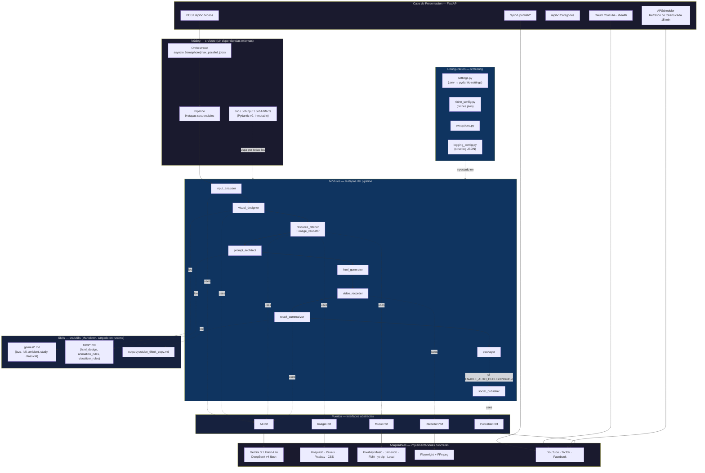

### Estructura de directorios real

```text
src/
├── core/
│   ├── job.py                 # Job, JobInput, JobArtifacts, JobStage (enum)
│   ├── orchestrator.py        # Orchestrator.run_batch() — concurrencia con Semaphore
│   ├── pipeline.py             # pipeline.run(job) — orquesta las 9 etapas
│   └── ports/
│       ├── ai_port.py          # AIPort: complete_json / complete_text / analyze_image
│       ├── image_port.py       # ImagePort: fetch / fetch_candidates
│       ├── music_port.py       # MusicPort: get
│       ├── recorder_port.py    # RecorderPort: record
│       └── publisher_port.py   # PublisherPort: publish / get_video / update_video / delete_video
├── adapters/
│   ├── ai/
│   │   ├── factory.py
│   │   └── infrastructure/
│   │       ├── gemini_flash_adapter.py
│   │       └── deepseek_adapter.py
│   ├── image/
│   │   ├── factory.py
│   │   ├── css_fallback_adapter.py
│   │   └── infrastructure/{unsplash,pexels,pixabay_image}_adapter.py
│   ├── music/
│   │   ├── factory.py
│   │   └── infrastructure/{pixabay_music,jamendo,fma,ytdlp_fallback,local_cache}_adapter.py
│   ├── recorder/
│   │   ├── factory.py
│   │   └── infrastructure/playwright_ffmpeg_adapter.py
│   └── publishing/
│       ├── factory.py · publisher_facade.py · base_platform.py
│       ├── token_storage.py · token_manager.py · scheduler.py
│       └── youtube_adapter.py · tiktok_adapter.py · facebook_adapter.py
├── modules/
│   ├── input_analyzer.py · visual_designer.py · resource_fetcher.py · image_validator.py
│   ├── prompt_architect.py · html_generator.py · video_recorder.py
│   └── result_summarizer.py · packager.py · social_publisher.py
├── config/
│   ├── settings.py · niche_config.py · exceptions.py · logging_config.py
├── presentation/
│   ├── main.py
│   └── api/{routers/{videos,publisher,categories,youtube_oauth}.py, schemas/*.py}
└── skills/
    ├── genres/{jazz,lofi,ambient,study,classical}.md
    ├── html/{html_design,animation_rules,visualizer_rules}.md
    └── output/youtube_tiktok_copy.md
```

---

## 4. Modelo de dominio: el objeto `Job`

El `Job` es un modelo Pydantic v2 **inmutable** que atraviesa las 9 etapas. Cada módulo recibe un `Job` y retorna una **nueva copia** con su artefacto agregado (`model_copy()`), nunca muta el estado anterior — esto garantiza thread-safety durante la ejecución concurrente de varios jobs y permite auditar el estado exacto en cualquier punto.

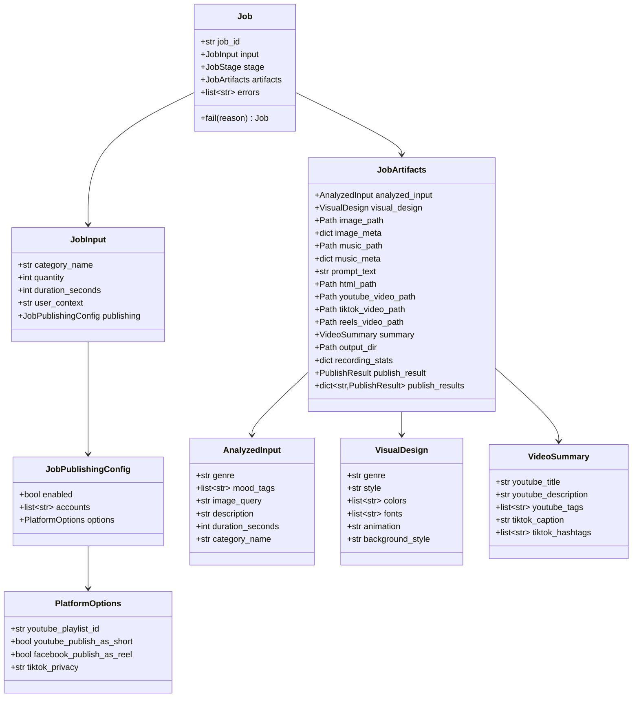

---

## 5. Máquina de estados del pipeline

El enum `JobStage` (`src/core/job.py`) define el ciclo de vida completo. La etapa `PUBLISHING → PUBLISHED` sólo se alcanza si la publicación automática está habilitada.

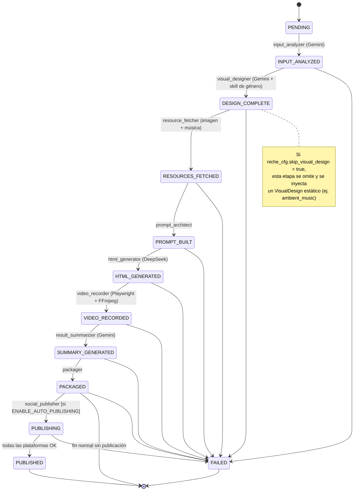

---

## 6. El pipeline de 9 etapas — flujo completo

Este es el diagrama central del sistema. Actualiza y expande el diagrama original del README (7 etapas) incorporando lo que existe realmente en el código: **validación de imágenes por visión artificial**, el formato adicional **Reels (9:16 completo)**, y la **etapa 9 de publicación condicional**.

```mermaid
flowchart TD
    START(["Usuario: category_name, quantity, duration_seconds, user_context"]) --> ORQ

    subgraph ORQ_G["Orchestrator — src/core/orchestrator.py"]
        ORQ["run_batch()\nasyncio.Semaphore(max_parallel_jobs=2)"]
        ORQ --> LOOP["Por cada video del lote\n(en paralelo controlado)"]
    end

    LOOP --> NICHE["get_niche_config(category_name)\nlee niches.json"]

    subgraph E1["Etapa 1 · input_analyzer"]
        NICHE --> S1["Gemini 3.1 Flash-Lite\nJSON mode"]
        S1 --> S1L[("01_input_completado.json")]
        S1L --> S1O["AnalyzedInput:\ngenre, mood_tags, image_query, description"]
    end

    subgraph E2["Etapa 2 · visual_designer"]
        S1O --> SKIP{"niche_cfg.skip_visual_design?"}
        SKIP -- "sí" --> S2X["Inyecta VisualDesign estático\n(sin llamada a IA)"]
        SKIP -- "no" --> S2G["Carga skill\nsrc/skills/genres/{genre}.md"]
        S2G --> S2["Gemini 3.1 Flash-Lite\nDiseñador visual"]
        S2 --> S2L[("02_diseno_visual.json")]
        S2L --> S2O["VisualDesign:\ncolors (≤4), fonts, animation, background_style"]
        S2X --> S2O
    end

    subgraph E3["Etapa 3 · resource_fetcher + image_validator"]
        S2O --> IMGQ["Construye query de imagen\n(fija / generada por Gemini / analyzed_input)"]
        IMGQ --> IMGF["fetch_image_candidates()\nUnsplash → Pexels → Pixabay → CSS"]
        IMGF --> IMGV{"¿validación de imagen\nhabilitada en el nicho?"}
        IMGV -- "sí" --> IMGAI["Gemini Vision\nanalyze_image() contra criterios"]
        IMGAI --> IMGL[("05b_validacion_imagenes.json")]
        IMGL --> IMGBEST["pick_best_candidate()\nmejor score ≥ min_score"]
        IMGV -- "no" --> IMGBEST
        IMGBEST --> BG[("bg.jpg")]
        S2O --> MUSQ["Construye queries de música\n(Gemini genera variantes)"]
        MUSQ --> MUSF["Pixabay Music → Jamendo → FMA → yt-dlp → Local\n(+ fallback de género si todo falla)"]
        MUSF --> SONG[("song.mp3")]
        BG --> RESL[("05_imagen_seleccionada.json\n06_musica_seleccionada.json")]
        SONG --> RESL
    end

    subgraph E4["Etapa 4 · prompt_architect"]
        RESL --> TPL{"template = image_only?"}
        TPL -- "sí" --> P4A["Prompt minimalista\nsolo imagen + audio, sin visualizador"]
        TPL -- "no" --> P4B["Carga skill html_design.md\n+ safe-zone 9:16 si aplica\n+ filtros CSS del nicho"]
        P4A --> P4L[("03_prompt_generacion.txt")]
        P4B --> P4L
    end

    subgraph E5["Etapa 5 · html_generator"]
        P4L --> S5["DeepSeek v4-flash\nGenerador de código (temperature 0.7)"]
        S5 --> S5V{"¿contiene\n&lt;!DOCTYPE&gt; / &lt;html&gt;?"}
        S5V -- "no" --> S5ERR["AIGenerationError"]
        S5V -- "sí" --> HTML[("index.html")]
        HTML --> S5L[("04_html_generado.html\n04_html_log.json")]
    end

    subgraph E6["Etapa 6 · video_recorder"]
        S5L --> REC1["Playwright Chromium headless\nautoplay-policy=no-user-gesture-required"]
        SONG -.-> REC1
        REC1 --> RAW[("_raw.webm mudo")]
        RAW --> REC2["FFmpeg: mezcla video + audio\nlibx264 · crf 18 · aac 192k"]
        REC2 --> YTV[("youtube_video.mp4\n16:9, duración completa")]
        YTV --> REC3{"¿nicho define\nformato 9:16?"}
        REC3 -- "sí" --> REELS["FFmpeg crop centrado\ncrop=ih*9/16:ih → scale 1080x1920"]
        REELS --> REELV[("reels_video.mp4\n9:16, duración completa")]
        REELV --> REC4["FFmpeg recorte 61s\nafade in 1s + afade out 2s"]
        REC4 --> TKV[("tiktok_video.mp4\n9:16, 61s")]
        REC3 -- "no" --> DONE6["Sin formato vertical"]
        TKV --> S6L[("07_grabacion_stats.json")]
        DONE6 --> S6L
    end

    subgraph E7["Etapa 7a · result_summarizer"]
        S6L --> S7G["Carga skill\noutput/youtube_tiktok_copy.md"]
        S7G --> S7["Gemini 3.1 Flash-Lite\nCopywriter SEO"]
        S7 --> S7O["VideoSummary:\ntítulo, descripción, tags YT · caption, hashtags TikTok"]
    end

    subgraph E8["Etapa 7b · packager"]
        S7O --> PKG["Verifica existencia de todos los\narchivos requeridos por el nicho"]
        PKG --> MANI[("manifest.json")]
        MANI --> S8L[("08_resumen_final.json")]
    end

    S8L --> PUBCHK{"ENABLE_AUTO_PUBLISHING\n= true?"}

    subgraph E9["Etapa 9 · social_publisher (condicional)"]
        PUBCHK -- "sí" --> ACC["Resuelve cuentas:\njob.input.publishing.accounts\no settings.active_account"]
        ACC --> SEL["Selecciona video por plataforma:\nTikTok → tiktok_video · YouTube/FB → youtube_video"]
        SEL --> PUB["PublisherFacade.publish_video()\npor cada cuenta configurada"]
        PUB --> PL{"YouTube con\nplaylist_id?"}
        PL -- "sí" --> PLA["add_video_to_playlist()"]
        PL -- "no" --> PUBOK
        PLA --> PUBOK
        PUBOK["PublishResult por cuenta"] --> S9L[("09_publicacion_resultado.json")]
    end

    PUBCHK -- "no" --> ENDOK(["Job = PACKAGED\ncarpeta lista para publicación manual"])
    S9L --> ENDPUB(["Job = PUBLISHED (o FAILED si alguna plataforma falla)"])

    ENDOK --> MORE{"¿Más videos\nen el lote?"}
    ENDPUB --> MORE
    MORE -- "sí" --> LOOP
    MORE -- "no" --> FIN(["BatchResult: succeeded, failed, elapsed_seconds"])

    style ORQ_G fill:#1a1a2e,color:#e0e0e0
    style E1 fill:#16213e,color:#e0e0e0
    style E2 fill:#0f3460,color:#e0e0e0
    style E3 fill:#1a1a2e,color:#e0e0e0
    style E4 fill:#16213e,color:#e0e0e0
    style E5 fill:#0f3460,color:#e0e0e0
    style E6 fill:#1a1a2e,color:#e0e0e0
    style E7 fill:#16213e,color:#e0e0e0
    style E8 fill:#0f3460,color:#e0e0e0
    style E9 fill:#3a1a1a,color:#e0e0e0
```

---

## 7. Secuencia de ejecución de un job

Vista temporal de las llamadas entre componentes para **un solo job**, desde la petición HTTP hasta el paquete final.

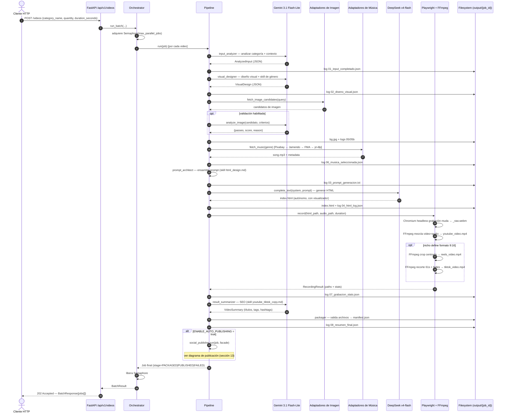

---

## 8. Modelos de Inteligencia Artificial utilizados

El sistema integra **dos proveedores de IA** cubriendo **cuatro roles funcionales** distintos. Los identificadores exactos están definidos en `src/config/settings.py:27-29`.

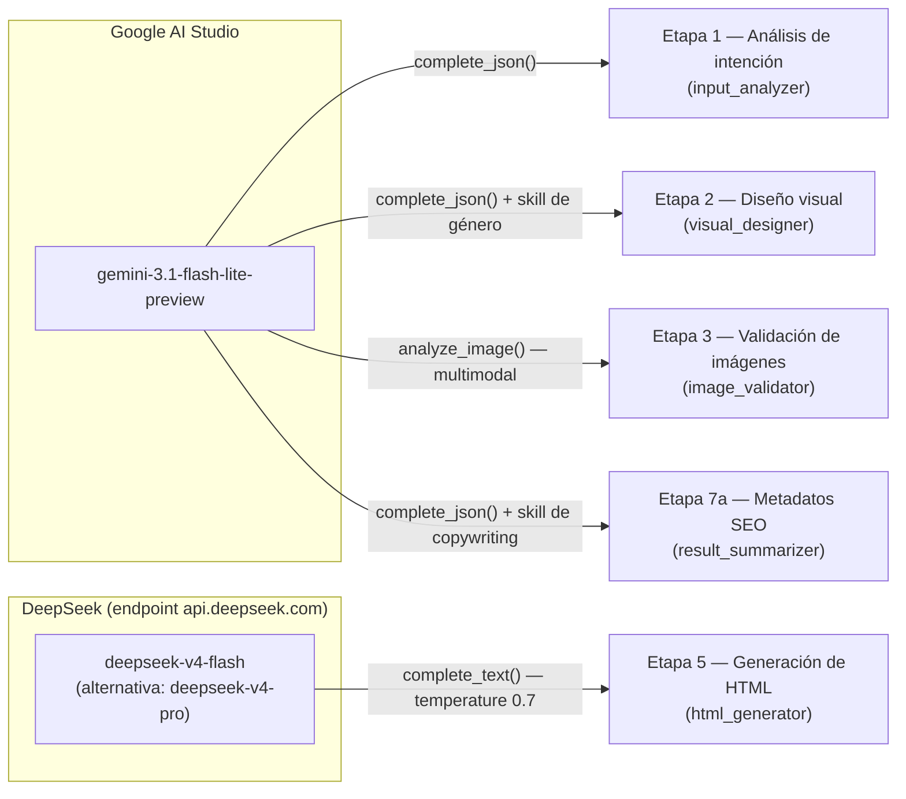

### Tabla comparativa de roles

| # | Rol funcional | Proveedor · Modelo | Método del `AIPort` | Módulo | Entrada clave | Salida |
|---|---|---|---|---|---|---|
| 1 | Análisis de intención | Gemini `gemini-3.1-flash-lite-preview` | `complete_json()` | `input_analyzer.py` | categoría, contexto de usuario, duración | `AnalyzedInput` (género, mood_tags, image_query, descripción) |
| 2 | Diseño visual | Gemini `gemini-3.1-flash-lite-preview` | `complete_json()` | `visual_designer.py` | `AnalyzedInput` + skill `genres/{genre}.md` | `VisualDesign` (≤4 colores, tipografías, animación, estilo de fondo) |
| 3 | Validación de imágenes (multimodal) | Gemini `gemini-3.1-flash-lite-preview` | `analyze_image()` | `image_validator.py` | imagen candidata + criterios del nicho | `{passes, score, reason, criteria_met, criteria_failed}` |
| 4 | Generación de queries variadas | Gemini `gemini-3.1-flash-lite-preview` | `complete_json()` | `resource_fetcher.py` | `query_theme` del nicho | queries de búsqueda de imagen/música variadas |
| 5 | Generación de código HTML | DeepSeek `deepseek-v4-flash` (vía `api.deepseek.com`, cliente `AsyncOpenAI` compatible) | `complete_text()` | `html_generator.py` | prompt ensamblado (diseño + skills HTML) | `index.html` autónomo con Web Audio API |
| 6 | Metadatos SEO | Gemini `gemini-3.1-flash-lite-preview` | `complete_json()` | `result_summarizer.py` | diseño + análisis + skill `youtube_tiktok_copy.md` | título/descr./tags YouTube, caption/hashtags TikTok |

**Justificación de la elección técnica:**

- **Gemini Flash-Lite** se usa para todas las tareas estructuradas (JSON) y para la **única tarea multimodal** del sistema (validar imágenes por visión), por ser el modelo más económico de la familia Gemini con capacidad de visión.
- **DeepSeek v4-flash** se reserva exclusivamente para la generación de código HTML/CSS/JS, tarea donde modelos especializados en código superan a modelos generalistas en coherencia de sintaxis y en seguir restricciones de diseño extensas (las skills de `src/skills/html/` superan las 250 líneas combinadas de reglas).
- Ambos adaptadores implementan **reintentos con backoff exponencial** (`ai_max_retries=3`, `ai_retry_delay_seconds=2.0`, `ai_max_output_tokens=8192`), configurables vía `.env`.

---

## 9. Puertos y adaptadores (Hexagonal Architecture)

```mermaid
classDiagram
    class AIPort {
        <<interface>>
        +complete_json(system, user) dict
        +complete_text(system, user) str
        +analyze_image(image_path, criteria) dict
    }
    class ImagePort {
        <<interface>>
        +fetch(query, dest_path, min_w, min_h) ImageFetchResult
        +fetch_candidates(query, dest_dir, count, color_filter, orientation) list
    }
    class MusicPort {
        <<interface>>
        +get(genre, dest_path) MusicFetchResult
    }
    class RecorderPort {
        <<interface>>
        +record(html_path, audio_path, output_dir, duration, niche_cfg) RecordingResult
    }
    class PublisherPort {
        <<interface>>
        +publish(video_path, title, description, tags, account_alias, privacy) PublishVideoResult
        +get_video(video_id, account_alias) VideoMetadata
        +update_video(video_id, account_alias, ...) VideoMetadata
        +delete_video(video_id, account_alias) bool
    }

    AIPort <|.. GeminiFlashAdapter
    AIPort <|.. DeepSeekAdapter
    ImagePort <|.. UnsplashAdapter
    ImagePort <|.. PexelsAdapter
    ImagePort <|.. PixabayImageAdapter
    ImagePort <|.. CSSFallbackAdapter
    MusicPort <|.. PixabayMusicAdapter
    MusicPort <|.. JamendoAdapter
    MusicPort <|.. FMAAdapter
    MusicPort <|.. YtDlpFallbackAdapter
    MusicPort <|.. LocalCacheAdapter
    RecorderPort <|.. PlaywrightFFmpegAdapter
    PublisherPort <|.. YouTubeAdapter
    PublisherPort <|.. TikTokAdapter
    PublisherPort <|.. FacebookAdapter
```

| Puerto | Archivo | Adaptadores concretos | Selección |
|---|---|---|---|
| `AIPort` | `src/core/ports/ai_port.py` | `GeminiFlashAdapter`, `DeepSeekAdapter` | Fija por rol (análisis/diseño/resumen → Gemini; codegen → DeepSeek) |
| `ImagePort` | `src/core/ports/image_port.py` | `UnsplashAdapter` → `PexelsAdapter` → `PixabayImageAdapter` → `CSSFallbackAdapter` | Cadena secuencial hasta el primer éxito |
| `MusicPort` | `src/core/ports/music_port.py` | `LocalCacheAdapter`, `PixabayMusicAdapter`, `JamendoAdapter`, `FMAAdapter`, `YtDlpFallbackAdapter` | `settings.music_adapter_order` (default: `pixabay, jamendo, ytdlp`) + fallback de género |
| `RecorderPort` | `src/core/ports/recorder_port.py` | `PlaywrightFFmpegAdapter` | Único |
| `PublisherPort` | `src/core/ports/publisher_port.py` | `YouTubeAdapter`, `TikTokAdapter`, `FacebookAdapter` | Por `account_selector` ("platform:alias") |

---

## 10. Cadenas de fallback de recursos multimedia

### Imagen

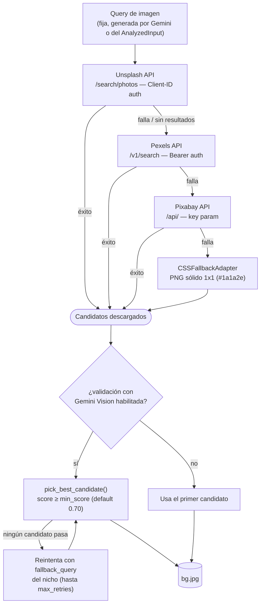

### Música

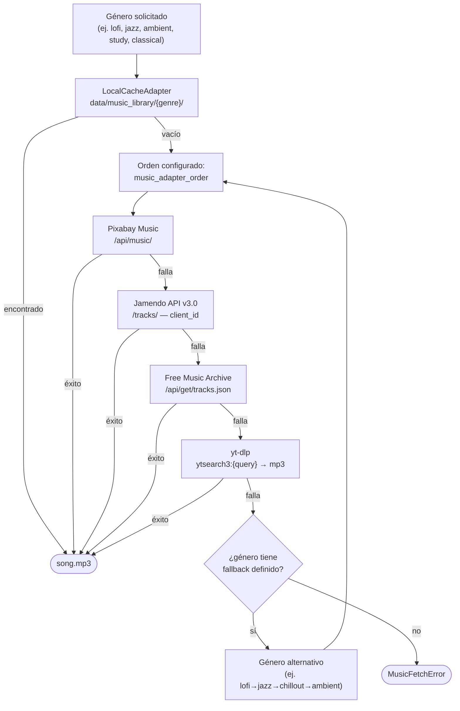

**Mapa de fallback de género** (`src/adapters/music/factory.py`):

| Género solicitado | Cadena de fallback |
|---|---|
| `lofi` | `jazz` → `chillout` → `ambient` |
| `study` | `ambient` → `chillout` → `instrumental` |
| `ambient` | `chillout` → `instrumental` → `jazz` |
| `classical` | `instrumental` → `ambient` |
| `jazz` | `blues` → `instrumental` |

---

## 11. Grabación y transcodificación de video

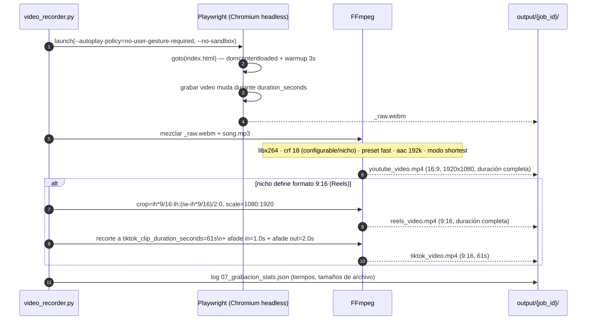

Parámetros relevantes (`settings.py` / `niches.json` por formato):

| Parámetro | Default | Configurable por |
|---|---|---|
| Resolución de grabación | 1920×1080 | `settings.video_width/height` |
| CRF (calidad) | 18 (YouTube) / 20 (Reels/TikTok) | `niches.json → video.formats[].crf` |
| Preset de codificación | `fast` | `niches.json → video.formats[].preset` |
| Duración clip TikTok | 61 s | `settings.tiktok_clip_duration_seconds` |
| Fade in / fade out TikTok | 1.0 s / 2.0 s | `settings.tiktok_fade_in/out_seconds` |
| Método de generación 9:16 | `crop_safe_zone` | `niches.json → video.formats[].generation_method` |

---

## 12. Sistema de Skills — diseño inyectado como Markdown

Las "skills" son la pieza más distintiva del microkernel: **no son plantillas de código**, son documentos de dirección creativa en lenguaje natural que se leen del disco en tiempo de ejecución y se concatenan al prompt de la IA correspondiente.

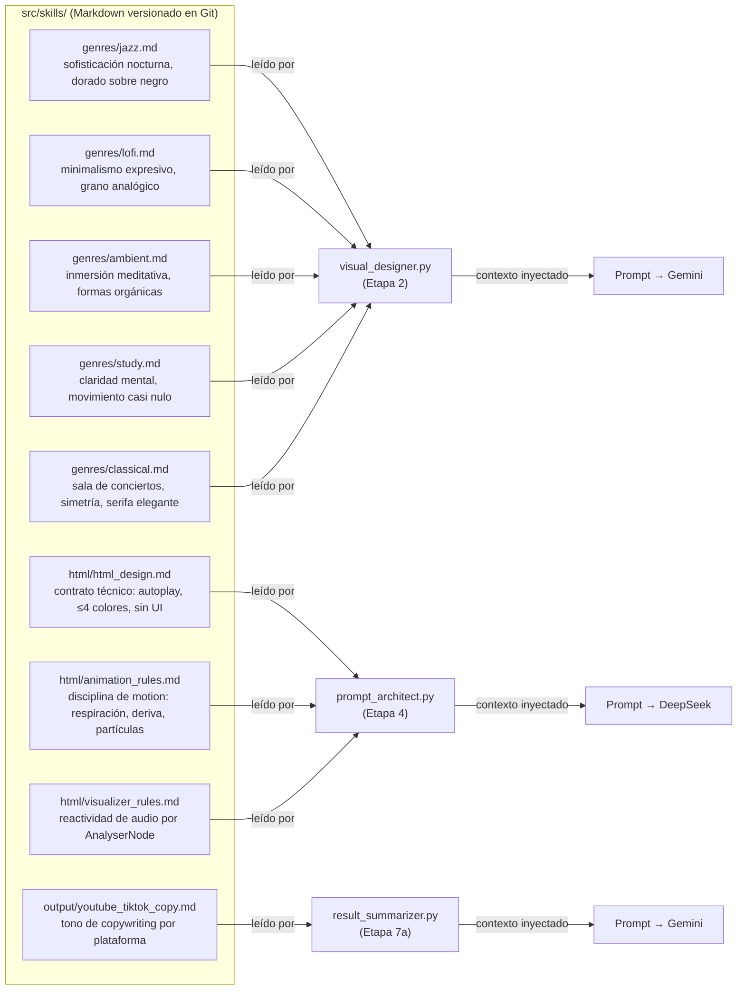

### Resumen de las skills de género

| Skill | Paleta / lenguaje visual | Movimiento |
|---|---|---|
| `jazz.md` | Dorado sobre negro casi puro, máx. 4 colores | "Swing" — timing irregular que imita fraseo musical |
| `lofi.md` | Oscuro con contraste orgánico, grano, viñeta | Pulsos lentos e imperceptibles, derivas graduales |
| `ambient.md` | Azul profundo, violeta oscuro, negro espacial | Gradientes que "respiran", formas orgánicas nunca geométricas |
| `study.md` | Grises fríos, blancos rotos, sin ornamento | Movimiento mínimo — cursor, halo casi imperceptible |
| `classical.md` | Tonos tierra y marfil, tipografía serifa | Animaciones simétricas y arquitectónicas, ondas discretas |

### Reglas técnicas de `html/html_design.md` (contrato no negociable para la IA generadora)

- El HTML corre en **Chromium headless sin interacción humana** — todo debe iniciar en `DOMContentLoaded`, nunca esperar un clic.
- **Máximo 4 colores** en toda la pieza (primario, secundario, acento, neutro).
- **Prohibido:** botones, controles, texto adicional al título, logos, watermarks, spinners, emojis.
- Debe correr **2+ horas sin fugas de memoria** (uso de `requestAnimationFrame`, cancelación en `beforeunload`).
- El visualizador debe reaccionar a **datos reales de frecuencia de audio** (Web Audio API `AnalyserNode`), nunca animación temporizada falsa.

---

## 13. Publicación automática en redes sociales

Etapa 9, condicional a `ENABLE_AUTO_PUBLISHING=true`. Arquitectura centrada en un **Facade** que resuelve credenciales por `"plataforma:alias"` y delega en el adaptador correspondiente.

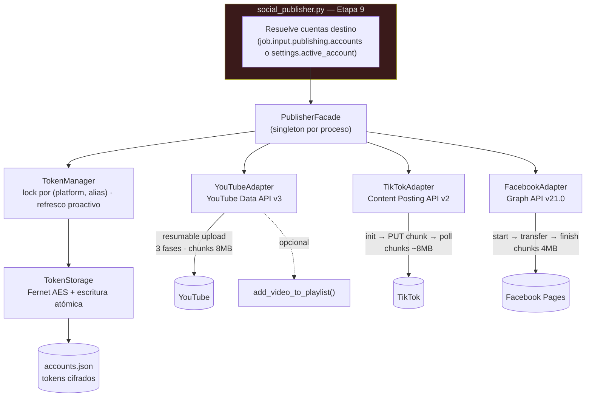

### Protocolo de subida por plataforma

| Plataforma | Protocolo | Resumible | Tamaño de chunk | Límite de privacidad / cuota |
|---|---|---|---|---|
| **YouTube** | Resumable Upload (HTTP 308) — init → PUT chunks → poll `uploadStatus` | Sí | ~8 MB | Cuota diaria 10 000 unidades · 1 600 por subida → máx. ~6 videos/día |
| **TikTok** | Content Posting API v2 — `init` → `PUT` a `upload_url` → `poll status/fetch` | No (atómico) | ~8 MB | Máx. ~20 publicaciones/usuario/día · privacidad `SELF_ONLY` mientras la app esté en modo desarrollo |
| **Facebook** | Graph API v21.0 — `start` → `transfer` (multiparte) → `finish` | Sí | 4 MB | Rutas separadas para Reels (`/video_reels`, 9:16) y feed estándar (`/videos`) |

### Secuencia de publicación (con gestión de tokens)

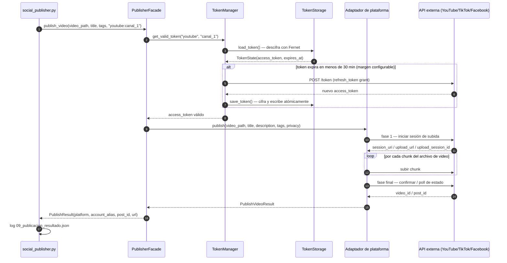

### Detalle por adaptador

- **`YouTubeAdapter`** (`src/adapters/publishing/youtube_adapter.py`): además del CRUD estándar, expone `list_playlists()`, `create_playlist()` y `add_video_to_playlist()`. Incluye guarda de cuota (`check_quota_before_upload`) que lanza `QuotaExceededError` antes de intentar una subida que excedería el límite diario.
- **`TikTokAdapter`** (`tiktok_adapter.py`): la operación `update_video()` **no está soportada** por la API de TikTok y lanza `UnsupportedOperationError` con log de auditoría explícito, en vez de fallar silenciosamente.
- **`FacebookAdapter`** (`facebook_adapter.py`): decide entre publicar como **Reel** (`facebook_publish_as_reel`, activado por defecto según `PlatformOptions`) o como video estándar de página.
- **`base_platform.py`**: infraestructura común — cliente `httpx.AsyncClient`, decorador `with_retry(max_retries=3, backoff_base=2.0)` que reintenta en errores de red y HTTP 429/500/502/503/504, pero **no** en 400/401/403/404/409.

---

## 14. Seguridad y gestión de tokens OAuth

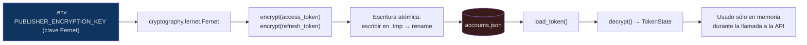

**Ciclo de vida por plataforma** (verificado contra `accounts.json` real del sistema, sin exponer valores cifrados ni credenciales):

| Plataforma | Vigencia del `access_token` | Vigencia del `refresh_token` | Estrategia de refresco |
|---|---|---|---|
| YouTube | ~1 hora | No expira (salvo revocación manual) | `TokenManager._refresh_youtube()` → `POST https://oauth2.googleapis.com/token` |
| TikTok | 24 horas | 365 días (puede rotar en cada refresh) | `TokenManager._refresh_tiktok()` → `POST https://open.tiktokapis.com/v2/oauth/token/` |
| Facebook | No expira (Page Access Token derivado de Long-Lived User Token) | N/A | No-op — `_refresh_facebook()` es intencionalmente vacío |

**Propiedades de diseño:**

- Un **`asyncio.Lock` por cada par `(plataforma, alias)`** evita que múltiples jobs concurrentes disparen refrescos duplicados sobre la misma cuenta.
- El margen de refresco proactivo es de **30 minutos** (`PUBLISHER_TOKEN_REFRESH_MARGIN_SECONDS=1800`), y un `APScheduler` ejecuta `refresh_all_tokens()` cada 15 minutos en segundo plano.
- Ante fallo persistente de refresco (3 reintentos con backoff 2s → 4s → 8s), la cuenta se marca `status="requires_reauth"` y se lanza `TokenExpiredError` — el job de publicación falla de forma explícita en vez de intentar publicar con un token inválido.
- `accounts.json` está declarado en `.gitignore` y nunca debe versionarse; el archivo `.env.example` documenta cómo generar una clave Fernet nueva (`Fernet.generate_key()`).

---

## 15. Configuración del sistema

### Jerarquía de configuración por nicho (`niches.json` → `NicheConfig`)

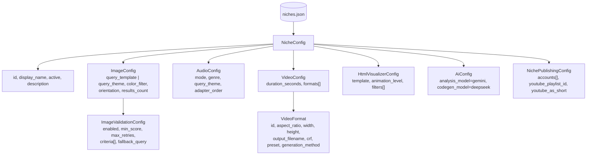

**Nichos activos verificados en el repositorio:**

| ID | Nombre visible | Activo | `skip_visual_design` | Formatos de video | Validación de imagen |
|---|---|---|---|---|---|
| `ambient_music` | Ambient Music B&W — @DrovaSoft | ✅ | ✅ (estilo fijo B&N) | YouTube 16:9 + Reels 9:16 | min_score 0.70, 2 reintentos, filtro B&N |
| `animated_study` | Lofi Study Beats — Cozy Animation | ✅ | ❌ | YouTube 16:9 + Reels 9:16 | min_score 0.75, 2 reintentos |
| `economy_finance` | Economy Chronicles (Futuro) | ❌ (inactivo) | ❌ | Sólo YouTube 16:9 | min_score 0.65 |

### Variables de entorno principales (`.env` / `.env.example`)

| Categoría | Variable | Default | Propósito |
|---|---|---|---|
| IA | `GEMINI_API_KEY` | — | Google AI Studio |
| IA | `DEEPSEEK_API_KEY` | — | DeepSeek / Novita AI |
| Imagen | `UNSPLASH_API_KEY`, `PEXELS_API_KEY`, `PIXABAY_API_KEY` | — | Cadena de fallback de imagen |
| Música | `JAMENDO_API_KEY` | — | Jamendo (Pixabay reutiliza su propia key) |
| Pipeline | `VIDEO_MIN/MAX_DURATION_SECONDS` | 60 / 300 | Rango válido de duración |
| Pipeline | `MAX_PARALLEL_JOBS` | 2 | Concurrencia del `Orchestrator` |
| Pipeline | `LOG_LEVEL` | INFO | Verbosidad de `structlog` |
| Pipeline | `MUSIC_ADAPTER_ORDER` | `["pixabay","jamendo","ytdlp"]` | Orden de la cadena de música |
| Publisher | `ENABLE_AUTO_PUBLISHING` | `false` | Activa la Etapa 9 |
| Publisher | `ACTIVE_ACCOUNT` | `tiktok:cuenta_1` | Cuenta por defecto si el job no especifica una |
| Publisher | `PUBLISHER_ENCRYPTION_KEY` | — | Clave Fernet para cifrar `accounts.json` |
| Publisher | `TIKTOK_CLIENT_ID/SECRET`, `YOUTUBE_CLIENT_ID/SECRET`, `FACEBOOK_CLIENT_ID/SECRET` | — | Credenciales OAuth por plataforma |
| Publisher | `YOUTUBE_DAILY_QUOTA_LIMIT` / `YOUTUBE_QUOTA_COST_PER_UPLOAD` | 10000 / 1600 | Guarda de cuota de YouTube |
| Publisher | `PUBLISHER_TOKEN_REFRESH_MARGIN_SECONDS` | 1800 | Margen de refresco proactivo |

### Jerarquía de excepciones (`src/config/exceptions.py`)

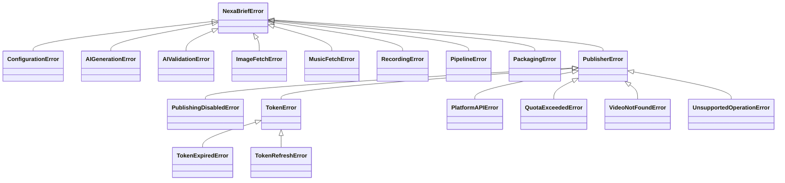

---

## 16. API REST

Framework: **FastAPI** + **Uvicorn**, capa fina sobre el `Orchestrator` y el `PublisherFacade`.

| Método | Ruta | Módulo | Descripción |
|---|---|---|---|
| `POST` | `/api/v1/videos` | `routers/videos.py` | Dispara `run_batch()`; devuelve `202 Accepted` con `BatchResponse` (bloqueante hasta completar todo el lote) |
| `GET` | `/api/v1/categories` | `routers/categories.py` | Lista los nichos configurados en `niches.json` |
| `POST` | `/api/v1/publish` | `routers/publisher.py` | Publicación manual, independiente del pipeline (`ManualPublishRequest`) |
| `GET` | `/api/v1/publish/accounts` | `routers/publisher.py` | Lista cuentas configuradas sin exponer tokens |
| `GET/PUT/DELETE` | `/api/v1/publish/{platform}/{alias}/{video_id}` | `routers/publisher.py` | CRUD de video ya publicado |
| `GET` | `/api/v1/auth/youtube/*` | `routers/youtube_oauth.py` | Flujo OAuth2 de escritorio/servidor para YouTube |
| `GET` | `/health` | `presentation/main.py` | Estado del servicio + flag `auto_publishing` |

**Ciclo de vida de la app** (`main.py`): un `lifespan` de FastAPI arranca el `APScheduler` de refresco de tokens sólo si `ENABLE_AUTO_PUBLISHING=true`, y libera los recursos del `PublisherFacade` en el shutdown.

---

## 17. Herramientas auxiliares de scraping

Fuera del pipeline principal, `scripts/` contiene herramientas independientes para poblar bibliotecas locales de imágenes (no forman parte del flujo de producción en caliente, se ejecutan manualmente u offline):

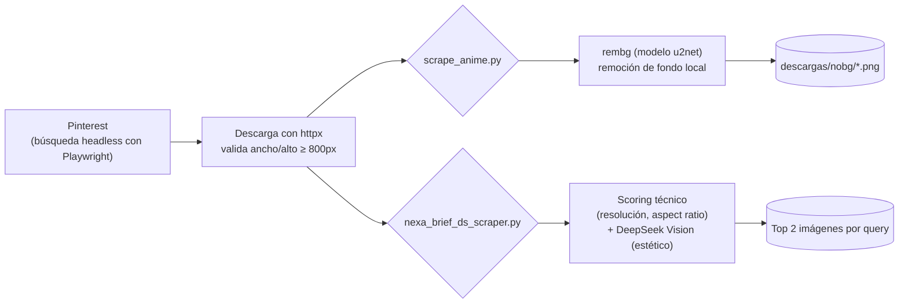

| Script | Propósito | Filtrado |
|---|---|---|
| `nexa_brief_ds_scraper.py` | Fondos de escritorio de alta calidad | Score técnico (resolución/aspect ratio) + ranking por DeepSeek Vision, conserva el top 2 |
| `scrape_anime.py` | Arte de personajes de cuerpo completo | Detección de transparencia nativa + `rembg` (u2net) para remover fondo |
| `scrape_backgrounds.py` / `scrape_backgrounds_v3.py` | Fondos generales (versión legacy y unificada) | Validación de dimensión mínima 800×800 |

---

## 18. Cobertura de pruebas

```text
tests/
├── unit/
│   ├── test_token_storage.py            # cifrado/descifrado Fernet, escritura atómica
│   ├── test_token_manager.py            # refresco automático, mocks de HTTP
│   ├── test_publisher_router.py         # endpoints FastAPI de publicación
│   ├── test_social_publisher_module.py  # lógica de la Etapa 9
│   ├── test_adapters_reels_playlists.py # Facebook Reels + YouTube Playlists
│   ├── test_visual_designer.py          # Etapa 2
│   ├── test_input_analyzer.py           # Etapa 1
│   └── test_prompt_architect.py         # Etapa 4
└── integration/
    └── test_full_pipeline.py            # pipeline extremo a extremo (con mocks de IA/red)
```

Herramientas: `pytest`, `pytest-asyncio` (modo `auto`), `pytest-cov`. Calidad de código: `ruff` (lint + format) y `mypy` (tipado estático).

---

## 19. Stack tecnológico completo

| Capa | Tecnología | Versión mínima |
|---|---|---|
| Lenguaje | Python | ≥ 3.10.12 |
| Gestor de paquetes | `uv` | — |
| Framework API | FastAPI | ≥ 0.115.0 |
| Servidor ASGI | Uvicorn | ≥ 0.34.0 |
| Validación de datos | Pydantic v2 + pydantic-settings | ≥ 2.13.4 / ≥ 2.14.1 |
| IA — análisis/diseño/visión/resumen | `google-genai` (Gemini 3.1 Flash-Lite) | ≥ 2.8.0 |
| IA — generación de código | `openai` (cliente compatible, endpoint DeepSeek) | ≥ 2.41.1 |
| OAuth | `google-auth-oauthlib` | ≥ 1.4.0 |
| Cliente HTTP async | `httpx` | ≥ 0.28.1 |
| Grabación headless | `playwright` | ≥ 1.60.0 |
| Transcodificación | FFmpeg (binario de sistema) | — |
| Imágenes | `Pillow` | ≥ 11.0.0 |
| Remoción de fondo | `rembg` + `onnxruntime` | ≥ 2.0.69 / <1.20 |
| Cifrado | `cryptography` (Fernet AES) | ≥ 44.0.0 |
| I/O asíncrono | `aiofiles` | ≥ 25.1.0 |
| JSON rápido | `orjson` | ≥ 3.11.9 |
| Logging estructurado | `structlog` | ≥ 26.1.0 |
| Salida de consola | `rich` | ≥ 15.0.0 |
| Programación de tareas | `APScheduler` | ≥ 3.10.4 |
| Testing | `pytest`, `pytest-asyncio`, `pytest-cov` | ≥ 9.1.0 / ≥1.4.0 / ≥7.1.0 |
| Calidad de código | `ruff`, `mypy` | ≥ 0.15.17 / ≥ 2.1.0 |

---

## 20. Despliegue e infraestructura

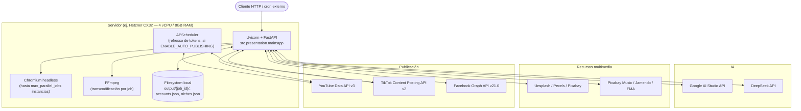

**Consideraciones de capacidad:** cada job concurrente consume aproximadamente una instancia de Chromium (~800 MB) más el proceso de FFmpeg; con `max_parallel_jobs=2` (default) el consumo de memoria pico ronda 2–3 GB, dejando margen amplio en un servidor de 8 GB. No hay base de datos: todo el estado persiste en el filesystem (`output/`, `accounts.json`, `niches.json`), lo que simplifica el despliegue pero implica que un reinicio del proceso pierde los jobs en curso (no hay cola persistente).

---

## 21. Estado real observado y hallazgos

Verificado directamente contra el repositorio (no contra documentación histórica, que en algunos puntos describe fases planeadas aún no implementadas):

- **28 carpetas de job** existen en `output/`, todas con su carpeta `logs/` completa (8-9 archivos JSON por job), confirmando que el pipeline corre de punta a punta en producción.
- `niches.json` define **3 nichos**, de los cuales **2 están activos** (`ambient_music`, `animated_study`); `economy_finance` está desactivado (`active: false`) y representa un nicho planeado a futuro (voz IA + infografías, aún sin implementar en el código de módulos).
- Los tokens de `accounts.json` usan cifrado Fernet real; los `access_token` de YouTube y TikTok tienen vigencia corta (~1h y ~24h respectivamente) por diseño — su expiración periódica **es esperada** y queda cubierta por el refresco automático de `TokenManager`, no representa una falla salvo que el `refresh_token` también sea rechazado por la plataforma.
- El adaptador de **TikTok** publica en modo `SELF_ONLY` (privado) mientras la app no tenga aprobación de producción de la plataforma — esto es una restricción de TikTok, no un bug del sistema.
- `TikTokAdapter.update_video()` lanza `UnsupportedOperationError` de forma explícita porque la API de TikTok no ofrece esa operación — comportamiento correcto y documentado, no un defecto.
- No existe base de datos ni cola de trabajos persistente: el endpoint `POST /api/v1/videos` es **bloqueante** hasta que termina todo el lote, lo cual es aceptable para uso interno/cron pero limitaría un uso con múltiples clientes concurrentes de cara al usuario final.

---

## 22. Glosario

| Término | Significado en este sistema |
|---|---|
| **Job** | Unidad de trabajo inmutable que representa la generación de un video, desde `PENDING` hasta `PACKAGED`/`PUBLISHED`/`FAILED` |
| **Nicho** (`niche`) | Configuración de categoría de contenido (`niches.json`): define imagen, audio, formatos de video, IA y publicación por defecto |
| **Skill** | Documento Markdown con dirección creativa/técnica que se inyecta como contexto en un prompt de IA |
| **Puerto** (`Port`) | Interfaz abstracta en `src/core/ports/` que el núcleo usa sin conocer la implementación concreta |
| **Adaptador** (`Adapter`) | Implementación concreta de un puerto para un proveedor externo específico |
| **Facade** | `PublisherFacade`, punto único de entrada para todas las operaciones de publicación en redes sociales |
| **Reels** | Formato de video vertical (9:16) de duración completa, generado por recorte centrado del video 16:9 |
| **Safe zone** | Franja central horizontal (60%) que la IA generadora de HTML debe respetar cuando el formato final será 9:16 |

---

*Documento generado mediante auditoría directa del código fuente de Nexa-Brief (commit más reciente: "Add TikTok verification file"). No se ha incluido ningún token, clave API, `client_secret` ni identificador de cuenta real — todos los ejemplos usan los alias genéricos ya presentes en `.env.example` (`canal_1`, `cuenta_1`, `pagina_1`).*
