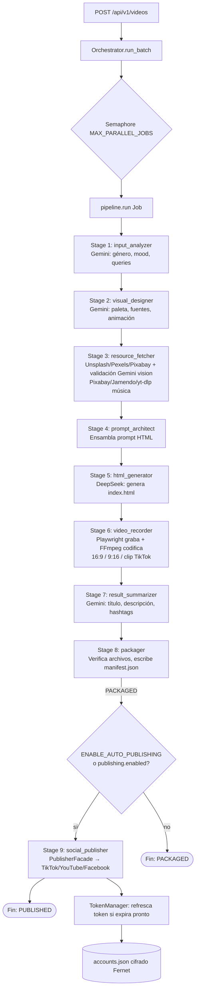

# Nexa Brief Server — Documentación Técnica del Sistema

> Estudio completo del backend `nexa-brief-server`: arquitectura, flujo de ejecución, módulos, adaptadores, endpoints y configuración. Generado a partir de una lectura exhaustiva del código fuente en `src/`.

---

## 1. Qué es este sistema

`nexa-brief-server` es un backend **FastAPI (Python 3, async)** que genera videos musicales de forma 100% automática (sin intervención humana) y opcionalmente los publica en YouTube, TikTok y Facebook.

Flujo de altísimo nivel:

```
Categoría/Nicho (texto) 
   → IA analiza y diseña 
   → IA genera queries de búsqueda 
   → se descargan imagen + música 
   → IA arma un prompt 
   → IA genera un visualizador HTML/CSS/JS autónomo 
   → un navegador headless (Playwright) graba ese HTML en video 
   → FFmpeg mezcla audio + exporta 16:9 / 9:16 
   → IA genera metadata SEO (título, descripción, hashtags) 
   → se empaqueta todo en una carpeta de salida 
   → (opcional) se publica automáticamente en redes sociales
```

Cada ejecución de este flujo es un **Job**, y se pueden correr varios Jobs en paralelo (batch) controlados por un **Orchestrator** con un semáforo de concurrencia.

---

## 2. Arquitectura general

El proyecto sigue **Arquitectura Hexagonal (Puertos y Adaptadores)** + un **Microkernel** (el `Orchestrator`/`pipeline`) que coordina "plugins" intercambiables (proveedores de IA, imágenes, música, publicación).

```
src/
├── core/                     # Núcleo del dominio — no depende de infraestructura
│   ├── job.py                 # Job, JobStage, JobArtifacts (el objeto que viaja por el pipeline)
│   ├── pipeline.py             # Ejecuta las 8-9 etapas en secuencia para UN job
│   ├── orchestrator.py         # Corre N jobs en paralelo (asyncio.Semaphore)
│   └── ports/                  # Interfaces abstractas (contratos)
│       ├── ai_port.py            # AIPort: complete_json / complete_text / analyze_image
│       ├── image_port.py         # ImagePort: fetch / fetch_candidates
│       ├── music_port.py         # MusicPort: get
│       ├── recorder_port.py      # RecorderPort: record
│       └── publisher_port.py     # PublisherPort: publish/get/update/delete video
│
├── adapters/                 # Implementaciones concretas de los puertos (infraestructura)
│   ├── ai/                     # Gemini (análisis/diseño/resumen) + DeepSeek (código HTML)
│   ├── image/                   # Unsplash, Pexels, Pixabay, fallback CSS puro
│   ├── music/                   # Pixabay, Jamendo, yt-dlp, caché local
│   ├── recorder/                 # Playwright (graba HTML) + FFmpeg (codifica/mezcla)
│   └── publishing/                # TikTok, YouTube, Facebook — OAuth, tokens, CRUD
│
├── modules/                  # Lógica procedimental de cada etapa del pipeline (Stage 1-9)
│
├── presentation/              # Capa HTTP (FastAPI)
│   ├── main.py                   # App entrypoint, lifespan, routers
│   └── api/
│       ├── routers/                # videos, categories, publisher, youtube_oauth
│       └── schemas/                # Modelos Pydantic in/out
│
├── config/                    # settings.py (.env), niche_config.py (niches.json), exceptions.py
├── skills/                     # Prompts/reglas en Markdown, cargadas en runtime como "skills" de IA
└── categories/                 # default_categories.json / user_categories.json (catálogo de nichos "legacy")

tests/                         # unit + integration
data/music_library/            # caché local de pistas de música
output/<job_id>/               # salida generada por cada Job (video, audio, html, logs, manifest)
accounts.json                  # tokens OAuth cifrados (AES/Fernet) de las cuentas conectadas
niches.json                    # configuración declarativa de cada nicho/categoría (fuente de verdad actual)
```

**Regla de dependencia (hexagonal):** `core` no importa nada de `adapters`; los `modules` reciben los adaptadores ya resueltos como parámetros (inyección manual desde `pipeline.py`). Esto permite cambiar de proveedor de IA/imagen/música sin tocar la lógica de negocio.

---

## 3. El objeto `Job`: cómo viaja el estado por el pipeline

Definido en [`src/core/job.py`](src/core/job.py). Es un modelo Pydantic **inmutable**: cada etapa produce un nuevo `Job` (via `model_copy`) en vez de mutar el existente.

```python
Job
├── job_id: str                # uuid4 hex[:8], p.ej. "0094b66e"
├── input: JobInput            # category_name, quantity, duration_seconds, user_context, publishing
├── stage: JobStage            # máquina de estados (ver abajo)
├── artifacts: JobArtifacts    # "bolsa" acumulativa — cada stage agrega su propia clave, nunca sobreescribe otra
└── errors: list[str]
```

### Máquina de estados `JobStage`

```
PENDING
   ↓  (input_analyzer)
INPUT_ANALYZED
   ↓  (visual_designer)
DESIGN_COMPLETE
   ↓  (resource_fetcher)
RESOURCES_FETCHED
   ↓  (prompt_architect)
PROMPT_BUILT
   ↓  (html_generator)
HTML_GENERATED
   ↓  (video_recorder)
VIDEO_RECORDED
   ↓  (result_summarizer)
SUMMARY_GENERATED
   ↓  (packager)
PACKAGED                    ←── fin del pipeline "core" (siempre se llega aquí si todo va bien)
   ↓  (social_publisher, SOLO si publishing está habilitado)
PUBLISHING → PUBLISHED

En cualquier etapa, una excepción NexaBriefError (o cualquier Exception) 
marca el job como FAILED y detiene el pipeline (fail-fast, sin rollback).
```

### `JobArtifacts` — qué produce cada etapa

| Campo | Producido por |
|---|---|
| `analyzed_input`, `search_queries` | Stage 1 — `input_analyzer` |
| `visual_design` | Stage 2 — `visual_designer` |
| `image_path`, `image_meta`, `music_path`, `music_meta` | Stage 3 — `resource_fetcher` |
| `prompt_text` | Stage 4 — `prompt_architect` |
| `html_path` | Stage 5 — `html_generator` |
| `youtube_video_path`, `tiktok_video_path`, `reels_video_path`, `recording_stats` | Stage 6 — `video_recorder` |
| `summary` | Stage 7 — `result_summarizer` |
| (verifica archivos, escribe `manifest.json`) | Stage 8 — `packager` |
| `publish_result`, `publish_results` | Stage 9 — `social_publisher` (opcional) |

---

## 4. El flujo completo, paso a paso

### 4.0 Punto de entrada HTTP

`POST /api/v1/videos` ([`src/presentation/api/routers/videos.py`](src/presentation/api/routers/videos.py)):

1. Recibe `VideoGenerationRequest` (`category_name`, `quantity`, `duration_seconds`, `user_context`, `publishing`).
2. Si `publishing.enabled=true`, **valida antes de arrancar nada**: que la cuenta exista en `accounts.json` y que su token sea válido (o refrescable) — si no, responde `400`/`401` inmediatamente sin gastar cuota de IA.
3. Crea un `Orchestrator()` y llama `run_batch(...)`.
4. Esta llamada es **síncrona desde el punto de vista HTTP** (se espera a que termine todo el batch) y devuelve `202 Accepted` con el resultado completo — no hay polling de estado ni cola de jobs persistente; es "fire and wait".

### 4.1 `Orchestrator.run_batch` (microkernel)

[`src/core/orchestrator.py`](src/core/orchestrator.py)

- Crea `quantity` objetos `Job` (uno por video solicitado).
- Usa un `asyncio.Semaphore(MAX_PARALLEL_JOBS)` (default 2, configurable en `.env`) para limitar cuántos jobs corren en paralelo — evita saturar APIs de IA/imagen/música y no colapsar CPU con múltiples instancias de Chromium grabando a la vez.
- Ejecuta todos los jobs con `asyncio.gather`, mide el tiempo total, y separa resultados en `succeeded` / `failed` según `job.stage == PACKAGED`.

### 4.2 `pipeline.run(job)` — el corazón del sistema

[`src/core/pipeline.py`](src/core/pipeline.py)

Por cada Job, individualmente:

1. Crea el directorio `output/<job_id>/` y `output/<job_id>/logs/`.
2. Carga la configuración del nicho desde `niches.json` vía `get_niche_config(category_name)` — si el nicho no existe, usa una config por defecto segura (retrocompatible).
3. Resuelve los adaptadores de IA **una sola vez por job**: `get_analysis_ai()` → Gemini, `get_codegen_ai()` → DeepSeek.
4. Si `niche_cfg.skip_visual_design=True`, inyecta un `VisualDesign` estático (`image_only`, blanco/negro) y se salta la llamada a Gemini de diseño — pensado para nichos tipo "solo imagen + audio, sin animaciones".
5. Construye la lista de 8 etapas (+ una 9na condicional) y las ejecuta **secuencialmente** con un `try/except`:
   - `NexaBriefError` → `job.fail(f"[{stage_name}] {exc}")` (error de dominio esperado)
   - `Exception` genérica → mismo resultado pero logueada como `stage_unexpected_error`
6. Si todas las etapas pasan, devuelve el `Job` final con `stage=PACKAGED` (o `PUBLISHED` si corrió Stage 9).

**No hay reintentos a nivel de pipeline ni rollback de etapas ya ejecutadas** — si la etapa 6 (grabación) falla, las etapas 1-5 no se re-ejecutan; el job entero se marca `FAILED` y sus artefactos parciales quedan en `output/<job_id>/` para debugging.

---

## 5. Las 9 etapas del pipeline en detalle

### Stage 1 — `input_analyzer` ([`src/modules/input_analyzer.py`](src/modules/input_analyzer.py))

Dos sub-pasos, ambos vía Gemini (`ai.complete_json`):

- **1a — Análisis**: a partir de `category_name` + `duration_seconds` (+ `user_context` opcional del usuario), la IA devuelve `genre`, `mood_tags`, `image_query`, `description`. Se valida contra el modelo Pydantic `AnalyzedInput`; si falla, `AIValidationError`. Log: `logs/01_input_completado.json`.
- **1b — Search queries** (solo si el nicho define `search_instructions.image` y `.music` en `niches.json`): la IA genera **4 queries de imagen** (frases descriptivas en inglés) y **4 queries de música** (una palabra cada una, tags de género válidos en Jamendo). Esto maximiza variedad entre ejecuciones del mismo nicho. Log: `logs/01b_search_queries.json`.

### Stage 2 — `visual_designer` ([`src/modules/visual_designer.py`](src/modules/visual_designer.py))

- Carga un "skill" Markdown específico del género (`src/skills/genres/{genero}.md`, fallback `ambient.md`) y lo antepone al system prompt — así cada género tiene reglas de diseño propias.
- Le pide a Gemini un `VisualDesign`: `style`, `colors` (3-4 hex), `fonts` (1-2 Google Fonts), `animation`, `background_style`. Incorpora "hints" del nicho (template visual, nivel de animación) al prompt.
- Se puede saltear completamente si `niche_cfg.skip_visual_design=True` (ver pipeline.py). Log: `logs/02_diseno_visual.json`.

### Stage 3 — `resource_fetcher` ([`src/modules/resource_fetcher.py`](src/modules/resource_fetcher.py))

**Imagen:**
- Usa las `search_queries.image_queries` del Stage 1b (mezcladas al azar con `random.shuffle`), o cae a `niche_cfg.image.query_template`, o al `image_query` del análisis.
- Si `niche_cfg.image.validation.enabled=True`: descarga varios candidatos (`fetch_image_candidates`, página aleatoria 1-8 para variedad) y usa el **image_validator** (Stage 2.5 embebido) para que Gemini vision analice cada candidato contra criterios del nicho y elija el de mejor `score` (≥ `min_score`). Si ninguno pasa, intenta un `fallback_query`, y si aún así falla, usa el primero disponible como último recurso.
- Si la validación está desactivada: descarga una sola imagen directamente.
- Prueba las queries **en orden** hasta que una tenga éxito.

**Música:**
- Usa `search_queries.music_queries` del Stage 1b, o el género del nicho/análisis.
- Prueba cada query hasta que un adaptador la resuelva.

Logs: `logs/05_imagen_seleccionada.json`, `logs/05b_validacion_imagenes.json` (si aplica), `logs/06_musica_seleccionada.json`.

### Stage 4 — `prompt_architect` ([`src/modules/prompt_architect.py`](src/modules/prompt_architect.py))

Construye el prompt que luego consumirá DeepSeek. Dos plantillas según `niche_cfg.html_visualizer.template`:

- **`image_only` / `image_only_ambient` / `still_image`**: plantilla ultra-restrictiva — solo imagen de fondo `object-fit: cover` + `<audio loop>`, cero texto, cero visualizador, cero animaciones, filtros CSS del nicho aplicados directo sobre la imagen.
- **Plantilla completa (default)**: pide un visualizador de audio con Web Audio API + Canvas, animaciones acordes al `VisualDesign` del Stage 2, y — si el nicho tiene formato 9:16 (`has_reels_format()`) — inyecta un bloque de **"zona segura"** que obliga a que todo el contenido crítico quede en el 60% central horizontal (para que el crop a 9:16 no corte nada importante).
- Incluye advertencias explícitas de que el HTML corre en un **Chromium headless sin usuario**: prohibido cualquier `click to start` o interacción requerida; el audio debe reproducirse automáticamente vía `DOMContentLoaded` + `audioCtx.resume()` + `audio.play()`.

Log: `logs/03_prompt_generacion.txt`.

### Stage 5 — `html_generator` ([`src/modules/html_generator.py`](src/modules/html_generator.py))

- Envía el prompt del Stage 4 a **DeepSeek** (`ai.complete_text`) pidiendo el HTML completo como texto plano.
- Chequeo de cordura: debe contener `<!DOCTYPE` o `<html>`, si no → `AIGenerationError`.
- Guarda `index.html` en la carpeta del job + copia de auditoría en `logs/04_html_generado.html` y metadata (`logs/04_html_log.json`: si tiene audio, canvas, Web Audio API, three.js, gsap).

### Stage 6 — `video_recorder` ([`src/modules/video_recorder.py`](src/modules/video_recorder.py) → [`src/adapters/recorder/infrastructure/playwright_ffmpeg_adapter.py`](src/adapters/recorder/infrastructure/playwright_ffmpeg_adapter.py))

El paso más pesado en cómputo:

1. **Playwright** lanza Chromium headless con flags (`--autoplay-policy=no-user-gesture-required`, sin sandbox), navega a `index.html` (vía `file://`), espera `domcontentloaded` + 3s de warmup, y graba video nativo del navegador (`record_video_dir`) durante `duration_seconds`.
2. El `.webm` crudo se renombra a `_raw.webm`.
3. **FFmpeg** mezcla ese video con `song.mp3` → `youtube_video.mp4` (16:9, códec libx264, CRF/preset configurables por nicho).
4. Si el nicho tiene formato 9:16 (`has_reels_format()`): se hace un **crop seguro desde el centro** (`crop=ih*9/16:ih:(iw-ih*9/16)/2:0,scale=1080:1920`) del video 16:9 → `reels_video.mp4` (duración completa, vertical).
5. A partir de `reels_video.mp4` se recorta un clip de 61s con fade in/out (`tiktok_clip_duration_seconds`, `tiktok_fade_in/out_seconds` en settings) → `tiktok_video.mp4`.
6. Si el nicho NO tiene 9:16, el clip de TikTok se deriva directamente del video 16:9 (comportamiento legado).

Se limpia el `.webm` crudo al final. Log: `logs/07_grabacion_stats.json` (tamaños de archivo, tiempos de procesamiento).

### Stage 7 — `result_summarizer` ([`src/modules/result_summarizer.py`](src/modules/result_summarizer.py))

- Carga un skill de copywriting (`src/skills/output/youtube_tiktok_copy.md`).
- Le pide a Gemini un `VideoSummary`: `youtube_title` (≤70 chars), `youtube_description` (200-400 chars), `youtube_tags` (10-15), `tiktok_caption` (≤150 chars), `tiktok_hashtags` (5-8).
- Combina esto con la metadata real de imagen/música usada y escribe `logs/08_resumen_final.json`.

### Stage 8 — `packager` ([`src/modules/packager.py`](src/modules/packager.py))

- Verifica que existan todos los archivos requeridos (`index.html`, `bg.jpg`, `song.mp3` + los definidos en `niche_cfg.video.formats`) — si falta alguno, `PackagingError` (fail-fast antes de intentar publicar algo incompleto).
- Escribe `manifest.json` en la raíz de la carpeta del job: resumen de categoría, nicho, género, estilo, título/tags de YouTube, hashtags de TikTok, formatos de video y tamaños de archivo en bytes.
- Avanza el job a `PACKAGED` — **este es el final "estándar" del pipeline**.

### Stage 9 — `social_publisher` (opcional) ([`src/modules/social_publisher.py`](src/modules/social_publisher.py))

Solo se agrega a la lista de etapas si `ENABLE_AUTO_PUBLISHING=true` en `.env` **o** el request explícitamente trae `publishing.enabled=true` (y el request puede forzar `enabled=false` para desactivarlo aunque el `.env` lo tenga en `true`).

1. Determina qué cuentas publicar: `job.input.publishing.accounts` si vino en el request, si no `settings.active_account` (formato `"platform:alias"`, puede ser una lista separada por comas para multi-cuenta).
2. Por cada cuenta (`platform:alias`):
   - Selecciona el archivo de video correcto: TikTok → `tiktok_video_path` (9:16, 61s), YouTube/Facebook → `youtube_video_path` (16:9 completo).
   - Extrae título/descripción/tags del `VideoSummary` del Stage 7 (distinto set para TikTok vs YouTube).
   - Aplica opciones dinámicas: `#Shorts` en el título si `youtube_publish_as_short`, `publish_as_reel` para Facebook, `tiktok_privacy`.
   - Llama a `PublisherFacade.publish_video(...)`.
   - Si es YouTube y se pidió `youtube_playlist_id`, añade el video a la playlist tras la subida.
3. Si **alguna** plataforma falla, se recolectan todos los errores y al final se lanza `PublisherError` con el resumen — el job completo se marca `FAILED` aunque otras plataformas hayan tenido éxito (los éxitos parciales quedan igual en `job.artifacts.publish_results` para auditoría, pero el stage general se considera fallido).
4. Log de auditoría: `logs/09_publicacion_resultado.json` con resultados y errores por cuenta.
5. Si todo tuvo éxito, el job pasa a `PUBLISHED`.

---

## 6. Sistema de nichos (`niches.json`) — la fuente de verdad del comportamiento

[`src/config/niche_config.py`](src/config/niche_config.py) carga y cachea en memoria `niches.json` (raíz del proyecto). Cada nicho controla **todo** el comportamiento del pipeline sin tocar código:

```jsonc
{
  "niches": {
    "ambient_music": {
      "display_name": "Ambient Music B&W — @DrovaSoft",
      "active": true,
      "skip_visual_design": false,
      "search_instructions": { "image": "...", "music": "..." },  // → activa Stage 1b
      "image": {
        "query_template": "...",           // usado solo si NO hay search_instructions
        "color_filter": "black_and_white",
        "results_count": 3,                 // >1 activa validación multimodal
        "orientation": "landscape",
        "validation": { "enabled": true, "min_score": 0.7, "criteria": [...], "fallback_query": "..." }
      },
      "audio": { "genre": "ambient", "adapter_order": ["pixabay","jamendo"] },
      "video": { "formats": [ { "id":"youtube","aspect_ratio":"16:9",... }, { "id":"reels","aspect_ratio":"9:16",... } ] },
      "html_visualizer": { "template": "minimal_grayscale", "animation_level": "low", "filters": ["grayscale(1)"] },
      "publishing": { "accounts": [...], "youtube_playlist_id": "..." }
    }
  }
}
```

Nichos activos detectados en el repo actual: `ambient_music`, `animated_study`, `economy_finance` (este último `active: false`, en preparación).

Si se pide un `category_name` que **no** existe en `niches.json`, `get_niche_config()` devuelve una config por defecto segura que reproduce el comportamiento "clásico" (sin validación de imagen, template `default`, ambos formatos 16:9 y 9:16) — así el sistema nunca rompe por una categoría desconocida.

Separadamente existe `src/categories/default_categories.json` / `user_categories.json`, un catálogo más simple (id, nombre, colores, mood_tags) que alimenta el endpoint `GET /api/v1/categories` — es el catálogo "legacy" que ve el frontend, distinto del motor de comportamiento (`niches.json`).

---

## 7. Capa de adaptadores (infraestructura intercambiable)

### 7.1 IA — `src/adapters/ai/`

| Rol | Adaptador | Uso |
|---|---|---|
| Análisis, diseño, resumen, validación de imágenes (multimodal) | `GeminiFlashAdapter` (`gemini-3.1-flash-lite-preview`) | Stages 1, 2, 3 (validación), 7 |
| Generación de código HTML | `DeepSeekAdapter` (`deepseek-v4-flash`, vía endpoint OpenAI-compatible de DeepSeek) | Stage 5 |

Ambos implementan `AIPort` (`complete_json`, `complete_text`; Gemini además `analyze_image`). El parseo de JSON tolera que el modelo envuelva la respuesta en fences ```` ```json ```` y hace extracción robusta del bloque `{...}`/`[...]` si el parseo directo falla.

### 7.2 Imágenes — `src/adapters/image/factory.py`

Orden de intento fijo: **Unsplash → Pexels → Pixabay → CSS fallback** (gradiente generado localmente, garantiza que el pipeline nunca se caiga por falta de imágenes). `fetch_image_candidates` usa una página aleatoria (1-8) para variar resultados entre ejecuciones con el mismo query.

### 7.3 Música — `src/adapters/music/factory.py`

Orden configurable vía `settings.music_adapter_order` (default `["pixabay", "jamendo", "ytdlp"]`). Si todas las queries fallan para el género pedido, hay una **tabla de fallback de género** (p.ej. `study → ambient, chillout, instrumental`) con un fallback universal a `"ambient"` como última red de seguridad.

### 7.4 Grabación — `src/adapters/recorder/`

`PlaywrightFFmpegAdapter` es la única implementación de `RecorderPort` hoy. Detalle completo en Stage 6 arriba.

### 7.5 Publicación — `src/adapters/publishing/`

Arquitectura en capas:

```
social_publisher.py (módulo del pipeline, Stage 9)
        ↓
PublisherFacade                    ← único punto de entrada (usado también por el router manual y el scheduler)
        ↓
  ┌─────────────┬──────────────┬───────────────┐
TikTokAdapter  YouTubeAdapter  FacebookAdapter   ← extienden BasePlatformAdapter (PublisherPort)
        ↓
   TokenManager  ← refresco automático con locks por cuenta, reintentos con backoff exponencial
        ↓
   TokenStorage  ← accounts.json, cifrado Fernet (AES-256 + HMAC-SHA256)
```

- **`BasePlatformAdapter`**: cliente HTTP compartido, mapeo uniforme de errores HTTP → excepciones tipadas (`404→VideoNotFoundError`, `429→QuotaExceededError`, `401/403→PlatformAPIError`), decorador `with_retry` con backoff exponencial para errores transitorios (429/500/502/503/504 y errores de red), lectura de archivos por chunks de 8MB para subidas resumibles.
- **`TokenManager`**: antes de cada operación, `get_valid_token(platform, alias)` chequea si el token expira en menos de `PUBLISHER_TOKEN_REFRESH_MARGIN_SECONDS` (default 30 min) y lo refresca proactivamente. Usa un `asyncio.Lock` por cuenta para que refrescos concurrentes no dupliquen llamadas. Tras 3 reintentos fallidos, marca la cuenta `requires_reauth` en `accounts.json`.
  - **TikTok**: tokens de acceso expiran en 24h, refresh token en 365 días; TikTok puede rotar el refresh token en cada uso.
  - **YouTube**: tokens de acceso expiran en 1h; Google no rota el refresh token.
  - **Facebook**: Page Access Token derivado de un Long-Lived User Token — **nunca expira**, `_refresh_facebook()` es un no-op deliberado.
- **`TokenStorage`**: cifra `access_token`/`refresh_token` con Fernet antes de persistir en `accounts.json`; escritura atómica (`.tmp` + `rename`) para no corromper el archivo si el proceso muere a mitad de escritura.
- **`scheduler.py`**: un `APScheduler` `BackgroundScheduler` (hilo separado del event loop de FastAPI, puenteado con `asyncio.run_coroutine_threadsafe`) corre cada **15 minutos** y llama `facade.refresh_all_tokens()` para refrescar proactivamente cualquier token próximo a vencer, incluso sin publicaciones activas. Se arranca en el `lifespan` de `main.py` solo si `ENABLE_AUTO_PUBLISHING=true` y hay `PUBLISHER_ENCRYPTION_KEY` configurada.

**Estado de producción de cada plataforma** (según comentarios en `social_publisher.py`, verificado 2026-06-27):
- **YouTube**: ✅ Producción — subida resumible por chunks, polling de procesamiento, videos públicos, auto-detección de Shorts por `#Shorts` en el título, soporte de playlists.
- **Facebook**: ✅ Producción — dos rutas de subida (`/video_reels` para 9:16, `/videos` para feed estándar; ambas terminan visibles en el mismo lugar de la página), token permanente.
- **TikTok**: ⚠️ Modo desarrollo — la app aún no está aprobada por TikTok, así que todos los videos se suben como `SELF_ONLY` (privados, solo visibles para el dueño de la cuenta) hasta que la app sea aprobada.

---

## 8. Endpoints de la API (`/api/v1` + `/api/oauth`)

### Videos

| Método | Ruta | Descripción |
|---|---|---|
| `POST` | `/api/v1/videos` | Dispara generación batch. Valida cuentas de publicación si `publishing.enabled=true` **antes** de arrancar. Devuelve `202` con el resultado completo (bloqueante hasta terminar todo el batch). |

### Categorías

| Método | Ruta | Descripción |
|---|---|---|
| `GET` | `/api/v1/categories` | Lista `default_categories.json` + `user_categories.json`. |
| `GET` | `/api/v1/categories/{id}` | Detalle de una categoría; `404` si no existe. |

### Publicación (`/api/v1/publish`)

| Método | Ruta | Descripción |
|---|---|---|
| `POST` | `/publish/` | Publicación manual de un video local, sin pasar por el pipeline. |
| `GET` | `/publish/accounts` | Lista cuentas conectadas y su estado (`ok` / `requires_reauth`), sin exponer tokens. |
| `GET` | `/publish/{platform}/{alias}/{video_id}` | Metadata de un video ya publicado. |
| `PUT` | `/publish/{platform}/{alias}/{video_id}` | Edita título/descripción/tags (TikTok devuelve `422`, no soportado). |
| `DELETE` | `/publish/{platform}/{alias}/{video_id}` | Elimina el video de la plataforma (no borra el archivo local). |
| `GET` | `/publish/youtube/{alias}/playlists` | Lista playlists del canal. |

Mapeo de errores → HTTP: `TokenExpiredError→401`, `VideoNotFoundError→404`, `QuotaExceededError→429`, `UnsupportedOperationError→422`, `PlatformAPIError→502`, resto→`500`.

### OAuth — inicio y callback por plataforma

| Plataforma | Start | Callback |
|---|---|---|
| YouTube (router dedicado) | `GET /api/oauth/youtube/start?alias=canal_1` | `GET /api/oauth/youtube/callback` |
| TikTok | `GET /api/v1/publish/auth/tiktok/start?alias=cuenta_1` | `GET /api/v1/publish/auth/tiktok/callback` |
| Facebook | `GET /api/v1/publish/auth/facebook/start?alias=pagina_1` | `GET /api/v1/publish/auth/facebook/callback` |
| YouTube (alterno, dentro del router `publisher`) | `GET /api/v1/publish/auth/youtube/start?alias=canal_1` | `GET /api/v1/publish/auth/youtube/callback` |

> Nota: existen **dos** implementaciones del flujo OAuth de YouTube — una en [`youtube_oauth.py`](src/presentation/api/routers/youtube_oauth.py) (lee credenciales de `client_secret.json`, redirect fijo a `localhost:8000`) y otra dentro de [`publisher.py`](src/presentation/api/routers/publisher.py) (también lee `client_secret.json` pero con `redirect_uri` dinámico basado en `request.base_url`, útil para túneles como ngrok o producción). Ambas terminan guardando en el mismo `accounts.json`.

**Secuencia típica (ejemplo TikTok):**

```
Usuario abre  GET /publish/auth/tiktok/start?alias=cuenta_1
   → Redirige a tiktok.com/v2/auth/authorize (state=alias)
Usuario autoriza en TikTok
   → TikTok redirige a  GET /publish/auth/tiktok/callback?code=...&state=cuenta_1
   → Backend intercambia code por access_token + refresh_token
   → TokenStorage.save_tokens(...) cifra y persiste en accounts.json
   → Se actualiza data/channels.json (nombre, avatar, target_id)
   → Devuelve página HTML de éxito/error
```

---

## 9. Configuración (`.env` / `src/config/settings.py`)

`Settings` (Pydantic `BaseSettings`) lee `.env` en la raíz del proyecto. Grupos principales:

- **API Keys de proveedores**: `GEMINI_API_KEY`, `DEEPSEEK_API_KEY`, `UNSPLASH_API_KEY`, `PEXELS_API_KEY`, `PIXABAY_API_KEY`, `JAMENDO_API_KEY`.
- **Modelos de IA**: `gemini_model` (default `gemini-3.1-flash-lite-preview`), `deepseek_model` (default `deepseek-v4-flash`).
- **Video**: dimensiones (`1920x1080`, 30fps), duración TikTok (61s, fade in 1s / fade out 2s).
- **Concurrencia**: `MAX_PARALLEL_JOBS` (default 2).
- **Publicación**: `ENABLE_AUTO_PUBLISHING`, `ACTIVE_ACCOUNT` (`platform:alias`, puede ser lista separada por comas), `PUBLISHER_ENCRYPTION_KEY` (clave Fernet obligatoria si se usa publishing), credenciales OAuth por plataforma (`*_CLIENT_ID`/`*_CLIENT_SECRET`), márgenes de refresco de token, cuota diaria de YouTube (10000 unidades, 1600 por subida).

`settings.output_dir`, `data_dir`, `music_library_dir`, `skills_dir`, `categories_dir` son rutas resueltas relativas a `BASE_DIR` (raíz del proyecto, 3 niveles arriba de `settings.py`).

---

## 10. Estructura de salida de un Job (`output/<job_id>/`)

Ejemplo real observado en el repo (`output/0094b66e/`):

```
output/0094b66e/
├── bg.jpg                       # imagen de fondo elegida
├── song.mp3                     # pista de audio elegida
├── index.html                   # visualizador generado por DeepSeek
├── manifest.json                 # resumen final (Stage 8)
├── youtube_video.mp4             # 16:9 duración completa
├── reels_video.mp4               # 9:16 duración completa (si el nicho lo soporta)
├── tiktok_video.mp4              # 9:16, clip de 61s con fades
└── logs/
    ├── 01_input_completado.json     # Stage 1a
    ├── 01b_search_queries.json      # Stage 1b (si aplica)
    ├── 02_diseno_visual.json        # Stage 2
    ├── 03_prompt_generacion.txt     # Stage 4
    ├── 04_html_generado.html        # Stage 5 (copia de auditoría)
    ├── 04_html_log.json             # Stage 5 (metadata: tiene canvas, web audio, etc.)
    ├── 05_imagen_seleccionada.json  # Stage 3
    ├── 05b_validacion_imagenes.json # Stage 3 (si hay validación multimodal)
    ├── 06_musica_seleccionada.json  # Stage 3
    ├── 07_grabacion_stats.json      # Stage 6
    ├── 08_resumen_final.json        # Stage 7
    └── 09_publicacion_resultado.json # Stage 9 (si publishing está activo)
```

Cada log es una auditoría independiente y trazable — se puede reconstruir exactamente qué decidió la IA en cada paso, qué imagen/música se descargó y de qué proveedor, y el resultado de cada publicación.

---

## 11. Manejo de errores

Jerarquía en [`src/config/exceptions.py`](src/config/exceptions.py), todas heredan de `NexaBriefError`:

```
NexaBriefError
├── ConfigurationError
├── AIGenerationError / AIValidationError
├── ImageFetchError
├── MusicFetchError
├── RecordingError
├── PackagingError
├── PipelineError
└── PublisherError
    ├── PublishingDisabledError
    ├── TokenError
    │   ├── TokenExpiredError
    │   └── TokenRefreshError
    ├── PlatformAPIError        (platform, status_code, body)
    ├── QuotaExceededError
    ├── VideoNotFoundError
    └── UnsupportedOperationError
```

`pipeline.py` captura cualquier `NexaBriefError` (o excepción genérica) por etapa y marca el job `FAILED` con el mensaje `[{stage_name}] {error}` — nunca deja excepciones sin capturar que tumben el proceso; el `Orchestrator` sigue procesando el resto del batch aunque un job individual falle.

---

## 12. Concurrencia y modelo de ejecución

- Todo el pipeline es **`async`/`await`** de punta a punta (FastAPI + `asyncio`).
- El único límite de paralelismo real es `asyncio.Semaphore(MAX_PARALLEL_JOBS)` en el `Orchestrator` — controla cuántos Jobs corren simultáneamente (cada uno con su propia instancia de Chromium grabando, llamadas a IA, descargas, etc.).
- No hay cola persistente ni worker separado: `run_batch` se ejecuta dentro del propio proceso/request de FastAPI (aunque el endpoint responde `202`, en la práctica espera a que termine todo — es un patrón "long-running request", no un job queue real con polling posterior).
- El refresco de tokens corre en un **hilo separado** (`APScheduler.BackgroundScheduler`) puenteado al event loop principal vía `run_coroutine_threadsafe`, para no compartir el loop de asyncio de forma insegura entre hilos.

---

## 13. Tests

`tests/unit/` cubre: `input_analyzer`, `prompt_architect`, `visual_designer`, `social_publisher`, `token_manager`, `token_storage`, router de publisher, adaptadores de reels/playlists.
`tests/integration/test_full_pipeline.py` corre el pipeline completo end-to-end (probablemente con adaptadores/mocks controlados).

---

## 14. Resumen visual del flujo completo



---

## 15. Puntos a tener en cuenta / posibles ambigüedades del sistema actual

- Existen **dos routers OAuth de YouTube** funcionalmente redundantes (`youtube_oauth.py` y las rutas `/publish/auth/youtube/*` dentro de `publisher.py`) — ambos guardan en el mismo `accounts.json`, pero difieren en cómo resuelven el `redirect_uri`.
- `POST /api/v1/videos` es bloqueante hasta terminar todo el batch (no hay endpoint de consulta de estado por `job_id` mientras corre) — para lotes grandes o de larga duración, el cliente HTTP debe tolerar una espera larga.
- TikTok está en **modo desarrollo** (`SELF_ONLY`) — cualquier integración de frontend que asuma publicación pública en TikTok debe considerar este estado hasta que la app sea aprobada.
- El catálogo de categorías visible en la API (`default_categories.json`) es independiente del motor de comportamiento (`niches.json`) — agregar una categoría al primero no activa automáticamente lógica de nicho especial en el segundo; hay que mantenerlos sincronizados manualmente si se quiere un nicho completo con validación de imagen, formatos 9:16, etc.
