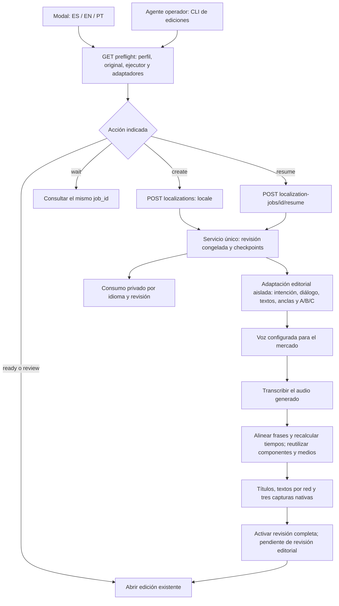

# Creación nativa de NodeTech desde la web y desde un agente

La [guía compartida de implementación](estandar-implementacion-ediciones-multilingues-2026-11.md)
consolida este flujo, los cambios posteriores y los requisitos para incorporar otros
diseños y categorías. Este informe conserva la evidencia de la integración web/CLI.

Implementación y pruebas realizadas en `alfred-server`, checkout `/home/alfred/Projects/Git-Projects/nexa-brief/nexa-brief`. Las rutas de código de este informe se refieren a ese checkout privado.

Fecha: 2026-11-12. Alcance: servidor y web privados de Nexa Brief; ES original, EN y PT-BR. No se usa Opus ni se publica en redes durante esta validación.

## Cómo funcionaba al comenzar esta revisión

La web podía pedir una edición por idioma al servicio de localización. El servicio ya extraía el original, invocaba al agente editorial aislado y dirigía voz, transcripción, alineación, escenas, títulos y tres miniaturas. La edición activa se cambiaba al terminar, conservando la anterior ante un fallo.

La entrada de consola de ediciones sólo ofrecía `show`: inspeccionaba la configuración, pero no creaba ni seguía trabajos. Faltaba una guía operativa en el índice de skills. El navegador tampoco comprobaba previamente si todos los adaptadores estaban disponibles. Un fallo en la primera llamada editorial podía no dejar checkpoints; un corte brusco podía conservar un workspace que impedía recuperar. El consumo de voz nativa podía terminar en el registro ES y el cierre no tenía atribución completa por edición.

## Cómo queda el flujo compartido



Preflight no llama a modelos, no genera medios y no reserva trabajos. Comprueba el perfil efectivo, las tres aperturas del original, el contrato de escenas, el ejecutor aislado, FFmpeg, FFprobe, el módulo de transcripción, Chromium y la configuración local de voz. No confirma cuotas externas: `quota_verified` permanece falso.

La creación verifica de nuevo esas precondiciones en el servidor. Ambos clientes reciben estados `create`, `wait`, `resume`, `review` o `ready`. El servicio coordina una sola tarea por video/idioma; la CLI adopta un trabajo existente y no reintenta automáticamente una mutación cuya respuesta se perdió. Rehacer una edición existente requiere `--new-version` explícito.

El navegador consulta el trabajo activo cada cinco segundos y la CLI cada tres segundos sólo mientras se usa `--wait`. Se detienen al terminar; cerrar la vista cancela sus consultas. Cerrar el cliente no cancela la generación que ya aceptó la API.

## Agentes, instrucciones y contratos

```text
nexa-brief-server/
├── src/skills/README.md                       # índice: entrada para ediciones nativas
├── src/skills/editions/
│   ├── SKILL.md                              # agente operador: preflight/create/status/resume
│   └── prompts/
│       ├── lead.md                           # intención, hechos, atribuciones, límites
│       ├── task.md                           # diálogo, anclas, textos y paquete A/B/C
│       └── output.schema.json                # contrato de edition.output.json
├── src/templates/_tools/design-definitions/nodetech/
│   ├── agents/edition.md                     # instrucciones específicas del diseño
│   └── identity/markets/{es-419,en-US,pt-BR}.json
├── src/core/explainer/editions/
│   ├── __main__.py + cli.py + client.py       # cliente de la misma API de la web
│   ├── service.py + readiness.py              # flujo único y requisitos previos
│   ├── agent.py + checkpoints.py              # aislamiento y recuperación
│   └── studio.py                             # estado y consumo de cada edición
└── src/templates/_tools/explainer-kit/tools/
    ├── edition_job.py                        # herramientas del host
    └── edition_usage.py                      # registro privado de intentos TTS
```

El operador usa la API; el agente editorial interior sólo recibe el workspace de datos y devuelve JSON. No ejecuta esta CLI ni herramientas TTS/STT. El host extrae la investigación existente y conserva hechos, fuentes, créditos, nombres, cifras y grados de certeza. La adaptación reescribe el gancho, la expresión, la intención y el ritmo para el mercado, sin nueva búsqueda de imágenes ni investigación.

Ejecutar en Bash, desde la raíz del repositorio privado y con la API ya iniciada en el perfil correcto:

```bash
source scripts/profile-env.sh
cd nexa-brief-server
.venv/bin/python -m src.core.explainer.editions preflight VIDEO_ID --locale pt
.venv/bin/python -m src.core.explainer.editions create VIDEO_ID --locale pt --wait
.venv/bin/python -m src.core.explainer.editions status JOB_ID --wait
.venv/bin/python -m src.core.explainer.editions resume JOB_ID --wait
```

La guía completa está en `src/skills/editions/SKILL.md`. No se leen credenciales desde el CLI ni se desactiva la autenticación. El acceso HTTP queda dentro de la API privada autorizada del operador.

## Archivos y base de datos del perfil

```text
$NEXA_PROFILE_DIR/                             # profesional, esquema 3
├── .system/runtime/localization/JOB_ID/       # staging privado mientras trabaja
│   ├── edition.json                          # contrato congelado
│   ├── usage-context.json                    # idioma/revisión para atribución
│   ├── checkpoints.json                      # incluye un punto inicial antes del primer proveedor
│   ├── agent/
│   │   ├── prompt.md + initial.usage.json
│   │   └── retry-001.*                       # conserva intentos previos al recuperar
│   └── logs/usage.jsonl                       # voz/cierre: intentos HTTP reales
├── productions/nodetech/VIDEO_ID/
│   ├── assets/ + PLAN.md + BRIEF.md           # original y su investigación
│   ├── work/localization/JOB_ID/              # workspace aislado, temporal
│   └── languages/{en-US,pt-BR}/
│       ├── active.json                       # apunta sólo a una revisión completa
│       └── revisions/rev-NNN/
│           ├── edition.json + usage-context.json + checkpoints.json
│           ├── agent/ + logs/                # privados; no expuestos por el servidor de medios
│           ├── script.json + strings.json
│           ├── song.mp3 + song-with-outro.mp3
│           ├── transcript-raw.json + lyrics.json + alignment.json
│           ├── config.json + storyboard.json + publish.json
│           ├── publication.json + config.publication.json + storyboard.publication.json
│           ├── thumbnail-A.jpg + thumbnail-B.jpg + thumbnail-C.jpg
│           ├── review.json                   # terminar no equivale a aprobar
│           └── INFORME.md                    # resultado de la revisión humana/técnica
└── data/json/                                # acceso siempre mediante DataPort
    ├── jobs.json                             # kind=localization, job_id, etapa, estado, revisión
    ├── video_localizations.json              # estado por video/mercado
    └── video_localization_revisions.json     # revisiones completadas
```

La activación mueve el staging completo a su revisión y actualiza el puntero. Recuperar mantiene el mismo `job_id` y revisión y reutiliza pasos cuyos inputs y archivos siguen coincidiendo con sus hashes. Un workspace huérfano se valida y limpia antes de ejecutar de nuevo el agente; una respuesta residual nunca pasa como salida nueva. Si el fallo estuvo en una comprobación del host y ya existe una respuesta archivada, se revalida íntegramente con el contrato, los hechos, las anclas y el paquete editorial actuales. Sólo un candidato completamente válido se recupera sin otra llamada al proveedor; un JSON mal formado se omite y no bloquea otros candidatos.

La recuperación de intentos históricos sin registro de consumo crea un contexto con `historical_usage_unattributed: true`: atribuye llamadas futuras sin inventar información del pasado. El registro separa entrada nueva, caché, salida y razonamiento; conserva uso reportado y deja costes desconocidos en `null`, sin duplicar caché ni fabricar un total de tokens.

## Fallo detectado en la prueba real y corrección

El primer intento de PT detectó falsos positivos del validador de hechos: `dois mil e um` perdía su última unidad y una mención genérica de «usuario» junto a una fecha se trataba como una cantidad de usuarios. El agente intentó una reparación acotada, pero el host seguía rechazando las expresiones. Se detuvo antes de TTS. Se corrigió el parser para conservar cardinales compuestos naturales y distinguir usuarios cuantificados de menciones genéricas; se mantienen los rechazos de cifras, porcentajes, monedas, tiempos y cambios de usuarios por registros. El JSON original archivado pasó después la validación completa, por lo que la recuperación puede continuar sin otra adaptación editorial. Los dos consumos anteriores se conservan.

## Validación y resultado real

La prueba real terminó: `pt-BR/rev-001`, trabajo `5fb616a768a64c5ba165987987a3d085`, duración final **741.16 segundos (12:21.16)**, 45 segmentos y 80 beats. Se pulsó una vez el botón de la web; el agente adoptó ese trabajo, lo recuperó por API tras el arreglo del validador y completó el flujo. Otra solicitud `create --locale pt` devolvió `reused`, sin revisión ni llamada nuevas.

Se verificaron todos los artefactos, hashes de checkpoints, tres JPG reales de 1280×720, idioma y ruta de audio del iframe, render 16:9 y 9:16, las tres pestañas y ausencia de scroll horizontal a 384 y 300 px de sidebar. El botón de grabar está habilitado. En el flujo del modal: 0 errores JS, 0 errores de consola y 0 respuestas HTTP fallidas. El login directo de desarrollo conserva un `ClientFetchError` de Auth.js previo al modal; no se cambió ni ocultó la autenticación.

ES y EN rev-005 conservaron sus hashes. El ledger ES no se modificó: su mtime es anterior al trabajo PT; los cinco intentos TTS de PT están atribuidos a su propia revisión. No se grabó MP4 ni se publicó en redes.

Validación: 61 pruebas iniciales combinadas de API/CLI/Studio/instrumentación; 33 pruebas web y TypeScript completo; después del hallazgo real, 87 casos de regresión de cifras/unidades y la nueva prueba HTTP de recuperación con JSON inválido y workspace huérfano. Ruff aprobado. Las pruebas con dobles no se presentan como consumo real ni escucha completa.

### Consumo observado

| Modelo | Llamadas | Entrada nueva | Caché | Salida | Razonamiento | Dinero reportado |
|---|---:|---:|---:|---:|---:|---|
| claude-sonnet-5-5 | 2 | 210885 | 744235 | 88845 | 60754 | USD 1.8063695, valoración de lista reportada por el CLI |
| gemini-3.8-flash-tts | 5 | 2922 | 0 | 18447 | 0 | sin dato |

La primera fila incluye la reparación por el defecto del validador ya corregido; recuperar el JSON validado no añadió llamadas editoriales. Los contadores incluyen lecturas y razonamiento de la sesión CLI. La valoración de lista no es una factura adicional de la suscripción. No se calculó un total de tokens mezclando caché, salida y razonamiento ni un coste total sin el precio real de TTS. Whisper fue local. El orquestador del chat: consumo sin dato.

### Recursos y cierre

Memoria disponible: 6271 MiB antes, mínimo observado de 2281 MiB durante Whisper y 6438 MiB tras cerrar las herramientas y el navegador. Whisper llegó a 4154 MiB RSS en la muestra, con aproximadamente 3.5 núcleos activos entre dos mediciones. Hubo unos 12 MiB adicionales de salida a swap y ninguna entrada registrada en las muestras. Al terminar no quedaron procesos editoriales, transcriptores ni Chromium de la prueba. Next principal: 2371.5 → 2364.2 MiB. La muestra comprueba liberación tras este trabajo; no demuestra ausencia de fugas en ejecuciones prolongadas.

### Revisión editorial pendiente

`completed` confirma que la generación y la activación terminaron, no que el contenido haya pasado una escucha humana completa. `review.json` conserva 9 cues proporcionales, 2 sustituciones de anclas ES de cierre, 2 ajustes por duración mínima y un cue estimado del cierre. Hay 45 discrepancias ASR crudas, muchas de grafía numérica o nombres; se debe revisar la posible omisión «retenção e acesso» en s30. También quedan observaciones sobre una fecha noviembre/diciembre de 2025 en la investigación fuente y datos de créditos ausentes. Se conservaron y no se aprobó automáticamente esta edición. Instagram conserva el texto vacío de la fuente; no se presenta como una nueva campaña editorial para esa red.

Las capturas prueban la apertura y los controles, no cada fotograma del video completo. La grabación/publicación real no fue ejecutada. La cuota y disponibilidad futuras de proveedores externos no se pueden garantizar mediante un preflight local.

Evidencia privada elegida: en el contenido del perfil, `work/results/test/native-creation-2026-11-12/`. Informe de contenido: `languages/pt-BR/revisions/rev-001/INFORME.md`. Guía de operación estándar: `src/skills/editions/SKILL.md`.

