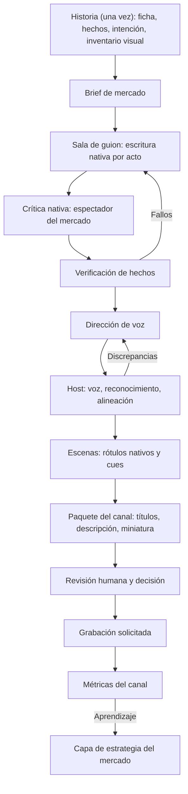

# Ediciones nativas por mercado

> Visión editorial y propuesta histórica. Para el contrato ejecutable y la adopción
> en otros diseños, consultar la
> [guía operativa de ediciones multilingües](estandar-implementacion-ediciones-multilingues-2026-11.md).
> Los pendientes y la libertad de remonte descritos aquí corresponden a distintas
> fases del proyecto: la guía actual distingue implementación, evidencia y propuestas.

Fecha de la propuesta: 2026-11-11.

**Estado comprobado el 2026-11-12:** el piloto EN de NodeTech está activo en
alfred-server y pendiente de aprobación editorial. Recuperación por etapas, selector
ES/EN/PT y pruebas verificadas; miniaturas propias y grabación por idioma siguen pendientes.
Ver [revisión, resultado y pendientes](revision-recuperacion-ediciones-nodetech-2026-11-12.md).

Relación con los otros documentos:

- [propuesta-localizacion-nodetech-2026-11.md](propuesta-localizacion-nodetech-2026-11.md)
  (informe consolidado de Codex): se mantienen sus decisiones técnicas de almacenamiento,
  registros, API, cues semánticos, voz/alineación con Whisper como base, medición de
  consumo y dimensiones de calidad. Este documento **cambia su objetivo editorial** y
  **añade la arquitectura** que pidió la persona responsable.
- [estandar-localizacion-mantenibilidad-2026-11.md](estandar-localizacion-mantenibilidad-2026-11.md):
  antecedente. Sus reglas técnicas sobre lo que llega a la IA siguen siendo válidas; su
  enfoque de "una llamada por idioma" queda descartado para la parte creativa.

---

## 1. Qué cambia con las aclaraciones

Dos requisitos nuevos de la persona responsable:

1. **Arquitectura:** mantenible en el tiempo, escalable y **elástica ante cambios
   fuertes**: el sistema y sus componentes cambiarán cada vez más.
2. **Finalidad:** contenido de calidad para **canales propios por idioma**. El doblaje de
   YouTube no basta: mantiene el video original y solo cambia el audio. Voz, guion,
   títulos, descripciones y estrategia deben tener **identidad propia en el nuevo
   idioma**, como si un equipo de ese país hubiera trabajado en el video.

Consecuencia: no se hace una **variante traducida** de un video, sino una **edición
nativa para un mercado**. La historia, la investigación y los medios son los mismos;
el guion, la voz, el gancho y la publicación se escriben para ese público con las mismas
estrategias que hacen crecer el canal en español.

| | Traducción / adaptación | Edición nativa |
| --- | --- | --- |
| Punto de partida | El guion en español | La historia (investigación, intención, medios); el guion en español es referencia |
| Quién escribe | Un adaptador que conserva cada frase | Un equipo de guion del mercado que aplica la estrategia narrativa |
| Gancho y títulos | Traducidos | Creados con las estrategias de título del mercado |
| Voz | Una voz en otro idioma | Voz con identidad del canal de ese mercado y dirección por segmento |
| Segmentos | Uno a uno, mismos IDs | Pueden dividirse o unirse dentro de un acto, con trazabilidad |
| Publicación | Textos traducidos | Paquete propio del canal (título, descripción, etiquetas, comentario fijado, miniatura) |
| Aprendizaje | Ninguno | Las métricas de cada canal mejoran las estrategias de ese mercado |

Lo que **no** cambia: hechos, cifras, atribuciones, tesis, orden de los actos y medios
aprobados. Se puede escribir distinto, no afirmar distinto.

---

## 2. Por qué la traducción literal mata la tracción

Evidencia en el propio sistema:

- Las estrategias están escritas para el español. `title_anchor_tension_v1.json` usa
  plantillas como `"{N} segundos para {acción}"` o `"Creyeron que {X} en {tiempo corto}"`,
  y la narrativa `amarillista` incluye ejemplos y reglas de voz en español. Traducirlas no
  las convierte en estrategias que funcionen en inglés o portugués.
- El guion ya contiene dirección emocional por segmento (`act`, `tone`, `intensity`,
  `delivery_note`) y una `voice_direction` global ("alarma contenida al abrir… 130
  palabras por minuto"). Esa dirección debe reescribirse para el idioma, no copiarse.
- El ritmo, los conectores, las preguntas retóricas y la forma de generar tensión
  cambian entre mercados. Un gancho eficaz en español puede sonar exagerado o plano en
  inglés.

---

## 3. Modelo de dominio estable

La elasticidad ante cambios depende de tener **pocos conceptos centrales que casi nunca
cambian**. Todo lo demás (proveedores, motores, estrategias, idiomas, canales) se
conecta como pieza intercambiable.

| Concepto | Qué es | Cambia | Ejemplo |
| --- | --- | --- | --- |
| **Historia** (`Story`) | Investigación, hechos, intención por acto y segmento, inventario visual. Sin idioma. | Muy poco | "Tus chats ante un juez" |
| **Mercado** (`Market`) | Idioma, acento, convenciones de escritura y de plataforma | Poco | `en-US`, `pt-BR`, `es-419` |
| **Canal** (`Channel`) | Identidad de marca en un mercado: nombre, voz, tono, cierre, CTA | Poco | NodeTech EN |
| **Estrategia** (`Strategy`) | Paquete versionado de reglas creativas (narrativa, título, miniatura, descripción) con capas por mercado | A menudo, por datos | `title_anchor_tension_v1` + capa `en` |
| **Edición** (`Edition`) | Historia × canal: guion, voz, escenas y publicación de ese mercado, con revisiones | Por cada producción | NodeTech EN, rev-002 |
| **Motor** (`Engine`) | Diseño que convierte una edición en video | A menudo | rough, common, atlas |
| **Etapa** (`Stage`) | Unidad de trabajo con entradas y salidas declaradas | A veces | escribir guion, voz, alinear |

Regla clave: **el español también es una edición.** La producción actual en español es
la primera edición de una historia. Así no existen dos sistemas (producir y traducir):
hay un solo flujo que produce ediciones, con la investigación hecha una vez.

---

## 4. Arquitectura para las tres cualidades

### 4.1 Mantenibilidad

- **M-01 Módulos por concepto del dominio**, no por tecnología: `story`, `markets`,
  `channels`, `strategies`, `editions`, `engines`. Cada uno con interfaz pública pequeña,
  `README.md` breve y pruebas propias.
- **M-02 Dependencias hacia el centro.** El dominio no importa proveedores, motores ni la
  API. Una prueba de importaciones lo comprueba.
- **M-03 Contratos versionados.** Todo JSON lleva `schema` con versión. Cada versión
  nueva trae su migración (`upcaster`) y una prueba con datos antiguos.
- **M-04 Decisiones registradas (ADR).** Cada decisión de arquitectura queda en un
  archivo corto en `docs/adr/` (contexto, decisión, alternativas, consecuencias). Evita
  que una IA deshaga una decisión que no conoce y reduce lo que hay que leer.
- **M-05 Un documento vigente por tema.** Los antecedentes se marcan como tales y no
  contienen estructuras contradictorias sin aviso.
- **M-06 No crecer los monolitos.** `producer.py` (1227 líneas) y el router del explainer
  solo reciben puntos de integración. Toda lógica nueva vive en su módulo.

### 4.2 Escalabilidad

- **E-01 Mercados, canales, estrategias y motores son datos o implementaciones
  registradas.** Añadir PT-BR, FR o un canal nuevo no modifica código del núcleo.
- **E-02 Trabajo por etapas en cola.** Cada etapa es un trabajo independiente, sin estado
  en memoria, que lee y escribe artefactos del perfil por ID. Se reanuda tras una caída.
- **E-03 Clases de recurso con límites propios:** IA (llamadas en paralelo moderado), TTS
  (cuota del proveedor), alineación y transcripción (CPU, en serie en el i3), grabación
  (pesada, en serie). Una edición no bloquea a otra salvo en el recurso compartido.
- **E-04 Trabajadores intercambiables.** Como cada etapa solo necesita artefactos e IDs,
  más adelante puede ejecutarse en otra máquina (equipo local, alfred-server,
  ever-server) sin rediseño. No se implementa ahora; se evita impedirlo.
- **E-05 Persistencia detrás de `DataPort`.** JSON por secciones hoy; un adaptador SQL
  cuando el volumen lo pida, sin tocar el dominio.
- **E-06 Costo proporcional a lo que cambia.** Caché por hash de entradas en cada etapa:
  cambiar un rótulo no regenera la voz; cambiar una estrategia de título no reescribe
  el guion.

### 4.3 Elasticidad ante cambios fuertes

- **C-01 Todo lo externo detrás de un puerto:** modelo de texto, TTS, transcripción,
  alineación, generación de imágenes, publicación. Cambiar de proveedor es un adaptador
  nuevo y una línea en `roles.json`.
- **C-02 Motores detrás de una capa anticorrupción** (`LocalizableEngine` y el contrato de
  escenas del informe consolidado). Un motor nuevo o muy distinto (NodeMotion, mapas 3D)
  implementa el contrato; el resto del sistema no se entera.
- **C-03 Las estrategias son datos versionados, no código.** Una edición fija la versión
  de estrategia con la que se produjo; cambiar la estrategia vigente no altera ediciones
  publicadas y permite comparar versiones.
- **C-04 Etapas insertables.** El flujo es una lista de etapas con entradas y salidas
  declaradas. Añadir una etapa (por ejemplo, regenerar imágenes con texto) no modifica
  las demás. Se reutiliza `src/core/pipeline.py` si encaja, sin crear un marco genérico
  antes de necesitarlo.
- **C-05 Activación gradual.** Cada mercado, canal y etapa nueva tiene interruptor en la
  configuración del perfil. Se prueba en un canal antes de abrirlo a todos.
- **C-06 Pruebas que protegen el comportamiento,** no la implementación: pruebas de
  contrato de puertos y motores, pruebas de oro con entradas fijadas, y la garantía de
  que la edición en español sigue igual.

### 4.4 Estructura propuesta

```text
src/core/
├── story/                 # Historia: ficha editorial, hechos, intención, inventario visual
├── markets/               # registro único de mercados (absorbe core/metadata/language.py)
├── channels/              # identidad por canal y mercado (lee config del perfil)
├── strategies/            # resolución de estrategia + capa de mercado + versión fijada
├── editions/              # servicio de ediciones: etapas, revisiones, activación
│   └── stages/            # una carpeta por etapa: write, critique, voice, align, visuals, publish
├── ports/                 # existentes (ai, voice, lyrics) + alignment, image si hace falta
└── explainer/localization/ → integración con el kit y el motor (informe consolidado)

src/skills/
├── explainer/strategies/  # existentes + carpeta markets/<locale>/ por estrategia
└── editions/              # prompts versionados por rol (sección 6)

NEXA_PROFILE_DIR/config/
├── markets.json           # mercados habilitados en el perfil
└── channels/<canal>.json  # biblia del canal por mercado (sección 5)
```

El almacenamiento de revisiones, registros y la API siguen el informe consolidado
(secciones 11 y 14), renombrando "variante" a "edición".

La separación entre núcleo, diseño, identidad de voz y personalidad, y formato (duración
y tipo de video) se detalla en la **Parte 2** (secciones 14 a 21). Esa parte manda sobre
la estructura de esta sección donde difieran.

---

## 5. Identidad por canal y mercado

### 5.1 Biblia del canal

Cada canal de cada mercado tiene un archivo de identidad. Es lo que da carácter propio y
consistente a todos sus videos:

```json
{
  "schema": "nexa.channel/1",
  "channel_id": "nodetech-en",
  "market": "en-US",
  "brand_name": "NodeTech",
  "persona": "Narrador cercano y preciso; curioso, nunca sensacionalista sin respaldo",
  "voice": { "provider_role": "voice_premium", "voice_id": "…", "pace_wpm": 150,
             "range": "contenida en el gancho, cálida en el cierre",
             "lexicon_ref": "lexicon/en-US.json" },
  "writing": { "register": "conversational", "sentence_length": "short-medium",
               "humor": "dry, occasional", "avoid": ["clickbait sin respaldo", "modismos británicos"] },
  "hook_style": "pregunta directa o contradicción en los primeros 8 segundos",
  "cta": "…", "outro_ref": "outro/nodetech-en-v1",
  "title_rules": { "case": "Title Case", "max_chars": 60 },
  "thumbnail_text": { "max_words": 4, "case": "UPPER" },
  "strategies": { "narrative": "amarillista_v2", "title": "anchor_tension_v1",
                  "description": "nine_blocks_v1" }
}
```

- **I-01** La voz es parte de la marca: una voz fija por canal, elegida escuchando
  pruebas en ese idioma, con su léxico de pronunciación (nombres, siglas, marcas).
- **I-02** El cierre, la CTA y la fórmula de presentación del canal se escriben de forma
  nativa una vez y se reutilizan.
- **I-03** Si el proveedor actual no da una voz con suficiente identidad en un idioma,
  se añade otro adaptador de voz para ese canal. La arquitectura lo permite (C-01) sin
  cambiar el flujo.

### 5.2 Capas de estrategia por mercado

Cada estrategia conserva su **intención universal** y recibe una **capa de mercado**:

```text
src/skills/explainer/strategies/title/
├── title_anchor_tension_v1.json          # intención, emociones, estructura (universal)
└── markets/
    ├── en-US.json                        # plantillas, ejemplos y reglas nativas en inglés
    └── pt-BR.json
```

- **S-01** Universal: qué emoción busca, qué estructura tiene (ancla + tensión + detalle),
  qué está prohibido (prometer algo que el video no confirma).
- **S-02** Capa de mercado: plantillas escritas en el idioma, ejemplos reales de
  referencia de ese mercado, convenciones (mayúsculas, longitud, palabras de poder,
  signos), y lo que suena falso o exagerado allí.
- **S-03** Las capas se crean una vez por mercado, con ejemplos de referencia de canales
  exitosos de ese mercado y revisión. No se generan traduciendo la estrategia española.
- **S-04** Sin capa de mercado aprobada, la estrategia no se usa en ese mercado: la
  edición queda bloqueada en lugar de producir un resultado mediocre.

---

## 6. El equipo de la edición: etapas y roles

Cada edición pasa por un "equipo" de roles. Son etapas con contrato, no necesariamente
un agente por rol.



### 6.1 Brief de mercado (1 llamada, modelo medio)
Qué necesita este público para entender la historia (contexto local que el original da
por sabido, por ejemplo una institución argentina), qué analogías o encuadres resuenan,
qué evitar. **Puede añadir contexto explicativo marcado, nunca hechos nuevos.**

### 6.2 Sala de guion (1 llamada por acto, modelo fuerte)
- Recibe: ficha editorial, hechos del acto, intención por segmento, brief de mercado,
  biblia del canal, estrategia narrativa con su capa de mercado, y el guion en español
  **como referencia de contenido, no como texto a traducir**.
- Escribe el acto de forma nativa: gancho, ritmo, transiciones, preguntas retóricas.
- Puede dividir o unir segmentos **dentro del acto**; cada segmento nuevo declara de qué
  segmentos de origen y qué hechos procede (`from: ["s12"]`, `facts: ["fact-07"]`).
- Reescribe `tone`, `intensity` y `delivery_note` en el idioma, para la voz del canal.
- **Marca en línea dónde aparece cada escena** (por ejemplo `⟦scene-018⟧` antes de la
  palabra que la dispara). El host retira las marcas antes de la voz y las ubica con la
  alineación. Así el que escribe decide la sincronización semántica sin una etapa extra
  de storyboard.

### 6.3 Crítica nativa (1 llamada, modelo fuerte distinto si es posible)
Lee el guion completo **como espectador del mercado**: fuerza del gancho en los primeros
segundos, puntos donde se abandonaría el video, frases que suenan traducidas o robóticas,
coherencia con la identidad del canal. Devuelve puntuación por dimensión y cambios
concretos por segmento. Usar un modelo distinto del escritor reduce el sesgo de
autoevaluación.

### 6.4 Verificación de hechos (código primero, IA solo si hace falta)
- Código: cifras, fechas, nombres, atribuciones y glosario de cada segmento contra
  `facts.json`; todos los hechos de origen presentes; nada sin procedencia.
- IA (modelo económico): solo los segmentos marcados, para comprobar grado de certeza y
  matices ("podría" frente a "va a").
- Reparación acotada a los segmentos fallidos, con un tope de iteraciones.

### 6.5 Dirección de voz y voz
- La dirección por segmento escrita en 6.2 va al TTS con la voz y el léxico del canal.
- El host genera la voz por bloques, reconoce lo dicho (Whisper como base, según el
  informe consolidado), alinea y compara con el guion.
- Métricas automáticas de interpretación: velocidad por segmento, pausas, volumen,
  variación de intensidad frente a la indicada. Un segmento plano o atropellado se
  regenera solo él.

### 6.6 Escenas
- Los rótulos visibles se escriben como textos de pantalla nativos (breves, con el
  registro del canal), no como traducción de la narración.
- Los tiempos salen de las marcas en línea y la alineación. Las proporciones solo como
  respaldo marcado.
- Imágenes con texto incrustado: si el diseño lo permite, se regeneran con el texto del
  mercado mediante la generación de imágenes del servidor; si no, se reporta.

### 6.7 Paquete del canal
Títulos (varias opciones para prueba A/B), descripción, etiquetas, comentario fijado,
texto de miniatura y capítulos con los tiempos del audio nuevo, **generados con las
estrategias y la capa del mercado**, no traducidos del paquete español. Comprobación de
que el título promete lo que el video confirma.

### 6.8 Revisión humana
La persona responsable habla español. Para que pueda decidir sobre una edición en otro
idioma:
- Resumen en español de qué dice cada acto de la edición (retrotraducción de sentido,
  no literal) y de las diferencias con el original.
- Tabla de puntuaciones de la crítica, verificación y voz.
- Escucha de la edición completa.
- Para los primeros videos de cada mercado se recomienda una revisión de un hablante
  nativo; sin ella, la edición se marca como no revisada por un nativo, no como aprobada.

### 6.9 Aprendizaje por canal
Las métricas de cada canal (ya sincronizadas por `ChannelCatalogPort`) se relacionan con
la versión de estrategia, el estilo de título y el gancho de cada edición. Con datos
suficientes, se propone una nueva versión de la capa de mercado y se compara con la
anterior. Así cada mercado mejora con sus propios resultados, no con los del español.

---

## 7. Qué llega a la IA y qué no

### Llega (porque crea valor creativo)
- Ficha editorial, hechos e intención del acto (no el PLAN completo).
- Brief de mercado y biblia del canal.
- Estrategia con su capa de mercado, solo las partes que usa la etapa.
- Guion en español del acto como referencia.
- Para la crítica: el guion nuevo completo, en texto plano.
- Para escenas: rótulos, intención de la escena y límites de caracteres.

### No llega
- JSON completos del motor (`storyboard`, `config`, `manifest`), parámetros técnicos,
  rutas, colores, tiempos, transcripciones por palabra.
- Notas internas de producción (`shows`, `query`, `media_review`).
- Código del motor o de componentes.
- Rutas del perfil, cuentas, credenciales.
- Lo que ya está en caché y sigue vigente.

---

## 8. Tokens: invertir en lo creativo, ahorrar en lo demás

La calidad nativa necesita modelos fuertes en las etapas creativas. El ahorro no sale de
recortar esas etapas, sino de no gastar en lo que no aporta.

- **T-01 Historia una vez.** La ficha, los hechos y la intención se extraen una vez y
  sirven para todas las ediciones y mercados.
- **T-02 Prefijo común en caché.** Historia, ficha, hechos y estrategia universal van al
  inicio de cada petición; mercado, canal y acto al final. Producir EN y PT-BR seguidos
  reutiliza el prefijo.
- **T-03 Texto plano, no JSON del motor.** La IA nunca ve estructura técnica.
- **T-04 Modelo por rol en `roles.json`:** fuerte para guion y crítica; medio para brief
  y paquete; económico para verificación de matices y resúmenes de revisión.
- **T-05 Reparaciones acotadas** a segmentos con fallo y con tope de iteraciones.
- **T-06 Caché por etapa.** Cambiar el título no reescribe el guion; cambiar un rótulo
  no regenera la voz.
- **T-07 Lo fijo del canal se escribe una vez:** cierre, CTA, fórmulas de presentación,
  léxico.
- **T-08 Medir antes de prometer.** El piloto registra por etapa entrada, salida, caché,
  reintentos, costo y calidad. Orientativamente, una edición de 12 minutos debería
  quedar en el orden de unas pocas decenas de miles de tokens; la cifra real la da el
  piloto.

Para los agentes que programan (Codex, Claude):

- **T-09** `README.md` corto por módulo y ADR por decisión: el agente lee el módulo que
  toca, no el sistema.
- **T-10** Briefs con objetivo, archivos permitidos, reglas citadas por ID (`I-01`,
  `C-03`), criterio de aceptación y comando de prueba.
- **T-11** Pruebas rápidas por módulo, sin levantar la API ni grabar.

---

## 9. Calidad: cómo se mide una edición

| Dimensión | Cómo se comprueba | Bloquea |
| --- | --- | --- |
| Fidelidad | Código contra `facts.json` + verificación de matices | Sí |
| Naturalidad | Crítica nativa + revisión humana o nativa | Sí, si es baja |
| Fuerza del gancho y retención | Crítica nativa con la estrategia del mercado | Advertencia |
| Identidad del canal | Crítica contra la biblia del canal | Advertencia |
| Voz | Discrepancias, métricas de interpretación, escucha | Sí, si hay discrepancias |
| Sincronización | Marcas en línea resueltas, sin escenas huérfanas | Sí |
| Diseño | Capturas 16:9 y 9:16, desbordes | Sí |
| Publicación | Título coherente con el video, capítulos con tiempos nuevos | Sí |

Ninguna edición se publica sin revisión humana registrada.

---

## 10. Riesgos y cómo se controlan

| Riesgo | Control |
| --- | --- |
| Más libertad creativa introduce errores de hechos | Cada segmento declara sus hechos; verificación por código; reparación acotada |
| La IA "mejora" el gancho exagerando | Regla universal de la estrategia y crítica: el título promete solo lo que el video confirma |
| Voz sin identidad en un idioma | Elección por escucha; adaptador de voz alternativo por canal |
| Capas de mercado mediocres | Creación con referencias reales del mercado y revisión; sin capa aprobada, no se produce (S-04) |
| La persona no puede juzgar el idioma | Resumen de sentido en español, puntuaciones, revisión nativa en los primeros videos |
| Costo mayor que una traducción | Inversión solo en etapas creativas; medición por etapa; topes |
| Divergencia entre ediciones al corregir el original | La edición fija la revisión de la historia; un cambio la marca como desactualizada |

---

## 11. Hoja de ruta

Las fases técnicas del informe consolidado se mantienen; se añaden las piezas de
identidad y escritura nativa.

| Fase | Entrega | Aceptación |
| --- | --- | --- |
| 0. Decisiones | Mercados iniciales, canales, criterio de revisión nativa; ADR de "edición nativa" | Decisiones registradas |
| 1. Núcleo y compatibilidad | `markets`, `VariantContext`/`EditionContext`, propagación de idioma en el kit | El español produce igual que hoy |
| 2. Historia | Extracción de ficha, hechos, intención por segmento e inventario visual del ejemplo | Ficha revisada; hechos con procedencia |
| 3. Identidad EN | Biblia del canal EN, voz elegida por escucha, léxico, cierre; capas `en-US` de narrativa y título | Capas revisadas con referencias del mercado |
| 4. Sala de guion EN | Escritura por acto, crítica nativa, verificación, resumen en español | Guion EN aprobado por la persona; costo medido |
| 5. Voz y escenas EN | Voz del canal, reconocimiento, alineación, marcas en línea, rótulos | Edición completa visible en ambas orientaciones |
| 6. Paquete del canal EN | Títulos A/B, descripción, miniatura, capítulos | Paquete coherente con la edición |
| 7. Persistencia, API y web | Según informe consolidado, con "edición" como concepto | Sin mezclas entre ediciones |
| 8. PT-BR | Biblia, voz y capas `pt-BR` | Añadir un mercado no cambia código del núcleo |
| 9. Aprendizaje | Relación métricas ↔ versión de estrategia por canal | Propuesta de nueva capa basada en datos |

Esta tabla queda reemplazada por la hoja de ruta de la sección 20, que incorpora las
capas de identidad y el formato de video corto animado.

---

## 12. Decisiones pendientes

1. **Mercados iniciales:** ¿`en-US` y `pt-BR`? ¿Algún otro antes?
2. **Canales:** ¿nombre de marca igual (NodeTech) o adaptado por mercado?
3. **Voz:** ¿se acepta pagar un proveedor de voz premium por canal si la voz actual no
   tiene identidad suficiente en inglés o portugués?
4. **Revisión nativa:** ¿habrá un hablante nativo para los primeros videos de cada
   mercado, o se acepta publicar con revisión de IA más la de la persona responsable?
5. **Libertad editorial:** ¿se permite dividir y unir segmentos dentro de un acto, y
   añadir contexto explicativo marcado para el público extranjero? (Esta propuesta
   recomienda que sí.)
6. **Ejecución:** ¿Codex implementa por fases y Claude revisa?

Decisiones adicionales sobre identidad y formatos: sección 21.

---

## 13. Lista de comprobación por entrega

- [ ] El cambio vive en un módulo del dominio o justifica tocar más.
- [ ] Respeta la dirección de dependencias y tiene pruebas de contrato.
- [ ] Ningún proveedor, motor, mercado o canal está fijado en código del núcleo.
- [ ] Contratos versionados con migración si cambian.
- [ ] La edición en español sigue igual.
- [ ] Nada de la lista "No llega" se envía a la IA.
- [ ] Las etapas creativas usan estrategia con capa de mercado aprobada.
- [ ] Se registran tokens, modelo y costo por etapa.
- [ ] README del módulo y ADR actualizados si hubo decisión.

---

# Parte 2. Núcleo, diseño, identidad y formato

Añadida el 2026-11-11. Responde a cuatro necesidades:

1. Cada diseño o plantilla cubre un tema y debe tener **su propia identidad**: voz,
   personalidad, forma de hablar y de expresarse. Esa identidad es la marca personal de
   la cuenta.
2. Esa identidad debe existir **en cada idioma**, no solo en español.
3. Lo global (lo que todos los diseños usan o pueden usar) va en el núcleo; lo propio de
   cada diseño va junto al diseño.
4. Habrá **otros tipos de video**, por ejemplo cortos de 3 a 4 minutos, solo con
   animaciones y sin imágenes. Duración modificable. Esos cambios deben afectar una sola
   parte del sistema.

---

## 14. Dónde está hoy el motor de NodeTech y qué contiene

NodeTech usa el diseño **`rough`** (nombre visible "PROTOTIPO", dibujo a mano con
rough.js). El `script.json` del video de ejemplo declara `"design": "rough"`. Sus piezas
están repartidas en varios lugares:

| Lugar | Qué contiene |
| --- | --- |
| `src/templates/_tools/explainer-kit/engine/` | Motor compartido por todos los diseños: `kit.js`, `player.js`, `loader.js` |
| `src/templates/_tools/explainer-kit/designs/rough/` | Código y estilo del diseño: `design.json`, `DESIGN.md`, `QUICK.md`, `components/` (shapes, ui, extra, sketches, intros, outros) |
| `src/templates/_tools/explainer-kit/designs/common/` | Componentes que comparten varios diseños: tabloid, question, hook, clip, text, logo |
| `src/templates/_tools/design-definitions/rough/` | Definición v3: `design.json` (id, categoría `nodetech`, estado) y `catalog.json` (88 KB, parámetros de cada componente) |
| `src/skills/explainer/categories/node_tech.json` | Canal, emoción, anclas, títulos preferidos, qué evitar, hashtags |
| `src/skills/explainer/active.json` y `strategies/` | Estrategias de título, miniatura, descripción, etc. por categoría |
| `src/templates/_tools/explainer-kit/outro/channels.json` y `outro/voices/` | Textos del cierre por canal y audio del cierre por voz |
| `src/templates/_tools/explainer-kit/lengths.json` | Duraciones, cantidades por minuto y formatos cortos |
| `src/templates/_tools/explainer-kit/production-policy.json` | Límites de agentes y políticas de medios por estilo |

### 14.1 Qué hay dentro de `designs/rough/design.json`

Mezcla cuatro responsabilidades distintas en un solo archivo:

| Responsabilidad | Campos actuales | ¿Es del diseño visual? |
| --- | --- | --- |
| Estilo visual | `palette`, `fonts`, `rough.boil`, `clip`, `transition`, `captions`, `scripts` | Sí |
| Identidad del canal | `channel.name: "PROTOTIPO"`, `channel.handle`, `channel.language: "es-419"`, y en `defaults.outro`: `channel: "NODETECH"`, `thanks: "gracias por ver"`, `cta: "SUSCRÍBETE"` | No |
| Voz | `voice.voice: "Sadaltager"`, alternativas, modelos de TTS, `base` (prompt de narrador en español), `target_wpm: [120, 138]` | No |
| Política de medios | `media.photos`, `media.per_video: [4, 8]` | Depende del formato |

### 14.2 Problemas que esto provoca

- **El nombre del canal está en 4 lugares** y no coincide: `design.json → channel.name`
  dice "PROTOTIPO", `design.json → defaults.outro.channel` dice "NODETECH",
  `outro/channels.json` tiene su propia entrada `nodetech` y `categories/node_tech.json`
  tiene `channel: "NodeTech"`.
- **La voz y los textos del cierre están en español dentro del diseño visual.** Para
  hacer NodeTech en inglés habría que tocar el archivo del diseño, y eso afecta a todos
  los videos que lo usan.
- **La identidad hoy es débil:** los 15 diseños declaran `es-419` y 14 usan la misma voz
  (Charon) con rangos de velocidad casi iguales. Solo `rough` usa otra voz (Sadaltager).
- **La duración es global:** `lengths.json` fija `min_minutes: 5`, así que un video de 3
  o 4 minutos no es posible fuera de los formatos especiales `short_map` y
  `short_preparation` (2 minutos), que están metidos dentro del archivo de duraciones.
- Lo consumen varios lectores: `tools/narrate.py`, `outro.py`, `narrative_check.py`,
  `lengths.py`, `kit.py` y `src/core/explainer/designs.py` leen la voz; `producer.py`,
  `publishing/strategies.py` y `outro.py` leen categorías y canales;
  `src/core/explainer/lengths.py` aplica el mínimo de minutos.

---

## 15. Modelo de capas

Cada video se arma combinando capas independientes. Cada capa responde una sola
pregunta y se puede cambiar sin tocar las demás.

| Capa | Pregunta que responde | Dónde vive | Quién la cambia |
| --- | --- | --- | --- |
| **Núcleo** | ¿Qué conceptos, contratos y reglas comparten todos? | `src/core/` + esquemas | Desarrollo, rara vez |
| **Motor** | ¿Cómo se reproduce y graba una escena? | `explainer-kit/engine/` | Desarrollo, rara vez |
| **Diseño** | ¿Cómo se ve? Componentes, paleta, tipografía, ritmo visual | `explainer-kit/designs/<id>/` (código) + `design-definitions/<id>/` (declaración) | Al crear o mejorar un diseño |
| **Identidad** | ¿Quién habla y cómo? Personalidad, voz, forma de expresarse, en cada idioma | `design-definitions/<id>/identity/` | Al definir la marca del diseño |
| **Formato** | ¿Qué tipo de video? Duración, estructura, medios permitidos | `src/skills/formats/` (global) + capacidades en cada diseño | Al crear un tipo de video |
| **Categoría** | ¿Qué reglas editoriales tiene el tema? | `src/skills/explainer/categories/` | Al ajustar el tema |
| **Estrategia** | ¿Qué técnica creativa se usa? Narrativa, títulos, miniaturas | `src/skills/explainer/strategies/` + capas de mercado | Por datos y pruebas |
| **Mercado** | ¿Qué idioma y convenciones? | `src/core/markets/` | Al abrir un idioma |
| **Canal (cuenta)** | ¿En qué cuenta se publica y qué ajustes propios tiene? | Perfil: `config/channels/<canal>.json` | La persona, por cuenta |
| **Episodio** | ¿Qué excepción necesita este video concreto? | Carpeta de la producción | Por video, mínimo |

Regla de oro: **una capa nunca guarda datos de otra.** El diseño no guarda la voz; la
identidad no guarda colores; el formato no guarda el nombre del canal.

---

## 16. La identidad de cada diseño (voz y personalidad por idioma)

### 16.1 Dónde vive y por qué

Cada diseño tiene su carpeta de identidad **junto a su definición**, separada del
archivo visual:

```text
src/templates/_tools/design-definitions/rough/
├── design.json              # existente: id, estado, categoría
├── catalog.json             # existente: componentes y parámetros
├── localizable.json         # NUEVO: qué campos se traducen (informe consolidado)
├── formats.json             # NUEVO: formatos que soporta y cómo (sección 17)
└── identity/                # NUEVO: quién habla y cómo
    ├── persona.json         # personalidad universal, sin idioma
    └── markets/
        ├── es-419.json      # expresión, voz y textos en español
        ├── en-US.json       # expresión, voz y textos en inglés
        └── pt-BR.json
```

Motivos:

- Vive en el repositorio, versionada, junto al diseño que la usa: cada plantilla trae su
  identidad "de fábrica".
- Está separada del código visual (`explainer-kit/designs/rough/`): cambiar la voz no
  toca componentes, y cambiar un componente no toca la voz.
- Añadir un idioma es añadir un archivo en `markets/`, sin modificar los demás.
- La cuenta del perfil (sección 18) puede ajustar detalles sin copiar la identidad.

### 16.2 Personalidad universal (`persona.json`)

Lo que la marca **es**, igual en todos los idiomas:

```json
{
  "schema": "nexa.persona/1",
  "persona_id": "rough-prototipo",
  "archetype": "El inventor curioso que te explica cómo funciona el mundo moderno",
  "traits": ["curioso", "preciso", "cercano", "con energía contenida"],
  "values": ["no exagerar lo que no está probado", "hacer sentir al espectador que entiende"],
  "relationship_with_viewer": "un amigo que sabe de tecnología y te avisa de lo que te afecta",
  "emotional_range": { "hook": "alarma contenida", "middle": "explicativo", "close": "cálido" },
  "humor": "seco y ocasional, nunca a costa del espectador",
  "never": ["imitar a una persona real", "tono de vendedor", "sensacionalismo sin respaldo"]
}
```

### 16.3 Expresión y voz por idioma (`markets/<locale>.json`)

Cómo se **expresa** esa personalidad en cada idioma:

```json
{
  "schema": "nexa.identity-market/1",
  "persona_id": "rough-prototipo",
  "market": "en-US",
  "status": "draft",
  "voice": {
    "provider_role": "voice_narration",
    "voice_id": "…elegida por escucha…",
    "alternatives": ["…"],
    "direction": "Clear, curious tech narrator with contained energy. Neutral American accent…",
    "target_wpm": [140, 160],
    "lead": 1.2,
    "tail": 6.0,
    "lexicon_ref": "lexicon/en-US.json",
    "outro_audio_ref": "outro/en-US/<voz>.mp3"
  },
  "expression": {
    "register": "conversational",
    "sentence_length": "short-medium",
    "rhetorical_devices": ["direct question", "contrast", "you-centered framing"],
    "signature_phrases": ["…propias del idioma, no traducidas…"],
    "avoid": ["britishisms", "corporate jargon"]
  },
  "texts": {
    "outro": { "thanks": "THANKS FOR WATCHING", "cta": "SUBSCRIBE", "support": "…" },
    "intro_formula": "…"
  },
  "examples": [
    { "kind": "hook", "text": "…ejemplo de referencia escrito en inglés…" }
  ]
}
```

- **ID-01** La voz se elige escuchando pruebas en ese idioma; `status` pasa de `draft` a
  `approved` solo tras esa escucha.
- **ID-02** Las frases propias, el registro y los ejemplos se escriben en el idioma, no
  se traducen del español.
- **ID-03** Un diseño sin identidad aprobada en un mercado no produce en ese mercado.
- **ID-04** El cierre (`outro`) toma sus textos y audio de aquí, no de `design.json` ni de
  `outro/channels.json`.
- **ID-05** Varios diseños pueden compartir una persona (por ejemplo dos estilos
  visuales para NodeTech) apuntando al mismo `persona_id`.

### 16.4 Qué sale de `design.json` del diseño

| Campo actual | Destino |
| --- | --- |
| `channel.*` | Identidad (`markets/<locale>.json`) y cuenta del perfil |
| `voice.*` | `identity/markets/<locale>.json → voice` |
| `defaults.outro.thanks / cta / support / channel / handle` | `identity/markets/<locale>.json → texts.outro` y cuenta |
| `defaults.outro.enabled / use / dur` | Se queda en el diseño (es visual) |
| `media.per_video` | Formato (sección 17) |
| Paleta, fuentes, componentes, ritmo visual | Se queda en el diseño |

---

## 17. Formatos de video (duración y tipo)

### 17.1 Qué es un formato

Un formato define **qué tipo de video** se produce, independiente del diseño visual y
del idioma. Es global: todos los diseños pueden soportarlo si declaran cómo.

```text
src/skills/formats/
├── README.md
├── documental-largo.json      # el actual: 5 a 60 min, fotos y clips, capítulos
├── animado-corto.json         # NUEVO: 3 a 4 min, solo animaciones, sin imágenes
└── short-mapa.json            # migrado desde lengths.json → formats.short_map
```

Ejemplo de `animado-corto.json`:

```json
{
  "schema": "nexa.format/1",
  "format_id": "animado-corto",
  "label": "Corto animado",
  "duration_seconds": { "min": 150, "default": 210, "max": 270, "step": 15 },
  "structure": {
    "acts": [3, 4],
    "hook_max_seconds": 5,
    "chapters": false,
    "ending": "pregunta o cierre en bucle"
  },
  "media": { "photos": false, "clips": false, "generated_images": false, "only_components": true },
  "density": { "segments_per_minute": [5, 7], "scenes_per_minute": [10, 16] },
  "voice": { "wpm_factor": 1.05 },
  "narrative": { "strategy_variant": "short" },
  "publication": { "chapters": false, "description_variant": "short" },
  "aspects": ["9:16", "16:9"]
}
```

- **F-01** La duración es un **parámetro dentro del rango del formato**. "3 minutos" o
  "4 minutos" no son formatos distintos: es el mismo formato con otro valor, que se
  puede cambiar por video o por cuenta.
- **F-02** Las cantidades (segmentos, escenas, palabras) se calculan a partir de la
  duración elegida, la densidad del formato y la velocidad de la voz de la identidad.
  Así un minuto en inglés y uno en español tienen las palabras correctas para cada voz.
- **F-03** `lengths.json` se convierte en el formato `documental-largo` y sus formatos
  cortos pasan a su propio archivo. `src/core/explainer/lengths.py` lee el formato
  elegido en lugar de un mínimo global de 5 minutos.
- **F-04** El formato elige variantes de estrategia (`short` para narrativa y
  descripción) en lugar de duplicar estrategias.

### 17.2 Cómo lo soporta cada diseño (`formats.json`)

```json
{
  "schema": "nexa.design-formats/1",
  "design_id": "rough",
  "supports": {
    "documental-largo": { "status": "approved" },
    "animado-corto": {
      "status": "draft",
      "components": ["rough.title", "rough.icon", "rough.flow", "rough.compare",
                     "rough.counter", "common.punch", "common.question"],
      "excluded": ["rough.photo", "common.clip"],
      "visual_rhythm": { "scene_seconds": [2, 4] }
    }
  }
}
```

- **F-05** Un diseño solo produce en los formatos que declara como `approved`.
- **F-06** Para `animado-corto`, el diseño declara el subconjunto de componentes sin
  imágenes. La validación rechaza cualquier escena con foto o clip.
- **F-07** Añadir el formato corto a otro diseño es escribir su entrada en `formats.json`,
  sin tocar el formato ni el núcleo.

### 17.3 Por qué el corto animado es el mejor primer piloto de idiomas

- No tiene fotos ni clips, así que no hay texto incrustado en imágenes: **todo el texto
  está en componentes**, es decir, todo es traducible.
- Dura 3 o 4 minutos: cada prueba de guion, voz y revisión cuesta una fracción de lo que
  cuesta el video de 12 minutos.
- No depende de búsqueda de medios ni de revisión de imágenes.
- Valida las capas nuevas (identidad, formato, mercado) con poco riesgo antes de aplicar
  todo al documental largo.

---

## 18. Cuenta del perfil (canal publicado)

La identidad del diseño es la marca "de fábrica". La cuenta real donde se publica vive
en el perfil privado y solo guarda **lo que es de esa cuenta** y los ajustes mínimos:

```json
{
  "schema": "nexa.channel/1",
  "channel_id": "nodetech-en",
  "market": "en-US",
  "design_ids": ["rough"],
  "persona_id": "rough-prototipo",
  "category": "node_tech",
  "default_format": "animado-corto",
  "default_duration_seconds": 210,
  "accounts": { "youtube": "<id de cuenta, no credenciales>" },
  "brand": { "name": "NodeTech", "handle": "@nodetech-en" },
  "hashtags": { "youtube": ["#NodeTech"] },
  "overrides": { "voice.voice_id": "…solo si esta cuenta usa otra voz…" }
}
```

- **CH-01** La cuenta referencia la identidad; no la copia. `overrides` contiene solo
  claves explícitas y se registra cuáles se aplicaron.
- **CH-02** El nombre, el handle y los hashtags de la cuenta salen de aquí. Se eliminan
  sus copias en `design.json`, `outro/channels.json` y `categories/*.json`.
- **CH-03** La categoría conserva solo reglas editoriales del tema (anclas, qué evitar,
  estrategias preferidas), sin datos de la cuenta.

---

## 19. Cómo se combinan las capas

### 19.1 Orden de resolución

Un único resolvedor del núcleo calcula la **configuración efectiva** de cada edición:

```text
núcleo (valores por defecto)
  → formato (animado-corto, 210 s)
  → diseño (rough: visual y capacidades del formato)
  → identidad (persona + mercado en-US)
  → categoría (node_tech)
  → estrategia (+ capa de mercado + variante del formato)
  → cuenta del perfil (overrides explícitos)
  → episodio (excepciones del video)
  = configuración efectiva de la edición
```

- **L-01** Cada capa solo puede escribir las claves que su esquema le permite (por
  ejemplo, el formato no puede cambiar la voz). El resolvedor rechaza lo demás.
- **L-02** La configuración efectiva guarda **de qué capa salió cada valor**. Sirve para
  depurar ("¿por qué esta voz?") y para auditar.
- **L-03** La configuración efectiva se congela con la revisión de la edición. Cambiar
  una capa después marca la edición como desactualizada, no la altera.
- **L-04** Las herramientas del kit y las etapas de IA leen **solo** la configuración
  efectiva, nunca los archivos de cada capa. Así ninguna herramienta depende de dónde
  vive cada dato, y mover un dato de capa no rompe consumidores.
- **L-05** A la IA se le envía solo la parte de la configuración efectiva que su etapa
  necesita (por ejemplo, la sala de guion recibe persona, expresión del mercado,
  estrategia y formato; no la paleta ni las cuentas).

### 19.2 Qué afecta cada cambio

| Cambio | Archivos que se tocan | No se toca |
| --- | --- | --- |
| Nueva voz para NodeTech en inglés | `identity/markets/en-US.json` | Diseño, formato, núcleo, otros idiomas |
| Video corto de 3 en vez de 4 minutos | Un valor en la cuenta o el episodio | Todo lo demás |
| Nuevo formato (por ejemplo "explicación de 60 s") | `src/skills/formats/<nuevo>.json` + entradas en `formats.json` de los diseños que lo soporten | Núcleo, identidades |
| Nuevo diseño visual | `explainer-kit/designs/<id>/` + `design-definitions/<id>/` (incluida su `identity/`) | Núcleo, formatos, otros diseños |
| Nuevo idioma para un diseño | `identity/markets/<locale>.json` + capas de estrategia del mercado | Diseño visual, formato |
| Nueva cuenta | `config/channels/<canal>.json` del perfil | Repositorio |
| Cambio de proveedor de voz | Adaptador + `roles.json` | Identidades (salvo `voice_id`), diseños |

### 19.3 Lo que aprende NodeTech y heredan los demás

Lo que se construye para `rough` queda en el núcleo y en esquemas comunes:

- Esquemas `persona`, `identity-market`, `format`, `design-formats`, `channel`,
  `localizable`.
- El resolvedor de capas y su registro de procedencia.
- El formato `animado-corto` y su validación sin imágenes.
- Las etapas de edición (sala de guion, crítica, verificación, voz, escenas, paquete).

Para otro diseño o categoría solo se escriben sus datos: `identity/`, `formats.json`,
`localizable.json` y las capas de mercado que falten. No se repite código.

---

## 20. Hoja de ruta actualizada

| Fase | Entrega | Aceptación |
| --- | --- | --- |
| 0. Decisiones | Respuestas de las secciones 12 y 21; ADR de capas y de edición nativa | Registradas |
| 1. Esquemas y resolvedor | Esquemas de todas las capas, resolvedor con procedencia, registro de mercados | Configuración efectiva del video de ejemplo idéntica a la actual |
| 2. Migración de identidad de `rough` | `identity/persona.json` y `markets/es-419.json` con la voz y textos actuales; consumidores leen la configuración efectiva; canal unificado | El español graba igual; el nombre del canal sale de un solo lugar |
| 3. Formatos | `documental-largo` (desde `lengths.json`), `animado-corto`; `formats.json` de `rough`; duración por parámetro | Un video de 3 o 4 minutos se planifica con las cantidades correctas |
| 4. Corto animado en español | Primer video corto con `rough` sin imágenes | Video aprobado por la persona |
| 5. Identidad EN de `rough` | `markets/en-US.json`, voz por escucha, léxico, capas `en-US` de estrategias | Identidad aprobada |
| 6. Edición EN del corto | Sala de guion, crítica, verificación, voz, escenas, paquete | Edición EN aprobada; costo medido |
| 7. Persistencia, API y web | Informe consolidado, con edición, formato y duración en la interfaz | Sin mezclas entre ediciones ni formatos |
| 8. Edición EN del documental largo | Mismo flujo con fotos, clips y capítulos | Edición aprobada |
| 9. PT-BR y otros diseños | Solo datos: identidad, formatos, capas de mercado | Sin cambios en el núcleo |
| 10. Aprendizaje | Métricas por cuenta ↔ versión de estrategia | Propuesta de capa basada en datos |

Respuesta a "¿después o desde ahora?": los **esquemas y el resolvedor (fase 1) van
desde ahora**, porque cuestan poco y evitan rehacer trabajo. El formato corto
(fases 3 y 4) puede ir **antes que los idiomas** y además sirve como su primer piloto.
Como está aislado en su propia capa, Codex puede hacerlo en paralelo sin tocar la sala
de guion ni la voz.

---

## 21. Decisiones adicionales

7. **Persona por diseño o por categoría:** ¿cada diseño tiene su propia personalidad, o
   los diseños de una misma categoría comparten una (por ejemplo, toda NodeTech con la
   misma voz aunque cambie el estilo visual)? La estructura admite ambas (ID-05).
8. **Nombre del canal de `rough`:** ¿"PROTOTIPO" o "NodeTech"? Hoy conviven ambos.
9. **Formato corto:** ¿rango de 150 a 270 segundos con 210 por defecto? ¿Solo 9:16, solo
   16:9 o ambos?
10. **Primer piloto de idiomas:** ¿corto animado (recomendado) o el documental de 12
    minutos?
11. **Voces por diseño:** hoy 14 de 15 diseños usan Charon. ¿Se asigna una voz distinta a
    cada identidad para diferenciar las marcas?

---

## 22. Lista de comprobación adicional

- [ ] Ningún archivo de diseño visual contiene voz, nombre de canal ni textos en un
      idioma concreto.
- [ ] La identidad de cada mercado está escrita en ese idioma y aprobada por escucha.
- [ ] La duración es un parámetro dentro del formato, no un formato nuevo.
- [ ] Herramientas y etapas leen solo la configuración efectiva.
- [ ] Cada valor efectivo registra su capa de origen.
- [ ] Un formato nuevo o un idioma nuevo no modifica el núcleo.
