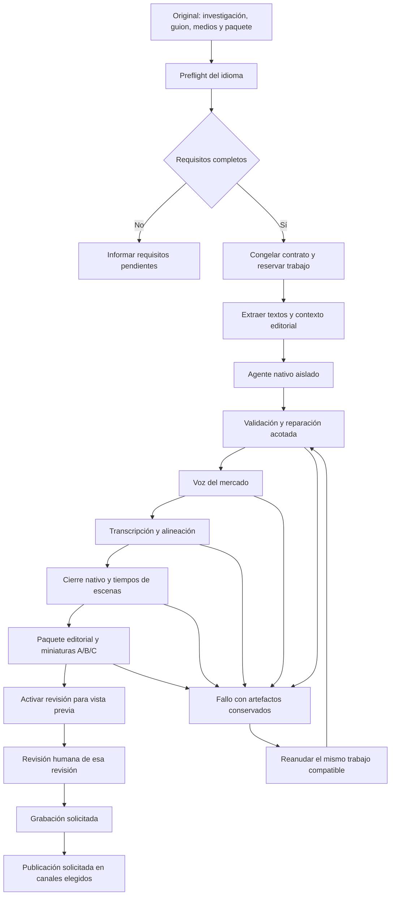
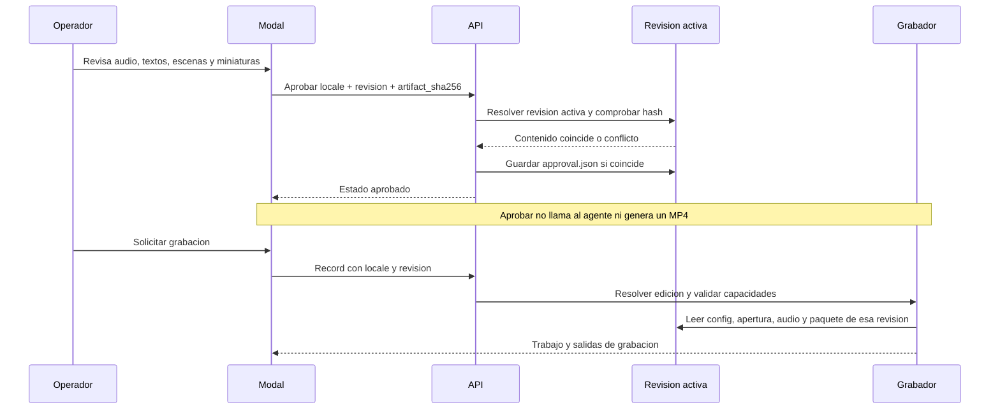

# Guía de implementación de ediciones multilingües para categorías y diseños

Fecha: 2026-11-12. Versión documental: 1.0.

**Documento operativo de referencia para ampliar el flujo existente.** Basado en la implementación ejecutable de servidor y web revisada en `alfred-server`, no solamente en las propuestas iniciales. El piloto es NodeTech con el diseño `rough`; no certifica los demás diseños.

El objetivo es que un agente pueda habilitar otro diseño siguiendo contratos y pasos conocidos: conservar la historia y la intención, adaptar su expresión al mercado, producir la voz, sincronizar los componentes y preparar la publicación en ese idioma. La calidad buscada es la de una edición concebida por un equipo nativo de guion, locución, diseño y edición.

## 1. Cómo funciona actualmente el proyecto

### 1.1 Producción del original

El repositorio contiene código, motores, definiciones, estrategias, prompts y herramientas. El perfil activo contiene los proyectos privados, sus medios, resultados y registros. El original español conserva sus rutas; habilitar idiomas no lo mueve a otra carpeta ni lo convierte automáticamente en una revisión nativa.

| Paso | Qué ocurre | Evidencia principal |
|---|---|---|
| Encargo | Se fija qué se quiere explicar, a quién y con qué límites | `BRIEF.md`, brief registrado |
| Investigación | Se documentan hechos, fuentes, incertidumbres y enfoque | `PLAN.md`, documentos de investigación, fuentes editoriales |
| Guion | Se escribe narración por segmentos identificados | `assets/script.json` |
| Medios | Se seleccionan imágenes y clips con contexto y derechos | `assets/media/`, créditos y registros de recursos |
| Voz | Las herramientas del host generan la narración | `assets/song.mp3` |
| Transcripción | Se obtiene el texto con tiempos de las palabras | `assets/lyrics.json` |
| Composición | Se eligen componentes, parámetros y anclas al relato | `assets/storyboard.json`, `assets/config.json` |
| Paquete editorial | Se preparan títulos, miniaturas A/B/C y textos de redes | `publish.json`, capturas de miniaturas |
| Vista previa | El modal reproduce la composición y presenta su paquete | Player y panel lateral |
| Acciones finales | El operador puede solicitar grabación y publicación | Trabajos del grabador, Biblioteca y publicador |

Una producción preparada no implica que exista un MP4. Una tarjeta que dice «Listo para grabar» expresa disponibilidad de preparación; «Publicable» debe depender de las validaciones del paquete. La presencia de fuentes tampoco demuestra, por sí sola, que cada afirmación sea verdadera.

### 1.2 Generación de otra edición por idioma

En `rough`, el modal consulta los idiomas disponibles. ES es el original predeterminado. EN y PT corresponden a `en-US` y `pt-BR`. Al elegir otro idioma:

1. Si existe una revisión activa, se carga su configuración, audio, tiempos, textos y paquete editorial.
2. Si no existe, el cliente consulta las precondiciones y ofrece crearla cuando corresponde.
3. El servidor congela fuente, identidad, voz, formato y estrategias en `edition.json`.
4. Extrae los textos declarados y una ficha editorial acotada de la investigación existente.
5. Un agente editorial aislado adapta guion, rótulos, anclas verbales y publicación.
6. El host valida la salida, genera la voz y transcribe ese audio en el idioma de destino.
7. El código calcula tiempos, incorpora el cierre propio del idioma y reutiliza componentes y medios.
8. Prepara el paquete y captura las tres miniaturas; activa la revisión terminada para verla.
9. La revisión humana, la grabación de un MP4 y la publicación son acciones posteriores distintas.



Las flechas de recuperación resumen el flujo: el servicio vuelve a recorrer las etapas y reutiliza exclusivamente checkpoints válidos. No vuelve necesariamente al agente ni vuelve a pagar todas las etapas.

### 1.3 Qué se comprobó y qué sigue pendiente

| Capacidad | Situación comprobada al redactar esta guía |
|---|---|
| Servicio común de ediciones, persistencia y recuperación | Implementado |
| Ruta común para navegador y agente operador | Implementada mediante la misma API |
| Registro ES/EN/PT e identidad de `rough` | Implementados; identidades EN/PT declaradas `draft` |
| Contratos de textos, predeterminados y componentes propios del piloto | Implementados para `rough` |
| Vista previa y tres miniaturas de la edición inglesa de la Web | Generadas y comprobadas en el navegador |
| Grabador consciente de idioma y revisión | Implementado y cubierto por pruebas; no se hizo una grabación completa real del nuevo piloto de la Web |
| Publicación real del nuevo piloto | No ejecutada |
| Certificación de todos los componentes y videos de `rough` | No; hay producciones con pendientes editoriales o de medios |
| Soporte completo de los demás diseños | No implementado por el hecho de existir en el catálogo |

La prueba inglesa de `vago-pero-emocionante` terminó como `en-US/rev-001`, con aproximadamente 3:28, 489 palabras y tres miniaturas. Conserva dos anclajes aproximados, una posible despedida duplicada y observaciones de pronunciación/investigación que requieren revisión. Las 331 pruebas de la intervención son evidencia de regresión del piloto, no una certificación automática de todos los motores.

## 2. Cómo utilizar esta guía sin volver a estudiar todo el proyecto

| Trabajo asignado | Lectura mínima |
|---|---|
| Habilitar un diseño del explainer-kit | 3–8, 15, 20–23 y 28 |
| Redactar identidad, instrucciones o estrategias | 4–6, 9–11 y 13 |
| Integrar API, modal y grabación | 14–19 y 24 |
| Adaptar un motor independiente | 3, 6, 20.2, 22 y 27 |
| Generar una edición de un diseño ya habilitado | La skill de ediciones, 12, 17, 18 y 25 |
| Revisar la calidad de una entrega | 4, 12, 13, 18, 22 y 28 |

Accesos directos: [contratos del diseño](#7-árbol-mínimo-para-habilitar-un-diseño-del-explainer-kit),
[investigación](#9-investigación-dónde-se-almacena-y-qué-recibe-el-agente),
[prompts](#10-prompts-e-instrucciones-un-orden-compartido),
[almacenamiento](#14-almacenamiento-repositorio-perfil-y-revisiones),
[API](#16-api-existente-contrato-común-para-web-y-agentes),
[modal](#18-modal-web-contrato-visual-compartido),
[procedimiento de adopción](#20-procedimiento-para-incorporar-cada-diseño),
[pruebas](#22-plan-de-validación-que-debe-repetir-cada-diseño) y
[lista de aceptación](#28-criterios-de-aceptación-y-plantilla-de-entrega-por-diseño).

Referencias principales del código:

- [Estándar editorial CALIDAD](../../src/skills/CALIDAD.md), [orquestación](../../src/skills/ORQUESTACION.md) e [índice de flujos](../../src/skills/README.md): instrucciones comunes para producir contenido; esta guía añade la integración multilingüe.
- [Contratos comunes de ediciones](../../src/core/editions/README.md).
- [Skill del agente operador](../../src/skills/editions/SKILL.md).
- [Servicio de ediciones](../../src/core/explainer/editions/service.py).
- [Esquemas cerrados](../../src/core/editions/schemas.py).
- [Registro de mercados](../../src/core/markets/markets.json).
- [Definición de referencia de rough](../../src/templates/_tools/design-definitions/rough/).
- [Distribución de perfiles v3](../profile-layout-v3-2026-11.md).

**Precedencia documental:** para incorporar diseños, esta guía describe la línea de implementación vigente. Los documentos de propuesta del 11 de noviembre explican decisiones y alternativas históricas; sus nombres de módulos, APIs propuestas, equipos de agentes y cálculos de coste no sustituyen los contratos actuales. Cuando cambie el código, debe actualizarse esta guía junto con sus ejemplos y pruebas.

La copia local y la del servidor han tenido cambios divergentes. Antes de implementar, identificar qué checkout ejecuta realmente la API y verificar allí los archivos citados. No sustituir en bloque un checkout por el otro.

## 3. Categoría, diseño, estilo, formato, mercado y motor

| Concepto | Responsabilidad | Ejemplo |
|---|---|---|
| Categoría | Tema, reglas editoriales y restricciones de afirmaciones | `nodetech`, `nodehistory`, `nodeeconomy` |
| Diseño | Sistema visual y contratos de sus componentes | `rough`, `binary`, `periodico` |
| Estilo | Variante visual dentro del diseño | El `style_id` realmente declarado por ese diseño |
| Formato narrativo | Duración, estructura y capacidades de medios | `animado-corto`, `documental-largo` |
| Mercado | Idioma regional, expresión y convenciones | `es-419`, `en-US`, `pt-BR` |
| Identidad | Persona del canal, voz y expresión del mercado | Persona de `rough` y sus mercados |
| Motor | Implementación que reproduce la composición | `explainer-kit`, `_atlas`, `_mapas`, `_vida` |
| Producción | Episodio con historia y medios privados | `productions/nodetech/vago-pero-emocionante/` |
| Revisión nativa | Resultado de una generación para un mercado | `languages/en-US/revisions/rev-001/` |

Habilitar inglés en una categoría no habilita todos sus diseños. Una categoría puede usar varios motores. Dos diseños que comparten motor pueden tener campos, predeterminados y restricciones visuales diferentes.

### 3.1 Inventario de definiciones observado

Se observaron 21 carpetas de definición, incluida una definición con ID de sandbox. Es un inventario de archivos, no una lista de diseños aprobados ni una promesa de estabilidad de sus IDs.

| Grupo | IDs observados | Situación de localización |
|---|---|---|
| Referencia del explainer-kit | `rough` | Tiene persona, ES/EN/PT, formatos y contratos |
| Otros diseños del explainer-kit | `acuarela`, `atlas`, `binary`, `carta`, `collage`, `cronica`, `dinero`, `enmienda`, `grunge`, `imperio`, `memorias`, `pelicula`, `periodico`, `pop` | Sin esos contratos completos en la definición observada |
| Motor Atlas | `atlas-cinematico`, `atlas-en-movimiento`, `sandbox-a476d9552a6cf43f01c78eb8` | Necesitan estudiar el enlace con su motor y su almacenamiento |
| Otros motores propios | `mapas-satelitales`, `cara-a-cara`, `vida-en-escena` | Necesitan integración de motor; copiar contratos de rough no basta |

`atlas` del explainer-kit y los motores Atlas cinematográficos son sistemas diferentes. El catálogo puede incorporar o retirar definiciones después de esta fecha: repetir el inventario al asignar una migración.

## 4. Reglas de calidad que deben conservarse

| ID | Regla operativa |
|---|---|
| E-01 | Reutilizar investigación y medios aprobados del original. Corregir un original defectuoso en una tarea editorial explícita antes de propagarlo. |
| E-02 | Adaptar intención, claridad, ritmo, humor y emoción para el público del mercado. Conservar hechos, cifras, nombres, atribuciones, tesis y grados de certeza. |
| E-03 | El agente editorial entrega contenido; el host resuelve rutas, herramientas, tiempos y estructura técnica. |
| E-04 | Usar la misma API y el mismo servicio desde web y CLI. No crear un productor paralelo por categoría o idioma. |
| E-05 | El motor y los medios se comparten; cada revisión guarda los resultados propios del idioma. |
| E-06 | Declarar los campos traducibles y sus predeterminados. Un componente sin contrato debe producir un error previo a la generación. |
| E-07 | Vincular escenas a palabras reales del nuevo audio. No escalar globalmente los tiempos del español. |
| E-08 | Aislar el agente. La investigación contiene datos y no concede permisos ni cambia su rol. |
| E-09 | Separar generado, activo para vista previa, aprobado, grabado y publicado. |
| E-10 | Reanudar trabajos compatibles con sus checkpoints; no simular estados ni repetir consumo sin necesidad. |
| E-11 | Conservar fuentes, créditos, licencia y contexto de cada recurso. Una imagen del mismo tema no demuestra que represente el mismo hecho. |
| E-12 | Revisar ambos aspectos, todos los textos públicos y las tres miniaturas. Un JSON válido no demuestra calidad audiovisual. |
| E-13 | Respetar el perfil efectivo y las rutas autorizadas. No copiar producciones privadas al repositorio. |
| E-14 | Registrar el proveedor realmente utilizado y distinguir coste registrado, estimado y desconocido. No utilizar Opus en este encargo. |
| E-15 | Mostrar errores reales con acciones útiles. No ocultar un fallo para presentar una edición como lista. |

### 4.1 Conservar la intención con profesionalismo

Antes de escribir en otro idioma, el agente debe poder responder: qué pregunta abre el video, qué cree inicialmente el espectador, qué evidencia cambia su comprensión, qué emoción produce cada giro y qué idea debe recordar al terminar.

Puede cambiar orden sintáctico, modismos, longitud de frase y ejemplos retóricos que no añadan hechos. Puede expresar una comparación de manera más natural para ese mercado. No puede cambiar una institución real por una local, atribuir una intención no demostrada, omitir una advertencia incómoda ni intensificar una causalidad para ganar clics.

Ejemplo: «Una empresa anunció despidos un día después de hablar de IA» no autoriza «La IA despidió a sus programadores». Mantener números y nombres no detectaría esa alteración. La revisión editorial debe leer la afirmación completa.

El gancho, el título y la miniatura deben hacer la misma promesa que cumple el video. Las variantes A/B/C ofrecen enfoques editoriales distintos y defendibles; no tres maneras de exagerar el relato.

## 5. Arquitectura compartida y responsabilidad de cada módulo

```text
REPOSITORIO/
├── nexa-brief-server/
│   ├── src/core/
│   │   ├── markets/                   # IDs canónicos, alias y parámetros de idioma
│   │   ├── editions/                  # esquemas, campos y formatos comunes
│   │   ├── localization/             # textos, validaciones, prompts y salida editorial
│   │   └── explainer/editions/        # integración con producciones del explainer
│   │       ├── service.py             # orquestación y activación
│   │       ├── repository.py          # estado consultable mediante DataPort
│   │       ├── resolver.py            # contrato congelado y procedencia
│   │       ├── extraction.py          # textos y contexto permitido
│   │       ├── text_defaults.py       # materialización de predeterminados auditados
│   │       ├── research_readiness.py  # presencia de investigación
│   │       ├── research_context.py    # filtrado de contexto de investigación
│   │       ├── agent.py               # agente aislado, salida y reparación
│   │       ├── tools.py               # broker del host para voz/STT/cierre
│   │       ├── alignment.py           # correspondencia de segmentos y palabras
│   │       ├── retiming.py            # mínimos visuales y desplazamientos acotados
│   │       ├── application.py         # aplicación y storyboard del idioma
│   │       ├── checkpoints.py         # reutilización por entradas y hashes
│   │       ├── packaging.py           # paquete nativo y aprobación
│   │       ├── attribution.py         # fuentes/créditos y descripción efectiva
│   │       ├── thumbnail_layout.py    # ajuste de B para rough/binary actualmente
│   │       ├── studio.py              # capacidades, problemas y consumo del estudio
│   │       ├── preview.py             # integración de vista previa
│   │       ├── client.py              # cliente de la API privada
│   │       └── cli.py                 # comandos del operador
│   ├── src/skills/
│   │   ├── editions/                  # instrucciones del operador y prompts globales
│   │   ├── models/roles.json          # política de roles y proveedores
│   │   ├── formats/                   # formatos narrativos compartidos
│   │   └── explainer/
│   │       ├── categories/            # reglas editoriales de categoría
│   │       └── strategies/            # estrategias y capas nativas por mercado
│   ├── src/templates/_tools/
│   │   ├── design-definitions/        # identidad y contratos de cada diseño
│   │   └── explainer-kit/             # reproductor, componentes y herramientas
│   └── src/presentation/api/routers/explainer.py
└── nexa-brief-web/src/features/explainer/
    ├── hooks/useLocalizations.ts      # listado, preflight, creación y recuperación
    ├── lib/studio-edition.ts          # vista del video del idioma seleccionado
    ├── api/explainer-service.ts       # miniaturas y grabación con locale/revision
    └── components/
        ├── ExplainerVideoCard.tsx     # modal del video y selector de ediciones
        ├── ExplainerStudioSidebar.tsx
        └── PublishPackagePanel.tsx
```

No existe en este flujo un nuevo `core/locales` que deba crearse para cada migración. El registro actual es `core/markets`. El contrato heredado `core/metadata` conserva restricciones propias de metadatos; no ampliarlo por efecto secundario ni crear un tercer registro.

La API delega en `EditionService`. El servicio coordina reglas de dominio y adaptadores; no debe convertirse en un bloque de excepciones `if categoria == ...`. Las peculiaridades editoriales van en identidad/instrucciones, las visuales en contratos y componentes y las de motores en una integración explícita.

## 6. Capas de configuración: dónde vive cada decisión

| Decisión | Ubicación vigente | No ponerla en |
|---|---|---|
| Locale, alias, STT/TTS y prompt base de idioma | `src/core/markets/markets.json` | Botones fijos del frontend |
| Persona estable del canal/diseño | `design-definitions/<id>/identity/persona.json` | Cada guion o un prompt duplicado por video |
| Voz, registro, canal, cierre y ejemplos del mercado | `identity/markets/<locale>.json` | Código del router o texto generado por el agente |
| Léxico de pronunciación | `extras/lexicon/<locale>.json`, referenciado por la identidad | Sustituciones dispersas en herramientas |
| Reglas temáticas | `skills/explainer/categories/*.json` | El motor de dibujo |
| Estructura y capacidades narrativas | `skills/formats/<formato>.json` | El idioma o la voz |
| Formatos que admite el diseño | `design-definitions/<id>/formats.json` | Inferencia por el título del video |
| Parámetros que pueden traducirse | `localizable.json` | Heurísticas por nombre de clave |
| Textos visibles implícitos | `localizable-defaults.json` | Conocimiento informal del agente |
| Criterio de edición propio del diseño | `agents/edition.md` | Copias del prompt global |
| Estrategia nativa de títulos/narrativa/etc. | `strategies/<pieza>/markets/<locale>/<id>.json` | Traducción automática de ejemplos españoles |
| Ajustes autorizados de cuenta/episodio | `Overrides` del resolvedor | Un JSON libre con claves arbitrarias |
| Resultado efectivo | `edition.json` y su `provenance` | Lecturas variables de configuración durante un trabajo |

El resolvedor aplica los ajustes de cuenta y después episodio dentro de su lista permitida: `format_id`, `duration_seconds`, `voice`, `channel`, `outro`. Los argumentos del resolvedor y la configuración fuente también participan; consultar `provenance` para saber qué ganó en cada campo. Ninguna de esas capas puede sobrescribir libremente locale, rutas o esquemas. El canal debe pertenecer al locale de la edición.

La identidad `draft` es una declaración editorial, no una prueba de calidad. Actualmente no debe suponerse que todas las rutas bloqueen automáticamente por cada etiqueta `draft`: comprobar las capacidades y la revisión efectiva. La certificación de identidad y la aprobación de una revisión concreta son decisiones distintas.

## 7. Árbol mínimo para habilitar un diseño del explainer-kit

```text
src/templates/_tools/design-definitions/<design_id>/
├── design.json                       # ficha existente, categoría y engine_id reales
├── catalog.json                      # catálogo existente
├── identity/
│   ├── persona.json                  # nexa.persona/1
│   └── markets/
│       ├── es-419.json               # nexa.identity-market/1
│       ├── en-US.json
│       └── pt-BR.json
├── formats.json                      # nexa.design-formats/1
├── localizable.json                  # nexa.localizable/1
├── localizable-defaults.json          # nexa.localizable-defaults/1
├── agents/
│   ├── README.md                     # cómo se compone el contexto de este diseño
│   └── edition.md                    # criterio editorial y visual del diseño
└── extras/
    └── lexicon/
        ├── en-US.json                # si la voz necesita pronunciaciones concretas
        └── pt-BR.json
```

Los archivos de identidad deben validarse con los modelos de `core/editions/schemas.py`. Las claves de `persona_id`, `market` y `design_id` deben coincidir entre capas. `voice.models` declara la selección configurada de voz; la selección editorial se hace mediante roles. No copiar nombres de voces o modelos de este documento para eludir la configuración vigente.

`localizable-defaults.json` es necesario en la extracción actual incluso si el diseño no tiene predeterminados traducibles: en ese caso se declara `components: {}` con el esquema e ID correctos, después de auditarlo. No omitirlo suponiendo que el storyboard contiene todo lo visible.

La presencia de estos archivos no demuestra soporte completo. La detección inicial `_supported` es superficial; el preflight y la prueba del episodio deben confirmar formatos, estrategias, medios, herramientas, contrato visual y reproductor.

### 7.1 Qué debe explicar agents/edition.md

1. Qué promete el diseño y cómo se relaciona con el espectador.
2. Qué función cumple cada familia de componentes: proceso, comparación, cifra, documento, mapa, cita, pregunta, etc.
3. Longitud y tono de los textos; qué campos admiten acentos o destacados.
4. Qué se conserva literalmente: citas, código histórico, nombres, monedas, referencias legales.
5. Cómo elegir frases disparadoras exactas y distinguirlas de rótulos resumidos.
6. Qué constituye una miniatura honesta y legible en ese diseño.
7. Cómo termina la narración sin duplicar el cierre fijo del canal.

No introducir ahí comandos de shell, búsqueda, TTS, rutas del perfil ni permisos. Tampoco imponer el color lima, el humor o las metáforas tecnológicas de `rough` a todos los diseños.

## 8. Contrato de componentes y textos predeterminados

### 8.1 Declarar los campos reales

El extractor solo recorre los campos declarados. `translate: false` protege medios y enumeraciones. Los números técnicos, IDs, opciones de animación, coordenadas y referencias de archivos no se convierten en texto editorial por parecer cadenas.

Ejemplo didáctico de una declaración mínima válida como estructura; **no es una definición suficiente de un diseño real**. Hay que completarla con todos los componentes usados, intros, overlays y cierre:

```json
{
  "schema": "nexa.localizable/1",
  "design_id": "mi-diseno",
  "limit_policy": "Límites auditados en 16:9 y 9:16; medios y opciones protegidos.",
  "script": {
    "title": {"type": "title", "max_chars": 160},
    "segments.*.text": {"type": "narration", "max_chars": 2400},
    "segments.*.delivery_note": {"type": "narration", "max_chars": 1400},
    "segments.*.chapter": {"type": "title", "max_chars": 160}
  },
  "storyboard": {
    "title": {"type": "title", "max_chars": 160}
  },
  "components": {
    "mi-diseno.title": {
      "source": "designs/mi-diseno/components/titles.js",
      "fields": {
        "text": {"type": "title", "max_chars": 80},
        "accent": {"type": "substring:text", "max_chars": 30},
        "src": {"type": "media", "max_chars": 0, "translate": false},
        "mode": {"type": "enum", "max_chars": 0, "translate": false}
      },
      "notes": "accent debe ser parte exacta de text; src y mode se conservan."
    }
  }
}
```

`*` recorre listas en las rutas declaradas, por ejemplo `items.*.label`. No presupone un recorrido arbitrario de todos los objetos. `substring:<campo>` vincula un destacado a su texto; ambos deben adaptarse juntos. Los límites actuales se aplican al texto cambiado para permitir la ida y vuelta de originales históricos que ya excedían un presupuesto.

Hay dos representaciones relacionadas: los punteros de `core/editions/strings.py` (`/storyboard/beats/0/params/text`) y las claves editoriales de `extraction.py` (`scene.0.text`, `seg.s01`, etc.). El host conserva la correspondencia. El agente no inventa punteros ni cambia las claves de una ejecución.

### 8.2 Auditar todo lo que aparece aunque falte en el JSON

Revisar el registro del componente, sus valores por defecto, texto en funciones de render, fallback ante cadenas vacías y listas vacías, etiquetas internas, ejes, unidades, botones simulados, marcas temporales, texto de cierre e imágenes con letras incrustadas.

El manifiesto materializa los textos ausentes **en una copia** antes de extraerlos:

```json
{
  "schema": "nexa.localizable-defaults/1",
  "design_id": "mi-diseno",
  "components": {
    "mi-diseno.title": {"text": "Una pregunta concreta"}
  }
}
```

Un predeterminado declarado debe tener contrato traducible. Si un componente oculta texto fuera de parámetros, primero hay que exponer ese campo o implementar un mecanismo auditado; añadir una entrada al manifiesto no cambia por sí solo el renderizador.

Para componentes procedentes de `component-library/sources/`, la implementación actual compara el archivo instalado en `assets/components/` con la fuente auditada. Si difiere, el preflight debe detenerse y exigir auditoría. No cambiar el hash esperado o desactivar la guarda para admitir una copia desconocida.

Caso aprendido en Amazon: registrar solo los componentes genéricos no cubría `rough.layoffMail`, `rough.codeReview` y `rough.careerLadder`. Deben inventariarse también los componentes propios de los episodios, con su fuente y valores implícitos. Un ejemplo ficticio de código puede adaptar identificadores descriptivos y comentarios con sintaxis preservada; el código histórico o una cita auténtica debe conservarse literalmente.

### 8.3 Pruebas exigidas al contrato

- Cobertura de todos los componentes utilizados y de los predeterminados visibles.
- Extracción y aplicación de la misma tabla sin alterar campos protegidos.
- Rechazo de claves extra, campos de medios traducidos y destacados ajenos a su texto.
- Cambios de listas y textos de longitud límite con capturas en ambos aspectos.
- Detección de un componente de episodio divergente de su versión auditada.

## 9. Investigación: dónde se almacena y qué recibe el agente

La investigación pertenece a la producción original. El agente de idiomas la reutiliza para comprender intención, contexto y límites; no vuelve a investigar ni a buscar imágenes. Si falta evidencia o hay contradicciones, se corrige el original o se solicita una tarea editorial separada. No se resuelve inventando una referencia dentro de la edición.

### 9.1 Entradas reconocidas actualmente

| Entrada | Uso |
|---|---|
| `research.json`, `assets/research.json` | Evidencia estructurada con claves factuales reconocidas |
| `research.md`, `assets/research.md` | Documento editorial de investigación |
| Secciones de investigación/fuentes de `PLAN.md` | Evidencia heredada y contexto editorial |
| `BRIEF.md` | Encargo, intención y restricciones editoriales |
| `publish.json` → `sources` | Referencias editoriales que también deben conservarse en publicación |
| `publish.json` → `credits` | Atribución de recursos; **no sustituye investigación factual** |

Para episodios nuevos, seguir `CALIDAD.md`: guardar `research.json` estructurado y `research.md` legible, coherentes entre sí; usar `PLAN.md` para decisiones narrativas y de montaje. Mantener la evidencia estructurada como referencia y actualizar su representación legible conjuntamente, sin copiar hechos incompatibles. Que el lector acepte cualquiera de las entradas anteriores es compatibilidad con originales heredados, no permiso para rebajar el estándar de nuevas producciones.

La investigación original debe registrar fecha del dato y de consulta, actualidad pertinente y dos fuentes independientes por cifra, una primaria u oficial, conforme a `CALIDAD.md`. Si hay desacuerdo relevante, documentarlo y resolverlo o usar una formulación defendible. La creación de otra edición reutiliza esa investigación; si necesita actualizarse, abrir el trabajo editorial del original sin dar navegación libre al agente de idiomas.

Ejemplo acotado compatible con las claves factuales filtradas:

```json
{
  "title": "La historia que explica el episodio",
  "summary": "Tesis, pregunta inicial y límites de lo que se puede concluir.",
  "facts": [
    {
      "claim": "Afirmación concreta comprobada para el guion.",
      "source": "Referencia primaria y apartado que la sostiene.",
      "url": "https://example.org/documento-publico",
      "date": "2026-11-12"
    }
  ],
  "discarded": [
    {"claim": "Interpretación descartada", "reason": "La fuente no demuestra causalidad."}
  ]
}
```

El ejemplo describe datos, no un nuevo esquema estricto `nexa.research/1`: ese esquema formal no está implementado. Campos adicionales deben verificarse contra el filtrado de `research_context.py`; no asumir que todo lo que se guarde llegará al agente. Evitar hechos representados únicamente como booleanos o claves no reconocidas.

### 9.2 Filtrado y límites actuales

`research_readiness.py` verifica presencia significativa de investigación; no realiza verificación factual. `research_context.py` limita los documentos adicionales a 1 MB por archivo y un contexto conjunto de hasta 16 000 caracteres, con límites internos de profundidad y elementos. Filtra claves, posibles secretos, rutas de host, enlaces privados y URLs con parámetros de autenticación. `PLAN.md` y `BRIEF.md` tienen además extracción editorial y límites propios.

Estos filtros son una defensa acotada, no una garantía universal de eliminación de información privada. Revisar la ficha que se entrega al agente; un dato omitido por el límite no debe ser la única referencia de una advertencia esencial. Las URLs públicas de las fuentes son referencias; no habilitan navegación del agente.

El contexto de `story.json` incluye intención/editorial, metadatos de segmentos, función de escenas, textos públicos de referencia y `research` cuando hay documentos o fuentes. Excluye el motor completo, los medios binarios y los parámetros técnicos que el agente no debe modificar.

## 10. Prompts e instrucciones: un orden compartido

```text
src/skills/editions/
├── SKILL.md                           # agente operador: API, seguimiento y límites
└── prompts/
    ├── lead.md                        # rol y reglas globales del agente editorial
    ├── task.md                        # tarea, alcance y claves de salida
    └── output.schema.json             # estructura admitida

design-definitions/<id>/
├── agents/edition.md                  # criterio específico del diseño
├── identity/persona.json
└── identity/markets/<locale>.json

skills/explainer/strategies/<pieza>/
├── <estrategia>.json                  # intención universal
└── markets/<locale>/<estrategia>.json # expresión y convenciones nativas
```

`compose_prompt` concatena seis secciones: **rol global → instrucciones del diseño → identidad de mercado → estrategias efectivas → historia y ficha editorial → tarea**. El esquema de salida se entrega en el workspace. Se conserva una copia del prompt para auditar la ejecución.

La identidad da continuidad al canal; las estrategias orientan gancho, estructura y publicación; el contexto factual limita lo que puede afirmarse. Las fuentes y los guiones son datos de referencia, incluso si contienen frases que parecen órdenes. No se permite que un documento cambie el rol, el destino de archivos o las herramientas autorizadas.

### 10.1 Estrategias nativas

Cada estrategia seleccionada necesita su capa del mercado. El lector verifica `piece`, `strategy_id` y `locale`. La capa contiene `intent`, `templates`, `examples`, `conventions`, `sounds_false`, `overrides` y variantes cuando corresponden, con esquema `nexa.strategy-market/1`.

Una capa ausente produce error; no sustituirla silenciosamente por español. El formato puede seleccionar instrucciones nativas de una variante, por ejemplo `short`, sin elegir la voz. Los prompts reciben estrategias editoriales filtradas; no deben necesitar leer el motor ni otras categorías.

### 10.2 Salida del agente y reparación

El archivo `edition.output.json` contiene:

| Campo | Qué debe entregar |
|---|---|
| `locale` | Mercado exacto pedido |
| `segments` | Mismos IDs y orden, `text` y `delivery_note` nativos |
| `strings` | Todas y solo las claves no `seg.*` de la tabla |
| `cues` | Mismas claves de escenas, segmento conservado y frase disparadora exacta |
| `publish` | YouTube, Instagram, Facebook y TikTok según el esquema vigente |
| `observations` | Matices, dudas y observaciones de revisión |
| `packaging` | Títulos A/B/C, textos de miniaturas y elecciones cuando se exige paquete nativo |

La libertad de escritura existe **dentro de los segmentos conservados**. La implementación actual no permite dividir/unir segmentos ni crear nuevas escenas, aunque una propuesta histórica lo planteara. Esos cambios requerirían una evolución de contrato con trazabilidad y pruebas.

El host valida estructura, claves, límites, cifras, nombres, destacados y anclas. En una llamada editorial normal admite una reparación acotada de claves con errores; no mantiene un diálogo creativo indefinido. Puede revalidar una salida archivada tras una corrección del host sin volver a llamar al proveedor si satisface las mismas entradas congeladas.

No se promete una sola llamada facturada por idioma: un ejecutor puede hacer pasos internos y los reintentos añaden consumo. El flujo no requiere crear un agente independiente para cada rótulo ni otro agente que invente segundos.

## 11. Workspace editorial y adaptadores del host

```text
productions/<categoria>/<video>/work/localization/<job_id>/
├── PROMPT.md
├── strings.source.json
├── story.json
├── identity.json
├── strategies.json
├── output.schema.json
└── edition.output.json                 # único entregable del agente
```

Es un workspace efímero: el host controla su creación y eliminación al finalizar. Los artefactos de auditoría y consumo quedan en el staging/revisión, no dependen de que ese workspace siga existiendo.

`EditionAgent` usa la factoría y `AgentScope` existentes. El proveedor editorial no recibe permisos sobre el perfil, navegador de investigación, motores, voz o grabador. El rol se resuelve mediante `roles.json` y la política de fallback permitida, registrando qué proveedor y modelo se usó. La ausencia de aislamiento o cuota produce un bloqueo; no se amplían permisos para hacer pasar la generación.

`EditionTools` ejecuta en el host comandos cerrados de `tools/edition_job.py`: `voice`, `transcribe`, `outro`. La herramienta rechaza la ejecución desde el contexto reservado del agente de pipeline. Usa la edición congelada y un contexto que resuelve staging, producción y rutas del idioma.

Existen puertos de voz y letras en el proyecto, pero la integración actual del explainer utiliza este broker y las herramientas del kit. No describir una alineación CTC ni una abstracción nueva como si ya sustituyera a Whisper. Si otro motor necesita adaptadores, evaluar los puertos existentes antes de crear interfaces equivalentes.

## 12. Voz, transcripción, tiempos y cierre

### 12.1 Responsabilidades

| Elemento | Responsable |
|---|---|
| Intención y nota de interpretación por segmento | Agente editorial, dentro de la identidad resuelta |
| Voz, modelos permitidos, idioma, WPM objetivo, léxico | Identidad/contrato y adaptadores del host |
| Audio real | Herramientas de voz |
| Palabras y tiempos | Transcripción configurada y alineación del host |
| Frase que dispara una escena | Agente: cita exacta del segmento de destino |
| Segundo final de aparición | Código, a partir de esa frase y audio real |
| Capítulos de YouTube | Agente propone segmento/título; código calcula tiempos |
| Duración del cierre y señales de like/suscripción | Identidad, audio de cierre y herramientas del host |

El idioma debe recorrer toda la cadena; no basta con escribir inglés en el guion si STT, numerales, cierre o parámetros de TTS siguen fijados a español. Auditar también las notas de interpretación y los textos incrustados en componentes.

### 12.2 Orden de sincronización real

Se conserva el audio de narración, se transcribe, se alinean segmentos y palabras, se añade el cierre del idioma y se construye el storyboard adaptado. El host verifica con `ffprobe` que la duración declarada y el audio final coincidan dentro de la tolerancia actual de 0,5 s.

`alignment.py` busca frases en el segmento correspondiente. Cuando no encuentra una coincidencia utilizable puede registrar `cue_proportional_fallback`: posición proporcional **dentro del segmento**, no escalado global del video. Esa aproximación requiere inspección del momento; no debe ocultarse ni presentarse como sincronización exacta.

`retiming.py` ajusta escenas principales para respetar `minDur`, con desplazamiento máximo actual de ±1,5 s respecto al ancla. Si no puede satisfacerlo dentro del margen, falla y exige corregir el montaje. Un ajuste permitido técnicamente aún puede resultar editorialmente tardío; escuchar y mirar.

En la prueba de la Web el cierre heredado recortaba el audio inglés utilizando segundos del original. La corrección conserva toda la nueva narración y sustituye el beat visual de cierre obsoleto. La advertencia `possible_duplicate_closing` permite identificar una despedida del guion que repite el cierre fijo; no se elimina narración a ciegas para esconderla.

### 12.3 Qué debe revisar una persona

Pronunciación de nombres, cifras y siglas; claridad de cautelas; respiraciones; ausencia de fragmentos cortados; relación entre frase y componente; tiempo suficiente para leer; ausencia de vacío antes del cierre; pregunta final; cierre y CTA en el idioma correcto. El texto final de subtítulos debe corresponder al audio, no solamente al guion previsto.

SRT/VTT descargables, alineación forzada alternativa y memoria persistente de traducción no deben darse por implementados en todos los diseños por aparecer en propuestas anteriores.

## 13. Diseño visual, medios y tres miniaturas

La adaptación conserva componentes, medios y composición aprobados, con nuevos parámetros editoriales y tiempos. El diseño debe tolerar expansión de texto, diacríticos y convenciones numéricas del mercado. Las capturas en horizontal no sustituyen la revisión vertical.

Auditar números, monedas, fechas, unidades, escalas, signos y etiquetas de gráficos. Separar valor numérico y representación localizada. `rough.counter` ya usa el locale de la configuración; no demuestra que otros contadores, mapas o componentes hayan eliminado su español fijo. Cambiar formato de miles no autoriza convertir moneda, unidades o escala sin una decisión editorial explícita.

Una fotografía, gráfico o clip con letras incrustadas necesita una decisión específica: conservarlo como documento auténtico con contexto, usar un overlay fiel o preparar un recurso derivado autorizado. No prometer «todo traducido» cambiando solo parámetros de texto mientras el recurso visible sigue en español.

### 13.1 Paquete A/B/C

El flujo actual de nuevas ediciones exige las tres opciones del original y reutiliza sus imágenes. La preparación nativa conserva fuentes y créditos, adapta los textos y valida que el título elegido coincida con el título público. La miniatura elegida también se utiliza como apertura.

- **A:** apertura de texto del diseño.
- **B:** texto e imagen adecuados al contexto.
- **C:** composición tabloide común compatible con el paquete, con texto e imagen propios cuando corresponda.

La correspondencia técnica se resuelve con `opening_specs`; no asumir que todos los motores independientes tienen intros `introv1`/`introv2` o `common.tabloid`. Para un diseño del kit, comprobar registro, parámetros, imagen, estado de elección y captura de cada opción.

La corrección de ajuste de líneas de B está aplicada en código a `rough` y `binary`. Ese nombre en el helper **no habilita binary para idiomas**. Los demás diseños necesitan pruebas de legibilidad y una política visual apropiada; no copiar ciegamente el corte de líneas de rough.

Las miniaturas deben ser imágenes capturadas reales, sin «Imagen pendiente», recortes incorrectos, contraste insuficiente ni letras minúsculas por autoajuste. Validar A/B/C tanto antes como después de cambiar de idioma y comprobar que la apertura elegida sea la reproducida.

Aplicar también los criterios de `CALIDAD.md`: comprobarlas a 320 px de ancho, con una a cinco palabras y hasta dos filas como objetivo de legibilidad de A/B; B no debe añadir más palabras que A sin resolver la contradicción con ese estándar. Los presupuestos `max_chars` y los saltos automáticos son límites técnicos, no sustituyen esta revisión. Las referencias generales del estándar a textos en español se adaptan aquí al mercado pedido explícitamente por el usuario; la ortografía, la naturalidad y la ausencia de emojis se mantienen.

### 13.2 Fuentes y créditos en el idioma de publicación

`attribution.py` compone la descripción efectiva con referencias y créditos, evita duplicados y valida el presupuesto actual de 5000 bytes UTF-8. Mantiene URLs, autores y textos de licencia; no traducir arbitrariamente nombres legales de licencias. Los encabezados y la redacción editorial pueden localizarse sin destruir la atribución.

Guardar una lista de créditos en un JSON no demuestra que llegue a la red: comprobar la descripción efectiva que usa el publicador. Si faltan referencias del original o se excede el límite, debe existir una incidencia; no truncar silenciosamente los créditos para conseguir un estado verde.

## 14. Almacenamiento: repositorio, perfil y revisiones

### 14.1 Perfil v2/v3

```text
$NEXA_PROFILE_DIR/
├── profile.json
├── data/json/
│   ├── videos.json                    # colecciones de videos/localizaciones
│   ├── jobs.json                      # trabajos, incluidos kind=localization
│   ├── logs.json                      # trazas según el adaptador
│   └── designs.json                   # estado de diseños por perfil
├── productions/<categoria>/<video_id>/
│   ├── index.html                     # entrada compartida del episodio
│   ├── manifest.json
│   ├── BRIEF.md                       # si existe
│   ├── PLAN.md
│   ├── research.json                  # evidencia estructurada en episodios nuevos
│   ├── research.md                    # versión legible coherente; herencia puede variar
│   ├── publish.json                   # paquete del original español
│   ├── assets/
│   │   ├── script.json
│   │   ├── storyboard.json
│   │   ├── config.json
│   │   ├── lyrics.json
│   │   ├── song.mp3
│   │   ├── song-with-outro.mp3
│   │   ├── media/                     # recursos compartidos por idiomas
│   │   ├── components/                # componentes del episodio cuando existen
│   │   └── thumbnails/                # capturas del original en este layout
│   ├── languages/
│   │   ├── en-US/
│   │   │   ├── active.json            # {"revision": "rev-001"}
│   │   │   └── revisions/
│   │   │       └── rev-001/
│   │   │           ├── edition.json   # contrato congelado y procedencia
│   │   │           ├── checkpoints.json
│   │   │           ├── strings.source.json
│   │   │           ├── strings.json
│   │   │           ├── script.json
│   │   │           ├── storyboard.json
│   │   │           ├── config.json
│   │   │           ├── song.mp3
│   │   │           ├── song-with-outro.mp3
│   │   │           ├── transcript-raw.json
│   │   │           ├── lyrics.narration.json
│   │   │           ├── lyrics.json
│   │   │           ├── alignment.json
│   │   │           ├── publish.json
│   │   │           ├── publication.json
│   │   │           ├── storyboard.publication.json
│   │   │           ├── config.publication.json
│   │   │           ├── thumbnail-A.jpg
│   │   │           ├── thumbnail-B.jpg
│   │   │           ├── thumbnail-C.jpg
│   │   │           ├── *.sha256        # sellos de capturas
│   │   │           ├── review.json
│   │   │           ├── approval.json   # solo tras aprobación concreta
│   │   │           ├── usage-context.json
│   │   │           ├── voice.log / transcribe.log / outro.log
│   │   │           └── agent/          # prompts, salidas, intentos y consumo
│   │   └── pt-BR/
│   │       ├── active.json
│   │       └── revisions/...
│   └── work/
│       ├── localization/<job_id>/     # workspace efímero del escritor
│       └── results/                   # pruebas y propuestas del episodio
├── sandbox/<categoria>/<prototipo>/   # proyectos de prueba del perfil
├── resources/                        # recursos administrados del perfil
├── renders/                          # salidas administradas y Biblioteca
├── logs/
└── .system/
    ├── runtime/
    │   ├── localization/<job_id>/     # staging del host antes de activar
    │   └── recordings/...            # grabaciones administradas en curso
    ├── cache/
    └── ...                           # otros directorios internos del perfil
```

El árbol muestra archivos relevantes, no exige que todos los históricos ya los contengan. Pueden existir capturas WebP, orientación vertical u otros artefactos auxiliares. Los nombres de salidas administradas los decide el resolvedor de almacenamiento y el grabador: no inventar una jerarquía alternativa por idioma para MP4s.

No duplicar `index.html`, motor ni `assets/media/` bajo cada idioma. No crear `/leguache`, `/en`, `/ingles` o carpetas paralelas a `languages/<locale>/revisions/`. El español conserva su compatibilidad actual en `assets/` y `publish.json` de la raíz.

Las definiciones compartidas permanecen en el repositorio. En v3 no se crean `designs/` ni `sandbox/designs/` dentro del perfil para alojar copias de motores. El estado de diseño del perfil se administra por servicio y DataPort.

### 14.2 Qué es congelado y qué es un sidecar editorial

`edition.json` congela la resolución de identidad, estrategias, formato y rutas para ese trabajo. Los archivos de narración/alineación y sus checkpoints son resultados que no se deben retocar para fingir una recuperación válida.

`publication.json` conserva el paquete editorial nativo. `storyboard.publication.json` y `config.publication.json` son derivados para aplicar la apertura elegida sin modificar el storyboard congelado ni el original. El estudio y el grabador deben consumir esos derivados cuando existen.

La revisión no es un directorio absolutamente inmutable: hay sidecars editables de publicación y aprobación. Precisamente por eso la aprobación se vincula al contenido revisado y debe invalidarse cuando cambia contenido cubierto por ella. No describir la selección de un puntero como sustituto de la revisión humana.

### 14.3 Estado consultable y puntero activo

El estado consultable pasa por `DataPort`. La selección efectiva para reproducción se resuelve además con `languages/<locale>/active.json`. Ambos forman parte del contrato actual; no afirmar que todo está solo en base de datos o solo en carpetas.

El servicio mueve el staging completo a la revisión final, registra la revisión, actualiza la localización y escribe el puntero con reemplazo atómico. Incluye compensación del puntero si falla la activación y reconciliación de trabajos interrumpidos. Eso no equivale a una transacción universal entre todos los archivos y colecciones: debe probarse la recuperación de cortes.

## 15. Base de datos lógica y trazabilidad

No crear una tabla distinta por idioma. Las colecciones actuales son:

| Colección | Contenido | Sección JSON actual |
|---|---|---|
| `video_localizations` | Resumen video/locale: trabajo, revisión, estado y fuente | `videos` |
| `video_localization_revisions` | Revisión, fuente, vínculo a localización/trabajo y fecha | `videos` |
| `jobs` | `kind=localization`, video, locale, revisión, fase, avance, error y fechas | `jobs` |
| `execution_logs` | Trazas generales de ejecución según el adaptador | `logs` |

`section_names.py` es el mapeo real; si cambia el backend de persistencia, usar el mismo puerto y sus migraciones. Los archivos JSON de sección no se deben editar desde el frontend ni desde el agente editorial.

Ejemplos ilustrativos de filas, con IDs y hashes ficticios:

```json
{
  "video_id": "episodio-ejemplo",
  "locale": "en-US",
  "status": "ready",
  "revision": "rev-001",
  "job_id": "00000000000000000000000000000001",
  "source_revision": "sha256:..."
}
```

```json
{
  "job_id": "00000000000000000000000000000001",
  "kind": "localization",
  "video_id": "episodio-ejemplo",
  "locale": "en-US",
  "revision": "rev-001",
  "status": "running",
  "stage": "voice",
  "percent": 38,
  "packaging_required": true,
  "error": null
}
```

No se omiten IDs calculados, fechas u otros campos reales al guardar: los ejemplos muestran solo el vínculo conceptual. `repository.key` deriva la identidad de localización de video y locale dentro del almacenamiento del perfil.

`source_revision` incorpora guion, storyboard, configuración, letras, publicación, PLAN, BRIEF y los documentos adicionales de investigación utilizados. No es un hash universal de todos los medios, scripts del motor, prompts y binarios. Los cambios de esos elementos necesitan su revisión de compatibilidad y sus propios sellos; no asumir que `stale=false` los certifica.

## 16. API existente: contrato común para web y agentes

Base del servidor: `/api/v1`. No crear `/translate-video` ni una API de localización por categoría. La autenticación y el perfil se resuelven en la configuración privada existente; no enviarlos como una ruta de filesystem elegida por el cliente.

| Método y ruta | Función y datos relevantes |
|---|---|
| `GET /explainer/videos` | Catálogo e IDs reales del perfil |
| `GET /explainer/videos/{id}/localizations` | Idiomas, revisión, progreso, vista previa y datos del estudio |
| `GET /explainer/videos/{id}/localizations/{locale}/preflight` | Precondiciones y acción recomendada, sin generación editorial/TTS |
| `POST /explainer/videos/{id}/localizations` | Body `{"locale":"en-US"}`; crea un trabajo y responde 202 |
| `GET /explainer/localization-jobs/{job_id}` | Fase, avance, error y estado del trabajo |
| `POST /explainer/localization-jobs/{job_id}/resume` | Reanuda ese trabajo compatible; responde 202 |
| `GET /explainer/videos/{id}/localizations/{locale}/usage` | Consumo editorial registrado del idioma |
| `POST /explainer/videos/{id}/localizations/{locale}/approve` | Body con `revision` y `artifact_sha256` revisados |
| `POST /explainer/videos/{id}/thumbnails?locale=...&revision=...` | Captura las opciones del idioma; `only_missing=true` cuando corresponda |
| `PUT /explainer/videos/{id}/thumbnail?locale=...&revision=...` | Body `{"option":"B"}`: elige la apertura/miniatura |
| `POST /explainer/videos/{id}/record` | Solicita grabar o publicar la edición indicada |
| `GET /explainer/jobs/{job_id}` | Estado de trabajo de grabación/publicación, distinto del de localización |
| `GET /explainer/files/{content_key}` | Archivos por clave portable y autorizada, sin rutas absolutas del host |

Las rutas `GET` de listado/preflight/estado pueden ejecutar reconciliación del estado de trabajos huérfanos. No generan voz ni llaman al escritor; no describirlas como funciones puras sin ningún efecto sobre registros.

### 16.1 Preflight y acciones

Respuesta típica resumida:

```json
{
  "video_id": "episodio-ejemplo",
  "locale": "en-US",
  "ready": true,
  "next_action": "create",
  "issues": [],
  "profile": {"id": "perfil-activo", "schema_version": 3},
  "source_revision": "sha256:...",
  "job_id": null,
  "revision": null,
  "provider": {"status": "available", "quota_verified": false}
}
```

| `next_action` | Acción correcta |
|---|---|
| `create` | Crear solo si `ready=true` y el usuario pidió generar |
| `wait` | Seguir el trabajo existente |
| `resume` | Recuperar ese trabajo con sus checkpoints |
| `review` | Revisar la edición ya terminada |
| `ready` | Reutilizar lo existente |

`ready` de preflight significa que sus precondiciones pasan para esa acción, no que la cuota del proveedor esté garantizada ni que el guion esté editorialmente aprobado. En respuestas con errores pueden faltar campos auxiliares; el cliente no debe asumir un objeto completo de perfil/proveedor.

### 16.2 Ejemplo de grabación consciente del idioma

Petición ilustrativa, **no una orden para ejecutarla al leer la guía**:

```json
{
  "locale": "en-US",
  "revision": "rev-001",
  "duration": "10",
  "formats": ["16x9", "9x16"],
  "publish": false,
  "privacy": "private"
}
```

`duration` admite `10`, `20` o `full` como cadenas; los formatos de API son `16x9`/`9x16`, mientras los contratos narrativos usan `16:9`/`9:16`. No intercambiar esas notaciones. Para publicar, el contrato exige destinos válidos y capacidad de publicación, además de la autorización correspondiente.

La vista previa usa la entrada compartida del episodio con `?edition=<locale>&revision=<rev>` y versionado del sidecar de publicación cuando existe. Usar las URLs devueltas por el servidor; no construir rutas absolutas ni cargar el audio español como fallback silencioso.

### 16.3 Límites que no se deben ocultar

La API actual de creación recibe solo `locale`; no recibe del navegador instrucciones técnicas de voz, modelo, carpetas ni una lista arbitraria de idiomas. Tampoco hay aquí una API genérica de edición manual de cada texto nativo. La ruta histórica `publish-texts` trabaja con el original y rechaza el paquete v2; no reutilizarla como si editara una revisión EN/PT.

Un `POST localizations` directo puede crear otra revisión cuando ya existe una activa: la protección de reutilización de la CLI/UI no equivale a una clave HTTP de idempotencia para cualquier cliente. La coordinación impide dos trabajos activos para el mismo video/locale; los consumidores deben consultar primero y conservar `job_id`. No repetir un POST tras un timeout sin reconciliar qué aceptó el servidor.

## 17. Agente operador: misma ruta que el navegador

Leer [la skill de ediciones](../../src/skills/editions/SKILL.md) para generar o recuperar, en lugar de ejecutar herramientas aisladas de TTS/STT o editar archivos del perfil manualmente.

Desde la raíz correcta del repositorio, en **Bash**:

```bash
source scripts/profile-env.sh
cd nexa-brief-server
.venv/bin/python -m src.core.explainer.editions preflight VIDEO_ID --locale en-US
.venv/bin/python -m src.core.explainer.editions list VIDEO_ID
```

El helper usa semántica de Bash; no cargarlo directamente desde zsh. El perfil efectivo es el del proceso API: exportar otro valor en el cliente no cambia un servidor que ya estaba iniciado.

Solo después de un pedido autorizado de generación:

```bash
.venv/bin/python -m src.core.explainer.editions create VIDEO_ID --locale en-US --wait
.venv/bin/python -m src.core.explainer.editions status JOB_ID
.venv/bin/python -m src.core.explainer.editions resume JOB_ID --wait
```

`create` reutiliza el resultado existente o el trabajo activo cuando corresponde. `--new-version` expresa otra generación y consumo; no es el remedio predeterminado para un error. `resume` es explícito y verifica fuente y checkpoints. `Ctrl+C` o el timeout del cliente no cancelan lo ya aceptado por la API.

La URL base predeterminada es la API privada local del servidor. `--api-url` se coloca antes del subcomando y solo se utiliza con una dirección autorizada del proyecto. No sacar el proyecto a un servicio público para que un agente pueda leerlo.

## 18. Modal web: contrato visual compartido

El selector, el player y las tres pestañas deben representar **la misma edición**: «Títulos y metadatos», «Grabar y publicar» y «Uso». La interfaz del operador puede seguir en español mientras el contenido editorial del video está en inglés; son dos idiomas de propósito distinto.

| Estado | Lo que debe ver y poder hacer el operador |
|---|---|
| Original ES | Identificación de predeterminado, reproducción y paquete originales |
| No creada | Explicación breve y creación del idioma si pasa preflight |
| Requisitos pendientes | Causa concreta y acción para resolverla; ninguna falsa vista previa |
| En cola/generando | Fase y progreso del trabajo correspondiente |
| Generación terminada | Audio y contenido del idioma, con revisión pendiente |
| Fallo sin revisión disponible | Mensaje real y recuperación del trabajo compatible |
| Fallo al crear otra revisión | Conservar la revisión anterior visible y explicar el fallo del intento nuevo |
| Original modificado | Aviso de edición desactualizada y bloqueo correspondiente de acciones finales |
| Aprobada | Aprobación ligada a los artefactos vigentes de esa revisión |

### 18.1 Reglas de presentación

1. ES es la selección inicial; idiomas y etiquetas proceden del backend, no de arrays nuevos por categoría.
2. Identificar el idioma en la cabecera del panel; todos los títulos, descripciones, miniaturas, apertura y datos de uso corresponden a esa selección.
3. «Títulos y metadatos» comienza con revisión/estado y miniatura de apertura, seguido del paquete de publicación. No reintroducir por defecto los antiguos bloques redundantes de «Completar preparación» ni dos selectores A/B/C distintos.
4. Mostrar las tres capturas disponibles, su relación con el título y la apertura elegida. Una miniatura no disponible debe producir una incidencia real.
5. El panel admite scroll vertical sin desplazamiento horizontal. Usar contenedores reducibles y límites de ancho; permitir partir URLs y palabras largas sin esconder controles.
6. Mostrar «Crear nueva versión» solo donde tenga propósito y coste comprensibles, como acción secundaria de regeneración. No añadirla a todas las cabeceras ni ocultar una edición buena por un fallo anterior.
7. Los errores del preflight se explican en la creación; los de publicación en su panel. No mostrar `Falta youtube_title en publish.json` por haber tomado ES al seleccionar EN.
8. Una notificación de fallo antiguo debe reflejar el último intento real. No borrarla por conveniencia ni mantenerla después de una recuperación exitosa.

### 18.2 Estado asíncrono y caché

El hook actual consulta trabajos activos cada 5 s mientras el modal está abierto y deja de sondear al terminar/cerrar. La CLI usa su propio intervalo acotado de espera. Conservar ese comportamiento, abortar peticiones obsoletas y evitar una animación o navegador persistente por tarjeta de miniatura.

Verificar cambios rápidos ES→EN→PT: ninguna respuesta tardía debe reemplazar el idioma seleccionado; reiniciar la reproducción con la nueva identidad; pausar/liberar el iframe anterior. Las claves relevantes deben distinguir perfil/contexto, video, locale, revisión y trabajo según el recurso. Actualmente algunas claves del hook solo incluyen video o video/locale: si se incorpora cambio de perfil en la misma sesión, limpiar/particionar esas cachés es una tarea explícita, no una garantía ya existente.

La `editionKey` del sidebar actual incluye video y locale; revisar también cambios de revisión en el mismo idioma para que formularios, elección de cuenta y trabajo visible no se hereden indebidamente. La identidad de grabación sí debe transportar locale y revisión hasta Biblioteca y publicador.

## 19. Aprobar, grabar y publicar: qué pasa realmente



La aprobación actual guarda estado, hash de artefactos y nota. No afirmar que ofrece un registro completo de identidad del revisor y fecha si esa auditoría no está implementada. El endpoint comprueba que la revisión seleccionada sigue activa y que el hash coincide; no escucha el audio ni sustituye el juicio de la persona.

El hash de aprobación cubre contrato, guion, audio final, publicación, configuración, storyboard y letras, más el contenido del paquete y la descripción efectiva cuando corresponde. Excluye las elecciones A/B/C del paquete porque se revisan conjuntamente sus opciones. No significa que cubra cada byte del motor, las capturas JPEG o cualquier cambio externo.

Cambiar contenido editorial cubierto exige revisar nuevamente. Elegir otra opción ya revisada puede conservar la aprobación, pero debe aplicar la apertura correspondiente e invalidar el render previo. La vigencia del MP4 y la del hash de aprobación son controles distintos.

El grabador compartido recibe locale/revisión, revalida su vigencia al ejecutar el trabajo y conserva su identidad en resultados. La publicación usa metadatos de esa edición y cuentas seleccionadas. El handle de marca de una identidad no conecta automáticamente una cuenta ni selecciona el canal de publicación correcto.

La publicación en canales separados por idioma es el objetivo de estas ediciones; no confundirla con una pista de doblaje añadida al video español. La asignación real de cuenta, credenciales, privacidad y horarios pertenece al flujo existente de canales y publicación, no al agente editorial.

## 20. Procedimiento para incorporar cada diseño

### 20.1 Diseño que ya pertenece al explainer-kit

| Fase | Trabajo | Criterio de salida |
|---|---|---|
| A. Inventario | Identificar engine_id, categoría, estilos, formatos, componentes y un episodio de prueba | Lista real, incluyendo componentes propios y cierre |
| B. Original | Comprobar guion con IDs, investigación, medios, licencias, tiempos y paquete A/B/C | Original válido para adaptar; defectos registrados/resueltos |
| C. Identidad | Crear persona y mercados ES/EN/PT con expresión, voz, cierre y ejemplos | Esquemas válidos y criterio editorial propio |
| D. Contratos | Declarar formatos, todos los campos y predeterminados | Cobertura y pruebas de ida y vuelta |
| E. Estrategias | Verificar capas nativas de todas las estrategias efectivas | Sin fallback español implícito |
| F. Motor | Auditar textos internos, números, tipografía, longitud y locale | Componentes reciben datos del idioma y funcionan en ambos aspectos |
| G. Integración | Ejecutar preflight/listado por la API existente | Contrato y herramientas correctos, sin generar todavía |
| H. Piloto EN | Crear una sola edición autorizada desde el navegador | Audio, texto, tiempos, cierre, paquete y tres miniaturas visibles |
| I. Recuperación | Probar fallos controlados con dobles; recuperar el trabajo real si falla | Sin doble pago por pasos reutilizables ni pérdida de revisión activa |
| J. Revisión | Escuchar y revisar capturas y metadatos de ese piloto | Observaciones corregidas o limitaciones explícitas |
| K. Ruta del agente | Verificar que CLI reutiliza/sigue el mismo trabajo y resultados | Ningún pipeline paralelo |
| L. PT y episodio nuevo | Probar PT y un original nuevo cuando el humano lo solicite | Evidencia por mercado y del productor de nuevos videos |
| M. Cierre | Documentar archivos, pruebas, consumo y límites | Ficha de aceptación completa, sin declarar cobertura que no se probó |

La integración no consiste en duplicar carpetas rough con otro ID y darla por terminada. Reutilizar esquemas y estructura, redactar identidad propia y auditar el código real del nuevo diseño. No ejecutar generaciones pagadas masivas para descubrir errores que podían detectarse en la fase D.

### 20.2 Motor independiente: paso adicional obligatorio

La integración actual conoce rutas `assets/script.json`, `assets/storyboard.json`, `assets/config.json`, `assets/lyrics.json`, componentes y herramientas del kit. Un motor `_atlas`, `_mapas`, `_pizarra` o `_vida` puede tener otro modelo de escenas, entrada HTML, audio o grabación. Crear únicamente identidad y `localizable.json` no lo adapta.

Antes de anunciar soporte, definir y probar estas operaciones con el motor real:

| Frontera | Lo que debe resolver la integración |
|---|---|
| Lectura de fuente | Identidad de producción, guion, investigación, duración y medios |
| Extracción | Textos semánticos y relación con componentes/escenas |
| Aplicación | Introducir los textos nativos sin reescribir arbitrariamente el motor |
| Sincronización | Aplicar tiempos de palabras/segmentos al modelo temporal propio |
| Vista previa | Cargar revisión y audio seleccionados sin duplicar el motor |
| Miniaturas | Tres opciones equivalentes y apertura efectivamente utilizada |
| Grabación | El grabador recibe la edición y obtiene el resultado correcto |
| Publicación | Metadatos, referencias y estado coherentes con la revisión |
| Recuperación | Reutilización por entradas y verificación de artefactos |

**Esto es una especificación de integración pendiente, no una interfaz `EditionEnginePort` ya implementada.** Evaluar los puertos y registros existentes; extraer un adaptador pequeño cuando la segunda integración real lo justifique. Mantener el núcleo y la API compartidos y aislar el conocimiento del motor. No sumar ramas por todos los nombres de diseños al orquestador ni dar permisos adicionales al agente para compensar una integración ausente.

## 21. Originales existentes y videos nuevos: formatos y duración

La edición de un video existente conserva su intención visual. `preserve_source_format=True` permite usar `documental-existente` cuando no hay formato explícito, tomando primero la duración registrada en letras. Eso evita tratar un documental de 3 minutos con fotos como un corto nuevo que prohíbe fotos. No es el formato predeterminado para producir todos los videos futuros.

Situación actual de formatos:

| Formato | Duración declarada | Medios | Observación |
|---|---|---|---|
| `animado-corto` | 150–240 s | Solo componentes; sin fotos/clips/imágenes generadas | Soporte rough declarado `draft` |
| `documental-largo` | 300–3600 s | Fotos, clips e imágenes permitidos según políticas | Selección global usa umbral de 240 s |
| `documental-existente` | 1–3600 s | Conserva capacidad documental del original | Compatibilidad para adaptación heredada |

**Pendiente general:** el selector usa «menor de 240 s» para corto y, desde 240 s, largo; el largo exige mínimo 300 s. Por tanto, la selección automática deja sin cobertura válida el intervalo [240, 300). El borde exacto de 4 minutos también requiere decisión. Corregir de forma coherente selector, intervalos, validaciones y UI antes de prometer «todo lo menor a 4 min animado y todo lo demás documental». No arreglarlo con una excepción por idioma.

También hay que resolver la relación entre corto sin medios y el paquete obligatorio de tres aperturas: B/C pueden introducir fotos en un video cuyo formato las prohíbe. La validación de escenas se realiza antes de aplicar algunos derivados de publicación; no asumir que esos derivados quedaron certificados por el preflight. Definir si la regla cubre también apertura/miniatura o si admite una excepción explícita, y probar el resultado final.

La localización y un nuevo diseño de cortos pueden evolucionar por separado si se conserva el contrato de formato. No cambia automáticamente a formato largo una edición cuyo audio traducido cruza el umbral: requiere una política explícita de duración real frente a formato editorial, no una reclasificación silenciosa.

Para episodios nuevos, el productor debe entregar desde el inicio: IDs estables, investigación útil, relación entre escenas y relato, componentes auditados, medios referenciados portablemente, publicación completa y cierre no duplicado. La verificación de una edición heredada no demuestra que el productor genere así todos los originales futuros: probar un episodio nuevo es una aceptación separada.

## 22. Plan de validación que debe repetir cada diseño

### 22.1 Pruebas sin proveedores ni grabación

| Área | Comprobación mínima |
|---|---|
| Esquemas | Identidad, mercados, formatos, localizable y estrategia válidos; IDs coinciden |
| Cobertura | Todos los componentes y predeterminados visibles declarados |
| Protección | Medios, enums, códigos y estructura no cambian al aplicar textos |
| Editorial | Segmentos/orden, cifras, nombres, destacados y límites; alteraciones de certeza revisadas por persona |
| Tiempos | Anclas ambiguas/ausentes, escenas fuera de audio, minDur, cierre y clips |
| Paquete | A/B/C, título elegido, referencias, créditos y descripción efectiva |
| Estado | Doble clic, trabajo activo, caída, reanudación, original cambiado y revisión anterior preservada |
| Seguridad | Ruta externa, symlink, locale/revisión inválidos, contenido externo con órdenes |
| Web | Cambio rápido de idioma, respuesta tardía, cierre/reapertura, datos completos del idioma |
| Grabador | Locale/revisión de entrada, datos resueltos, salida y metadatos correctos con dobles |

La prueba de edición completa con dobles debe ejecutar ambas entradas del flujo sin red ni pago. No basta una prueba que solamente compruebe que un archivo JSON existe.

### 22.2 Comandos reales de referencia

Desde `nexa-brief-server`, suite usada para las 331 comprobaciones de la intervención:

```bash
PYTHONPATH="$PWD" .venv/bin/python -m pytest -q \
  tests/unit/test_attribution.py \
  tests/unit/test_thumbnail_layout.py \
  tests/unit/test_editions_base.py \
  tests/unit/test_editions_pipeline.py \
  tests/unit/test_editions_outro_regression.py \
  tests/unit/test_edition_existing_format.py \
  tests/unit/test_research_context.py \
  tests/unit/test_rough_counter_locales.py \
  tests/unit/test_localization.py \
  tests/unit/test_localization_quantity_facts.py \
  tests/unit/test_publishing_package.py \
  tests/unit/test_publishing_strategies.py \
  tests/integration/test_editions_service.py
```

Para cambios en CLI, estudio, herramientas, grabador o caché añadir las pruebas pertinentes ya existentes: `test_editions_cli.py`, `test_editions_studio.py`, `test_edition_usage_tools.py`, `test_kit_editions.py`, `test_native_explainer_recording.py`, `test_explainer_thumbnail_cache.py` y `test_content_paths.py`. Leer sus casos antes de copiar fixtures; los de rough no prueban otro motor.

Desde `nexa-brief-web`, ejemplo de suite enfocada disponible:

```bash
pnpm exec vitest run \
  src/features/explainer/__tests__/localizations.test.tsx \
  src/features/explainer/__tests__/studio-editions.test.tsx \
  src/features/explainer/__tests__/native-studio-service.test.ts \
  src/features/explainer/__tests__/thumbnail-preparation.test.tsx
```

Estos comandos son recetas de reproducción, no una afirmación de que se hayan vuelto a ejecutar al escribir esta guía. Ajustar el alcance a los módulos cambiados y completar los checks requeridos por el repositorio.

### 22.3 Prueba real desde el navegador y por agente

1. Elegir un original preparado del nuevo diseño y guardar su revisión de fuente.
2. Abrir su modal, comprobar ES, seleccionar EN y leer el preflight.
3. Crear una sola vez, conservar `job_id` y seguir el progreso.
4. Consultar el mismo trabajo desde CLI; comprobar que no se crea otro.
5. Si hay fallo, resolver su causa y reanudar con los checkpoints compatibles.
6. Verificar audio real y todas las escenas críticas, no solo que el iframe cargue.
7. Comprobar apertura, pregunta final, cierre, tres miniaturas y textos de todas las redes.
8. Cambiar ES/EN/PT rápidamente, cerrar/reabrir y recargar durante/después del trabajo.
9. Medir `scrollWidth <= clientWidth` del panel y revisar a 300/384 px y en escritorio.
10. Probar horizontal y vertical: texto largo, diacríticos, destacados, cifras y medios.
11. Comprobar consola, respuestas fallidas, ausencia de audio doble y recursos liberados.
12. Si el encargo autoriza grabación, grabar una previsualización y revisar que Biblioteca conserva idioma y revisión. La publicación real requiere su propio pedido.
13. Documentar observaciones restantes y obtener la revisión humana necesaria para aprobar esa edición.

## 23. Recuperación, idempotencia y coste de los fallos

El servicio coordina por video y locale dentro del perfil y usa propiedad/lease de tareas. No depende solo de una lista de tareas en memoria. Al detectar un proceso interrumpido reconcilia su estado y permite recuperar cuando las entradas y artefactos son compatibles.

`Checkpoints` congela un hash del contrato y hashes de archivos por etapa. Actualmente se reutilizan explícitamente agente, voz, transcripción y activación cuando coinciden sus entradas; otras derivaciones pueden recalcularse. Nunca editar `checkpoints.json` para que un archivo modificado parezca válido.

Una nueva versión de los prompts, herramientas o motor puede requerir una revisión adicional aunque el hash de fuente no cambie. Registrar qué cambió; no asumir que el checkpoint conoce cualquier cambio de implementación. Si la corrección afecta el contenido generado, no reutilizarlo solo para ahorrar dinero.

| Situación | Respuesta correcta |
|---|---|
| Timeout del navegador/CLI | Consultar listado/estado antes de repetir creación |
| Trabajo activo | Esperar el mismo ID |
| Fallo con fuente/checkpoints compatibles | Reanudar ese trabajo |
| Artefactos alterados o fuente cambiada | Rechazar recuperación; preparar una nueva revisión |
| Falta de cuota o ejecutor aislado | Informar bloqueo; no cambiar permisos/modelos por cuenta propia |
| Otra revisión fallida con anterior activa | Mantener anterior visible y describir el último intento |
| Corte durante activación | Reconciliar con los artefactos verificados y el puntero |

## 24. Cachés, recursos del servidor y mantenimiento

### 24.1 Vigencia de miniaturas y renders

`capture_current` calcula la vigencia de una captura leyendo su archivo y sello; no renderiza. `ensure` puede regenerar cuando esa captura no está vigente. Los endpoints de captura y selección tienen efectos distintos de un diagnóstico de lectura.

El digest de miniaturas incluye texto, medios locales y scripts del diseño. Cambiar un script compartido puede volver obsoletas capturas de otros videos aunque la edición siga aprobada. La vigencia del JPEG, la del MP4 y la aprobación editorial deben revisarse por separado.

Se detectaron seis capturas EN/PT históricas marcadas como desactualizadas tras la intervención; no se regeneraron. La edición nueva inglesa de la Web conserva sus tres capturas vigentes. Registrar este pendiente, no modificar aprobaciones ni usar una recaptura masiva como limpieza silenciosa. Si una restricción de aprobación impide una acción concreta sobre material aprobado, explicarla y solicitar autorización para esa acción.

### 24.2 Concurrencia y liberación

Reutilizar los slots existentes de producción, herramientas pesadas, transcripción y grabación. No equiparar el máximo del productor por lotes con una garantía de que se puedan iniciar cinco TTS, Whisper y renders simultáneos. Medir según el servidor real y limitar la concurrencia del recurso pesado.

Antes/después de cambios de render, sondeos o procesos: medir CPU, RAM disponible, swap y procesos en reposo, durante uso y al cerrar/terminar. Verificar liberación de iframes, navegadores, tareas, observadores y temporizadores. No mantener modelos de voz/STT cargados ni motores animados por todas las tarjetas sin necesidad.

No reiniciar API/web durante una generación, transcripción, captura o grabación ajena. Los cambios Python pueden disparar reload; revisar trabajos activos antes de editar y reiniciar coordinadamente cuando corresponda. Una modificación documental como esta guía no requiere render ni prueba de consumo de CPU.

### 24.3 Perfil, privacidad y respaldos

Verificar perfil efectivo y manifiesto antes de escribir. No leer ni mostrar `.env`, cuentas, tokens, credenciales, sesiones o datos de otros perfiles. No desactivar autenticación para hacer funcionar una herramienta. Los proveedores configurados reciben el contexto autorizado de generación; eso no concede permiso para publicar el repositorio o la investigación en otra web.

Los respaldos completos y de migración requieren el HDD montado y verificado según el `AGENTS.md` raíz. Si no está montado, detener ese respaldo; no sustituirlo por una copia completa en SSD o `/tmp`. Diferenciar un borrador de trabajo de un respaldo, conservar originales y no borrar datos sin una operación explícita.

## 25. Consumo de tokens y cómo informar costes

Reutilizar investigación, motor y medios evita una producción completa desde cero, pero no garantiza un porcentaje fijo de ahorro. El volumen depende de longitud, contexto editorial, estrategias, esquema, ejecución interna del proveedor, caché, reparaciones y reintentos. No copiar como objetivos garantizados las cifras de propuestas iniciales.

En la prueba inglesa de la Web, dos registros editoriales de uso sumaron aproximadamente **USD 0,85 de coste de lista**. El proveedor registrado fue `claude-sonnet-5-5`; no se utilizó Opus. La voz se generó con `gemini-3.8-flash-tts`, pero no se obtuvo su coste efectivo completo. No hay base para anunciar USD 0,85 como coste total final por video ni como tarifa de todos los diseños.

El informe de cada piloto debe separar:

- Tokens de entrada, caché, salida y razonamiento disponibles en el registro.
- Modelo pedido y modelo/proveedor realmente utilizados, fallback y motivo.
- Coste de lista registrado, estimación y factura confirmada, si existe.
- Consumo de voz, STT, capturas y grabación; marcar lo no medido.
- Tiempo de espera frente a tiempo efectivo de cada etapa.
- Checkpoints reutilizados y qué llamadas nuevas se hicieron al recuperar.

La vista «Uso» debe representar el idioma elegido. Los archivos `agent/*.usage.json`, el contexto de uso y el ledger existente son evidencia; `execution_logs` no contiene necesariamente todo el consumo de todos los proveedores. No sumar dos veces registros agregados y desglosados, ni presentar ausencia de datos como coste cero.

## 26. Errores ya encontrados: prevención para los siguientes diseños

| Hallazgo | Causa/implicación | Regla que debe trasladarse |
|---|---|---|
| Componente propio bloqueaba Amazon | Faltaba contrato localizable | Inventariar componentes del episodio, además del catálogo |
| Texto español implícito en componentes | Predeterminados no estaban en el storyboard | Auditar y materializar defaults |
| Cierre cortaba narración inglesa | Reutilizaba segundos del español | Duración y cierre a partir de audio del idioma |
| Cierre visual heredado ocultaba el nativo | Beat antiguo conservado | Sustituir visual obsoleto sin borrar narración |
| Miniatura B diminuta | Título largo autoajustado a una línea | Política de saltos y revisión real por diseño |
| EN mostraba errores del paquete español | Datos/editorial no resueltos por edición | Propagar locale/revisión en panel, API y grabador |
| Créditos presentes en archivo pero ausentes en descripción | Derivación incompleta de publicación | Verificar texto efectivo que usa el publicador |
| Foto de otro vuelo en Ariane | Tema parecido confundido con hecho exacto | Contexto y derechos antes de reutilizar |
| Apolo parecía listo sin investigación suficiente | Etiqueta técnica confundida con revisión factual | Preflight de evidencia y corrección del original |
| Original corto con fotos rechazado al adaptar | Selección automática de formato nuevo | Preservar formato documental existente cuando corresponde |
| Número inglés con separadores españoles | Locale fijo dentro del componente | Formateo local y valor factual separados |
| Cachés antiguas cambiaron de vigencia | Scripts compartidos entran en el digest | Evaluar impacto transversal de cambios de motor |
| Trabajo aparentemente eterno | Ejecutores huérfanos/no reconciliados | Propiedad de tarea y recuperación persistente |
| Reintento podía duplicar gasto | Reinicio completo del pipeline | Checkpoints y seguimiento del mismo job |

El estado particular de los cuatro videos está en [preparacion-cuatro-nodetech-2026-11-12.md](preparacion-cuatro-nodetech-2026-11-12.md). No convertir sus pendientes en comportamientos aceptables para futuros videos.

## 27. Mejoras pendientes y propuestas: no confundir con soporte actual

| Prioridad | Trabajo | Razón y aceptación |
|---|---|---|
| P0 antes de cada diseño | Auditoría de contratos/defaults y original elegido | Generación detenida antes de pagar si falta una frontera |
| P0 para el nuevo flujo de cortos | Resolver [240,300) y política de miniaturas con medios | Selección, validación y derivados finales coherentes |
| P0 para Apolo | Corrección factual del original, voz, tiempos y medios | Fuente corregida antes de propagar otra edición |
| P0 para Ariane | Imagen B adecuada y derechos de uso | Tres opciones completas sin engañar sobre el vuelo |
| P1 transversal | Revisar cachés históricas de miniaturas | Regeneración controlada donde esté autorizada; sin falsa vigencia |
| P1 para otras categorías | Quitar el sesgo «technology documentary» del contexto global EN/PT de STT | Separar idioma de contexto temático sin duplicar registros |
| P1 al ampliar motores | Integración por fronteras de 20.2 | Piloto real del motor, sin ramas por veinte diseños |
| P1 al ampliar frontend | Perfil y revisión en claves/estado cuando cambian en una sesión | Sin respuestas o formularios de otra identidad |
| P1 API externa adicional | Idempotencia explícita si se necesita un cliente reintentable genérico | POST repetido no crea gasto/revisión duplicados |
| P1 de revisión | Mejorar trazabilidad de revisor/fecha y tratamiento de incidencias críticas | Auditoría verificable y puertas de calidad definidas |
| P2 tras medición | Memoria de traducción persistente y glosario ampliado | Reutilizar por identidad/contexto/hash, sin borrar intención |
| P2 opcional | Evaluar otro alineador y exportar SRT/VTT | Comparación de calidad/coste; no cambiar la base por suposición |
| P2 de producto | Generación de varios idiomas con selección múltiple | Usar trabajos por locale, concurrencia controlada y costes claros |
| P2 de evolución | División/unión de segmentos y remonte más libre | Nuevo contrato con trazabilidad; fuera del piloto actual |

La memoria `TextMemory` actual se usa de manera acotada durante la extracción, especialmente para textos de identidad/cierre. No es una memoria de traducción persistente compartida entre todos los videos. Incorporar un cuarto idioma exige más que añadir un botón: registro, identidad, voz/STT, estrategias, léxico cuando corresponda y QA de numerales y tipografía. Idiomas RTL, escrituras nuevas o flexión distinta requieren comprobaciones adicionales de motor y validadores.

## 28. Criterios de aceptación y plantilla de entrega por diseño

Un diseño está habilitado para un mercado cuando cumple el conjunto correspondiente, no cuando simplemente aparece EN en la cabecera.

- [ ] Identificados diseño, categoría, motor, estilos, formatos y episodio de prueba.
- [ ] Original con investigación útil, medios adecuados, atribuciones y paquete completo.
- [ ] Persona, identidad del mercado y voz revisadas; estado `draft/approved` descrito con honestidad.
- [ ] Estrategias efectivas del mercado disponibles y aplicadas.
- [ ] Campos traducibles, predeterminados y componentes propios cubiertos y probados.
- [ ] Motor sin texto español residual no justificado; formato numérico y tipografía correctos.
- [ ] Perfil, staging, revisiones, sidecars y DataPort siguen las rutas comunes.
- [ ] Preflight bloquea requisitos faltantes y no llama al escritor/TTS.
- [ ] Browser y agente usan el mismo trabajo y resultados.
- [ ] Recuperación comprobada sin alterar checkpoints ni duplicar pasos válidos.
- [ ] Guion conserva hechos, certeza, intención y orden de IDs.
- [ ] Audio, palabras, anclas, mínimos visuales, cierre y clips revisados.
- [ ] A/B/C legibles, completas, en el idioma y coherentes con apertura/títulos.
- [ ] Todas las redes usan textos de esa edición; fuentes/créditos llegan al texto efectivo.
- [ ] Modal sin mezcla de idiomas/revisiones ni scroll horizontal.
- [ ] Estado de aprobación vinculado a artefactos vigentes, separado del render y publicación.
- [ ] Grabación con locale/revisión verificada con dobles y, si se autorizó, con preview real.
- [ ] Pruebas pertinentes, mediciones de recursos cuando corresponden y evidencias registradas.
- [ ] Coste real/estimado/desconocido separado; proveedor efectivo registrado; sin Opus en este encargo.
- [ ] Pendientes específicos declarados; no afirmar soporte de otros estilos/idiomas no probados.

Plantilla breve para el informe de cada migración:

```text
Diseño / categoría / engine_id:
Checkout ejecutable y perfil comprobados:
Mercados y estilos probados:
Episodio y revisión de fuente:
Contratos y predeterminados añadidos:
Identidad y estrategias del mercado:
Cambios de código compartido y alcance transversal:
Trabajo de navegador / seguimiento por CLI:
Revisión nativa y duración real:
Audio y pronunciación revisados:
Escenas con fallback, desplazamientos y observaciones:
Miniaturas A/B/C y apertura comprobadas:
Metadatos efectivos, fuentes, créditos y licencias:
Pruebas y evidencias visuales:
Grabación real ejecutada o no ejecutada:
Publicación ejecutada o no ejecutada:
Consumo y coste medido / estimado / no disponible:
Estado de aprobación humana:
Pendientes, impacto y siguiente acción concreta:
```

### 28.1 Encargo reutilizable para el próximo agente implementador

> Habilita ediciones nativas para el diseño `<design_id>` en `<categoría>`, empezando por `<locale>`. Sigue esta guía y los AGENTS aplicables. Primero identifica motor, formatos y componentes reales; audita el original `<video_id>`, investigación, A/B/C y derechos. Reutiliza `EditionService`, la API, el registro de mercados y el modal existentes. Añade identidad, instrucciones, estrategias faltantes y contratos/defaults propios del diseño; no copies personalidad ni parámetros de rough sin auditoría. Si el motor es independiente, implementa y prueba las fronteras de integración antes de anunciar soporte. Conserva IDs de segmentos y deja los tiempos al host. Verifica preflight y contratos sin proveedores; ejecuta una sola prueba real únicamente si está autorizada en este encargo. Comprueba ambos aspectos, tres miniaturas, cierre, publicación efectiva y recuperación. No uses Opus. No publiques ni grabes si no se pidió. Entrega evidencia, costes disponibles, revisión humana y pendientes usando la plantilla anterior.

Para cada nuevo idioma se repite la aceptación del mercado; para cada motor nuevo se repite la aceptación de integración. El estándar permite aprovechar el trabajo ya hecho sin convertir las pruebas de NodeTech en una garantía sobre diseños que todavía no se han revisado.

### 28.2 Comprobación de esta entrega documental

La versión 1.0 se contrastó con el checkout ejecutable de `alfred-server`: servicio,
preflight, esquemas, API, persistencia, agente, paquete/aprobación, investigación,
resolvedor, formatos, retiming y hook web. Una revisión adversarial independiente
no identificó hallazgos de gravedad media o alta en ese contraste.

Se comprobaron los 12 enlaces iniciales de archivos/directorios, se parsearon los
siete bloques JSON y se validaron los ejemplos de `Localizable` y petición de
grabación contra sus modelos reales. También se comprobaron las cercas de código
y la existencia de las pruebas frontend citadas. Los accesos internos de navegación
se verifican al cerrar la entrega. La copia de la guía se conserva tanto en el
checkout local como en el del servidor, con el mismo hash de archivo.

Las 331 pruebas y el piloto de generación descritos corresponden a la intervención
previa; no se volvieron a ejecutar ni se generaron otros videos para redactar esta
guía. El documento se enlazó desde `AGENTS.md` del servidor y siete informes
anteriores, preservando su contenido histórico con una nota de precedencia.
