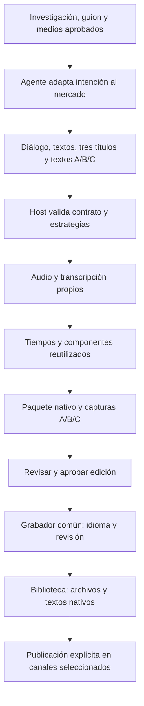

# Miniaturas y publicación por idioma

Para extender este flujo a otros diseños, seguir la
[guía compartida de implementación](estandar-implementacion-ediciones-multilingues-2026-11.md).
Este informe conserva el detalle de la intervención inicial sobre miniaturas y grabador.

2026-11-12 · NodeTech · server y web · instalado en alfred-server.

## Cómo funcionaba al recibir el pedido

La edición EN reproducía su audio y textos, pero sólo exponía una apertura. El adaptador del estudio borraba las miniaturas ES para evitar mezclarlas y no recibía un paquete A/B/C propio. El grabador seguía leyendo el catálogo original: por eso EN tenía controles deshabilitados. Además, la interfaz interpretaba cualquier bloqueo editorial como «Falta youtube_title», aunque el título existía.

## Cómo funciona ahora

Una edición tiene sus tres títulos y tres miniaturas, conserva las imágenes aprobadas del episodio y usa el grabador común con idioma y revisión explícitos. El audio aprobado no se regenera. «Títulos y metadatos» sigue empezando por «Antes de publicar» y después muestra las tres miniaturas/aperturas y los textos nativos.

Elegir A/B/C cambia la apertura de esa edición y recarga el reproductor. No modifica ES ni los archivos congelados que permiten recuperar trabajos sin repetir voz o transcripción. Los controles de grabación usan capacidades reales; la falta de aprobación ya no se presenta como un título ausente.



En una generación nueva, el agente recibe `packaging_source` y las estrategias resueltas junto con la investigación editorial ya disponible. Devuelve `packaging` con tres ángulos de título, emoción/estrategia y texto de A/B/C. El host conserva fotos, geometría y componentes: el agente no recibe autoridad para cambiar rutas, medios o segundos. Se comprueba que el original tenga A/B/C antes de llamar a proveedores. Los intentos antiguos conservan compatibilidad con sus puntos de recuperación.

## Archivos y responsabilidades

```text
nexa-brief-server/src/
├── core/localization/
│   ├── output.py                  # contrato editorial con packaging compatible con histórico
│   └── packaging.py               # tres títulos y textos, sin rutas ni imágenes del agente
├── core/explainer/
│   ├── editions/
│   │   ├── extraction.py          # contexto editorial y A/B/C originales
│   │   ├── packaging.py           # paquete nativo, apertura y aprobación
│   │   ├── studio.py              # estado y capacidades de la edición
│   │   └── service.py             # flujo, captura y activación
│   ├── thumbnails.py              # capturador común, destino por edición
│   ├── recorder.py                # grabador/cola/copy propios del idioma
│   └── render_cache.py            # identidad de audio/configuración y revisión
├── skills/editions/prompts/
│   ├── task.md                    # adaptar intención; no traducción literal ni nueva investigación
│   └── output.schema.json         # contrato sincronizado con el modelo
└── templates/_tools/
    ├── explainer-kit/engine/loader.js # carga de idioma y revisión exacta
    └── commercial/render_promo.py     # mismo encoder, configuración y audio nativos

nexa-brief-web/src/features/explainer/
├── lib/studio-edition.ts           # adaptación sin reutilizar textos/trabajos ES
├── components/PublishPackagePanel.tsx # A/B/C y elección de apertura comunes
├── components/ExplainerStudioSidebar.tsx # mismas pestañas para todos los idiomas
└── hooks/                         # operaciones y estados separados por idioma/revisión
```

```text
$NEXA_PROFILE_DIR/
├── productions/nodetech/<video>/
│   ├── assets/                    # original ES y medios compartidos, conservados
│   ├── publish.json               # paquete original, conservado
│   └── languages/en-US/
│       ├── active.json
│       └── revisions/rev-005/
│           ├── edition.json, script.json, config.json, storyboard.json
│           ├── song-with-outro.mp3, lyrics.json, publish.json, checkpoints.json
│           ├── publication.json   # paquete editorial A/B/C propio del idioma
│           ├── config.publication.json, storyboard.publication.json
│           ├── approval.json      # aprobación ligada a los artefactos exactos
│           ├── thumbnail-{A,B,C}.jpg / .webp
│           └── thumbnail-{A,B,C}-9x16.jpg / .webp
├── renders/videos/…               # máster y miniatura independientes por grabación
└── logs/videos/<video>/recordings/<grabación>/08_resumen_final.json
```

No se añadió otra base de datos: se mantienen DataPort y los registros existentes. `jobs` conserva idioma, revisión, `log_dir`, copias por plataforma y bloqueo de programación; `content_video_details.recordings` conserva idioma, revisión, título y recursos. El lector real de Biblioteca/cola utiliza el resumen nativo mediante `log_dir`. Las revisiones/localizaciones continúan en sus colecciones existentes.

## Grabación, publicación y aprobación

- `POST /api/v1/explainer/videos/<id>/record` recibe `locale` y `revision`, además de los parámetros existentes.
- Captura/elección de miniaturas usa las rutas existentes con `?locale=en-US&revision=rev-005`.
- `POST /api/v1/explainer/videos/<id>/localizations/<locale>/approve` recibe revisión y huella de los artefactos revisados.
- La aprobación cubre audio, diálogo, publicación, configuración/storyboard/transcripción congelados y contenido de las tres variantes. Elegir entre variantes ya revisadas conserva la aprobación; cambiar su texto la invalida.
- Una segunda grabación activa de la misma edición se rechaza antes de cambiar la apertura. Tras esperar turno se revalida revisión, original y aprobación.
- El máster, miniatura y resumen de cada grabación quedan separados. Cambiar una miniatura más tarde no altera una grabación anterior.
- Una edición nativa no entra automáticamente en los horarios generales ES. Los canales deben elegirse explícitamente para esa publicación. La publicación directa usa esos destinos y el idioma nativo, incluido el metadato de idioma de YouTube.
- `publication.json`, aprobación y prompts permanecen privados. El servidor sólo expone los archivos de reproducción y capturas autorizados.

## Piloto revisado

Video `lo-que-le-contas-a-la-ia-no-es-privado-tus-chats`, EN `rev-005`, audio de 660,86 s conservado.

| Opción | Texto | Medio |
|---|---|---|
| A | DELETED? / GONE FOR GOOD? | Tipografía del diseño |
| B | WHO / SEES IT? | Foto ilustrativa aprobada del episodio |
| C | YOUR CHATS BEFORE A JUDGE · 20 MILLION | Ilustración judicial aprobada |

C permanece elegida. Hay capturas reales 1280×720 y 1080×1920; se revisaron lectura, cortes y ausencia de rótulos ES. No se volvió a investigar, buscar imágenes ni generar voz. Las fuentes/créditos del texto EN se comprobaron contra los enlaces del original; no se afirma que se haya actualizado la investigación del episodio.

## Validación y límites

- 31 pruebas de integración/estudio/grabador nativo, incluida aprobación real por HTTP y preservación de ES y archivos congelados.
- 102 pruebas de localización, contratos, kit y caché aprobadas; cuatro casos adicionales del cargador comprueban producción, legado y revisión EN/PT.
- 77 pruebas del grabador y registro con encoder/publicador simulados. Incluyen EN/PT, dos episodios, publicación desde Biblioteca mediante lector/cola reales y bloqueo de horarios ES. Una prueba ajena de catálogo de categorías se excluyó después de comprobar que también falla sin estos cambios: espera seis categorías y el catálogo actual tiene siete.
- 31 pruebas web aprobadas; tras corregir el observador de trabajos se repitieron las 14 directamente afectadas. TypeScript completo aprobado.
- Modal real: tres imágenes cargadas, audio `en-US/rev-005`, recarga al elegir apertura, controles de grabación habilitados y publicación habilitada al marcar un canal. Se probaron las tres pestañas en paneles de 384 y 300 px, sin desplazamiento horizontal. No se pulsó grabar/publicar.
- No se codificó un MP4 completo ni se subió contenido: el encoder y publicador se validaron con dobles. Las capturas y la reproducción sí son reales.

El cambio está en el flujo común, sin condiciones especiales para el ID del piloto. Las otras plantillas adoptarán sus identidades/mercados mediante el contrato existente; esta entrega no declara producciones PT ni migraciones de todas las categorías que no se realizaron.

## Consumo

| Paso de esta corrección | Llamadas nuevas a proveedores |
|---|---:|
| Investigación o imágenes | 0 |
| Voz y transcripción | 0 |
| Agente editorial del pipeline | 0 |

Orquestación y revisiones: Codex de la sesión; tokens/tiempo facturado sin dato. No se usó Opus. No se trasladaron documentos ni el proyecto a servicios externos. Se reutilizaron investigación, audio y medios privados existentes. Los cambios de código se aplicaron con verificación de huellas, sin commit ni push.

## Recursos y evidencia final

Antes de la prueba había 6.638 MiB disponibles; durante una captura, 6.199 MiB; tras cerrar los navegadores, 6.477 MiB. En las muestras de un segundo no hubo entrada/salida de swap. La captura utilizó un Chromium con seis procesos visibles, que desaparecieron al terminar. Después de cerrar la validación no quedó ningún proceso Chromium.

Next de desarrollo pasó aproximadamente de 2.252 a 2.405 MiB RSS a lo largo de cambios, compilaciones y pruebas; el worker API final tenía 152 MiB. Los reinicios de desarrollo impiden comparar directamente el worker API inicial/final. El muestreo total de CPU fue aproximadamente 23 % durante la captura y 2 % después. Esto acredita la liberación de navegadores en esta prueba breve; no demuestra ausencia de una fuga de larga duración.

Resultado final del modal: cero errores JS, cero errores de consola y cero respuestas HTTP fallidas durante su operación. Se observó un `ClientFetchError` de Auth.js al entrar por el acceso directo de desarrollo, antes de abrir el modal; no se modificó autenticación para ocultarlo. La verificación del flujo del estudio quedó separada de ese aviso previo.

Evidencia privada seleccionada: `nexa-brief-server/work/results/native-publication-2026-11-12/` (`en-thumbnails.png`, `en-record-publish.png`, `result.json`). Las demás capturas de prueba permanecen temporales. C sigue elegida, la aprobación nativa es válida y se comprobaron las huellas originales después de las pruebas.
