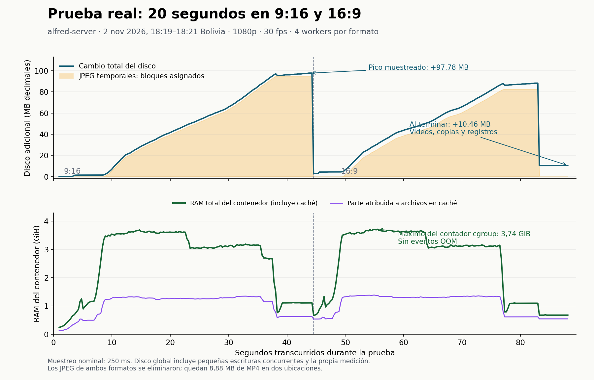

# Prueba real de almacenamiento y RAM: render de 20 segundos

**Servidor:** `alfred-server` · **Fecha:** 2 de noviembre de 2026 · **Ventana de grabación:** 18:19:55–18:21:23, hora de Bolivia (UTC−4).

Se generaron dos videos reales de 20 segundos de «Tu voz, su estafa»: 1080 × 1920 y 1920 × 1080, ambos a 30 fps, con el mismo motor de Nexa. Dos agentes independientes revisaron por SSH el render y Docker/respaldos. La prueba tardó 88,55 segundos de reloj.

## Resultado medido

**En esta prueba no quedaron GB de residuos.** El pico de disco fue de unos **98 MB adicionales**. Al terminar, el disco quedó **10,46 MB por encima del inicio**, incluyendo las dos copias de cada MP4, las firmas y los registros de la medición. Los lotes temporales de JPEG desaparecieron.

| Momento | Usado en `/` (bytes) | GB decimales | Diferencia desde el inicio |
|---|---:|---:|---:|
| Antes del render | 180.890.505.216 | 180,8905 GB | — |
| Máximo observado por el monitor independiente | 180.988.575.744 | 180,9886 GB | **+98,07 MB** |
| Después del render y cinco segundos de espera | 180.900.962.304 | 180,9010 GB | **+10,46 MB** |

El monitor del contenedor, con intervalo nominal de 250 ms, observó un máximo de +97,78 MB; el agente que muestreó el host cada segundo captó +98,07 MB. Son máximos observados, no una garantía de capturar todo instante. La diferencia es de unos 0,29 MB.

**Sobre los «187 GB usados» indicados en el pedido:** en el sistema de archivos raíz de este servidor, durante esta prueba, se midieron los valores anteriores, alrededor de 180,9 GB decimales. No se observó una lectura de 187 GB en esa ventana. Esto no reconstruye una lectura anterior ni descarta picos de otros trabajos. GB y GiB también dan números distintos: 180,89 GB son aproximadamente 168,47 GiB.



## Cuánto pesan los videos y qué se conserva

| Formato | Duración comprobada | Tamaño lógico | MiB |
|---|---:|---:|---:|
| 9:16, H.264 + AAC | 20,000 s | 2.388.941 bytes / **2,39 MB** | 2,28 |
| 16:9, H.264 + AAC | 20,000 s | 2.053.332 bytes / **2,05 MB** | 1,96 |
| Un ejemplar de cada formato | — | **4.442.273 bytes / 4,44 MB** | 4,24 |
| Dos ejemplares de cada formato | — | **8.884.546 bytes / 8,88 MB** | 8,47 |

El flujo conserva una copia en cada una de estas carpetas:

```text
/home/alfred/Projects/Git-Projects/nexa-brief/nexa-brief/nexa-brief-server/src/templates/nodetech/clonan-tu-voz-con-3-segundos-de-audio-las-llamad/render/preview/

/home/alfred/.local/share/nexa-brief/profiles/profesional/output/node_tech/rough/clonan-tu-voz-con-3-segundos-de-audio-las-llamad/preview-20s/
```

Nombres de los archivos:

```text
clonan-tu-voz-con-3-segundos-de-audio-las-llamad-9x16-20s.mp4
clonan-tu-voz-con-3-segundos-de-audio-las-llamad-16x9-20s.mp4
```

Además se conservaron dos firmas de 65 bytes y **0,96 MB de registros de esta auditoría**: 940.586 bytes de muestras, 11.325 de resumen, 4.356 de log y dos snapshots pequeños. Las firmas y los archivos ocupan bloques completos en disco. El espacio asignado a los archivos nuevos de los dos directorios de preview y a estos registros suma aproximadamente **9,88 MB**, antes de contar los directorios.

El `df` mide todo el sistema de archivos: también entran metadatos y pequeñas escrituras concurrentes. Por eso no se atribuyen automáticamente al render los cientos de KB restantes. El agente observó un aumento de unos 0,31 MB en `.runtime` en su ventana de seguimiento, algo más amplia que el render.

Los MP4 completos anteriores de casi diez minutos **mantuvieron sus SHA-256**. La firma de los datos de producción también fue idéntica antes y después. No se alteró el contenido de la plantilla.

## Dónde estuvo el pico temporal

El motor escribió **600 JPEG por formato**, a calidad 92, en `/tmp` del contenedor API. Esos cuadros estuvieron en la capa escribible de Docker, no en el `output/` del host. Se codificaron como MP4 al completar cada lote.

| Formato | Carpeta temporal | JPEG | Tamaño lógico máximo | Bloques asignados |
|---|---|---:|---:|---:|
| 9:16 | `/tmp/tmp8bq95k2i` | 600 | **93,72 MB** | **95,07 MB** |
| 16:9 | `/tmp/tmpawjs6_a_` | 600 | **81,29 MB** | **82,52 MB** |

Los formatos se ejecutaron uno después del otro. Sus lotes no se sumaron como un único pico. Los cuatro workers repartieron los cuadros de cada formato.

Antes y después, los archivos preexistentes de `/tmp` sumaban exactamente **583.918 bytes lógicos / 598.016 bytes asignados**, en seis archivos. Después no quedaba ninguno de los lotes de 600 JPEG. Docker también mostró que la capa escribible de la API regresó a menos de 1 MB.

**Lo demostrado:** el motor consume bastante más espacio durante la captura que el MP4 final, y esta ejecución eliminó sus cuadros temporales. **Lo no demostrado:** una interrupción abrupta o el pico exacto de la grabación original completa. No se forzó una caída ni se extrapoló linealmente este tramo de 20 segundos a todas las escenas del video largo.

## RAM: otra subida distinta del uso de disco

El monitor también leyó el cgroup del contenedor, separándolo de los procesos del host:

| Métrica | Antes | Máximo | Después, aún con el monitor activo |
|---|---:|---:|---:|
| RAM total cargada al contenedor, incluida caché | 267,78 MB | **4.020,74 MB / 3,74 GiB**, contador `memory.peak` | 731,87 MB |
| RAM de archivos en caché | 136,58 MB | 1.480,77 MB en la muestra de RAM más alta | 589,48 MB |
| Memoria anónima de procesos | 120,90 MB | 2.437,28 MB en esa misma muestra | 129,01 MB |

El máximo de `memory.current` muestreado fue 3.989.852.160 bytes; el contador de pico del kernel captó 4.020.744.192 bytes. El uso subió principalmente con Chromium y sus páginas de captura; parte también fue caché de archivos. **La caché en RAM no son nuevos archivos residuales de ese tamaño en el disco.**

Al terminar, la memoria anónima volvió cerca de su nivel inicial. Permaneció caché de archivos, que el sistema puede reclamar bajo presión. Los contadores no registraron OOM ni procesos terminados por falta de memoria. La swap cargada al contenedor rondó 14,17 MB y no creció durante la prueba; la swap del host ya estaba casi llena antes de empezar.

Otro consumidor independiente: `nexa-content-worker.service`, fuera de Docker. Durante el render se mantuvo en unos **33 MB** de RAM. Después se reinició a las **18:21:39** y alcanzó **4.489.617.408 bytes, unos 4,49 GB**, a las 18:21:55, mientras el disco permanecía prácticamente estable. Esa subida posterior pertenece a otro trabajo de contenido; no al video de prueba.

## Docker y respaldos durante la prueba

El agente de Docker confirmó al terminar:

- Mismos IDs de imágenes; **ningún build nuevo**.
- 26 imágenes, 71,46 GB informados por Docker.
- Caché sin cambios: 201 entradas, 50,89 GB informados.
- Volúmenes sin cambios: 8,139 GB.
- Respaldo de migración del 2 de noviembre: **17.384.345.600 bytes**, sin cambios.
- Respaldo del 24 de octubre: **8.146.165.760 bytes**, sin cambios.

Las cifras de imágenes y caché comparten capas: no se suman para calcular bytes físicos independientes. Son acumulación existente, que sigue siendo relevante para el consumo total del servidor; no crecieron durante estos 20 segundos de contenido.

## Incidente encontrado antes de poder renderizar

El primer intento con el flujo `ExplainerRecorder → kit.py render` falló **antes de crear cuadros**:

```text
ModuleNotFoundError: No module named 'src.core.explainer.runtime'
```

El host tenía `src/core/explainer/runtime.py`, modificado a las 18:08:12 de Bolivia. El `kit.py` montado, modificado a las 18:13:50, lo importaba en su línea 401. La imagen API actual no tenía ese módulo central: las plantillas se montan desde el host, pero `src/core` seguía dentro de una imagen anterior.

Para no cambiar Docker ni contaminar la medición con un build, la prueba exitosa usó **la misma clase `ExplainerRecorder` y su rama de preview**, inyectando un runner que llama directamente a **ese mismo `render_promo.py`**, con los argumentos de `kit.py`: 20 segundos, cuatro workers, 1080p y 30 fps. Se mantuvieron la captura, codificación y copia de previews. Solo se omitió el wrapper incompatible.

Esta es una prueba real del motor y su almacenamiento; **no certifica que el botón de la interfaz funcione de extremo a extremo mientras persista esa desincronización**. Ese despliegue requiere una corrección independiente. No se editó el código de la aplicación ni se reconstruyeron o reiniciaron servicios para esta auditoría.

## Evidencia conservada y validación

Directorio principal en el servidor:

```text
/home/alfred/.local/share/nexa-brief/profiles/profesional/reports/disk-test-20261102T221955Z/
```

Conserva `before.json`, `samples.jsonl`, `render.log`, `after.json` y `summary.json`. El intento fallido está separado en `disk-test-20261102T221905Z/`; no contiene MP4 ni cuadros generados.

Junto a este informe se guardan `prueba-medida-render-20s-2026-11-02.evidencia.json` y la gráfica. El JSON reúne el resumen medido, la revisión independiente, hashes y el inventario de archivos. Las series originales y el script de instrumentación están en el directorio de evidencia del perfil, fuera del código fuente.

Se verificaron duración, resolución, códecs y tamaño con `ffprobe`; se decodificaron ambos videos completos con FFmpeg sin errores. Se revisó visualmente un cuadro de control horizontal y se comprobó la transferencia de ambos MP4 mediante SHA-256. No se publicó contenido ni se borraron respaldos, cachés o archivos existentes.

**Conclusión de esta ejecución:** los residuos persistentes de video son las copias de MP4 previstas, **8,88 MB** en total. El consumo grande y pasajero estuvo en los JPEG y, sobre todo, en la RAM de Chromium. Los respaldos y Docker explican una parte importante del almacenamiento ya acumulado, pero no aumentaron en esta prueba. El salto histórico de 160 a 187 GB sigue necesitando una medición de la ventana concreta en que ocurrió.
