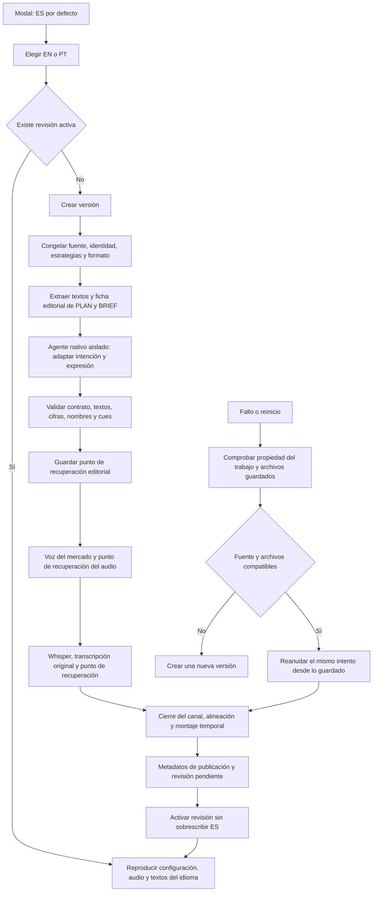

# Revisión y recuperación de las ediciones de NodeTech

> Informe de una intervención anterior. La
> [guía compartida de implementación](estandar-implementacion-ediciones-multilingues-2026-11.md)
> reúne el flujo actual y las comprobaciones posteriores de miniaturas, grabación y
> publicación por idioma. Usarla como entrada para incorporar otros diseños.

Fecha: 2026-11-12. Alcance: servidor y web, diseño `rough`, piloto de privacidad de chats.
Estado: implementación recuperada y vista previa EN comprobada; aprobación editorial pendiente.

## 1. Cómo funcionaba al retomar el trabajo

El trabajo anterior ya había integrado en **alfred-server** los mercados ES/EN/PT,
las identidades de voz por mercado, los formatos, la extracción de textos, el agente
editorial, el servicio de generación y el selector del modal. No estaba simplemente
pendiente de empezar: había siete intentos de generar inglés registrados.

El último intento, `ff4976cf06f344df98191c274ab07d73` (`rev-007`), aparecía
`running / agent / 18%`, pero no tenía ejecutor vivo. La API y la web estaban detenidas.
Un intento anterior, `0c5b7a5f531a4591ad94e547e5e1b991` (`rev-005`), sí conservaba
salida editorial, voz y transcripción reales, y había fallado al preparar el cierre.

El flujo anterior ejecutaba de nuevo agente → voz → transcripción al reintentar.
No tenía recuperación por etapas. Los trabajos huérfanos sólo se detectaban al enviar
otra generación; la interfaz podía quedarse indefinidamente mostrando progreso.
Un fallo de regeneración también ocultaba la vista previa de la revisión anterior.

La copia local de este repositorio y la de alfred-server tienen cambios previos distintos.
La implementación ejecutable revisada y corregida está en:

```text
/home/alfred/Projects/Git-Projects/nexa-brief/nexa-brief/
```

No se sustituyeron en bloque archivos locales divergentes. Este informe se conserva
en ambos repositorios. No se publicaron documentos en servicios externos.

## 2. Resultado comprobado

- ES sigue siendo la edición original y la selección inicial del modal.
- EN está activa como `rev-005`, con guion, textos de escenas, voz Iapetus,
  transcripción, tiempos, cierre y paquete editorial propios. Duración final: **660,86 s**.
- PT (`pt-BR`, voz Orus) está configurado y probado con dobles; no se generó un piloto
  portugués real en esta intervención.
- EN se muestra como **Requiere revisión**. Una prueba técnica no aprueba su calidad nativa.
- No se grabó ni publicó ningún video. Las acciones de la edición original siguen separadas.

Entrada privada de la web: `http://192.168.20.12:3000/plantillas?cat=node_tech`.
En «Demos de diseño», abrir «20 millones de conversaciones como la tuya» y elegir EN.

## 3. Cómo funciona ahora



La recuperación omite únicamente etapas cuyos archivos e inputs coinciden con sus hashes.
Si sólo terminó el agente, aún debe generar voz; si también terminó la voz, sólo falta
transcribir y continuar. Una nueva generación continúa disponible cuando la fuente cambió.

La investigación y los medios del episodio se reutilizan. La adaptación recibe la ficha
editorial, textos fuente, identidad y estrategias resueltas; no vuelve a buscar imágenes
ni a investigar. El código aplica los textos y calcula los tiempos del motor.

## 4. Estructura que existe en el servidor

```text
nexa-brief-server/
├── src/core/
│   ├── markets/                         # registro de mercados y alias
│   ├── editions/                        # contratos, formatos y textos localizables
│   ├── localization/                    # tabla de textos, validación y composición del prompt
│   └── explainer/editions/
│       ├── resolver.py                  # resuelve y congela las capas de la edición
│       ├── extraction.py                # ficha editorial, campos de texto y cues fuente
│       ├── agent.py                     # factoría aislada; una reparación acotada
│       ├── application.py               # aplica textos y sincroniza escenas
│       ├── retiming.py                  # mínimos visuales con desplazamiento acotado
│       ├── checkpoints.py               # hashes de inputs y archivos por etapa
│       ├── service.py                   # cola, recuperación y activación
│       ├── repository.py                # acceso a DataPort
│       └── preview.py                   # configuración de la revisión activa
├── src/skills/editions/prompts/
│   ├── lead.md                          # función y criterios del agente editorial
│   ├── task.md                          # tarea y restricciones de entrega
│   └── output.schema.json
└── src/templates/_tools/
    ├── design-definitions/rough/
    │   ├── identity/persona.json
    │   ├── identity/markets/{es-419,en-US,pt-BR}.json
    │   ├── agents/edition.md            # dirección propia del diseño
    │   ├── formats/
    │   └── localizable.json
    └── explainer-kit/tools/
        ├── edition_context.py
        ├── edition_job.py
        └── outro.py

nexa-brief-web/src/features/explainer/
├── hooks/useLocalizations.ts
└── components/
    ├── ExplainerVideoCard.tsx           # ES / EN / PT, crear y reanudar
    └── PublishPackagePanel.tsx           # secciones del paquete por idioma
```

## 5. Almacenamiento real del piloto

Perfil verificado: `/home/alfred/.local/share/nexa-brief/profiles/profesional`, esquema v3.

```text
profiles/profesional/
├── data/                                # registros mediante DataPort
│   ├── jobs                             # kind=localization; progreso, error y revisión
│   ├── video_localizations
│   └── video_localization_revisions
├── .system/runtime/localization/<job>/   # intentos incompletos; no son públicos
└── productions/nodetech/<episodio>/
    ├── assets/                          # original ES, sin sustituir
    ├── PLAN.md / BRIEF.md / publish.json
    └── languages/en-US/
        ├── active.json                  # apunta a rev-005
        └── revisions/rev-005/
            ├── edition.json             # parámetros y revisión fuente congelados
            ├── strings.source.json / strings.json
            ├── script.json / storyboard.json / config.json
            ├── agent/                   # prompts, salidas y consumo de intentos editoriales
            ├── song.mp3 / song-with-outro.mp3
            ├── transcript-raw.json / lyrics.narration.json / lyrics.json
            ├── alignment.json / publish.json
            ├── checkpoints.json / review.json
            └── qa/                      # capturas y comprobación de navegador/modal
```

Los nombres bajo `data/` representan colecciones, no una imposición del formato físico
del backend de almacenamiento. Los artefactos privados, prompts y edición congelada no
se exponen por la ruta pública de archivos de la vista previa.

## 6. Correcciones realizadas en esta revisión

1. **Recuperación sin repetir pasos pagados.** Checkpoints ligados a la edición congelada,
   entradas y hashes de archivos. La transcripción de narración se conserva separada del
   archivo que después recibe el cierre. Archivos alterados o fuente distinta rechazan
   la recuperación. No se debilitó el aislamiento del ejecutor de agentes.
2. **Trabajos interrumpidos.** La API consulta la propiedad mediante un bloqueo del sistema,
   también entre procesos. Reconcilia trabajos huérfanos al listar o consultar progreso.
   La activación puede completarse idempotentemente después de mover archivos o escribir
   el puntero; se conserva la revisión anterior si falla una regeneración.
3. **Sincronización.** Un cue trasladado a un segmento vecino utiliza ese segmento destino.
   Las duraciones de escenas principales siguen los nuevos límites de narración; las de
   overlays conservan su función técnica. Si un mínimo visual lo exige, se permite mover
   límites hasta ±1,5 s, con aviso detallado; si no alcanza, se rechaza el montaje.
4. **Fidelidad determinista.** Nombres protegidos también en narración; hashes estables al
   ordenar sus nombres; comparación de signos, decimales y algunas unidades; equivalencia
   ortográfica para contracciones separadas por STT. Esto no valida atribuciones ni intención.
5. **Cierre hablado.** Corregidos errores de variables al guardar la medición y al estimar
   palabras clave. Un MP3 ya generado se reutiliza; las estimaciones quedan identificadas.
6. **Modal.** Un error de actualización no cambia silenciosamente EN por ES; una regeneración
   fallida conserva el preview activo. Se distingue trabajo de revisión activa, se marca
   fuente desactualizada y se ofrecen Reanudar o Crear nueva versión según corresponda.
7. **Calidad.** La activación técnica deja aprobación editorial pendiente explícita.

## 7. Evidencia y consumo

- **113 pruebas** de backend aprobadas: contratos, extracción, kit, recuperación,
  activación, errores, seguridad de rutas y navegador con perfil temporal.
- **10 pruebas** del modal/hooks aprobadas y `tsc --noEmit` sin errores.
- Navegador real contra el piloto activo: 1280×720 y 540×960; idioma EN, audio `rev-005`,
  80 beats cargados incluyendo overlays; sin errores JS ni respuestas HTTP fallidas.
- Web real, con el acceso de desarrollo existente: ES inicial, EN con título y audio,
  PT faltante, cierre libera iframe y reapertura restaura ES. No se pulsó generar contenido.
- Revisión adversarial de recuperación e interfaz, seguida de correcciones y regresiones.
- **Ninguna llamada nueva a Opus ni a otro modelo editorial, ni nueva síntesis de voz**
  durante esta recuperación. Se reutilizaron agente, voz y STT del intento 005.
  La medición pendiente del cierre se ejecutó con Whisper local y el montaje con FFmpeg.
- Los archivos de uso editoriales de los intentos previos registran 10 ejecuciones,
  864.683 tokens de entrada, 2.380.761 de entrada cacheada, 389.277 de salida y 270.451 de
  razonamiento. Son campos archivados: no deben sumarse como categorías necesariamente
  independientes. Su `cost_usd` acumulado es **7,5893781**, referencia registrada del CLI,
  no una factura verificada ni gasto de esta recuperación.
- El ledger de voz del episodio registra para el 12 de noviembre tres llamadas previas:
  2.565 tokens de entrada y 16.161 de salida. No proporciona un coste facturado completo.

La comprobación de Vitest utilizó `VITEST_SKIP_INSTALL_CHECKS=1` porque su comprobador
de dependencias encontraba un `package.json` inválido en el home del servidor. `jsdom`
ya estaba instalado y las pruebas sí se ejecutaron. No se modificó ese archivo ajeno
al proyecto. La advertencia de deprecación Starlette/httpx sigue presente.

## 8. Pendientes reales antes de considerar el contenido aprobado

- Escuchar y revisar la edición EN completa con criterio editorial y de voz nativa.
  Whisper dejó **27 discrepancias crudas** y **13 con la transcripción corregida**;
  incluyen diferencias de cifras escritas y dos posibles omisiones cerca de **03:02** y
  **09:33**. Debe comprobarse el audio: STT no demuestra que falten esas frases.
- Revisar cuatro anclas resueltas proporcionalmente y dos límites movidos por el mínimo
  del clip. Los desplazamientos se registran en `review.json`; no se ocultaron.
- Aprobar identidad, voz, expresión, títulos y matices por mercado; actualmente son borradores.
- Miniaturas A/B/C propias del idioma, edición manual, grabación y publicación de la revisión
  todavía no están integradas en el panel localizado. El panel lo indica y no reutiliza
  las acciones de grabación/publicación ES como si fueran EN.
- Generar y evaluar PT real cuando corresponda. El soporte de contrato y flujo no equivale
  a tener contenido portugués ya creado.
- Los formatos corto animado/documental y el umbral configurable son parte de la estructura;
  este piloto comprueba el documental existente. Un rediseño corto requiere su propia
  producción y validación visual; esta recuperación no lo sustituye ni lo acredita.

La API de creación sigue usando la factoría aislada y los roles configurados. La recuperación
de EN no demuestra disponibilidad ni cuota futura de esos proveedores; no se lanzó una nueva
ejecución para acreditarla ni se usó Opus como respaldo.

## 9. Endpoints de operación

```text
GET  /api/v1/explainer/videos/<id>/localizations
POST /api/v1/explainer/videos/<id>/localizations     {"locale":"en-US"}
GET  /api/v1/explainer/localization-jobs/<job>
POST /api/v1/explainer/localization-jobs/<job>/resume
```

La API y web de desarrollo se levantaron con `make dev`, publicación automática deshabilitada,
en la unidad transitoria del usuario `nexa-dev-localization.service`. No hubo commit ni push.

## 10. Sidebar unificado y ajustes solicitados el 12 de noviembre

ES, EN y PT usan ahora `ExplainerStudioSidebar`, con las mismas pestañas de
«Títulos y metadatos», «Grabar y publicar» y «Uso». Se retiró `LocalizedSidebar`.
El encabezado identifica el idioma; ES sigue siendo el predeterminado.

«Títulos y metadatos» empieza en «Antes de publicar». Se retiraron de esa pestaña
«Completar preparación», su regeneración con IA y el selector/capturador superior A/B/C.
Se conservan las secciones del paquete, empezando por miniatura y apertura.
El aviso de intento anterior fallido y la regeneración de una revisión activa ya no
ocupan la barra del reproductor. La revisión editorial real aparece dentro del paquete.

`lib/studio-edition.ts` adapta los datos editoriales del idioma al estudio común y
borra los títulos, trabajos, miniaturas y textos ES de la vista localizada.
`src/core/explainer/editions/studio.py` entrega la apertura, duración y revisión propias.
Una edición sin variantes A/B/C ni captura no las presenta como si ya estuvieran creadas.
La apertura EN se puede revisar usando la vista real de su revisión.

La pestaña Uso de un idioma consulta sus intentos editoriales, incluidos los fallidos,
con `GET /api/v1/explainer/videos/<id>/localizations/<locale>/usage`. No utiliza el
ledger ES como si perteneciera a EN. Los tokens sin atribución de voz quedan identificados
como pendientes, y no se inventa un total que sume razonamiento o caché dos veces.

En esta primera revisión, ES conservaba su grabación/publicación y EN/PT aún mostraban
controles deshabilitados. Esa limitación quedó resuelta en la integración de miniaturas
y publicación descrita en la sección 11. Seleccionar idioma o pestaña no ejecuta grabaciones.

Se corrigió la anchura con mínimos flexibles, pestañas en tres columnas, controles que
se ajustan al panel y cortes de palabras/URLs. Las miniaturas laterales usan imágenes
o bocetos estáticos; ya no montan un motor por cada opción. Los pedidos de vista previa
se cancelan al desmontar el panel.

Validación de esta revisión:

- 17 pruebas de web, TypeScript sin errores, 16 pruebas de integración y 5 unitarias del servidor.
- Navegador real: 18 combinaciones (ES/EN/PT × tres pestañas × dos tamaños de pantalla).
  En paneles de 300 y 341 px, `scrollWidth == clientWidth`, sin desbordamiento horizontal.
- Ningún iframe dentro del sidebar, ningún error JS y ninguna solicitud de generación,
  grabación o publicación durante la prueba de interfaz.
- Prueba breve de reproducción y tres ciclos de apertura/cierre: proceso de validación
  con Chromium pasó de 24,5 MiB y cero hijos a 1.886,8 MiB y ocho hijos durante el uso,
  y volvió a 30,9 MiB y cero hijos al cerrar. CPU muestreada: 117,9 % durante reproducción,
  0 % después; contadores de intercambio sin cambios. Son mediciones de desarrollo de
  esa sesión, no una comparación de rendimiento con la versión anterior ni una prueba prolongada.
- Evidencias temporales seleccionadas: `nexa-brief-server/work/results/studio-sidebar-2026-11-12/`.


## 11. Tres miniaturas y publicación por idioma

La revisión siguiente completó la integración que faltaba: paquete A/B/C nativo,
selección de apertura con recarga del reproductor y grabador compartido que consume
audio, textos y miniatura del idioma/revisión seleccionados. EN rev-005 conserva su
audio aprobado. No se ejecutó una grabación completa ni una publicación real.

El detalle de estructura, aprobación, cola, pruebas y límites está en
[Miniaturas y publicación por idioma](miniaturas-publicacion-por-idioma-2026-11-12.md).


## 12. Creación desde web y agente: verificación real

La prueba de PT rev-001 terminó por la misma API: botón web, recuperación por CLI y reutilización sin otra generación. Incluye el arreglo de cifras PT y recuperación de JSON válido sin repetir el modelo. [Cambios, pruebas, consumo y pendientes editoriales](creacion-web-agente-nodetech-2026-11-12.md).
