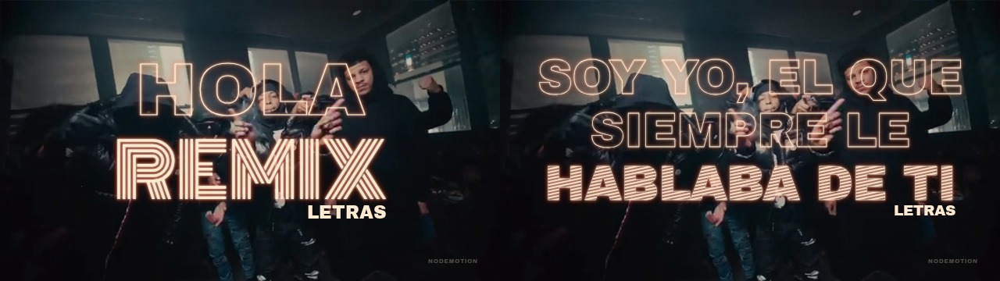

# NodeMotion

Plantillas de música, letras, imagen y video. La [guía de diseño](DESIGN.md) reúne el contrato de miniaturas, el catálogo de estilos y la receta de réplica. Cada plantilla incluye su propio `DESIGN.md` y la captura A/B en su README.

La configuración visual de miniaturas se centraliza en `design-tokens.json`; los videos conservan sus motores y generadores actuales. Las fuentes locales de las miniaturas y sus licencias están en `assets/fonts/`.

Resultados y límites de las comprobaciones: [docs/VALIDACION.md](docs/VALIDACION.md).
