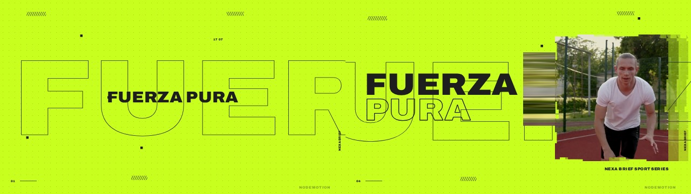

# promo-dynamic · diseño reproducible

Archivo variable y lima eléctrica sobre tinta. Grandes palabras, recortes, volantes gráficos y HUD. Cortes y cambios de tamaño marcados por el audio.

Esta ficha se complementa con la [guía común de NodeMotion](../../DESIGN.md). Código del video: `index.html`; configuración: `assets/config.json`. Fuente editable del motor: `../../_tools/commercial/build/ (dynamic.js y promo-dynamic.spec.json)`.

## Tipografía y color

Miniatura A: **Archivo 900**. B: **Archivo 900**. Estilo: `normal`. Las fuentes y combinaciones del video se conservan en el config y CSS originales:

```json
{
  "googleUrl": "https://fonts.googleapis.com/css2?family=Archivo:wdth,wght@62..125,100..900&display=swap"
}
```

Paleta declarada por el video:

```json
{
  "palette": {
    "neon": "#C9FF1F",
    "ink": "#1E1E1E"
  }
}
```

Los tokens complementarios de miniaturas se consultan en `../../design-tokens.json` → `templates.promo-dynamic`. No sustituir estos colores por la paleta de otra plantilla. Los campos dependientes del medio (filtro, contraste, mezcla) pertenecen al config del video; en miniaturas, ajustar el oscurecimiento del fondo sin perder su motivo.

## Composición y miniaturas

Ambas opciones salen de escenas reales del video: fondo lima #C9FF1F con la retícula de puntos, rayados, cuadritos, fecha, contador y texto vertical del HUD; tinta #1E1E1E; Archivo 900 extendida. La foto conserva sus colores.

**A (escena «INTRO», segundo 2):** sin foto. La palabra más larga del titular ocupa el ancho en contorno gigante (≈400 px sobre 720, puede salirse por la derecha como en el video) y el titular completo va sólido en una fila al centro, un 15% más grande que en el video (≈58 px sobre 720; se reduce solo si no cabe).

**B (escena «FUERZA PURA», segundo 5):** titular en dos filas, la primera sólida y la segunda en contorno, con la palabra en contorno gigante detrás. La foto lleva el borde escalonado tipo píxel y la estela de copias y la tira de píxel estirado congeladas, a un lado (`design.side`, derecha por defecto). La marca (`brand.tag`) va debajo. Usa las mismas palabras que A o menos.

Titular por defecto: el primer rótulo de dos filas del guion (`lyrics.json`, campo `lines`), por ejemplo «FUERZA PURA»; si no hay guion, el título del borrador. Sin «LETRAS» ni artista. NODEMOTION queda discreta en la esquina inferior derecha.



## Movimiento, transiciones y componentes

Archivo variable y lima eléctrica sobre tinta. Grandes palabras, recortes, volantes gráficos y HUD. Cortes y cambios de tamaño marcados por el audio.

Funciones disponibles en el motor (nombres reales para localizar el comportamiento):

`loadDB`, `deepMerge`, `mulberry32`, `lerpStr`, `easeFn`, `div`, `measure`, `canvasText`, `tx`, `duoFilter`, `asStill`, `blurPass`, `noiseTile`, `loadScript`, `linesOf`, `buildTimeline`, `lyricPhrases`, `lyricTimeline`, `enterFx`, `pickTrans`, `preloadMedia`, `mediaSpec`, `mbox`, `kenBurns`, `syncVideos`, `buildScene`, `begin`, `sceneAt`, `mount`, `render`, `frame`, `boot`, `hudDecor`, `jag`, `cut`, `flyer`, `bgWord`, `mainWord`, `base`

Las funciones `loadDB/loadConfig` cargan datos; `loadLyrics` y las funciones `group/buildPlan/buildTimeline` organizan la letra; las funciones `place/build/make` construyen piezas; `frame/render/draw` actualizan el estado. Los nombres que no aparezcan arriba no forman parte de este motor. Conservar su separación al replicarlo.

Keyframes CSS declarados: no declara keyframes CSS; el movimiento se calcula en JavaScript/timeline.

Transiciones y animaciones CSS registradas en el código:

El timeline de JavaScript define los tiempos y las curvas. Usar las funciones de escena y `render/frame`, con el audio como reloj; no convertirlas en animaciones CSS independientes.

### Outro compartido

`components/outroV2.js` es una segunda opción con la misma API y parámetros; se elige con `"outro": {"version": "v2"}` en el JSON o con `?outro=v2` en la URL del showcase. Sin indicarlo se usa `outro.js`.

`components/outro.js` (global `NexaPromoDynamicOutro`) es la implementación única del
cierre: fondo neón `#C9FF1F` con el HUD de la promo, tinta `#1E1E1E`, Archivo extendida
(`.ex` / `.lb`). No necesita fotos. Reserva por defecto los últimos **3,5 segundos dentro
de la duración de la música** (recorta o elimina las escenas que caen en ese tramo), con
entrada animada y lectura sostenida hasta el último fotograma. API: `defaults`,
`options(config)`, `timeline(scenes, duration, config, builders)` y
`render(sc, X, palette, config, tools)`; `dynamic.js` lo importa (URL canónica
`/api/v1/templates/promo-dynamic/showcase/components/outro.js` en previews,
`./components/outro.js` en local) y, si no carga, conserva la escena `logo` como final.
El diseño actual es provisional.

El caso activo del JSON puede definir `outro`; si se omite, usa los valores del
componente. No copies sus valores por defecto a cada video. Ejemplo de personalización:

```json
{
  "outro": {
    "sec": 3.5,
    "title": "Gracias",
    "sub": "Por ver",
    "cta": "Suscríbete",
    "channel": "NodeMotion",
    "support": "Tu apoyo hace posible que sigamos trayendo más contenido.",
    "url": "youtube.com/@nodemotion"
  }
}
```

`enabled: false` conserva el final del guion. `type` permite elegir otro tipo de escena
ya existente (si no existe, usa `outro`). Los textos vacíos se omiten.

## Receta para replicar

1. Cargar el config activo y los medios relativos; mantener paleta y familias tipográficas anteriores.
2. Seguir la descripción de composición y las funciones de escena. Conservar la semilla para que las elecciones aleatorias se repitan al buscar un tiempo.
3. Mantener los tiempos de transición indicados y los del timeline del código cuando no hay CSS. La entrada de cada palabra sigue `lyrics.json` y el reloj del audio.
4. Adaptar a 16:9 y 9:16 con las reglas originales de viewport; comprobar que la palabra dominante cabe completa.
5. Para miniaturas, usar el renderer compartido y las reglas A/B. Capturar ambas y comparar a tamaño pequeño; verificar también el JPEG final de la opción elegida.
