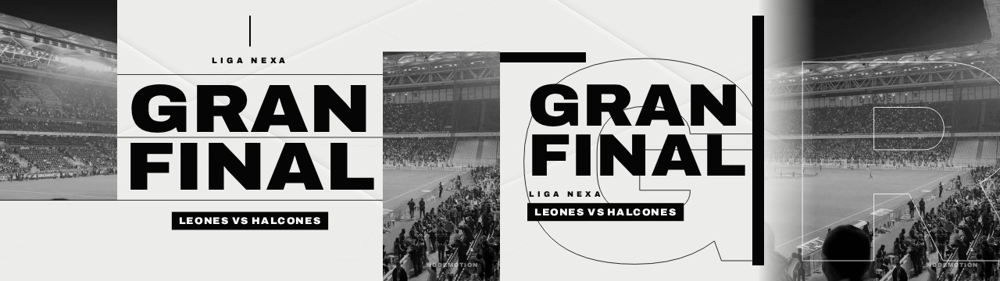

# promo-editorial · diseño reproducible

Composición editorial de papel, blanco y negro con Archivo variable. Filetes, contornos, cortes de texto, placas y medios a sangre. Barridos y entradas por secciones.

Esta ficha se complementa con la [guía común de NodeMotion](../../DESIGN.md). Código del video: `index.html`; configuración: `assets/config.json`. Fuente editable del motor: `../../_tools/commercial/build/ (editorial.js y promo-editorial.spec.json)`.

## Tipografía y color

Miniatura A: **Archivo 900**. B: **Archivo 900**. Estilo: `normal`. Las fuentes y combinaciones del video se conservan en el config y CSS originales:

```json
{
  "googleUrl": "https://fonts.googleapis.com/css2?family=Archivo:wdth,wght@62..125,100..900&display=swap"
}
```

Paleta declarada por el video:

```json
{
  "palette": {
    "paper": "#ECECEA",
    "black": "#050505",
    "white": "#FBFBFB"
  }
}
```

Los tokens complementarios de miniaturas se consultan en `../../design-tokens.json` → `templates.promo-editorial`. No sustituir estos colores por la paleta de otra plantilla. Los campos dependientes del medio (filtro, contraste, mezcla) pertenecen al config del video; en miniaturas, ajustar el oscurecimiento del fondo sin perder su motivo.

## Composición y miniaturas

Archivo 900, extendida al 112%, conserva la grotesca del video. Papel #ECECEA, tinta #050505 y blanco #FBFBFB proceden del config activo.

Ambas opciones salen de escenas reales del video y tratan la foto en blanco y negro, igual que el gradado de la promo.

**A (escena «FINAL ROUND», segundo 4):** papel con los dos bloques negros del video convertidos en ventanas a la misma foto o fotograma (izquierda arriba, derecha abajo). El título, de una a cinco palabras y máximo dos filas, va centrado entre filetes finos; encima, una marca vertical y el nombre de la promoción en versalitas espaciadas; debajo, una placa negra con la frase. Sin medio, las ventanas quedan como los bloques negros originales.

**B (escena de equipos, segundos 13 y 14):** foto a sangre en un lado (`design.side`: `right` por defecto o `left`), fundida con el papel. Tiene las dos primeras letras del título en contorno gigante (tinta sobre papel, blanco sobre la foto), la barra negra vertical en el corte y una barra horizontal en el borde izquierdo. El título usa la misma cantidad de palabras que A o menos e incluye la misma placa (nombre espaciado y placa negra con la frase).

Placa: el nombre sale de `brand.name` y la frase de `brand.left` + «vs» + `brand.right` (o `brand.tagline`); no se inventan textos. No se añaden «LETRAS» ni artista. NODEMOTION mantiene una presencia discreta en la esquina. El título por defecto es `brand.round` o `brand.name`.



## Movimiento, transiciones y componentes

### Outro compartido

`components/outroV2.js` es una segunda opción con la misma API y parámetros; se elige con `"outro": {"version": "v2"}` en el JSON o con `?outro=v2` en la URL del showcase. Sin indicarlo se usa `outro.js`.

`components/outro.js` es la implementación única del cierre: papel `#ECECEA`, tinta
`#050505`, blanco `#FBFBFB`, Archivo, filetes y barridos de bloques. No necesita fotos.
Reserva por defecto los últimos **3,5 segundos dentro de la duración de la música**,
con entrada animada y lectura sostenida hasta el último fotograma.

El caso activo del JSON puede definir `outro`; si se omite, usa los valores del
componente. No copies sus valores por defecto a cada video: así los próximos
ajustes del componente se heredan. Ejemplo de personalización:

```json
{
  "outro": {
    "sec": 3.5,
    "title": "Gracias",
    "sub": "Por ver",
    "cta": "Suscríbete",
    "channel": "NodeMotion",
    "support": "Tu apoyo hace posible que sigamos trayendo más contenido.",
    "url": "youtube.com/@nodemotion"
  }
}
```

`enabled: false` conserva el final del guion. `type` permite elegir otro tipo ya
registrado en el motor (por ejemplo `logo`); un tipo desconocido usa `outro`.
Los colores y la fuente proceden del diseño activo. Los textos admiten cadenas
vacías. El soporte usa varias líneas cuando lo requiere el formato vertical.

Las vistas de plantilla y drafts cargan el componente canónico con una URL nueva
por apertura para evitar cachés antiguas. Navegador sirve el archivo canónico al
grabar Editorial; HyperFrames toma la plantilla y el componente actuales al iniciar
su trabajo. Los recursos `components` también se declaran para uso local.
Modificar el cierre requiere editar solo este componente; modificar su conexión
requiere editar `editorial.js` y regenerar únicamente `promo-editorial`.

Composición editorial de papel, blanco y negro con Archivo variable. Filetes, contornos, cortes de texto, placas y medios a sangre. Barridos y entradas por secciones.

Funciones disponibles en el motor (nombres reales para localizar el comportamiento):

`loadDB`, `deepMerge`, `mulberry32`, `lerpStr`, `easeFn`, `div`, `measure`, `canvasText`, `tx`, `duoFilter`, `asStill`, `blurPass`, `noiseTile`, `loadScript`, `linesOf`, `buildTimeline`, `lyricPhrases`, `lyricTimeline`, `enterFx`, `pickTrans`, `preloadMedia`, `mediaSpec`, `mbox`, `kenBurns`, `syncVideos`, `buildScene`, `begin`, `sceneAt`, `mount`, `render`, `frame`, `boot`, `base`, `wipe`, `rule`, `outline`, `sliceIn`, `mediaFull`, `plate`

Las funciones `loadDB/loadConfig` cargan datos; `loadLyrics` y las funciones `group/buildPlan/buildTimeline` organizan la letra; las funciones `place/build/make` construyen piezas; `frame/render/draw` actualizan el estado. Los nombres que no aparezcan arriba no forman parte de este motor. Conservar su separación al replicarlo.

Keyframes CSS declarados: no declara keyframes CSS; el movimiento se calcula en JavaScript/timeline.

Transiciones y animaciones CSS registradas en el código:

El timeline de JavaScript define los tiempos y las curvas. Usar las funciones de escena y `render/frame`, con el audio como reloj; no convertirlas en animaciones CSS independientes.

## Receta para replicar

1. Cargar el config activo y los medios relativos; mantener paleta y familias tipográficas anteriores.
2. Seguir la descripción de composición y las funciones de escena. Conservar la semilla para que las elecciones aleatorias se repitan al buscar un tiempo.
3. Mantener los tiempos de transición indicados y los del timeline del código cuando no hay CSS. La entrada de cada palabra sigue `lyrics.json` y el reloj del audio.
4. Adaptar a 16:9 y 9:16 con las reglas originales de viewport; comprobar que la palabra dominante cabe completa.
5. Para miniaturas, usar el renderer compartido y las reglas A/B. Capturar ambas y comparar a tamaño pequeño; verificar también el JPEG final de la opción elegida.
