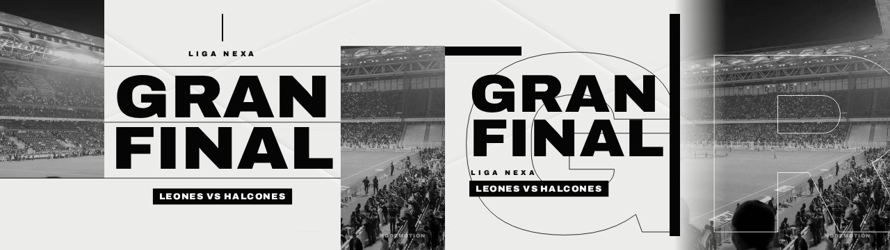

# promo-editorial

## Guía de diseño y miniaturas

Consultar [DESIGN.md](DESIGN.md) para paleta, tipografía, componentes, movimiento, transiciones y la receta para replicar esta plantilla. El contrato común está en [NodeMotion/DESIGN.md](../../DESIGN.md).

A: título corto sobre el medio completo. B: la misma cantidad de palabras o menos, con composición editorial de papel, tinta y foto. Ambas usan Archivo900 y los colores originales y admiten imagen propia o fotograma.

Exportaciones de revisión: [A](../../docs/previews/promo-editorial-A.jpg) · [B](../../docs/previews/promo-editorial-B.jpg).

