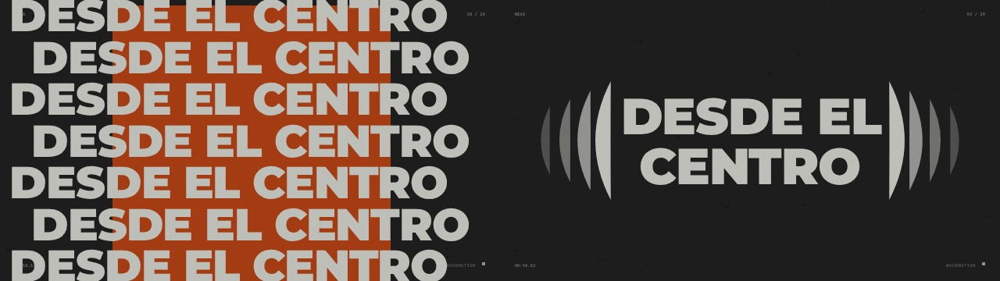

# promo-kinetic · diseño reproducible

Tipografía Montserrat pesada sobre gris carbón, rojo y amarillo. Filas de texto y cambios de escala con salidas sincronizadas a la escena. Usa JetBrains Mono para información auxiliar del video.

Esta ficha se complementa con la [guía común de NodeMotion](../../DESIGN.md). Código del video: `index.html`; configuración: `assets/config.json`. Fuente editable del motor: `../../_tools/commercial/build/ (kinetic.js y promo-kinetic.spec.json)`.

## Tipografía y color

Miniatura A: **Montserrat 900**. B: **Montserrat 900**. Estilo: `normal`. Las fuentes y combinaciones del video se conservan en el config y CSS originales:

```json
{
  "googleUrl": "https://fonts.googleapis.com/css2?family=Montserrat:wght@800;900&family=JetBrains+Mono:wght@500&display=swap"
}
```

Paleta declarada por el video:

```json
{
  "palette": {
    "bg": "#1C1C1D",
    "white": "#BDBDB8",
    "red": "#9B1F1F",
    "green": "#1E8A2E",
    "teal": "#2E9C74",
    "orange": "#A23A12",
    "yellow": "#D9C21A"
  }
}
```

Los tokens complementarios de miniaturas se consultan en `../../design-tokens.json` → `templates.promo-kinetic`. No sustituir estos colores por la paleta de otra plantilla. Los campos dependientes del medio (filtro, contraste, mezcla) pertenecen al config del video; en miniaturas, ajustar el oscurecimiento del fondo sin perder su motivo.

## Composición y miniaturas

Ambas opciones salen de escenas reales del video y, como él, son solo tipografía, sin foto: Montserrat 900 en hueso #BDBDB8 sobre gris #1C1C1D, con grano, rayones finos y el HUD monoespaciado (marca, contador y código de tiempo).

**A (escena «SAMURÁI», segundo 37):** cuadrado naranja #A23A12 al centro y el titular repetido en filas a lo alto del cuadro, que alternan su desplazamiento. La fila central queda entera y centrada.

**B (escena «WOW», segundo 4):** el titular entre paréntesis vectoriales en forma de media luna, con tres ecos a cada lado, cada uno más bajo, más fino y más apagado hacia fuera. Si el titular no cabe a buen tamaño en una fila, se reparte en dos y los paréntesis crecen con el bloque. Usa las mismas palabras que A o menos. La escena «LUNES», con letras estiradas, se descartó porque pierde lectura en tamaño de miniatura.

Titular por defecto: el primer rótulo del guion (por ejemplo «DESDE EL CENTRO»). Sin «LETRAS» ni artista.



## Movimiento, transiciones y componentes

### Outro compartido

`components/outroV2.js` es una segunda opción con la misma API y parámetros; se elige con `"outro": {"version": "v2"}` en el JSON o con `?outro=v2` en la URL del showcase. Sin indicarlo se usa `outro.js`.

`components/outro.js` (global `NexaPromoKineticOutro`) es la implementación única del
cierre, con la misma API que el de Editorial: `defaults`, `options`, `timeline`,
`render`. Reserva por defecto los últimos **3,5 segundos dentro de la duración de la
música** (recorta la escena que cruza ese punto y descarta las posteriores), con
entrada animada y lectura sostenida hasta el último fotograma. El cierre actual es
**provisional**: carbón con grano y HUD (`base`), Montserrat 900 en hueso, subtítulo
y dirección en amarillo, llamada sobre bloque rojo y JetBrains Mono para el apoyo.

El caso activo del JSON puede definir `outro`; si se omite, usa los valores del
componente. No copies sus valores por defecto a cada video. Ejemplo:

```json
{
  "outro": {
    "sec": 3.5,
    "title": "Gracias",
    "sub": "Por ver",
    "cta": "Suscríbete",
    "channel": "NodeMotion",
    "support": "Tu apoyo hace posible que sigamos trayendo más contenido.",
    "url": "youtube.com/@nodemotion"
  }
}
```

`enabled: false` conserva el final del guion. `type` permite elegir otro tipo ya
registrado en el motor (por ejemplo `typing`); un tipo desconocido usa `outro`. Los
textos admiten cadenas vacías. Si el módulo no carga, `B.outro` dibuja `B.typing`
(la escena final del guion). `render(sc, X, P, C.outro, tools)` recibe en `tools`:
`div`, `tx`, `fit`, `textW`, `measure`, `base`, `rowsOf`, `show`, `hideAt`, `exit`,
`safeZoom`, `portrait`, `mid`, `U`, `COL`, `GRAD`, `EASE_OUT`, `EASE_IN`, `EASE_IO`.

Las vistas de plantilla y drafts cargan el componente canónico
(`/api/v1/templates/promo-kinetic/showcase/components/outro.js`) con una URL nueva por
apertura; en local se usa `./components/outro.js`. Modificar el cierre requiere
editar solo este componente; modificar su conexión requiere editar `kinetic.js` y
regenerar únicamente `promo-kinetic`.

Tipografía Montserrat pesada sobre gris carbón, rojo y amarillo. Filas de texto y cambios de escala con salidas sincronizadas a la escena. Usa JetBrains Mono para información auxiliar del video.

Funciones disponibles en el motor (nombres reales para localizar el comportamiento):

`loadDB`, `deepMerge`, `mulberry32`, `lerpStr`, `easeFn`, `div`, `measure`, `canvasText`, `tx`, `duoFilter`, `asStill`, `blurPass`, `noiseTile`, `loadScript`, `linesOf`, `buildTimeline`, `lyricPhrases`, `lyricTimeline`, `enterFx`, `pickTrans`, `preloadMedia`, `mediaSpec`, `mbox`, `kenBurns`, `syncVideos`, `buildScene`, `begin`, `sceneAt`, `mount`, `render`, `frame`, `boot`, `base`, `rowsOf`, `exit`

Las funciones `loadDB/loadConfig` cargan datos; `loadLyrics` y las funciones `group/buildPlan/buildTimeline` organizan la letra; las funciones `place/build/make` construyen piezas; `frame/render/draw` actualizan el estado. Los nombres que no aparezcan arriba no forman parte de este motor. Conservar su separación al replicarlo.

Keyframes CSS declarados: no declara keyframes CSS; el movimiento se calcula en JavaScript/timeline.

Transiciones y animaciones CSS registradas en el código:

El timeline de JavaScript define los tiempos y las curvas. Usar las funciones de escena y `render/frame`, con el audio como reloj; no convertirlas en animaciones CSS independientes.

## Receta para replicar

1. Cargar el config activo y los medios relativos; mantener paleta y familias tipográficas anteriores.
2. Seguir la descripción de composición y las funciones de escena. Conservar la semilla para que las elecciones aleatorias se repitan al buscar un tiempo.
3. Mantener los tiempos de transición indicados y los del timeline del código cuando no hay CSS. La entrada de cada palabra sigue `lyrics.json` y el reloj del audio.
4. Adaptar a 16:9 y 9:16 con las reglas originales de viewport; comprobar que la palabra dominante cabe completa.
5. Para miniaturas, usar el renderer compartido y las reglas A/B. Capturar ambas y comparar a tamaño pequeño; verificar también el JPEG final de la opción elegida.
