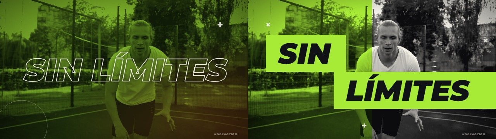

# promo-trendy · diseño reproducible

Montserrat pesada e inclinada, azul noche y lima. Anillos, puntos, fugas de luz, estelas de zoom y glitch. Golpes de escala y desplazamientos coordinados por escena.

Esta ficha se complementa con la [guía común de NodeMotion](../../DESIGN.md). Código del video: `index.html`; configuración: `assets/config.json`. Fuente editable del motor: `../../_tools/commercial/build/ (trendy.js y promo-trendy.spec.json)`.

## Tipografía y color

Miniatura A: **Montserrat 900**. B: **Montserrat 900**. Estilo: `italic`. Las fuentes y combinaciones del video se conservan en el config y CSS originales:

```json
{
  "googleUrl": "https://fonts.googleapis.com/css2?family=Montserrat:ital,wght@1,800;1,900&display=swap"
}
```

Paleta declarada por el video:

```json
{
  "palette": {
    "lime": "#A6EB35",
    "limeDark": "#0E1A06",
    "paper": "#F2EFE6",
    "ink": "#101114",
    "navy": "#000012",
    "navy2": "#0B0B24"
  }
}
```

Los tokens complementarios de miniaturas se consultan en `../../design-tokens.json` → `templates.promo-trendy`. No sustituir estos colores por la paleta de otra plantilla. Los campos dependientes del medio (filtro, contraste, mezcla) pertenecen al config del video; en miniaturas, ajustar el oscurecimiento del fondo sin perder su motivo.

## Composición y miniaturas

Ambas opciones salen de escenas reales del video: Montserrat 900 cursiva, lima #A6EB35, tinta #101114 y papel #F2EFE6. La foto se trata con los dos grades del video como filtros SVG (`duoLime`: #0E1A06→lima, contraste 1,35; `bwWarm`: #0C0C0E→papel, contraste 1,4). Llevan marcas ✖/+ dibujadas (no emoji), viñeta y grano.

**A (escena «ÉLITE», segundo 19):** toma completa en duotono lima, oscurecida para que el contorno se lea en pequeño, con fuga de luz cálida abajo a la derecha y viñeta. El titular va en contorno claro (papel) con una sombra suave, en una fila (dos si tiene más de dos palabras). Lleva una marca «+» arriba a la derecha y un aro fino abajo a la izquierda.

**B (escena «CADA DÍA», segundo 7):** una sola toma continua, con la mitad izquierda en duotono lima y la derecha en B/N cálido. El titular se parte en dos filas sobre bandas lima en escalera: la primera anclada a la izquierda y la segunda a sangre por la derecha. No repite texto; usa las mismas palabras que A o menos.

Titular por defecto: el primer rótulo de dos filas del guion (`lyrics.json`, campo `lines`), por ejemplo «SIN LÍMITES». Sin «LETRAS» ni artista. NODEMOTION queda discreta en la esquina.



## Movimiento, transiciones y componentes

Montserrat pesada e inclinada, azul noche y lima. Anillos, puntos, fugas de luz, estelas de zoom y glitch. Golpes de escala y desplazamientos coordinados por escena.

Funciones disponibles en el motor (nombres reales para localizar el comportamiento):

`loadDB`, `deepMerge`, `mulberry32`, `lerpStr`, `easeFn`, `div`, `measure`, `canvasText`, `tx`, `duoFilter`, `asStill`, `blurPass`, `noiseTile`, `loadScript`, `linesOf`, `buildTimeline`, `lyricPhrases`, `lyricTimeline`, `enterFx`, `pickTrans`, `preloadMedia`, `mediaSpec`, `mbox`, `kenBurns`, `syncVideos`, `buildScene`, `begin`, `sceneAt`, `mount`, `render`, `frame`, `boot`, `mark`, `dots`, `ring`, `svgShape`, `leak`, `vignette`, `full`, `region`, `streak`, `zoomTrail`, `glitchIn`, `punches`, `slideIn`

Las funciones `loadDB/loadConfig` cargan datos; `loadLyrics` y las funciones `group/buildPlan/buildTimeline` organizan la letra; las funciones `place/build/make` construyen piezas; `frame/render/draw` actualizan el estado. Los nombres que no aparezcan arriba no forman parte de este motor. Conservar su separación al replicarlo.

Keyframes CSS declarados: no declara keyframes CSS; el movimiento se calcula en JavaScript/timeline.

Transiciones y animaciones CSS registradas en el código:

El timeline de JavaScript define los tiempos y las curvas. Usar las funciones de escena y `render/frame`, con el audio como reloj; no convertirlas en animaciones CSS independientes.

## Receta para replicar

1. Cargar el config activo y los medios relativos; mantener paleta y familias tipográficas anteriores.
2. Seguir la descripción de composición y las funciones de escena. Conservar la semilla para que las elecciones aleatorias se repitan al buscar un tiempo.
3. Mantener los tiempos de transición indicados y los del timeline del código cuando no hay CSS. La entrada de cada palabra sigue `lyrics.json` y el reloj del audio.
4. Adaptar a 16:9 y 9:16 con las reglas originales de viewport; comprobar que la palabra dominante cabe completa.
5. Para miniaturas, usar el renderer compartido y las reglas A/B. Capturar ambas y comparar a tamaño pequeño; verificar también el JPEG final de la opción elegida.
