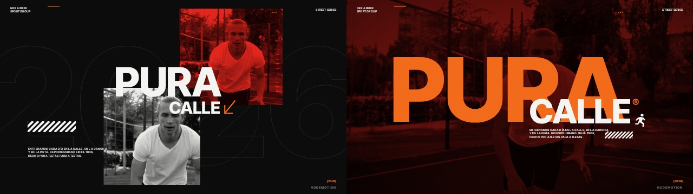

# promo-urban · diseño reproducible

Inter Tight, negro, naranja y rojo. Flechas, escalones, bloques, paneles y rótulos cromados. Cortes gráficos y entradas de tipografía compacta.

Esta ficha se complementa con la [guía común de NodeMotion](../../DESIGN.md). Código del video: `index.html`; configuración: `assets/config.json`. Fuente editable del motor: `../../_tools/commercial/build/ (urban.js y promo-urban.spec.json)`.

## Tipografía y color

Miniatura A: **Inter Tight 800**. B: **Inter Tight 800**. Estilo: `normal`. Las fuentes y combinaciones del video se conservan en el config y CSS originales:

```json
{
  "googleUrl": "https://fonts.googleapis.com/css2?family=Inter+Tight:wght@500;800&display=swap"
}
```

Paleta declarada por el video:

```json
{
  "palette": {
    "black": "#050505",
    "white": "#F4F4F2",
    "orange": "#F2681A",
    "red": "#E4261C",
    "redDark": "#140102"
  }
}
```

Los tokens complementarios de miniaturas se consultan en `../../design-tokens.json` → `templates.promo-urban`. No sustituir estos colores por la paleta de otra plantilla. Los campos dependientes del medio (filtro, contraste, mezcla) pertenecen al config del video; en miniaturas, ajustar el oscurecimiento del fondo sin perder su motivo.

## Composición y miniaturas

Ambas opciones salen de escenas reales del video: Inter Tight 800, rojo #E4261C, naranja #F2681A, blanco #F4F4F2 y fondo #140102. La foto se trata con el grade `duoRed` del video como filtro SVG (#140102→rojo, contraste 1,3). El HUD es el del video: «NEXA BRIEF / SPORT GROUP» (`brand.tagTop`) con su raya naranja, los tres puntos, la serie (`brand.tagRight`), el año entre corchetes (`brand.year`) y el texto pequeño (`brand.blurb`). Lleva grano.

**A (escena «PURA CALLE», segundo 2):** fondo oscuro #0B0B0B con el año (`brand.year`) gigante en contorno tenue. La toma aparece dos veces en recortes distintos: en duotono rojo arriba a la derecha y en B/N frío (`bwCold`) abajo al centro. La primera palabra va grande en blanco y el resto, menor, alineado a su derecha con una flecha naranja. Lleva el aro tenue, el rayado blanco y el texto pequeño a la izquierda.

**B (composición «SIN EXCUSAS», segundo 19, con el fondo de «ACTITUD»):** toma en duotono rojo oscurecida (mínimo 55%) con viñeta. La primera palabra va gigante en naranja y el resto en blanco, alineado con su base, empezando dentro de la gigante y terminando fuera de ella, así que el ® naranja y el corredor caen sobre la foto. Debajo van el texto pequeño y el rayado. Usa las mismas palabras que A o menos.

Titular por defecto: el primer rótulo de dos filas del guion, sin los marcadores ^ ~ * (por ejemplo «PURA CALLE»). Sin «LETRAS» ni artista.



## Movimiento, transiciones y componentes

Inter Tight, negro, naranja y rojo. Flechas, escalones, bloques, paneles y rótulos cromados. Cortes gráficos y entradas de tipografía compacta.

Funciones disponibles en el motor (nombres reales para localizar el comportamiento):

`loadDB`, `deepMerge`, `mulberry32`, `lerpStr`, `easeFn`, `div`, `measure`, `canvasText`, `tx`, `duoFilter`, `asStill`, `blurPass`, `noiseTile`, `loadScript`, `linesOf`, `buildTimeline`, `lyricPhrases`, `lyricTimeline`, `enterFx`, `pickTrans`, `preloadMedia`, `mediaSpec`, `mbox`, `kenBurns`, `syncVideos`, `buildScene`, `begin`, `sceneAt`, `mount`, `render`, `frame`, `boot`, `hatch`, `svg`, `arrow`, `runner`, `tinyText`, `chrome`, `blocks`, `typeLine`, `stair`, `panel`, `bigYear`, `ringR`, `base`

Las funciones `loadDB/loadConfig` cargan datos; `loadLyrics` y las funciones `group/buildPlan/buildTimeline` organizan la letra; las funciones `place/build/make` construyen piezas; `frame/render/draw` actualizan el estado. Los nombres que no aparezcan arriba no forman parte de este motor. Conservar su separación al replicarlo.

Keyframes CSS declarados: no declara keyframes CSS; el movimiento se calcula en JavaScript/timeline.

Transiciones y animaciones CSS registradas en el código:

El timeline de JavaScript define los tiempos y las curvas. Usar las funciones de escena y `render/frame`, con el audio como reloj; no convertirlas en animaciones CSS independientes.

## Receta para replicar

1. Cargar el config activo y los medios relativos; mantener paleta y familias tipográficas anteriores.
2. Seguir la descripción de composición y las funciones de escena. Conservar la semilla para que las elecciones aleatorias se repitan al buscar un tiempo.
3. Mantener los tiempos de transición indicados y los del timeline del código cuando no hay CSS. La entrada de cada palabra sigue `lyrics.json` y el reloj del audio.
4. Adaptar a 16:9 y 9:16 con las reglas originales de viewport; comprobar que la palabra dominante cabe completa.
5. Para miniaturas, usar el renderer compartido y las reglas A/B. Capturar ambas y comparar a tamaño pequeño; verificar también el JPEG final de la opción elegida.
