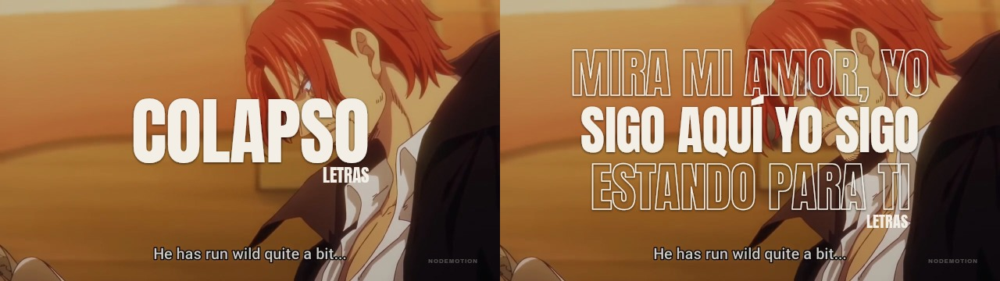

# lyrics-calado · diseño reproducible

Palabras caladas como láminas que dejan ver el video. Anton, paleta cálida y fría alternada, agrupación de frases, selección determinista de modos y grano escalonado.

Esta ficha se complementa con la [guía común de NodeMotion](../../DESIGN.md). Código del video: `index.html`; configuración: `assets/config.json`. Fuente editable del motor: `index.html`.

## Tipografía y color

Miniatura A: **Anton 400**. B: **Anton 400**. Estilo: `normal`. Las fuentes y combinaciones del video se conservan en el config y CSS originales:

```json
{}
```

Paleta declarada por el video:

```json
{
  "colors": {
    "ink": "#F4EFE6",
    "palette": [
      "#FF7A1A",
      "#4FC3FF",
      "#E0362C",
      "#FFD23F"
    ],
    "outline": "rgba(244,239,230,0.10)"
  }
}
```

Los tokens complementarios de miniaturas se consultan en `../../design-tokens.json` → `templates.lyrics-calado`. No sustituir estos colores por la paleta de otra plantilla. Los campos dependientes del medio (filtro, contraste, mezcla) pertenecen al config del video; en miniaturas, ajustar el oscurecimiento del fondo sin perder su motivo.

## Composición y miniaturas

A ocupa el centro con hasta cinco palabras en una o dos filas. B admite una frase más larga en hasta cuatro filas. Mantener la paleta en ambas. Fondo independiente de imagen propia o del medio existente, con recorte a sangre y encuadre ajustable; usar el medio original sin filtros, con una capa negra uniforme al 20% por defecto. Sin medio se conserva el fondo de la paleta original. Sin artista; «LETRAS» siempre debajo de la última fila, alineada a su extremo derecho, con el color principal de la plantilla a opacidad completa, al 24,3% en A y al 30% en B. El hueco de A es el 90% del común. NODEMOTION queda discreta en la esquina inferior derecha, con peso 900 y trazo de 0,4 px.

Los tratamientos de `thumbnail-style.json` usan relleno sólido en la primera fila de A y contorno en la segunda; B alterna contorno y sólido. El trazo mide 0.022 del cuerpo para conservar lectura en tarjetas, como aproximación a los modos calado y sólido del video. El contorno no reproduce la máscara real que deja ver el video dentro de las letras.



## Movimiento, transiciones y componentes

Palabras caladas como láminas que dejan ver el video. Anton, paleta cálida y fría alternada, agrupación de frases, selección determinista de modos y grano escalonado.

Funciones disponibles en el motor (nombres reales para localizar el comportamiento):

`loadDB`, `sizeCanvases`, `mulberry32`, `loadLyrics`, `groupPhrases`, `shuffledDeck`, `nextMode`, `coverRect`, `paintVideo`, `hexA`, `fitFs`, `makeLamina`, `drawLamina`, `begin`, `maybeOutro`, `frame`

Las funciones `loadDB/loadConfig` cargan datos; `loadLyrics` y las funciones `group/buildPlan/buildTimeline` organizan la letra; las funciones `place/build/make` construyen piezas; `frame/render/draw` actualizan el estado. Los nombres que no aparezcan arriba no forman parte de este motor. Conservar su separación al replicarlo.

Keyframes CSS declarados: `gsh`.

Transiciones y animaciones CSS registradas en el código:

- `opacity 0.8s ease`
- `gsh 0.95s steps(4) infinite`

## Receta para replicar

1. Cargar el config activo y los medios relativos; mantener paleta y familias tipográficas anteriores.
2. Seguir la descripción de composición y las funciones de escena. Conservar la semilla para que las elecciones aleatorias se repitan al buscar un tiempo.
3. Mantener los tiempos de transición indicados y los del timeline del código cuando no hay CSS. La entrada de cada palabra sigue `lyrics.json` y el reloj del audio.
4. Adaptar a 16:9 y 9:16 con las reglas originales de viewport; comprobar que la palabra dominante cabe completa.
5. Para miniaturas, usar el renderer compartido y las reglas A/B. Capturar ambas y comparar a tamaño pequeño; verificar también el JPEG final de la opción elegida.
