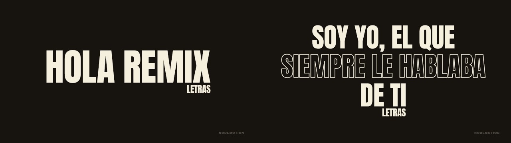

# lyrics-collage · diseño reproducible

Papel rasgado, tinta y rojo con Anton, Bebas Neue, Stardos Stencil, Permanent Marker y Courier Prime. Recortes que entran por ambos lados, figuras alternadas y rayos lentos.

Esta ficha se complementa con la [guía común de NodeMotion](../../DESIGN.md). Código del video: `index.html`; configuración: `assets/config.json`. Fuente editable del motor: `index.html`.

## Tipografía y color

Miniatura A: **Anton 400**. B: **Anton 400**. Estilo: `normal`. Las fuentes y combinaciones del video se conservan en el config y CSS originales:

```json
{
  "googleUrl": "https://fonts.googleapis.com/css2?family=Anton&family=Bebas+Neue&family=Stardos+Stencil:wght@400;700&family=Permanent+Marker&family=Courier+Prime:wght@400;700&display=swap",
  "poster": "\"Anton\", sans-serif",
  "condensed": "\"Bebas Neue\", sans-serif",
  "stencil": "\"Stardos Stencil\", cursive",
  "marker": "\"Permanent Marker\", cursive",
  "caption": "\"Courier Prime\", monospace"
}
```

Paleta declarada por el video:

```json
{
  "palette": {
    "ink": "#17130F",
    "paper": "#E7DFC7",
    "paperWhite": "#F5EFDD",
    "red": "#B81F19"
  }
}
```

Los tokens complementarios de miniaturas se consultan en `../../design-tokens.json` → `templates.lyrics-collage`. No sustituir estos colores por la paleta de otra plantilla. Los campos dependientes del medio (filtro, contraste, mezcla) pertenecen al config del video; en miniaturas, ajustar el oscurecimiento del fondo sin perder su motivo.

## Composición y miniaturas

A ocupa el centro con hasta cinco palabras en una o dos filas. B admite una frase más larga en hasta cuatro filas. Mantener la paleta en ambas. Fondo independiente de imagen propia o del medio existente, con recorte a sangre y encuadre ajustable. Sin artista; «LETRAS» siempre debajo de la última fila, alineada a su extremo derecho, con el color principal de la plantilla a opacidad completa, al 24,3% en A y al 34,5% en B, con el hueco al 25,2% del original en A y al 28% en B. NODEMOTION queda discreta en la esquina inferior derecha.



## Movimiento, transiciones y componentes

Papel rasgado, tinta y rojo con Anton, Bebas Neue, Stardos Stencil, Permanent Marker y Courier Prime. Recortes que entran por ambos lados, figuras alternadas y rayos lentos.

Funciones disponibles en el motor (nombres reales para localizar el comportamiento):

`loadDB`, `applyTheme`, `mulberry32`, `pickWeighted`, `buildCard`, `loadLyrics`, `tornPoly`, `nextFigureIndex`, `nextSceneTarget`, `clearScene`, `newScene`, `maybeCaption`, `fontSizeFor`, `placeWord`, `begin`, `maybeOutro`, `frame`

Las funciones `loadDB/loadConfig` cargan datos; `loadLyrics` y las funciones `group/buildPlan/buildTimeline` organizan la letra; las funciones `place/build/make` construyen piezas; `frame/render/draw` actualizan el estado. Los nombres que no aparezcan arriba no forman parte de este motor. Conservar su separación al replicarlo.

Keyframes CSS declarados: `raysDrift`, `slamL`, `slamR`, `figL`, `figR`, `gsh`, `hintPulse`.

Transiciones y animaciones CSS registradas en el código:

- `raysDrift 60s linear infinite`
- `opacity 0.6s ease`
- `slamL 0.5s cubic-bezier(0.18, 0.85, 0.24, 1.15) forwards`
- `slamR 0.5s cubic-bezier(0.18, 0.85, 0.24, 1.15) forwards`
- `transform 0.55s cubic-bezier(0.4,0,1,1), opacity 0.5s ease`
- `opacity 1.1s ease`
- `figL 0.7s cubic-bezier(0.2,0.8,0.24,1.05) forwards`
- `figR 0.7s cubic-bezier(0.2,0.8,0.24,1.05) forwards`
- `transform 0.6s cubic-bezier(0.4,0,1,1), opacity 0.5s ease`
- `gsh 1s steps(4) infinite`
- `opacity 1.3s ease`
- `hintPulse 2s ease infinite`

## Receta para replicar

1. Cargar el config activo y los medios relativos; mantener paleta y familias tipográficas anteriores.
2. Seguir la descripción de composición y las funciones de escena. Conservar la semilla para que las elecciones aleatorias se repitan al buscar un tiempo.
3. Mantener los tiempos de transición indicados y los del timeline del código cuando no hay CSS. La entrada de cada palabra sigue `lyrics.json` y el reloj del audio.
4. Adaptar a 16:9 y 9:16 con las reglas originales de viewport; comprobar que la palabra dominante cabe completa.
5. Para miniaturas, usar el renderer compartido y las reglas A/B. Capturar ambas y comparar a tamaño pequeño; verificar también el JPEG final de la opción elegida.

## Miniaturas: revisión de diseño

Anton en papel claro #F5EFDD sobre tinta #17130F; A y B alternan pleno y contorno evocando los recortes. «LETRAS» conserva el papel claro para facilitar la lectura. Las dos opciones comparten paleta; el texto, el fondo y el encuadre siguen siendo independientes.
