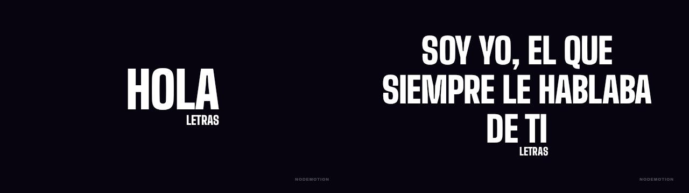

# lyrics-cristal · diseño reproducible

Cristal nocturno con rosa y cian, Big Shoulders Display, Unbounded y Caveat Brush. Mundos de bokeh/aurora/hielo; grietas, fragmentos y brillos que siguen eventos de la letra.

Esta ficha se complementa con la [guía común de NodeMotion](../../DESIGN.md). Código del video: `index.html`; configuración: `assets/config.json`. Fuente editable del motor: `index.html`.

## Tipografía y color

Miniatura A: **Big Shoulders Display 900**. B: **Big Shoulders Display 900**. Estilo: `normal`. Las fuentes y combinaciones del video se conservan en el config y CSS originales:

```json
{
  "googleUrl": "https://fonts.googleapis.com/css2?family=Big+Shoulders+Display:wght@800;900&family=Unbounded:wght@700;900&family=Caveat+Brush&family=JetBrains+Mono:wght@500;700&display=swap",
  "golpe": "\"Big Shoulders Display\", Impact, sans-serif",
  "grabado": "\"Unbounded\", \"Arial Black\", sans-serif",
  "vaho": "\"Caveat Brush\", cursive",
  "mono": "\"JetBrains Mono\", monospace"
}
```

Paleta declarada por el video:

```json
{
  "palette": {
    "night": "#07040F",
    "glass": "#DDF3FF",
    "text": "#FFFFFF",
    "hot": "#FF2E88",
    "cool": "#35E0FF",
    "frost": "#F4F8FF",
    "fog": "#E6EEF8"
  }
}
```

Los tokens complementarios de miniaturas se consultan en `../../design-tokens.json` → `templates.lyrics-cristal`. No sustituir estos colores por la paleta de otra plantilla. Los campos dependientes del medio (filtro, contraste, mezcla) pertenecen al config del video; en miniaturas, ajustar el oscurecimiento del fondo sin perder su motivo.

## Composición y miniaturas

A ocupa el centro con hasta cinco palabras en una o dos filas. B admite una frase más larga en hasta cuatro filas. Mantener la paleta en ambas. Fondo independiente de imagen propia o del medio existente, con recorte a sangre y encuadre ajustable. Sin artista; «LETRAS» siempre debajo de la última fila, alineada a su extremo derecho, con el color principal de la plantilla a opacidad completa, al 24,3% en A y al 30% en B, con el hueco al 25,2% del original en A y al 28% en B. NODEMOTION queda discreta en la esquina inferior derecha.



## Movimiento, transiciones y componentes

Cristal nocturno con rosa y cian, Big Shoulders Display, Unbounded y Caveat Brush. Mundos de bokeh/aurora/hielo; grietas, fragmentos y brillos que siguen eventos de la letra.

Funciones disponibles en el motor (nombres reales para localizar el comportamiento):

`loadDB`, `deepMerge`, `applyTheme`, `mulberry32`, `pickWeighted`, `hexA`, `sizeAll`, `measure`, `fontsReady`, `textSprite`, `rimSprite`, `discSprite`, `streakSprite`, `buildStatics`, `drawBg`, `drawCover`, `makeBokeh`, `makeAurora`, `makeRayos`, `makeMedia`, `makeFigure`, `build`, `resolveWorldDefs`, `currentFigSide`, `switchWorld`, `drawWorld`, `updateFrost`, `loadLyrics`, `buildPhrases`, `voiceOf`, `planPhrases`, `planTransitions`, `buildEvents`, `buildRows`, `layoutRows`, `makeItem`, `layoutPhrase`, `cardRows`, `activateCard`, `genWeb`, `strokeWeb`, `bakeWeb`, `clearCracks`, `buildShards`, `buildGlitter`, `drawShards`, `shatterPoint`, `doBlow`, `doShatter`, `doFade`, `activatePhrase`, `doTrans`, `doWord`, `handle`, `fastForward`, `maybeOutro`, `aimCamera`, `updateCamera`, `setupAnalyser`, `updateEnergy`, `spriteAt`, `drawFog`, `drawGrabado`, `drawSolid`, `drawGlass`, `startWall`, `begin`, `frame`, `init`

Las funciones `loadDB/loadConfig` cargan datos; `loadLyrics` y las funciones `group/buildPlan/buildTimeline` organizan la letra; las funciones `place/build/make` construyen piezas; `frame/render/draw` actualizan el estado. Los nombres que no aparezcan arriba no forman parte de este motor. Conservar su separación al replicarlo.

Keyframes CSS declarados: `gsh`, `hintPulse`.

Transiciones y animaciones CSS registradas en el código:

- `opacity 3s ease, filter 3s ease`
- `gsh 1s steps(4) infinite`
- `hintPulse 2s ease infinite`

## Receta para replicar

1. Cargar el config activo y los medios relativos; mantener paleta y familias tipográficas anteriores.
2. Seguir la descripción de composición y las funciones de escena. Conservar la semilla para que las elecciones aleatorias se repitan al buscar un tiempo.
3. Mantener los tiempos de transición indicados y los del timeline del código cuando no hay CSS. La entrada de cada palabra sigue `lyrics.json` y el reloj del audio.
4. Adaptar a 16:9 y 9:16 con las reglas originales de viewport; comprobar que la palabra dominante cabe completa.
5. Para miniaturas, usar el renderer compartido y las reglas A/B. Capturar ambas y comparar a tamaño pequeño; verificar también el JPEG final de la opción elegida.
