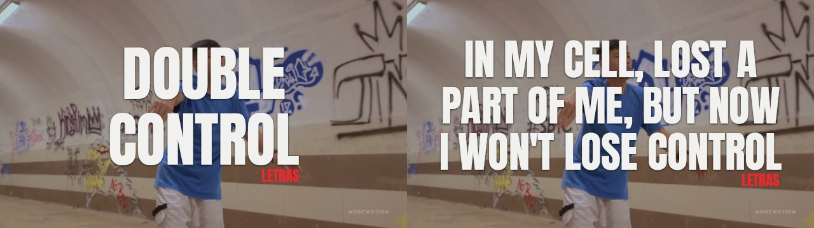

# lyrics-grunge · diseño reproducible

Anton, Archivo y Oswald sobre rojo, negro y papel. Bordes rasgados, manchas, ecos y trazos. Golpes de entrada y montaje por frases; no confundir con la paleta lima de Mixtas.

Esta ficha se complementa con la [guía común de NodeMotion](../../DESIGN.md). Código del video: `index.html`; configuración: `assets/config.json`. Fuente editable del motor: `../../_tools/lyrics-grunge/build/`.

## Tipografía y color

Miniatura A: **Anton 400**. B: **Anton 400**. Estilo: `normal`. Las fuentes y combinaciones del video se conservan en el config y CSS originales:

```json
{
  "googleUrl": "https://fonts.googleapis.com/css2?family=Anton&family=Archivo:wdth,wght@62..125,100..900&family=Oswald:wght@300;500&display=swap"
}
```

Paleta declarada por el video:

```json
{
  "palette": {
    "red": "#E8292E",
    "white": "#F1F1EF",
    "black": "#070707",
    "paper": "#EDEDEA",
    "ink": "#101010",
    "chalk": "#F5F5F2"
  }
}
```

Los tokens complementarios de miniaturas se consultan en `../../design-tokens.json` → `templates.lyrics-grunge`. No sustituir estos colores por la paleta de otra plantilla. Los campos dependientes del medio (filtro, contraste, mezcla) pertenecen al config del video; en miniaturas, ajustar el oscurecimiento del fondo sin perder su motivo.

## Composición y miniaturas

A ocupa el centro con hasta cinco palabras en una o dos filas. B admite una frase más larga en hasta cuatro filas. Mantener la paleta en ambas. Fondo independiente de imagen propia o del medio existente, con recorte a sangre y encuadre ajustable. Sin artista; «LETRAS» siempre debajo de la última fila, alineada a su extremo derecho, con el color principal de la plantilla a opacidad completa, al 24,3% en A y al 34,5% en B, con el hueco al 25,2% del original en A y al 28% en B. NODEMOTION queda discreta en la esquina inferior derecha.



## Movimiento, transiciones y componentes

Anton, Archivo y Oswald sobre rojo, negro y papel. Bordes rasgados, manchas, ecos y trazos. Golpes de entrada y montaje por frases; no confundir con la paleta lima de Mixtas.

Funciones disponibles en el motor (nombres reales para localizar el comportamiento):

`loadDB`, `deepMerge`, `mulberry32`, `lerpStr`, `easeFn`, `div`, `measure`, `canvasText`, `tx`, `duoFilter`, `asStill`, `blurPass`, `noiseTile`, `loadScript`, `linesOf`, `buildTimeline`, `lyricPhrases`, `lyricTimeline`, `enterFx`, `pickTrans`, `preloadMedia`, `mediaSpec`, `mbox`, `kenBurns`, `syncVideos`, `buildScene`, `begin`, `sceneAt`, `mount`, `render`, `frame`, `boot`, `rows`, `jagged`, `tornEdge`, `bgLayer`, `smear`, `word`, `line`, `slamIn`, `ghost`, `doodle`, `later`, `makeTimeline`

Las funciones `loadDB/loadConfig` cargan datos; `loadLyrics` y las funciones `group/buildPlan/buildTimeline` organizan la letra; las funciones `place/build/make` construyen piezas; `frame/render/draw` actualizan el estado. Los nombres que no aparezcan arriba no forman parte de este motor. Conservar su separación al replicarlo.

Keyframes CSS declarados: no declara keyframes CSS; el movimiento se calcula en JavaScript/timeline.

Transiciones y animaciones CSS registradas en el código:

El timeline de JavaScript define los tiempos y las curvas. Usar las funciones de escena y `render/frame`, con el audio como reloj; no convertirlas en animaciones CSS independientes.

## Receta para replicar

1. Cargar el config activo y los medios relativos; mantener paleta y familias tipográficas anteriores.
2. Seguir la descripción de composición y las funciones de escena. Conservar la semilla para que las elecciones aleatorias se repitan al buscar un tiempo.
3. Mantener los tiempos de transición indicados y los del timeline del código cuando no hay CSS. La entrada de cada palabra sigue `lyrics.json` y el reloj del audio.
4. Adaptar a 16:9 y 9:16 con las reglas originales de viewport; comprobar que la palabra dominante cabe completa.
5. Para miniaturas, usar el renderer compartido y las reglas A/B. Capturar ambas y comparar a tamaño pequeño; verificar también el JPEG final de la opción elegida.

## Miniaturas: revisión de diseño

Anton blanca y «LETRAS» rojo #E8292E de la paleta activa. El fondo toma el primer video original disponible de `media`, con capa negra del 20%; se puede cambiar la imagen o el fotograma. Las dos opciones comparten paleta; el texto, el fondo y el encuadre siguen siendo independientes.
