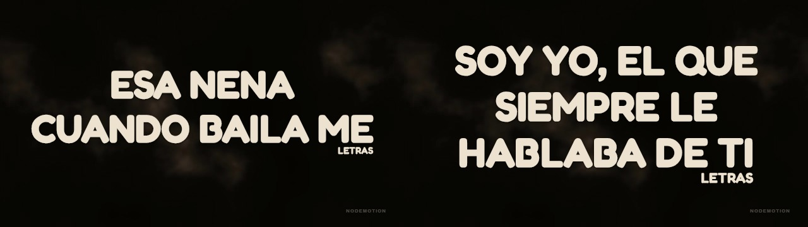

# lyrics-mirada · diseño reproducible

Fredoka, League Gothic y Alfa Slab One en tostado, crema, verde y carmesí. Ojos, manos, plumas y palomas; paneles, columnas, recortes y transiciones por frase.

Esta ficha se complementa con la [guía común de NodeMotion](../../DESIGN.md). Código del video: `index.html`; configuración: `assets/config.json`. Fuente editable del motor: `index.html`.

## Tipografía y color

Miniatura A: **Fredoka 700**. B: **Fredoka 700**. Estilo: `normal`. Las fuentes y combinaciones del video se conservan en el config y CSS originales:

```json
{
  "googleUrl": "https://fonts.googleapis.com/css2?family=Fredoka:wght@500;600;700&family=League+Gothic&family=Alfa+Slab+One&display=swap",
  "round": "\"Fredoka\", sans-serif",
  "column": "\"League Gothic\", sans-serif",
  "slab": "\"Alfa Slab One\", serif"
}
```

Paleta declarada por el video:

```json
{
  "palette": {
    "night": "#0A0807",
    "tan": "#B39A7C",
    "tanLight": "#D3BC9D",
    "tanDeep": "#88705A",
    "umber": "#5B4737",
    "cream": "#EDE2CF",
    "teal": "#1F6D69",
    "crimson": "#8E1C16"
  }
}
```

Los tokens complementarios de miniaturas se consultan en `../../design-tokens.json` → `templates.lyrics-mirada`. No sustituir estos colores por la paleta de otra plantilla. Los campos dependientes del medio (filtro, contraste, mezcla) pertenecen al config del video; en miniaturas, ajustar el oscurecimiento del fondo sin perder su motivo.

## Composición y miniaturas

A ocupa el centro con hasta cinco palabras en una o dos filas. B admite una frase más larga en hasta cuatro filas. Mantener la paleta en ambas. Fondo independiente de imagen propia o del medio existente, con recorte a sangre y encuadre ajustable. Sin artista; «LETRAS» siempre debajo de la última fila, alineada a su extremo derecho, con el color principal de la plantilla a opacidad completa, al 24,3% en A y al 34,5% en B, con el hueco al 25,2% del original en A y al 28% en B. NODEMOTION queda discreta en la esquina inferior derecha.



## Movimiento, transiciones y componentes

Fredoka, League Gothic y Alfa Slab One en tostado, crema, verde y carmesí. Ojos, manos, plumas y palomas; paneles, columnas, recortes y transiciones por frase.

Funciones disponibles en el motor (nombres reales para localizar el comportamiento):

`loadDB`, `applyTheme`, `vid`, `mulberry32`, `h`, `anim`, `retire`, `emWidth`, `capMetrics`, `splits`, `rec`, `fitLines`, `buildBlock`, `revealSoft`, `eyeUnit`, `eyesSVG`, `capsule`, `fingerSVG`, `handSVG`, `featherSVG`, `doveSVG`, `angelURI`, `burstPoints`, `cloudSVG`, `makeFeathers`, `tick`, `makeMirada`, `makeColumnas`, `retireCur`, `makeAngel`, `makeNoche`, `retireBlock`, `makePalomas`, `clearStair`, `toPanel`, `makeOjo`, `makeRecorte`, `fillCard`, `showCard`, `loadLyrics`, `buildPlan`, `sceneAt`, `switchTo`, `hardSync`, `dispatch`, `begin`, `totalDuration`, `maybeOutro`, `frame`

Las funciones `loadDB/loadConfig` cargan datos; `loadLyrics` y las funciones `group/buildPlan/buildTimeline` organizan la letra; las funciones `place/build/make` construyen piezas; `frame/render/draw` actualizan el estado. Los nombres que no aparezcan arriba no forman parte de este motor. Conservar su separación al replicarlo.

Keyframes CSS declarados: `mediaDrift`, `spin`, `twinkle`, `grainShift`, `hintPulse`, `moonDrift`.

Transiciones y animaciones CSS registradas en el código:

- `opacity 2.4s ease`
- `mediaDrift 40s ease-in-out infinite alternate`
- `opacity 1.8s ease`
- `opacity 0.8s cubic-bezier(0.65, 0, 0.35, 1)`
- `opacity 0.9s ease`
- `fill-opacity 0.8s ease, fill 0.8s ease`
- `fill-opacity 0.8s ease`
- `stroke-opacity 0.8s ease`
- `stroke 0.8s ease`
- `spin 70s linear infinite`
- `fill 0.7s ease`
- `twinkle var(--d) ease-in-out infinite`
- `color 0.8s ease`
- `grainShift 0.9s steps(5) infinite`

## Receta para replicar

1. Cargar el config activo y los medios relativos; mantener paleta y familias tipográficas anteriores.
2. Seguir la descripción de composición y las funciones de escena. Conservar la semilla para que las elecciones aleatorias se repitan al buscar un tiempo.
3. Mantener los tiempos de transición indicados y los del timeline del código cuando no hay CSS. La entrada de cada palabra sigue `lyrics.json` y el reloj del audio.
4. Adaptar a 16:9 y 9:16 con las reglas originales de viewport; comprobar que la palabra dominante cabe completa.
5. Para miniaturas, usar el renderer compartido y las reglas A/B. Capturar ambas y comparar a tamaño pequeño; verificar también el JPEG final de la opción elegida.

## Miniaturas: revisión de fidelidad

Fuente: Fredoka 700 normal. Fondo de respaldo #0A0807; título #EDE2CF; «LETRAS» #EDE2CF. Medio original por defecto: `assets/niebla.mp4`; se conserva el medio con una capa negra del 20%. Las dos opciones comparten estilo y paleta y permiten cambiar imagen o fotograma. Las fuentes de color fijo provienen del CSS original; los colores configurables siguen el config activo.
