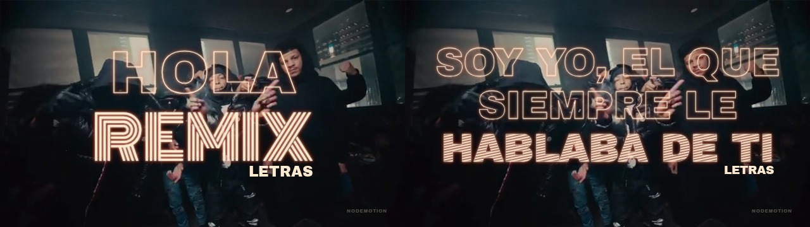

# lyrics-neon · diseño reproducible

Noche urbana, tubos cálidos y halo naranja. Alterna Monoton y Archivo Black; columnas escalonadas, encendido por carácter, cámara que retrocede entre columnas y textura CRT/grano.

Esta ficha se complementa con la [guía común de NodeMotion](../../DESIGN.md). Código del video: `index.html`; configuración: `assets/config.json`. Fuente editable del motor: `index.html`.

## Tipografía y color

Miniatura A: **Monoton 400**. B: **Archivo Black 400**. Estilo: `normal`. Las fuentes y combinaciones del video se conservan en el config y CSS originales:

```json
{
  "googleUrl": "https://fonts.googleapis.com/css2?family=Monoton&family=Archivo+Black&display=swap",
  "tube": "\"Monoton\", cursive",
  "block": "\"Archivo Black\", sans-serif"
}
```

Paleta declarada por el video:

```json
{
  "neon": {
    "core": "#FFE9CF",
    "glow": "#FF5A1F",
    "deep": "#E01400"
  }
}
```

Los tokens complementarios de miniaturas se consultan en `../../design-tokens.json` → `templates.lyrics-neon`. No sustituir estos colores por la paleta de otra plantilla. Los campos dependientes del medio (filtro, contraste, mezcla) pertenecen al config del video; en miniaturas, ajustar el oscurecimiento del fondo sin perder su motivo.

## Composición y miniaturas

A ocupa el centro con hasta cinco palabras en una o dos filas. B admite una frase más larga en hasta cuatro filas. Mantener la paleta en ambas. Fondo independiente de imagen propia o del medio existente, con recorte a sangre y encuadre ajustable. Sin artista; «LETRAS» siempre debajo de la última fila, alineada a su extremo derecho, con el color principal de la plantilla a opacidad completa, al 24,3% en A y al 30% en B, con el hueco al 25,2% del original en A y al 28% en B. NODEMOTION queda discreta en la esquina inferior derecha.



## Movimiento, transiciones y componentes

Noche urbana, tubos cálidos y halo naranja. Alterna Monoton y Archivo Black; columnas escalonadas, encendido por carácter, cámara que retrocede entre columnas y textura CRT/grano.

### Secuencia Neón

`applyTheme` aplica `fonts.tube`, `fonts.block` y `neon.core/glow/deep`; `styleNeon` construye las sombras de tubo. `lit` enciende y `unlit` apaga; `newColumn` elige columna y dirección con `seed`; `placeWord` coloca la palabra según la marca de tiempo; `aimCamera` cambia el objetivo y `frame` aproxima la cámara. Respetar `layout.stairVw`, `colGapVw/colGapVh`, `rowsMin/rowsMax`, `tubeChance` y `dirWeights`. El encendido es de 0.55 s a pasos; el fondo respira en 46 s y la salida se disuelve en 1.6 s. En miniaturas se congela el lenguaje de luz, sin copiar letra ni marca del video al fondo.

Funciones disponibles en el motor (nombres reales para localizar el comportamiento):

`loadDB`, `applyTheme`, `mulberry32`, `styleNeon`, `lit`, `unlit`, `updateCards`, `loadLyrics`, `pickDir`, `newColumn`, `fontSizeFor`, `placeWord`, `aimCamera`, `begin`, `frame`

Las funciones `loadDB/loadConfig` cargan datos; `loadLyrics` y las funciones `group/buildPlan/buildTimeline` organizan la letra; las funciones `place/build/make` construyen piezas; `frame/render/draw` actualizan el estado. Los nombres que no aparezcan arriba no forman parte de este motor. Conservar su separación al replicarlo.

Keyframes CSS declarados: `bgBreath`, `ignite`, `gsh`, `hintPulse`.

Transiciones y animaciones CSS registradas en el código:

- `bgBreath 46s ease-in-out infinite alternate`
- `opacity 1.6s ease, filter 1.6s ease`
- `ignite 0.55s steps(1, end) forwards`
- `gsh 1s steps(4) infinite`
- `opacity 1.6s ease`
- `hintPulse 2s ease infinite`

## Receta para replicar

1. Cargar el config activo y los medios relativos; mantener paleta y familias tipográficas anteriores.
2. Seguir la descripción de composición y las funciones de escena. Conservar la semilla para que las elecciones aleatorias se repitan al buscar un tiempo.
3. Mantener los tiempos de transición indicados y los del timeline del código cuando no hay CSS. La entrada de cada palabra sigue `lyrics.json` y el reloj del audio.
4. Adaptar a 16:9 y 9:16 con las reglas originales de viewport; comprobar que la palabra dominante cabe completa.
5. Para miniaturas, usar el renderer compartido y las reglas A/B. Capturar ambas y comparar a tamaño pequeño; verificar también el JPEG final de la opción elegida.


### Revisión de Neón · contorno y rayas

A: primera fila en Archivo Black con contorno y relleno transparente; última fila en Monoton, con sus bandas de tubo. B: todas las filas anteriores a la última en Archivo Black con contorno y sin relleno; última fila con relleno a rayas y huecos transparentes. «LETRAS» usa Archivo Black, mide el 24,3% del título en A y el 30% en B, con el color principal de la plantilla a opacidad completa con el hueco al 25,2% del original en A y al 28% en B y termina debajo del extremo derecho de REMIX o DE TI. NODEMOTION aumenta de 13 a 15.6 px y usa negrita 900 y refuerzo de trazo de 0.4 px.
