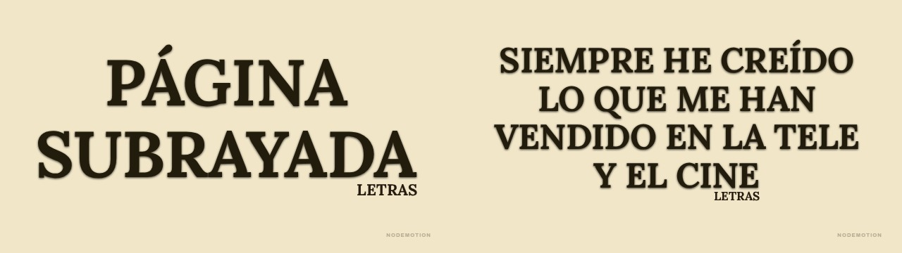

# lyrics-resaltado · diseño reproducible

Lectura editorial con Lora y Playfair Display. Páginas, párrafos y marcador irregular que progresa sobre puntos de control de la letra. Cambio de página y cámara de mano sutil.

Esta ficha se complementa con la [guía común de NodeMotion](../../DESIGN.md). Código del video: `index.html`; configuración: `assets/config.json`. Fuente editable del motor: `index.html`.

## Tipografía y color

Miniatura A: **Lora 700**. B: **Lora 700**. Estilo: `normal`. Las fuentes y combinaciones del video se conservan en el config y CSS originales:

```json
{}
```

Paleta declarada por el video:

```json
{}
```

Los tokens complementarios de miniaturas se consultan en `../../design-tokens.json` → `templates.lyrics-resaltado`. No sustituir estos colores por la paleta de otra plantilla. Los campos dependientes del medio (filtro, contraste, mezcla) pertenecen al config del video; en miniaturas, ajustar el oscurecimiento del fondo sin perder su motivo.

## Composición y miniaturas

A ocupa el centro con hasta cinco palabras en una o dos filas. B admite una frase más larga en hasta cuatro filas. Mantener la paleta en ambas. Fondo independiente de imagen propia o del medio existente, con recorte a sangre y encuadre ajustable. Sin artista; «LETRAS» siempre debajo de la última fila, alineada a su extremo derecho, con el color principal de la plantilla a opacidad completa, al 24,3% en A y al 34,5% en B, con el hueco al 25,2% del original en A y al 28% en B. NODEMOTION queda discreta en la esquina inferior derecha.



## Movimiento, transiciones y componentes

Lectura editorial con Lora y Playfair Display. Páginas, párrafos y marcador irregular que progresa sobre puntos de control de la letra. Cambio de página y cámara de mano sutil.

Funciones disponibles en el motor (nombres reales para localizar el comportamiento):

`loadDB`, `mulberry32`, `buildCard`, `loadLyrics`, `groupPhrases`, `pickFiller`, `roughMarkerPoly`, `buildParagraphHTML`, `buildCheckpoints`, `progressAt`, `buildPageContent`, `turnToPhrase`, `begin`, `maybeOutro`, `frame`

Las funciones `loadDB/loadConfig` cargan datos; `loadLyrics` y las funciones `group/buildPlan/buildTimeline` organizan la letra; las funciones `place/build/make` construyen piezas; `frame/render/draw` actualizan el estado. Los nombres que no aparezcan arriba no forman parte de este motor. Conservar su separación al replicarlo.

Keyframes CSS declarados: `handheld`, `gsh`, `hintPulse`.

Transiciones y animaciones CSS registradas en el código:

- `handheld 10s ease-in-out infinite alternate`
- `transform 0.2s ease`
- `opacity 0.18s ease`
- `gsh 1s steps(4) infinite`
- `opacity 1.2s ease`
- `opacity 1.7s ease`
- `hintPulse 2s ease infinite`

## Receta para replicar

1. Cargar el config activo y los medios relativos; mantener paleta y familias tipográficas anteriores.
2. Seguir la descripción de composición y las funciones de escena. Conservar la semilla para que las elecciones aleatorias se repitan al buscar un tiempo.
3. Mantener los tiempos de transición indicados y los del timeline del código cuando no hay CSS. La entrada de cada palabra sigue `lyrics.json` y el reloj del audio.
4. Adaptar a 16:9 y 9:16 con las reglas originales de viewport; comprobar que la palabra dominante cabe completa.
5. Para miniaturas, usar el renderer compartido y las reglas A/B. Capturar ambas y comparar a tamaño pequeño; verificar también el JPEG final de la opción elegida.

## Miniaturas: revisión de fidelidad

Fuente: Lora 700 normal. Fondo de respaldo #F1E6C8; título #241A0E; «LETRAS» #241A0E. Sin imagen o video de fondo predeterminado: se conserva el color de la plantilla. Las dos opciones comparten estilo y paleta y permiten cambiar imagen o fotograma. Las fuentes de color fijo provienen del CSS original; los colores configurables siguen el config activo.
