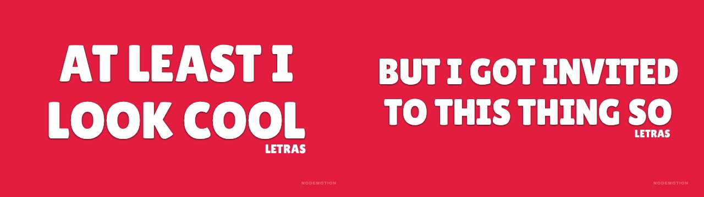

# lyrics-stylish-kinetic · diseño reproducible

Lilita One y Sniglet sobre rojo, amarillo, menta y verde azulado. Caracteres redondos, arco, flip, slide, pop y pincel; cambios de escena con un ritmo juguetón.

Esta ficha se complementa con la [guía común de NodeMotion](../../DESIGN.md). Código del video: `index.html`; configuración: `assets/config.json`. Fuente editable del motor: `index.html`.

## Tipografía y color

Miniatura A: **Lilita One 400**. B: **Lilita One 400**. Estilo: `normal`. Las fuentes y combinaciones del video se conservan en el config y CSS originales:

```json
{
  "googleUrl": "https://fonts.googleapis.com/css2?family=Lilita+One&family=Sniglet:wght@800&display=swap",
  "caps": "\"Lilita One\", sans-serif",
  "low": "\"Sniglet\", sans-serif",
  "lowerI": true,
  "wobbleDeg": 4,
  "jitterEm": 0.035
}
```

Paleta declarada por el video:

```json
{
  "palette": {
    "schemes": {
      "red": {
        "bg": "#E31D40",
        "ink": "#FFFFFF",
        "accent": "#F3C10A"
      },
      "yellow": {
        "bg": "#F3C10A",
        "ink": "#FFFFFF",
        "accent": "#084E62"
      },
      "mint": {
        "bg": "#85E5D3",
        "ink": "#FFFFFF",
        "accent": "#E31D40"
      },
      "teal": {
        "bg": "#084E62",
        "ink": "#FFFFFF",
        "accent": "#F3C10A"
      }
    },
    "order": [
      "red",
      "yellow",
      "mint",
      "red",
      "yellow"
    ],
    "cycle": [
      "red",
      "yellow",
      "mint",
      "teal"
    ]
  }
}
```

Los tokens complementarios de miniaturas se consultan en `../../design-tokens.json` → `templates.lyrics-stylish-kinetic`. No sustituir estos colores por la paleta de otra plantilla. Los campos dependientes del medio (filtro, contraste, mezcla) pertenecen al config del video; en miniaturas, ajustar el oscurecimiento del fondo sin perder su motivo.

## Composición y miniaturas

A ocupa el centro con hasta cinco palabras en una o dos filas. B admite una frase más larga en hasta cuatro filas. Mantener la paleta en ambas. Fondo independiente de imagen propia o del medio existente, con recorte a sangre y encuadre ajustable. Sin artista; «LETRAS» siempre debajo de la última fila, alineada a su extremo derecho, con el color principal de la plantilla a opacidad completa, al 24,3% en A y al 30% en B, con el hueco al 25,2% del original en A y al 28% en B. NODEMOTION queda discreta en la esquina inferior derecha.



## Movimiento, transiciones y componentes

Lilita One y Sniglet sobre rojo, amarillo, menta y verde azulado. Caracteres redondos, arco, flip, slide, pop y pincel; cambios de escena con un ritmo juguetón.

Funciones disponibles en el motor (nombres reales para localizar el comportamiento):

`loadDB`, `applyTheme`, `mulberry32`, `fillChars`, `measure`, `lerpStr`, `easeFn`, `div`, `mkLine`, `blurPass`, `flipUp`, `arcIn`, `slideIn`, `popIn`, `brush`, `splitTwo`, `chunk`, `buildScene`, `loadLyrics`, `phrases`, `buildTimeline`, `begin`, `sceneAt`, `mount`, `render`, `frame`

Las funciones `loadDB/loadConfig` cargan datos; `loadLyrics` y las funciones `group/buildPlan/buildTimeline` organizan la letra; las funciones `place/build/make` construyen piezas; `frame/render/draw` actualizan el estado. Los nombres que no aparezcan arriba no forman parte de este motor. Conservar su separación al replicarlo.

Keyframes CSS declarados: `hintPulse`.

Transiciones y animaciones CSS registradas en el código:

- `hintPulse 2s ease infinite`

## Receta para replicar

1. Cargar el config activo y los medios relativos; mantener paleta y familias tipográficas anteriores.
2. Seguir la descripción de composición y las funciones de escena. Conservar la semilla para que las elecciones aleatorias se repitan al buscar un tiempo.
3. Mantener los tiempos de transición indicados y los del timeline del código cuando no hay CSS. La entrada de cada palabra sigue `lyrics.json` y el reloj del audio.
4. Adaptar a 16:9 y 9:16 con las reglas originales de viewport; comprobar que la palabra dominante cabe completa.
5. Para miniaturas, usar el renderer compartido y las reglas A/B. Capturar ambas y comparar a tamaño pequeño; verificar también el JPEG final de la opción elegida.
