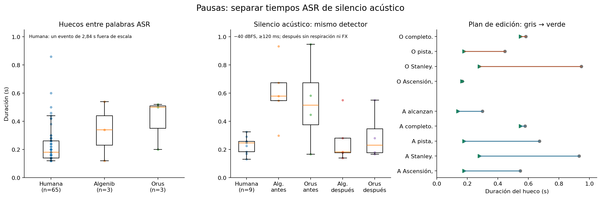
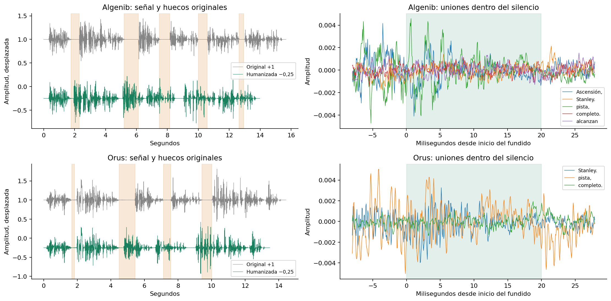

# Diagnóstico de las cuatro muestras anteriores

Detector acústico: −40 dBFS, mínimo 120 ms, une eventos separados por ≤40 ms. Se excluyen los márgenes. La asociación a puntuación usa la proximidad del final de la palabra anterior (hasta 650 ms); no es una alineación fonética. Se conserva el tiempo ASR sin corregir. Los originales procesados mantienen prácticamente las mismas pausas.

Referencia humana: ASR mediana 180 ms (coma 140 ms; punto 200 ms). Con el mismo detector acústico usado aquí: n=9, mediana 247 ms, máximo 325 ms. La medida ASR y la acústica se muestran por separado, sin equipararlas. El detector absoluto solo encuentra nueve silencios en la referencia, frente a 65 huecos ASR: un hueco entre palabras puede contener ruido o fondo y no cruzar −40 dBFS. Por ello no se interpreta la distribución acústica de una mezcla humana como una meta exacta para una voz seca.

## malvinas-algenib.mp3

| Silencio acústico (s) | Duración (ms) | Contexto asociado | Desplazamiento desde fin ASR (ms) |
|---|---:|---|---:|
| 1.795–2.306 | 511 | Ascensión, → un (coma) | 375 |
| 5.241–6.126 | 885 | Stanley. → Una (punto) | 361 |
| 7.521–8.156 | 635 | pista, → sin (coma) | 261 |
| 10.003–10.578 | 575 | completo. → Super (punto) | 283 |
| 12.650–12.941 | 291 | alcanzan →  (sin puntuación) | no asignable |

Huecos ASR ≥120 ms (aire y silencio pueden estar absorbidos en las palabras):

- 4.88–5.42 s: 540 ms; Stanley. → Una.
- 7.26–7.38 s: 120 ms; pista, → sin.
- 9.72–10.06 s: 340 ms; completo. → Super.

## malvinas-algenib-fx.mp3

| Silencio acústico (s) | Duración (ms) | Contexto asociado | Desplazamiento desde fin ASR (ms) |
|---|---:|---|---:|
| 1.798–2.306 | 508 | Ascensión, → un (coma) | 378 |
| 5.242–6.126 | 884 | Stanley. → Una (punto) | 362 |
| 7.534–8.155 | 621 | pista, → sin (coma) | 274 |
| 10.004–10.575 | 572 | completo. → Super (punto) | 284 |
| 12.655–12.941 | 286 | alcanzan →  (sin puntuación) | no asignable |

Huecos ASR ≥120 ms (aire y silencio pueden estar absorbidos en las palabras):

- 4.88–5.42 s: 540 ms; Stanley. → Una.
- 7.26–7.38 s: 120 ms; pista, → sin.
- 9.72–10.06 s: 340 ms; completo. → Super.

## malvinas-orus.mp3

| Silencio acústico (s) | Duración (ms) | Contexto asociado | Desplazamiento desde fin ASR (ms) |
|---|---:|---|---:|
| 1.671–1.817 | 146 | Ascensión, → un (coma) | 211 |
| 4.491–5.437 | 947 | Stanley. → Una (punto) | 351 |
| 7.130–7.572 | 442 | pista, → sin (coma) | 350 |
| 9.434–10.008 | 574 | completo. → Super (punto) | 354 |

Huecos ASR ≥120 ms (aire y silencio pueden estar absorbidos en las palabras):

- 4.14–4.64 s: 500 ms; Stanley. → Una.
- 6.78–6.98 s: 200 ms; pista, → sin.
- 9.08–9.60 s: 520 ms; completo. → Super.

## malvinas-orus-fx.mp3

| Silencio acústico (s) | Duración (ms) | Contexto asociado | Desplazamiento desde fin ASR (ms) |
|---|---:|---|---:|
| 1.671–1.804 | 133 | Ascensión, → un (coma) | 211 |
| 4.491–5.437 | 947 | Stanley. → Una (punto) | 351 |
| 7.131–7.572 | 441 | pista, → sin (coma) | 351 |
| 9.434–10.008 | 574 | completo. → Super (punto) | 354 |

Huecos ASR ≥120 ms (aire y silencio pueden estar absorbidos en las palabras):

- 4.14–4.64 s: 500 ms; Stanley. → Una.
- 6.78–6.98 s: 200 ms; pista, → sin.
- 9.08–9.60 s: 520 ms; completo. → Super.

## Decisiones de edición

Solo se acorta un intervalo si sobran al menos 25 ms. Objetivos máximos: coma 180 ms, punto ordinario 280 ms, hueco sin puntuación 140 ms. Se conserva hasta 550 ms antes de «Super Étendard», único cambio dramático. No se alargan huecos que ya eran menores. Los bordes acústicos mantienen al menos 45 ms intactos y el cruce de 20 ms está en el centro.

El hueco de Algenib dentro del intervalo ASR de «alcanzan» es ambiguo: puede ser vacilación o consonante débil. Su centro de muy baja amplitud se acorta conservando ambos extremos; comprobar esa palabra al escuchar. Las métricas no garantizan integridad fonética ni naturalidad perceptual.

