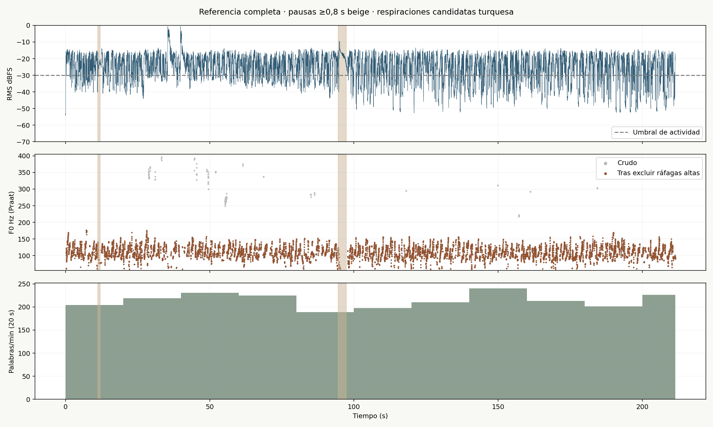
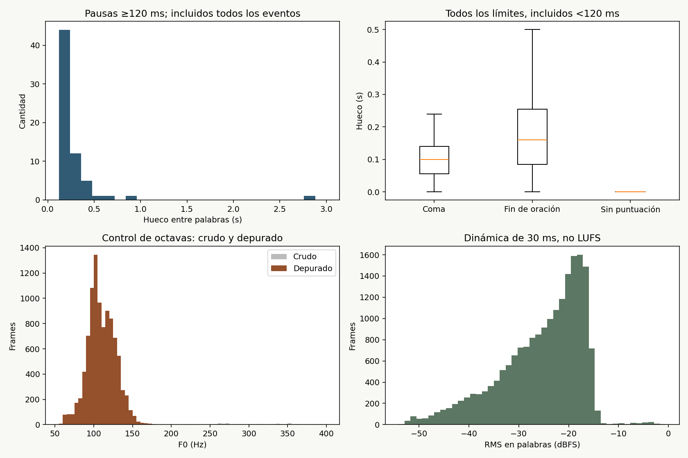
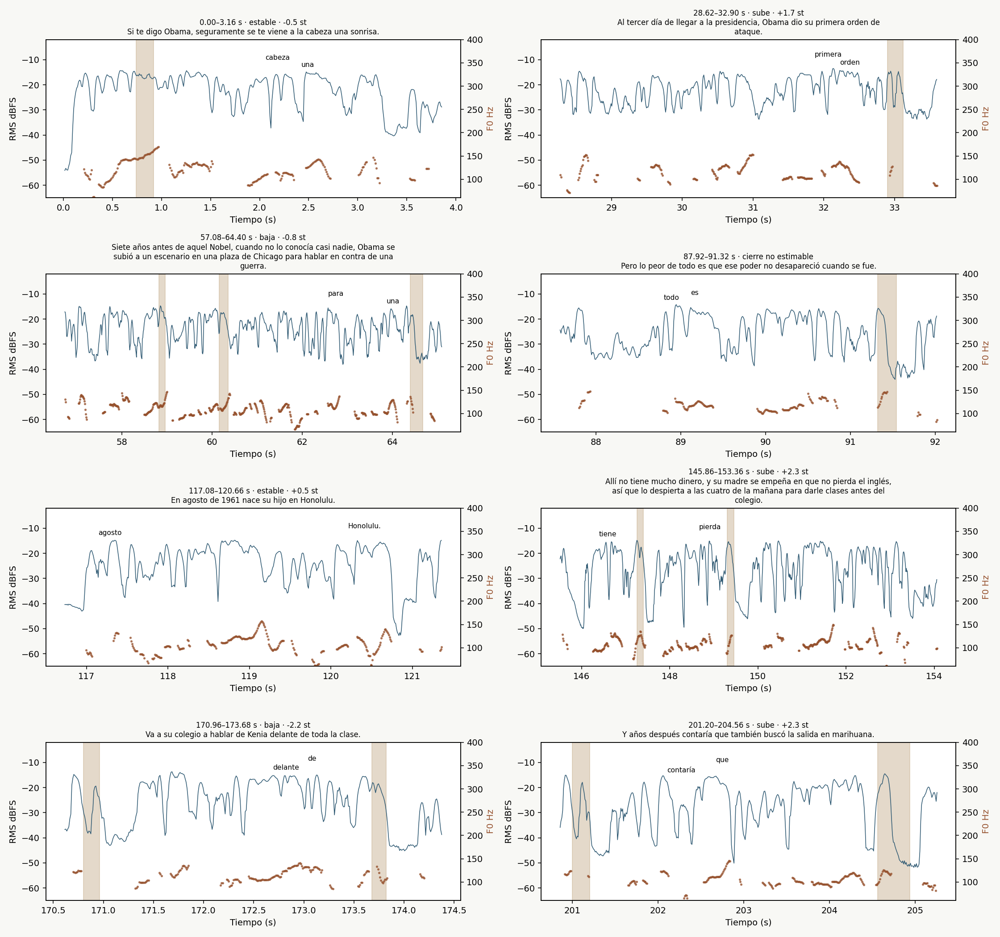
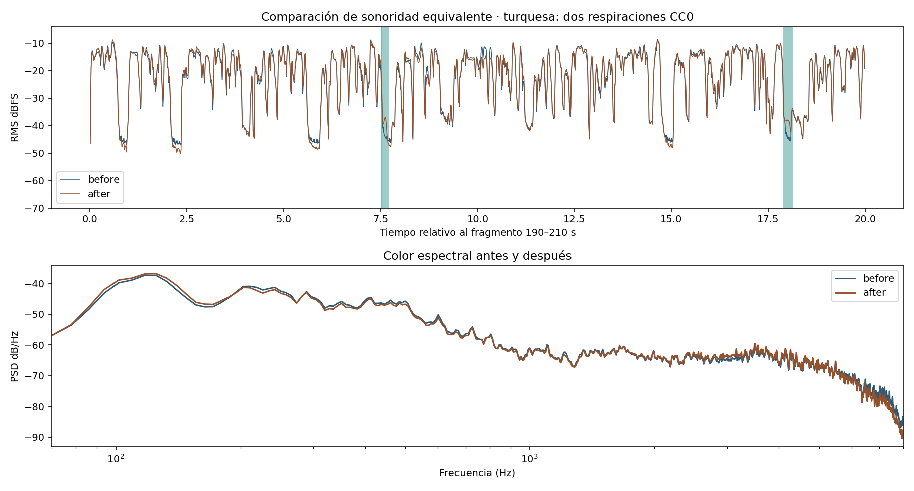

# Voz de referencia y dirección para Malvinas

Entrega local del 3 de noviembre de 2026. **Cero llamadas a Gemini o a cualquier API de pago.** Se completó Whisper large-v3 local, con CPU int8, tres hilos, palabras alineadas y VAD desactivado. Los procesos de trabajo se invocaron con `nice -n 15`, en secuencia para la transcripción, el análisis acústico y la prueba de audio.

## Qué archivo se estudió

`Picker_Rickmansworth_88_mp3.mp3`: **211,409 s**, estéreo, 44,1 kHz. SHA-256: `dd478a0faebab5b13cd28e34e66ab8be4e9b9c3a0da1e269f2222fcd34f8a4fd`. Aunque el nombre sugería inglés, el detector dio **español, 99,24 %**. El contenido transcrito comienza «Si te digo Obama…» y desarrolla un relato biográfico y político. No se atribuye identidad al hablante por el nombre del archivo, ni se verifica aquí la veracidad histórica de ese relato.

[Transcripción TXT](transcripcion.txt) · [JSON por palabra](transcripcion.json) · [medidas completas](analisis.json) · [series acústicas](series-acusticas.npz). El idioma tiene probabilidad de detección; no es una tasa de acierto del texto. Las probabilidades de palabra tienen mediana 1,000. No hubo corrección por escucha. Los tramos 20,64–22,26 s («Neal»), 167,98–169,16 s («aún más») y 205,52–207,70 s («cocina») quedan señalados para revisión en [incidencias-transcripcion.json](incidencias-transcripcion.json); no se sustituyeron por conjeturas. Se conservaron en la transcripción original las 2 palabras de duración menor de 20 ms; se excluyeron de las estadísticas.

## Perfil medido

| medida | resultado real |
|---|---:|
| Palabras léxicas contadas por expresión regular | 753 |
| Ritmo sobre archivo completo | **213,71 ppm** |
| Tiempo de palabras ASR; articulación sobre esos intervalos | 191,96 s; **235,36 ppm** |
| Tiempo sin huecos ≥120 ms ni márgenes; ritmo resultante | 193,98 s; 232,91 ppm |
| Actividad RMS, método independiente | 178,34 s; 253,34 ppm |
| Longitud de oración por puntuación ASR | 9,00 palabras (p10–p90: 3,00–18,00 palabras; n=71) |
| Duración de oración | 2,42 s (p10–p90: 1,08–4,50 s; n=71) |
| Longitud de cláusula, corte en coma o fin | 7,00 palabras (p10–p90: 2,20–13,80 palabras; n=103) |
| Huecos ≥120 ms | 65; 18,45/min; 17,30 s acumulados |
| Duración de esos huecos | 0,18 s (p10–p90: 0,14–0,42 s; n=65) |
| Pausas ≥800 ms | 0,57/min |
| F0 | **108,18 Hz (p10–p90: 89,24–132,50 Hz; n=9650)** |
| F0 p10–p90 en semitonos, referencia 100 Hz | -1,97–4,87 st; amplitud **6,84 st** |
| Cierres medidos | bajan 27; suben 21; estables 14 |
| RMS global; pico de muestra; crest factor | -20,07 dBFS; 2,27 dBFS; 22,33 dB |
| RMS de frames dentro de palabras | -23,39 dBFS (p10–p90: -37,68–-16,79 dBFS; n=19195) |
| Dinámica RMS p90−p10 de habla | **20,89 dB** |
| Respiraciones candidatas / confirmadas | 0 (0,00/min) / **sin conteo confirmado** |

El pico positivo de la fuente se midió sobre decodificación float de MP3: los transitorios superan 0 dBFS. Se conservó ese valor real, sin recortar ni normalizar antes del análisis; los picos de la prueba procesada se controlaron por separado.

El recuento léxico trata una cifra escrita como un token: no equivale siempre al número de palabras pronunciadas. Los tres tiempos de habla son aproximaciones diferentes; los intervalos ASR incluyen articulación sorda y pueden absorber pausas pequeñas. El umbral RMS independiente fue -30,00 dBFS, con cierre de huecos de unos 80 ms. No se presenta como VAD de referencia.

### Pausas, puntuación y cambios de idea

Se mide el hueco entre el final de una palabra y el comienzo de la siguiente, **no silencio acústico puro**: puede contener aire o ruido. La puntuación la infiere Whisper; la relación es descriptiva, no causal.

| límite anterior | todos los límites: mediana (p10–p90), s | solo pausas ≥120 ms: mediana (p10–p90), s |
|---|---:|---:|
| coma | 0,10 (p10–p90: 0,02–0,20; n=32) | 0,14 (p10–p90: 0,13–0,20; n=15) |
| punto / interrogación / exclamación | 0,16 (p10–p90: 0,06–0,42; n=70) | 0,20 (p10–p90: 0,14–0,44; n=50) |
| dos puntos / punto y coma | sin observaciones | sin observaciones |
| sin puntuación | 0,00 (p10–p90: 0,00–0,00; n=650) | sin observaciones |

Como proxy explícito de «entre ideas», fin de oración con hueco ≥600 ms: 0,86 s (p10–p90: 0,65–2,44 s; n=3). No todo punto supone un cambio de idea. Las pausas más largas fueron:

- 01:34.52–01:37.36: **2,84 s**, entre «tuviera.» y «Para».
- 00:11.20–00:12.06: **0,86 s**, entre «tele.» y «Un».
- 00:06.64–00:07.24: **0,60 s**, entre «Can.» y «El».
- 03:27.70–03:28.20: **0,50 s**, entre «cocina.» y «Al».
- 01:56.62–01:57.08: **0,46 s**, entre «casan.» y «En».
- 03:17.32–03:17.76: **0,44 s**, entre «gente.» y «Intenta».

### Ritmo a lo largo del relato

Ventanas fijas de 20 s; la última puede ser más corta. No son duraciones sintéticas de escenas.

| tramo | ppm | segundos en pausas ≥120 ms |
|---|---:|---:|
| 00:00.00–00:20.00 | 204,0 | 2,32 |
| 00:20.00–00:40.00 | 219,0 | 1,20 |
| 00:40.00–01:00.00 | 231,0 | 0,84 |
| 01:00.00–01:20.00 | 225,0 | 0,84 |
| 01:20.00–01:40.00 | 189,0 | 3,80 |
| 01:40.00–02:00.00 | 198,0 | 1,76 |
| 02:00.00–02:20.00 | 210,0 | 0,84 |
| 02:20.00–02:40.00 | 240,0 | 1,16 |
| 02:40.00–03:00.00 | 213,0 | 1,36 |
| 03:00.00–03:20.00 | 201,0 | 2,10 |
| 03:20.00–03:31.41 | 226,1 | 1,08 |

### Tono, énfasis y control de octavas

Praat por autocorrelación, 60–400 Hz, paso 10 ms, umbral de sonoridad 0,5. Frames sonoros: 45,66 %. Una segunda estimación 75–500 Hz dio mediana 108,71 Hz; en 8682 frames comunes, el desacuerdo mayor de nueve semitonos fue 0,08 %. Tras revisar las gráficas, se excluyeron 122 frames en ráfagas de hasta 350 ms que superaban una octava sobre la mediana sonora de ±1,5 s. Se conservaron la F0 cruda y todos los eventos excluidos, sin inventar valores de reemplazo. La mediana cruda fue 108,55 Hz. No se multiplicó ni dividió toda la curva por dos. Los picos grises del panorama muestran lo rechazado. Esta depuración es heurística y no confirma por escucha cada error.

El cierre compara la mediana de los últimos 350 ms sonoros con los 350 ms anteriores; «baja/sube» exige ±0,75 st. Delta final: -0,35 st (p10–p90: -4,35–3,67 st; n=62). La frase interrogativa puede terminar arriba; no se impone un descenso a todas.

Los picos se cruzaron con palabras. El delta local es p90 de RMS de la palabra menos la mediana del habla en un contexto de ±1,5 s: un candidato a énfasis, no una prueba perceptual por sí solo. Se separaron 5 palabras coincidentes con picos superiores al p99 de habla +6 dB (alrededor de 35,3–36,2 y 39,8–40,2 s), posibles transitorios de mezcla. No se borraron del audio ni se atribuyeron automáticamente a intención verbal.

| tiempo | palabra | RMS p90 dBFS | delta local dB | F0 mediana Hz |
|---|---|---:|---:|---:|
| 01:44.14 | que | -15,41 | +14,63 | 147,72 |
| 01:43.82 | igual | -16,93 | +14,12 | 104,69 |
| 01:52.88 | estudiante, | -16,39 | +13,17 | 117,52 |
| 01:44.34 | él, | -16,97 | +12,66 | 103,74 |
| 02:15.86 | vuelve | -15,83 | +12,33 | 123,56 |
| 02:10.34 | poco. | -15,08 | +11,38 | 121,39 |
| 02:16.40 | Kenia | -15,64 | +11,25 | 134,81 |
| 01:52.68 | una | -17,14 | +11,21 | 142,01 |
| 02:14.12 | Harvard | -16,66 | +11,17 | 120,21 |
| 01:41.86 | vida. | -15,04 | +10,95 | 106,79 |

### Respiración y aspereza

Detector exploratorio: ráfagas aperiódicas de 100–600 ms dentro de los huecos, menos energéticas que el habla, pero superiores al piso de ruido, y antes del siguiente inicio léxico. Exige planitud espectral >0,06 y ausencia de F0. Puede confundir fricativas, ambiente o compresión con respiración; también puede perder una exhalación sonora. **0 candidatos no significa 0 suspiros reales**. Si no aparecen candidatos, tampoco demuestra que el hablante no respire. Los eventos completos están en `analisis.json → breaths.events`.

| descriptor | resultado |
|---|---:|
| Jitter local, ventanas sonoras de 250–600 ms | 2,12 % (p10–p90: 1,21–3,49 %; n=110) |
| Shimmer local, mismas ventanas | 9,85 % (p10–p90: 6,35–15,87 %; n=110) |
| HNR | 12,13 dB (p10–p90: 8,33–15,82 dB; n=110) |
| Inclinación de log-potencia 300–4000 Hz | -7,76 dB/octava (p10–p90: -11,97–-0,38 dB/octava; n=8402) |
| Energía 2–5 kHz respecto de 80–7800 Hz, habla sonora | -21,73 dB (p10–p90: -31,89–-12,04 dB; n=8402) |

Jitter/shimmer/HNR describen una narración comprimida en MP3 y ventanas breves de habla conectada. No son mediciones clínicas ni equivalen automáticamente a «voz áspera». La inclinación también depende de vocales, micrófono, EQ y códec. No se recomienda elevar deliberadamente jitter o bajar HNR para simular edad.

## Ocho frases anotadas

Las palabras citadas provienen exclusivamente del audio entregado. Las anotaciones son inferencias acústicas, pendientes de escucha. «Aire» siempre se rotula como candidato; no se inventan suspiros donde no están confirmados.

1. **00:00.00–00:03.16** · «Si te digo Obama, seguramente se te viene a la cabeza una sonrisa.»
   13 palabras, 246,8 ppm dentro de la frase. Pico candidato en **una**, 00:02.34, +5,79 dB respecto del contexto. Cierre estable (-0,54 st). No hay hueco posterior ≥120 ms. Sin suspiro confirmado en este tramo.
2. **00:28.62–00:32.90** · «Al tercer día de llegar a la presidencia, Obama dio su primera orden de ataque.»
   15 palabras, 210,3 ppm dentro de la frase. Pico candidato en **orden**, 00:32.22, +7,26 dB respecto del contexto. Cierre sube (1,69 st). Hueco posterior 0,22 s. Sin suspiro confirmado en este tramo.
3. **00:57.08–01:04.40** · «Siete años antes de aquel Nobel, cuando no lo conocía casi nadie, Obama se subió a un escenario en una plaza de Chicago para hablar en contra de una guerra.»
   30 palabras, 245,9 ppm dentro de la frase. Pico candidato en **una**, 01:03.92, +6,82 dB respecto del contexto. Cierre baja (-0,84 st). Hueco posterior 0,28 s. Sin suspiro confirmado en este tramo.
4. **01:27.92–01:31.32** · «Pero lo peor de todo es que ese poder no desapareció cuando se fue.»
   14 palabras, 247,1 ppm dentro de la frase. Pico candidato en **todo**, 01:28.78, +8,94 dB respecto del contexto. Cierre no estimable (sin delta calculable). Hueco posterior 0,22 s. Sin suspiro confirmado en este tramo.
5. **01:57.08–02:00.66** · «En agosto de 1961 nace su hijo en Honolulu.»
   9 palabras, 150,8 ppm dentro de la frase. Pico candidato en **agosto**, 01:57.10, +7,51 dB respecto del contexto. Cierre estable (0,45 st). No hay hueco posterior ≥120 ms. Sin suspiro confirmado en este tramo.
6. **02:25.86–02:33.36** · «Allí no tiene mucho dinero, y su madre se empeña en que no pierda el inglés, así que lo despierta a las cuatro de la mañana para darle clases antes del colegio.»
   32 palabras, 256,0 ppm dentro de la frase. Pico candidato en **tiene**, 02:26.48, +9,62 dB respecto del contexto. Cierre sube (2,34 st). No hay hueco posterior ≥120 ms. Sin suspiro confirmado en este tramo.
7. **02:50.96–02:53.68** · «Va a su colegio a hablar de Kenia delante de toda la clase.»
   13 palabras, 286,8 ppm dentro de la frase. Pico candidato en **delante**, 02:52.62, +8,28 dB respecto del contexto. Cierre baja (-2,19 st). Hueco posterior 0,14 s. Sin suspiro confirmado en este tramo.
8. **03:21.20–03:24.56** · «Y años después contaría que también buscó la salida en marihuana.»
   11 palabras, 196,4 ppm dentro de la frase. Pico candidato en **contaría**, 03:21.94, +9,13 dB respecto del contexto. Cierre sube (2,34 st). Hueco posterior 0,38 s. Sin suspiro confirmado en este tramo.

## Gráficas







## Dos perfiles listos para dirigir TTS

Los datos estructurados están en [perfiles-tts.json](perfiles-tts.json). Los rangos de B son objetivos editoriales; no resultados de una voz Gemini que aún no se generó.

### A · referencia

`voice_direction`:

> Narración oral en español, cercana y clara. Reproduce la organización temporal medida, sin imitar la identidad de una persona: 203–224 palabras por minuto sobre el relato con sus pausas internas. Articula con fluidez, acelera en enumeraciones y afloja antes de la idea decisiva. En las comas que realmente separan cláusulas, deja aproximadamente 140 ms; al cerrar una oración, aproximadamente 200 ms. No conviertas cada coma en un silencio. Reserva uno o dos descansos mayores para giros del relato. Varía el tono en palabras importantes y deja caer las conclusiones, manteniendo las preguntas abiertas. La energía crece en la idea clave y vuelve a una voz cercana. Respira discretamente sin añadir suspiros dramáticos. No copies el texto de la referencia.


Objetivo total: **203–224 ppm**; F0 descriptiva 108,18 Hz, rango p10–p90 6,84 st; conservar el contraste RMS medido de 20,89 dB, con tolerancia orientativa ±2 dB tras masterizar. Pausas largas ≥800 ms: referencia 0,57/min. Las comas cortas se resuelven con puntuación; `<short pause>` solo en una frontera que necesita aire, no en todas las comas. `<long pause>` únicamente en los giros con espacio real. No trasladar cada hueco ASR como si fuera una instrucción exacta.

### B · veterano áspero, perfil elegido

`voice_direction`:

> Narrador masculino de edad madura, grave y ligeramente ronco, con una aspereza orgánica discreta. Español latinoamericano neutro, dicción nítida. Cansado pero firme, cercano y sobrio, como alguien que carga recuerdos difíciles. Ritmo de 100 a 115 palabras por minuto sobre la narración completa, incluidas sus pausas internas; articulación fluida, sin arrastrar sílabas. Separa ideas con aire y deja que cada dato se asiente. Antes de una fecha decisiva o un hecho duro, una pausa larga medida. Respira bajo entre ideas; uno o dos suspiros pequeños por minuto, nunca un jadeo teatral. Empieza contenido. En el momento clave sube brevemente el tono y endurece la intención, con un pequeño aumento de energía, sin gritar; después vuelve a bajar y cierra en descenso. Respeta a las víctimas, sin triunfo, arenga ni voz de tráiler. No imites la identidad de una persona real; toma únicamente los patrones de ritmo, contraste y cierre estudiados.

| control posterior | objetivo B |
|---|---|
| Ritmo total del relato, incluidas pausas internas | **100–115 ppm** |
| Articulación orientativa, sin grandes huecos | 130–150 ppm; verificar después, no forzar |
| F0 mediana / amplitud p10–p90 | 90–115 Hz / 6–9 st, si la tesitura natural de la voz lo permite |
| Coma que separa cláusulas / fin de oración | 180–300 ms / 350–600 ms |
| Pausa larga | 700–1100 ms, **4–6 por minuto** |
| Aire entre ideas | 4–6 eventos/min de 180–550 ms; **solo 1–2 suspiros/min**, incluidos en ese total |
| Momento clave, una sola vez | +2–4 st y +2–3 dB durante 2–4 s; volver al nivel contenido |
| Entrega de audio | −16 LUFS, pico verdadero ≤−1,5 dBTP; comprobar después de MP3 |

Puntuación y colocación:

- Comas para sintaxis y respiración pequeña. No separar «de» de una fecha, ni un nombre de su apellido, ni una cifra de su unidad.
- Punto al cerrar cada idea. `<short pause>` después del punto cuando haga falta 350–600 ms, sin sumar otra marca automáticamente en el mismo lugar.
- `<long pause>` antes de la **frase completa** con una fecha decisiva o un hecho duro. En Malvinas: antes de m03, m04, m06 y m07; cuatro en unos 56 s, aproximadamente 4,3/min. No antes de cada número incidental.
- Puntos suspensivos solo para una vacilación deliberada, una o dos veces por minuto como máximo. No apilar `... <short pause> <long pause>`.
- Respirar en los huecos entre ideas; el suspiro no cae encima de «Sheffield», «alcanzado» o «se rinde». El cierre se apaga con firmeza, sin melodrama.
- Mantener las palabras habladas limpias: ninguna instrucción entre paréntesis. Los objetivos numéricos son criterios de medición, no duración garantizada de una etiqueta.

La [copia marcada del guion](guion-marcado-B.json) conserva las 104 palabras y siete bloques de `assets/script.malvinas.json`; cambia dirección, puntuación/marcas e intensidad. No se editó el original. Las respiraciones externas quedan en un manifest, no en texto que pudiera leerse en voz alta.

### Integración real con el kit

`narrate.py.mark()` pasa `<short pause>`, `<long pause>` y `<breath>`; no valida un repertorio cerrado de marcas. La [documentación de Gemini 3.8](https://docs.cloud.google.com/gemini-enterprise-agent-platform/models/text-to-speech/prompting-guide) también admite `<sigh>` y `<exhales>`. Su soporte documentado no equivale a fiabilidad comprobada en estas voces: **no se hizo síntesis**. Con 3.1 deben revisarse las marcas de su guía heredada, que usa corchetes.

Hallazgo de integración: `chunks()` agrega 130 ppm incluso si el diseño pide otra cosa; 3.8 toma el estilo del diseño y no usa directamente `script.voice_direction`. El fallback `director_prompt()` sí lo usa, pero también añade 130. Por eso pasar solo `--voice Algenib` no configura B.

[preparar-kit.py](preparar-kit.py) extrae únicamente constantes y la función pura `mark()` mediante AST; no importa TTS, no lee claves y no llama a la red. Genera los chunks `text/style` para `tts.gemini_annotated` con la dirección elegida y sin 130 ppm. [kit-chunks-B.json](kit-chunks-B.json) es la preparación concreta revisable. Para generar en otra tarea autorizada: usar estos chunks directamente, o adaptar allí el constructor del kit para que respete `voice_direction` y el ritmo del perfil. No pasarlos otra vez por `chunks()` porque volvería a agregar la contradicción. No se modifica ningún lanzador ni script del servidor.

```bash
nice -n 15 python3 -I work/voz-ref/preparar-kit.py \
  work/voz-ref/guion-marcado-B.json --perfil B --kit /ruta/explainer-kit
```

**Duración:** 104 palabras a 100–115 ppm totales ocupan 54,3–62,4 s, con pausas internas. Si además se conservan 1,2 s de apertura y 6 s de cierre del kit, son **61,5–69,6 s**. Para 56 s totales con ese margen quedan 48,8 s de relato: aproximadamente **81–94 palabras** a ese ritmo. Otra opción es conservar las 104 palabras y reducir lead/tail; 56 s de relato equivalen a 111,4 ppm. No prometer 56 s sin medir una generación real y no acelerar la locución para encajar.

### Voces candidatas para B

Los caracteres del catálogo vienen de la [lista oficial de Gemini](https://aistudio.google.com/docs/speech-generation#voices); género de la [tabla oficial de Google Cloud](https://docs.cloud.google.com/text-to-speech/docs/gemini-tts#voice_options). «Firme» no garantiza F0 grave.

| prioridad | voz | motivo y reserva |
|---|---|---|
| **1** | **Algenib** | Masculina; carácter áspero. Es la primera hipótesis para textura rugosa sin apoyarse en distorsión. Verificar dicción, edad percibida y registro grave con escucha. |
| **2** | **Orus** | Masculina y firme; alternativa para sostener autoridad contenida. El grado de ronquera deberá comprobarse. |
| 3 | Alnilam | Masculina y firme; otra alternativa de cuerpo y aplomo. La profundidad no está garantizada por la etiqueta. |
| Condicionada | Gacrux | Carácter maduro, pero catalogada **femenina**: se incluye por el pedido, no como segunda opción masculina. No gastar una prueba de B en ella antes de comprobar su encaje. |

Sadaltager queda fuera de la primera ronda porque se busca diferenciar esta variante de las voces habituales. No se escucharon nuevas muestras del catálogo ni se generaron pruebas TTS.

## Suspiros y receta local

No hay una etiqueta cuya naturalidad esté **verificada aquí**. La alternativa controlable es reservar huecos, obtener una buena voz base y mezclar 4–6 recortes discretos por minuto, de los cuales solo 1–2 sean suspiros perceptibles. Cinco posiciones orientativas para Malvinas se describen en [respiraciones-plantilla.json](respiraciones-plantilla.json), sin segundos inventados. Alinear con el WAV real y omitir un cue si la voz ya respiró.

### SFXMint: fichas verificadas

Duración del archivo completo; no confundir con el recorte de 100–600 ms. Todas las fichas siguientes declaran **CC0 1.0**. Son metadatos y descripciones del proveedor, no aprobación por escucha. Solo `exhale-02` y `sigh-03` se descargaron para probar la mezcla; sus hashes coinciden con las fichas. Evidencia en [sfxmint-fichas.json](sfxmint-fichas.json), [búsquedas](sfxmint-busquedas.json) y [registro de dos descargas](sfx-descargas.json).

| ID y ficha | duración | licencia | pertinencia |
|---|---:|---|---|
| [deep-inhale-02](https://sfxmint.com/sounds/deep-inhale-02) | 2,500 s | [CC0](https://creativecommons.org/publicdomain/zero/1.0/) | Inspiración profunda; requiere recorte y evitar aspecto de ejercicio de meditación. |
| [breathing-02](https://sfxmint.com/sounds/breathing-02) | 9,297 s | [CC0](https://creativecommons.org/publicdomain/zero/1.0/) | Respiración nasal al dormir; contiene un silbido, poco apropiada para un veterano despierto. |
| [sigh-02](https://sfxmint.com/sounds/sigh-02) | 1,328 s | [CC0](https://creativecommons.org/publicdomain/zero/1.0/) | Alivio; usar solo donde ese sentido tenga cabida, no en una pérdida. |
| [sigh-03](https://sfxmint.com/sounds/sigh-03) | 1,317 s | [CC0](https://creativecommons.org/publicdomain/zero/1.0/) | Suspiro suave y triste; candidato secundario, sin convertir el relato en llanto. |
| [sigh-08](https://sfxmint.com/sounds/sigh-08) | 0,794 s | [CC0](https://creativecommons.org/publicdomain/zero/1.0/) | Impaciencia; probablemente descartar para hechos dolorosos. |
| [exhale-02](https://sfxmint.com/sounds/exhale-02) | 2,500 s | [CC0](https://creativecommons.org/publicdomain/zero/1.0/) | Exhalación relajada; primer candidato para aire bajo y discreto. |
| [sigh-01](https://sfxmint.com/sounds/sigh-01) | 1,814 s | [CC0](https://creativecommons.org/publicdomain/zero/1.0/) | Descripción de mujer suspirando; poco compatible con continuidad masculina. |
| [sigh-07](https://sfxmint.com/sounds/sigh-07) | 1,582 s | [CC0](https://creativecommons.org/publicdomain/zero/1.0/) | Descripción masculina, pero exasperada y fuerte; puede sonar actuada. |


### Cómo aplicar los efectos

[fx-veterano.sh](fx-veterano.sh) acepta un WAV y un manifest opcional de respiraciones. Usa solo ffmpeg/ffprobe y Python estándar. EQ: filtro de graves bajo 70 Hz, +2,2 dB alrededor de 150 Hz, +1,2 dB en 3 kHz, corte sobre 7,5 kHz. Saturación suave `tanh` de factor 1,10. Sala breve con dos reflexiones de 29/43 ms a 3,5/2 %. Mezcla sin normalización automática de entradas; fundidos de aire de 35/80 ms. Sonoridad a −16 LUFS mediante dos pasadas y duración recortada a la entrada, sin estirar ni desplazar palabras.

El manifest fija `file`, `start`, `source_start`, `duration` y `target_rms_dbfs`. El script mide el RMS de cada recorte tras filtrarlo y ajusta su nivel, en lugar de asumir que todos los SFX vienen al mismo volumen. Punto de partida: unos 22 dB por debajo del RMS de la voz antes del master; ajustar luego por escucha. Inspiraciones y suspiros siempre dentro del hueco, con al menos 60 ms de margen respecto de palabras. No añadir un suspiro a cada frase.

```bash
bash work/voz-ref/fx-veterano.sh voz.wav voz-fx.wav respiraciones.json
# Sin manifest: aplica solo EQ, saturación, sala y master.
bash work/voz-ref/fx-veterano.sh voz.wav voz-fx.mp3
```

Los efectos dan color; **no crean una edad, un género o una ronquera natural** si la voz base no los tiene. No se baja el pitch artificialmente. No usar jitter ni ruido continuo como sustituto de interpretación.

## Prueba de 20 segundos, realizada

[Antes MP3](prueba-fx-antes.mp3) · [Después MP3](prueba-fx-despues.mp3) · [WAV procesado](prueba-fx-despues.wav) · [validación](prueba-fx-validacion.json).

Fuente: segundos **190–210** del archivo de referencia, únicamente para comparar, **no publicar**. Antes y después se masterizaron por separado y se igualó la sonoridad atenuando la versión más fuerte, sin aumentar picos. El master apunta a −16 LUFS; el límite de pico dejó esta prueba cerca de −17 LUFS, según la medición real de la tabla. Dos recortes CC0 equivalen a seis respiraciones por minuto: exhalación de 180 ms en 7,515 s del fragmento (197,515 s del original), dentro de 197,32–197,76 s; recorte de suspiro de 220 ms en 17,90 s (207,90 s), dentro de 207,70–208,20 s. Ambas ventanas tienen RMS al menos 8 dB inferior a la mediana de habla durante todo el recorte; no se usaron solo los huecos de Whisper. No se alargó el fragmento ni se superpusieron con palabras ASR. Los recortes parten de 0,90 s de `exhale-02` y 0,17 s de `sigh-03`, alrededor de los picos informados por el proveedor; **pendientes de escucha**.

| medición después de decodificar los MP3 | antes | después |
|---|---:|---:|
| Sonoridad integrada | -16.99 LUFS | -16.99 LUFS |
| Pico verdadero medido por loudnorm | -2.24 dBTP | -1.74 dBTP |
| LRA | 1.40 LU | 1.30 LU |
| Duración PCM decodificada | 20,000 s | 20,000 s |
| Muestras con amplitud ≥1 | 0 | 0 |
| Banda 80–250 / 500–1500 Hz | 7,72 dB | 8,60 dB |
| Banda 2–4 kHz / 500–1500 Hz | -4,01 dB | -2,78 dB |



La diferencia integrada final fue 0,00 LU. Se atenuó el antes 0,49 dB para igualar la comparación. La prueba verifica ejecución, duración, mezcla y señal; no prueba que el resultado parezca un veterano ni que los suspiros encajen emocionalmente. Eso necesita escucha humana y una futura muestra de la voz candidata.

## Reproducibilidad y límites

1. `transcribir.py`: Python del proyecto con `-I`, modelo en caché local y `HF_HUB_OFFLINE=1`. Transcripción completada en 611,5 s, sin VAD. No editarlo mientras corre.
2. Análisis después de terminar Whisper: `/tmp/vozref-venv/bin/python work/voz-ref/analizar.py` con numpy/scipy/matplotlib locales y praat-parselmouth 0.4.7 en el venv desechable. Las fórmulas y eventos están guardados.
3. Prueba después del análisis: `/tmp/vozref-venv/bin/python work/voz-ref/probar-fx.py`. Requiere las dos descargas ya verificadas; no realiza red. Invocar ambos con `nice -n 15`, uno por vez.
4. `preparar-kit.py` solo produce datos de dirección; no sintetiza. Se validó que conserva palabras, IDs, siete bloques y fuentes del guion original, sin la instrucción fija de 130 ppm.

No se hizo clonación de identidad, generación TTS, escucha humana, validación histórica del relato de referencia ni publicación. No hay voz final de Malvinas, tiempos definitivos de sus anclas ni garantía de comportamiento de una marca. No se modificaron lanzadores, motor, assets originales ni herramientas del servidor. Las fuentes externas y el comportamiento real del kit están documentados en [FUENTES.md](FUENTES.md).

