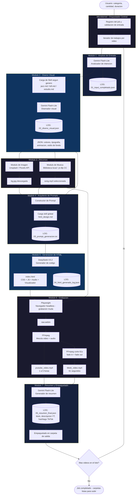

> **Archivado (2026-09-08):** describe una versión anterior del pipeline (7 etapas, sin validación de imágenes ni publicación social). El pipeline vigente tiene 9 etapas — ver [`estudio_tecnico_completo.md`](../estudio_tecnico_completo.md).

# Flujo del Sistema Nexa-Brief

El flujo completo de generacion de un video se divide en siete etapas secuenciales, orquestadas por un microkernel central que itera sobre cada trabajo del lote.

## Diagrama de flujo

## Descripcion de las etapas

### Etapa 1 – Analisis de entrada
El usuario proporciona una categoria, una cantidad y una duracion. El modulo `input_analyzer` envia estos datos a Gemini Flash-Lite, que completa los campos faltantes (genero musical, etiquetas de ambiente, frase de busqueda de imagen). El resultado se guarda como `01_input_completado.json`.

### Etapa 2 – Diseno visual
Se carga el skill del genero musical desde `skills/genres/` y se envia junto con la informacion completada a Gemini Flash-Lite en modo disenador. Este devuelve un plano de diseno visual (colores, tipografia, animacion, estilo de fondo) en formato JSON. Se registra en `02_diseno_visual.json`.

### Etapa 3 – Obtencion de recursos
El plano de diseno se utiliza para buscar la imagen de fondo (Unsplash, Pexels o Pixabay) y la pista de musica (biblioteca local o descarga desde fuentes libres). Se implementa un mecanismo de fallback: si todas las fuentes de imagen fallan, se genera un fondo CSS; si no hay musica local, se descarga de internet.

### Etapa 4 – Construccion del prompt
El modulo `prompt_architect` toma el plano de diseno, las rutas de los recursos y el skill universal de HTML (`html_design.md`) y construye un prompt detallado para el generador de codigo. Este prompt se guarda en `03_prompt_generacion.txt`.

### Etapa 5 – Generacion de HTML
DeepSeek-V3.2 recibe el prompt y el skill universal como contexto, y genera el archivo `index.html` completo, que incluye el visualizador de audio en canvas, las animaciones CSS y la reproduccion automatica de la musica. La respuesta se audita en `04_html_generado_log.json`.

### Etapa 6 – Grabacion del video
Playwright abre el HTML en un navegador Chromium headless y graba la pantalla durante la duracion especificada (entre 1 y 5 horas). Luego FFmpeg mezcla el video mudo con la pista de audio para producir `youtube_video.mp4`, y recorta los primeros 61 segundos con fundido para generar `tiktok_video.mp4`.

### Etapa 7 – Resumen y empaquetado
Gemini Flash-Lite analiza el resultado final y genera los metadatos para YouTube y TikTok (`05_resumen_final.json`). Finalmente, el sistema empaqueta todos los archivos (HTML, recursos, videos, logs) en una carpeta dentro de `output/`.

El proceso se repite para cada video del lote. El numero de trabajos simultaneos se controla mediante un semaforo configurable.
